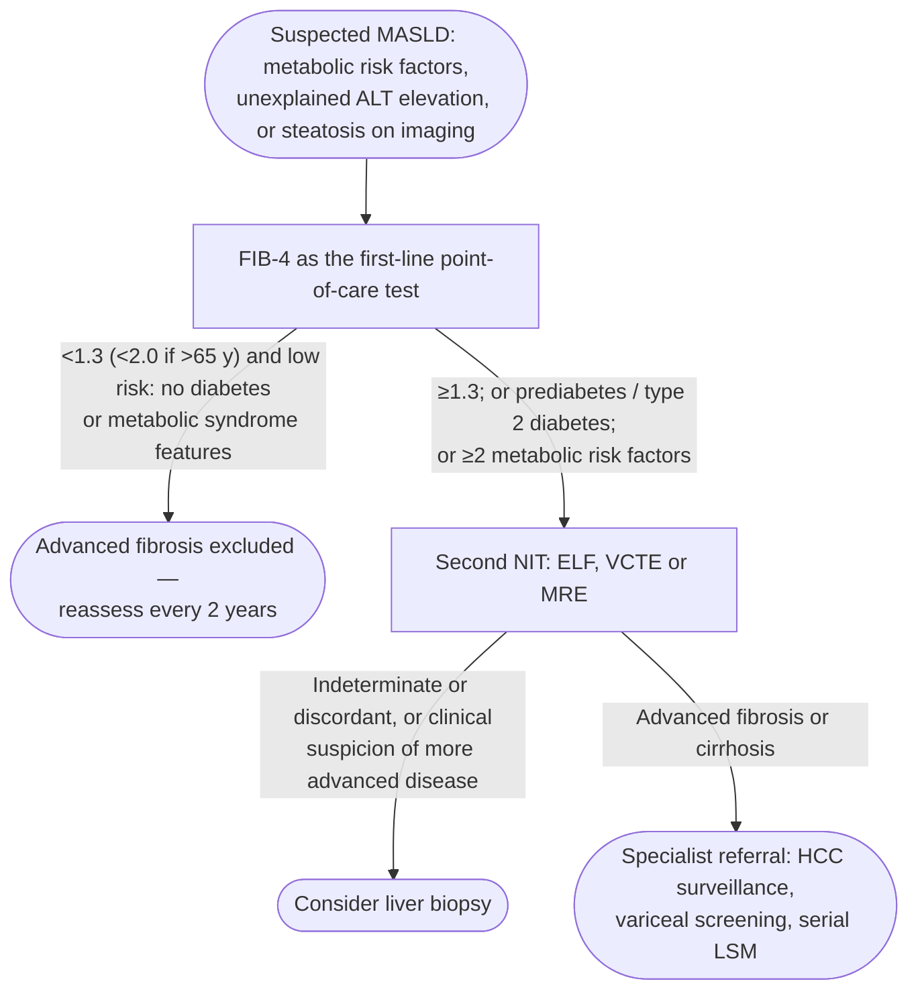

Noninvasive liver disease assessment (NILDA) is the set of blood-based and imaging-based tools that estimate **hepatic fibrosis** (up to and including [[cirrhosis]]) and **steatosis** without [[liver-biopsy|biopsy]]. The American Association for the Study of Liver Diseases (AASLD) published companion 2024 practice guidelines for blood-based and imaging-based NILDA; the framework now drives screening, risk stratification, pharmacotherapy candidacy, and (with caveats) treatment monitoring in [[nafld-masld|metabolic dysfunction-associated steatotic liver disease (MASLD)]].

## Contents
- [[#Core Principles]]
- [[#Diagnostic Pathway]]
- [[#Cut Points for Fibrosis]]
  - [[#Blood-Based]]
  - [[#Imaging-Based]]
- [[#Steatosis]]
- [[#Combining Tests]]
- [[#Elastography vs the Serum Indices — Head to Head]]
- [[#Serial Monitoring]]
- [[#When NITs Are Not Enough]]
- [[#Relation to the Baveno cACLD Ladder]]
- [[#Uses & Cross-Links]]

## Core Principles

- Most noninvasive tests (NITs) have **high negative predictive value (NPV; rule-out)** but **lower positive predictive value (PPV; rule-in)** for advanced fibrosis — so a low-cost first-line test excludes disease and a confirmatory test rules it in ([[aasld-2024-nilda-blood]]).
- **Advanced fibrosis (AF) = F3 (bridging) or F4 (cirrhosis)**; fibrosis stage is the strongest predictor of liver-related outcomes ([[aga-2023-nafld-noninvasive-biomarkers]]).
- Standard sequence: **Fibrosis-4 index (FIB-4) first → if ≥1.3, a second test** — vibration-controlled transient elastography (VCTE), magnetic resonance elastography (MRE), or Enhanced Liver Fibrosis (ELF) ([[aasld-2023-nafld]] guidance statement 19; [[aasld-2024-nilda-blood]]).
- Once FIB-4 is **>1.3**, a **combination of ≥2 NITs** (serum and/or imaging) is preferred over any single NIT for staging and risk stratification; in clinical trials sequential testing cut indeterminate AF stratification by **~20%** vs a single NIT ([[aga-2023-nafld-noninvasive-biomarkers]]).

> [!pitfall] The same cutoff is not the same test in every clinic
> FIB-4 <1.3 had NPV 90% in the studied cohort, but applied predictively the NPV **rises to 96% at 10% AF prevalence and falls to 73% at 50% prevalence** — a rule-out that is safe in primary care is much weaker in a hepatology or bariatric clinic ([[aga-2023-nafld-noninvasive-biomarkers]]).

## Diagnostic Pathway

*Noninvasive test pathway for suspected MASLD*
*Source: redrawn from Figure 1 of the American Gastroenterological Association (AGA) 2023 Clinical Practice Update*
*[[aga-2023-nafld-noninvasive-biomarkers|AGA 2023 Clinical Practice Update on Noninvasive Biomarkers in NAFLD]]*
*MASLD = metabolic dysfunction-associated steatotic liver disease · ALT = alanine aminotransferase · FIB-4 = Fibrosis-4 index · NIT = noninvasive test · ELF = Enhanced Liver Fibrosis · VCTE = vibration-controlled transient elastography · MRE = magnetic resonance elastography · HCC = hepatocellular carcinoma · LSM = liver stiffness measurement*

- Screen/serologically evaluate for alternative causes of chronic hepatitis if aminotransferases are elevated — **alanine aminotransferase (ALT) >20 U/L in women, >30 U/L in men** — or as otherwise clinically indicated ([[aga-2023-nafld-noninvasive-biomarkers]]).

## Cut Points for Fibrosis

Cut points below are for **nonalcoholic fatty liver disease (NAFLD)/MASLD** ([[aasld-2023-nafld]] Table 5). Etiology-specific kPa cut-offs (hepatitis C virus [HCV], hepatitis B virus [HBV], alcohol, post-sustained virologic response [SVR], varices, pre-operative) and VCTE validity criteria live on **[[liver-stiffness-measurement]]**. Accuracy is given as the area under the receiver operating characteristic curve (AUROC) with 95% confidence interval (CI).

| Test | Rule out F3–4 | Rule in F3–4 | Rule in F4 | Rule out F4 | AUROC for F3–4 (95% CI) |
|---|---|---|---|---|---|
| FIB-4 | <1.3 | ≥2.67 | ≥3.48 | <1.67 | 0.83 (0.79–0.86) |
| NAFLD Fibrosis Score (NFS) | < −1.44 | ≥0.672 | — | — | 0.75 (0.71–0.79) |
| Aspartate aminotransferase (AST)-to-platelet ratio index (APRI) | — | >0.84 | — | — | 0.76 (0.74–0.79) |
| ELF | <7.7 | ≥9.8 | ≥11.3 | <7.7 | 0.81 (0.77–0.85) |
| VCTE | <8 kPa | ≥12 kPa | ≥20 kPa | <8 kPa | 0.93 (0.89–0.96) |
| Shear wave elastography (SWE) | <8 kPa | ≥12 kPa | — | — | 0.89 (0.80–0.98) |
| MRE | <2.55 kPa | ≥3.63 kPa | ≥5 kPa | <3 kPa | 0.93 (0.90–0.96) |

*Noninvasive cut points for advanced fibrosis and cirrhosis in NAFLD/MASLD*
*Source: cut points recreated from Table 5 of the AASLD 2023 NAFLD practice guidance; AUROC column from the AGA 2023 Clinical Practice Update*
*[[aasld-2023-nafld|AASLD 2023 Practice Guidance on NAFLD]] · [[aga-2023-nafld-noninvasive-biomarkers|AGA 2023 Clinical Practice Update on Noninvasive Biomarkers in NAFLD]]*
*F3–4 = advanced fibrosis · F4 = cirrhosis · FIB-4 = Fibrosis-4 index · NFS = NAFLD Fibrosis Score · APRI = aspartate aminotransferase-to-platelet ratio index · ELF = Enhanced Liver Fibrosis · VCTE = vibration-controlled transient elastography · SWE = shear wave elastography · MRE = magnetic resonance elastography · AUROC = area under the receiver operating characteristic curve*

- The AUROCs were measured at the AGA's own rule-in cut-points, which match the rule-in column except **SWE >8.0 kPa** (AGA) vs **≥12 kPa** (AASLD, which calls the SWE cut points not well validated), NFS >0.676, and MRE >3.6 kPa. The APRI rule-in is the AGA's; AASLD 2023 Table 5 lists no APRI row.
- FIB-4 ≥3.48 **with** VCTE ≥20 kPa gives 90% specificity for ruling in cirrhosis; the pair will still miss some cirrhosis because the cut points are insensitive ([[aasld-2023-nafld]]).

### Blood-Based

- **FIB-4** is inaccurate **<35 y** and loses specificity in older adults — in patients **>65 y use <2.0** (not <1.3) to exclude AF ([[aga-2023-nafld-noninvasive-biomarkers]]).
- **ELF** is approved for clinical use in the US as a **prognostic** biomarker; **ELF ≥11.3 is associated with increased risk of hepatic decompensation in cirrhosis** ([[aasld-2023-nafld]]).
- Simple, cheap, nonproprietary tests (FIB-4, NFS) are **recommended over complex proprietary panels** for AF detection in NAFLD and for staging in HCV (both strong, moderate quality) ([[aasld-2024-nilda-blood]]).
- In **alcohol-associated liver disease** and **chronic cholestatic disease**, evidence is insufficient to recommend blood-based NILDA for fibrosis staging (ungraded) ([[aasld-2024-nilda-blood]]).
- **Confounders** ([[aasld-2024-nilda-blood]] Table 6):

| Factor | Tests affected | Direction |
|---|---|---|
| Splenectomy | APRI, FIB-4, Fibroindex, FibroMeter, NFS | Falsely **lower** (attenuated thrombocytopenia) |
| Thrombocytopenia not from portal hypertension | APRI, FIB-4, Fibroindex, FibroMeter, NFS | Falsely **higher** |
| Elevated ALT/AST (acute or acute-on-chronic hepatitis) | APRI, FIB-4, Fibroindex, FibroMeter, NFS | Falsely **higher** |
| Chronic kidney disease (CKD), hemodialysis | Fibroindex, APRI, FIB-4, FibroMeter | Falsely **lower** (urea; low ALT/AST) |
| Malnutrition | NFS | Falsely **higher** (albumin) |
| Active alcohol use; hemolysis; Gilbert syndrome or cholestasis; inflammatory conditions | FibroTest, HepaScore, Fibroindex, FibroMeter | Falsely **higher** (gamma-glutamyl transferase, bilirubin, low haptoglobin, acute-phase reactants) |
| Gastrectomy; extra-hepatic fibrosing conditions | FibroSpect, HepaScore, ELF | Falsely **higher** (hyaluronic acid, collagen turnover) |

*Clinical factors that distort blood-based fibrosis estimates*
*Source: recreated from Table 6 of the AASLD 2024 blood-based NILDA guideline*
*[[aasld-2024-nilda-blood|AASLD 2024 Practice Guideline: Blood-Based NILDA]]*
*APRI = aspartate aminotransferase-to-platelet ratio index · FIB-4 = Fibrosis-4 index · NFS = NAFLD Fibrosis Score · ELF = Enhanced Liver Fibrosis · ALT = alanine aminotransferase · AST = aspartate aminotransferase · CKD = chronic kidney disease · NILDA = noninvasive liver disease assessment*

### Imaging-Based

- **VCTE (FibroScan)** — point-of-care [[liver-stiffness-measurement|LSM]], reportable range ~2.5–75 kPa. LSM **8–12 kPa** may indicate fibrotic steatohepatitis; **>12 kPa** indicates a high likelihood of AF, though PPV is low (0.34–0.71) ([[aasld-2023-nafld]]).
- **MRE** — the most accurate imaging fibrosis NIT; more sensitive than VCTE for stage ≥F2, and the tool of choice when VCTE is unreliable or cross-sectional imaging is needed anyway. Baseline MRE LSM predicts incident decompensation and death in cirrhosis ([[aasld-2023-nafld]], [[aasld-2024-nilda-imaging]]).
- **Imaging NILDA is recommended** to detect F2–4, F3–4 and F4 in chronic HCV, chronic HBV and NAFLD (strong, moderate quality), and **suggested** in alcohol-associated and chronic cholestatic disease (conditional, low quality) ([[aasld-2024-nilda-imaging]]).
- Use the **XL probe** at higher body mass index (BMI); it tends to read lower than the M probe. Most VCTE data come from **viremic** patients, so performance after viral suppression or eradication is poorly defined ([[aasld-2024-nilda-imaging]]).
- VCTE false positives rise with operator inexperience, high BMI, non-fasting state, and markedly elevated ALT ([[aga-2023-nafld-noninvasive-biomarkers]]).

## Steatosis

- **Magnetic resonance imaging–proton density fat fraction (MRI-PDFF) ≥5%** identifies steatosis (<5% unlikely); it is the most sensitive quantifier across the spectrum of steatosis and is accurate for assessing dynamic change. **≥30% decline in MRI-PDFF** carries 5-fold improved odds of steatohepatitis resolution ([[aasld-2023-nafld]]).
- **Controlled attenuation parameter (CAP)** — point-of-care first-line quantitative screen. **≥288 dB/m** makes steatosis likely ([[aasld-2023-nafld]] Table 5); the **optimal cut-off to maximize sensitivity for at least grade 1 (≥5%) steatosis is 275 dB/m** ([[aasld-2024-nilda-imaging]]). Values overlap between adjacent grades and CAP is **not sensitive to change on therapy**.
- CAP and MRI-PDFF / magnetic resonance spectroscopy (MRS) are **superior to blood-based tests** and should be used where available (ungraded) ([[aasld-2024-nilda-imaging]]).
- **Not recommended:** standard ultrasound to identify steatosis (low sensitivity across the NAFLD spectrum — [[aasld-2023-nafld]] guidance statement 17); non-contrast computed tomography (insufficient sensitivity for mild steatosis, plus radiation) ([[aasld-2024-nilda-imaging]]); blood steatosis indices such as the fatty liver index and hepatic steatosis index ([[aasld-2024-nilda-blood]]).

> [!pearl] A fat-free liver does not exclude fatty liver disease
> Steatosis decreases and can disappear as fibrosis progresses, so its absence in a patient with advanced fibrosis or cirrhosis does not rule out fatty liver disease as the etiology ([[aasld-2024-nilda-imaging]]).

## Combining Tests

- **Rule out AF:** FIB-4 **<1.3** *and* VCTE **<8.0 kPa** (both required).
- **Rule in cirrhosis:** FIB-4 **≥3.48** *and* VCTE **≥20 kPa** (both required).
- Applying the pair rather than a single test cut the need for [[liver-biopsy|liver biopsy]] from **33% → 19%** (individual-patient-data meta-analysis, 37 studies, n = 5735, 30% AF prevalence) ([[aga-2023-nafld-noninvasive-biomarkers]]).
- **"At-risk" steatohepatitis** — the population targeted for pharmacotherapy — is defined by AASLD as **metabolic dysfunction-associated steatohepatitis (MASH) with fibrosis stage ≥2**; the AGA adds an activity criterion, **NAFLD activity score ≥4 *and* stage ≥2** ([[aasld-2023-nafld]], [[aga-2023-nafld-noninvasive-biomarkers]]).

| Score | Components | Rule in | Rule out |
|---|---|---|---|
| MEFIB | FIB-4 + MRE | FIB-4 **≥1.6** *and* MRE **≥3.3 kPa** (>90% PPV for stage ≥2) | FIB-4 <1.6 *and* MRE <3.3 kPa |
| FAST | VCTE LSM + CAP + AST | **≥0.67** (specificity 90%) | **≤0.35** (sensitivity 90%) |
| MAST | MRI-PDFF + MRE + AST | **≥0.242** (specificity 90%) | **≤0.165** (sensitivity 90%) |
| Corrected T1 (cT1) | MRI cT1 relaxation time | **≥875 ms** | **<825 ms** |

*Combination scores for identifying at-risk steatohepatitis*
*Source: recreated from Table 5 of the AASLD 2023 NAFLD practice guidance*
*[[aasld-2023-nafld|AASLD 2023 Practice Guidance on NAFLD]]*
*MEFIB = MRE combined with FIB-4 · FAST = score from FibroScan LSM, CAP and serum AST · MAST = score from MRI-PDFF, MRE and serum AST · cT1 = corrected T1 · FIB-4 = Fibrosis-4 index · MRE = magnetic resonance elastography · VCTE = vibration-controlled transient elastography · LSM = liver stiffness measurement · CAP = controlled attenuation parameter · AST = aspartate aminotransferase · MRI-PDFF = magnetic resonance imaging–proton density fat fraction · PPV = positive predictive value*

- Head to head for **MASH with fibrosis stage ≥2**, MEFIB beat FAST: AUROC **0.901** (0.875–0.928) vs **0.725** (0.683–0.767); PPV 95.3% vs 83.5%; NPV 90.1% vs 71.8% (all P ≤ .001). For **at-risk MASH** as the AGA defines it, AUROC **0.768** (0.728–0.808) vs **0.687** (0.640–0.733). AGA 2023 judged the clinical role of these combination scores not yet defined ([[aga-2023-nafld-noninvasive-biomarkers]]).
- FAST's PPV ranged **0.33–0.81** across validation cohorts ([[aasld-2023-nafld]]).
- Where imaging is not readily available, a second **blood** test (e.g. ELF) is an acceptable second NIT ([[aasld-2024-nilda-blood]], [[aga-2023-nafld-noninvasive-biomarkers]]).

## Elastography vs the Serum Indices — Head to Head

The evidence behind preferring imaging elastography over APRI/FIB-4 is etiology-specific and comes from the AGA's head-to-head comparison for **detecting cirrhosis** ([[aga-2017-elastography-liver-fibrosis]]).

| Etiology | VCTE sens / spec | APRI sens / spec | FIB-4 sens / spec | AGA position |
|---|---|---|---|---|
| [[hepatitis-c\|Chronic hepatitis C]] | 0.89 / 0.91 | 0.77 / 0.78 | 0.87 / 0.91 | **VCTE over APRI/FIB-4 — strong, moderate quality** |
| [[chronic-hepatitis-b\|Chronic hepatitis B]] | 0.86 / 0.85 | 0.66 / 0.74 | 0.87 / 0.65 | VCTE over APRI/FIB-4 — conditional, low quality |
| NAFLD | 0.90 / 0.87 | 0.78 / 0.71 | 0.74 / 0.71 | **No recommendation — knowledge gap** |

- **Read the hepatitis B row carefully:** FIB-4 matched VCTE on *sensitivity* (0.87 vs 0.86) but collapsed on *specificity* (0.65 vs 0.85). VCTE's advantage in HBV is in **excluding** cirrhosis, not in ruling it in.
- **Why NAFLD got no recommendation in 2017:** the pooled estimates were judged unacceptably biased — obese patients (BMI ≥30 kg/m²) excluded, failed or inadequate stiffness measurements excluded (commoner in NAFLD), per-protocol rather than intention-to-diagnose analysis. The AASLD cut points above are the later answer to this gap.
- **Proprietary serum panels were not reviewed**, but AGA states the evidence **does not support a significant advantage** of proprietary assays over the nonproprietary APRI and FIB-4.

## Serial Monitoring

- **Blood-based NILDA should not be used** to follow progression, stability or regression of histologic stage (ungraded) ([[aasld-2024-nilda-blood]]).
- **Imaging NILDA should not be used as a standalone test** to assess fibrosis regression or progression either; interpret a longitudinal rise or fall in LSM within an individualized clinical context that accounts for NILDA modifiers and other evidence of the clinical course (both ungraded) ([[aasld-2024-nilda-imaging]]).
- In **treated HBV and HCV**, the **pre-treatment LSM** is the most accurate longitudinal prognostic parameter — post-treatment values have limited outcome data (ungraded) ([[aasld-2024-nilda-imaging]]).
- Rapid LSM falls after viral eradication (up to 15 kPa after direct-acting antiviral therapy) reflect **reduced inflammation, not fibrosis regression**; absolute cut-offs for a meaningful change after eradication are not established ([[aasld-2024-nilda-imaging]]).
- Where monitoring is appropriate — NITs suggesting F3 or F4 — use **serial LSM by VCTE or MRE**, not FIB-4, because LSM correlates with clinically significant portal hypertension (CSPH) and decompensation ([[aga-2023-nafld-noninvasive-biomarkers]]). A **20% increase** in stiffness on VCTE or MRE may signal progression; thresholds for treatment-induced fibrosis *improvement* are not well established ([[aasld-2023-nafld]]).
- Baveno VIII's prognostic change thresholds (confirmed ≥30% relative LSM change by VCTE, ≥20% by MRE, 0.5-unit ELF) are detailed on [[liver-stiffness-measurement]].

## When NITs Are Not Enough

*The three triggers that send a patient to biopsy despite NITs — indeterminate/discordant NITs, conflict with other findings, suspected alternative etiology — are stated in full on [[liver-biopsy]] → Noninvasive Alternatives.*

**Interpret NITs in clinical context** (exam, biochemical, radiographic, endoscopic data) to optimize PPV, and **use each NIT per manufacturer specifications** — e.g. **not in patients with [[ascites]] or with pacemakers** — to minimize discordant results and adverse events; observe probe selection and quality measures ([[aga-2023-nafld-noninvasive-biomarkers]]).

## Relation to the Baveno cACLD Ladder

Baveno builds a parallel, portal-hypertension-oriented ladder on the same LSM, anchored on **<10 kPa** (rules out compensated advanced chronic liver disease [cACLD]), **10–15 kPa** (suggestive), **>15 kPa** (highly suggestive), and the **Rule of 5 (10-15-20-25 kPa)** for decompensation and liver-death risk. The full ladder, the CSPH rule-in/rule-out criteria, the spleen stiffness measurement (SSM) cut-offs, the fasting and confirmation rules, and what Baveno VIII changed from Baveno VII all live on **[[liver-stiffness-measurement]]** and **[[portal-hypertension]]** ([[baveno-viii-2026-portal-hypertension]], [[baveno-vii-2022-portal-hypertension]]). AASLD's own companion guideline on noninvasive portal-hypertension assessment is [[aasld-2024-nilda-portal-htn]].

> [!pitfall] Do not mix the Baveno and AASLD kPa ladders
> The Baveno numbers target **CSPH and decompensation risk**; the AASLD cut-points (rule-out <8, rule-in ≥12, cirrhosis ≥20 kPa) target **histologic fibrosis stage**. The two sets are not interchangeable, and Baveno VII values superseded by Baveno VIII must not be carried forward ([[baveno-viii-2026-portal-hypertension]]).

## Uses & Cross-Links

- Fibrosis staging and at-risk MASH identification in [[nafld-masld]]; pharmacotherapy candidacy ([[semaglutide]], [[resmetirom]]) uses F2–F3 NIT windows ([[aasld-2025-semaglutide-mash]]).
- Noninvasive CSPH staging in cirrhosis — see [[portal-hypertension]] and [[hepatic-venous-pressure-gradient]]. **LSM-based criteria do not apply** in [[porto-sinusoidal-vascular-disorder|porto-sinusoidal vascular disorder/non-cirrhotic portal fibrosis (PSVD/NCPF)]], where spleen stiffness substitutes — see [[liver-stiffness-measurement]].
- Fibrosis staging also applies in [[primary-sclerosing-cholangitis]], [[primary-biliary-cholangitis]], [[hereditary-hemochromatosis]] and [[alcohol-associated-liver-disease]].
- **NITs suggesting F3 or F4 are themselves the trigger for complication surveillance** — enter [[hcc-surveillance|HCC surveillance]] and [[variceal-upper-gi-bleeding|variceal screening]] per Baveno criteria ([[aga-2023-nafld-noninvasive-biomarkers]]).

## See Also

[[nafld-masld]], [[semaglutide]], [[portal-hypertension]], [[cirrhosis]], [[porto-sinusoidal-vascular-disorder]], [[primary-sclerosing-cholangitis]], [[primary-biliary-cholangitis]], [[hereditary-hemochromatosis]], [[alcohol-associated-liver-disease]], [[hepatitis-c]], [[chronic-hepatitis-b]], [[liver-biopsy]], [[liver-stiffness-measurement]], [[resmetirom]], [[hcc-surveillance]], [[variceal-upper-gi-bleeding]], [[hepatic-venous-pressure-gradient]], [[ascites]]

---

## Sources

1. [[aasld-2024-nilda-blood|AASLD 2024 Practice Guideline: Blood-Based Noninvasive Liver Disease Assessment (NILDA) of Hepatic Fibrosis and Steatosis]]
2. [[aasld-2023-nafld|AASLD Practice Guidance on the Clinical Assessment and Management of Nonalcoholic Fatty Liver Disease (2023)]]
3. [[aasld-2025-semaglutide-mash|Semaglutide Therapy for Metabolic Dysfunction–Associated Steatohepatitis: November 2025 Updates to AASLD Practice Guidance]]
4. [[aasld-2024-nilda-imaging|AASLD Practice Guideline: Imaging-Based Noninvasive Liver Disease Assessment (Fibrosis & Steatosis) (2024)]]
5. [[aasld-2024-nilda-portal-htn|AASLD Practice Guideline: Noninvasive Assessment of Portal Hypertension (2024)]]
6. [[baveno-viii-2026-portal-hypertension|Baveno VIII — Advancing Consensus in Portal Hypertension (J Hepatol 2026)]]
7. [[baveno-vii-2022-portal-hypertension|Baveno VII — Renewing Consensus in Portal Hypertension (J Hepatol 2022)]]
8. [[aga-2023-nafld-noninvasive-biomarkers|AGA Clinical Practice Update on the Role of Noninvasive Biomarkers in the Evaluation and Management of Nonalcoholic Fatty Liver Disease: Expert Review (2023)]]
9. [[aga-2017-elastography-liver-fibrosis|American Gastroenterological Association Institute Guideline on the Role of Elastography in the Evaluation of Liver Fibrosis (2017)]]
