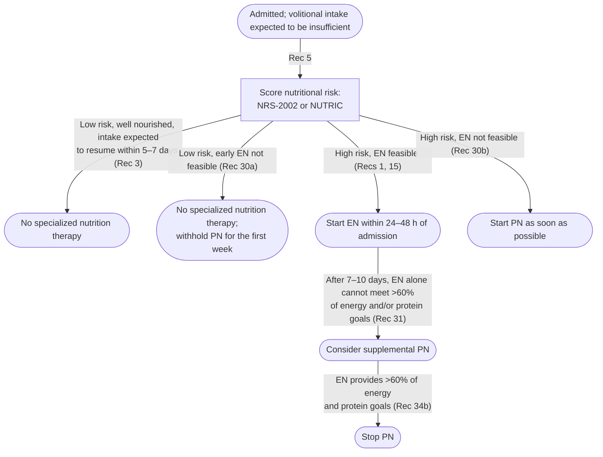

## Contents
- [[#Overview]]
- [[#Nutritional Risk Assessment]]
  - [[#NRS-2002]]
  - [[#NUTRIC Score]]
  - [[#Markers to Avoid]]
- [[#Energy and Protein Requirements]]
- [[#Choosing the Route]]
  - [[#Contraindications to EN]]
- [[#Enteral Access]]
- [[#Initiating and Advancing EN]]
  - [[#Permissive Underfeeding]]
  - [[#Refeeding Syndrome]]
- [[#Formula Selection]]
- [[#Monitoring Tolerance]]
  - [[#Aspiration Risk]]
  - [[#Diarrhea on EN]]
- [[#Parenteral Nutrition]]
- [[#Critically Ill Subgroups]]
- [[#End-of-Life Nutrition]]
- [[#See Also]]
- [[#Sources]]

## Overview

- Scope: adult hospitalized patient unable to sustain volitional intake, expected to stay >3 days — ward or intensive care unit (ICU); most evidence comes from the ICU ([[acg-2016-nutrition-hospitalized]]).
- **Nutritional risk** (nutritional status + disease severity), not malnutrition alone, sets how hard to feed: high-risk patients benefit most from early enteral nutrition (EN); in low-risk patients, EN or parenteral nutrition (PN) is unlikely to change outcome.
- Early EN also has non-nutritional benefits — maintains gut integrity and gut-associated lymphoid tissue (GALT), modulates immune and metabolic responses (ACG 2016 Table 4).
- Critically ill adults expected to stay >2 or 3 days in the ICU: also the Society of Critical Care Medicine/American Society for Parenteral and Enteral Nutrition (SCCM/ASPEN) 2016 guideline adds ICU-specific rules below; population targets in [[#Critically Ill Subgroups]] [[aspen-sccm-2016-critical-care-nutrition]].
- Disease-specific nutrition: [[acute-pancreatitis]], [[nutrition-in-liver-disease|liver disease]], [[nutrition-in-ibd|inflammatory bowel disease (IBD)]].

---

## Nutritional Risk Assessment

- **Rec 5** — before any specialized nutrition therapy (EN or PN), score nutritional risk with a validated system — Nutritional Risk Score 2002 (NRS-2002) or NUTRIC Score — in every admitted patient whose volitional intake is expected to be insufficient (Conditional, Very low) [[acg-2016-nutrition-hospitalized]].
- **Rec 6a** — also assess factors that shape the regimen: comorbid conditions, function of the gastrointestinal (GI) tract, risk of aspiration (Conditional, Very low).

### NRS-2002

ACG 2016 Table 5 [[acg-2016-nutrition-hospitalized]]:

| Points | Impaired nutritional status | Severity of disease |
|---|---|---|
| **0** | Normal nutritional status | Normal nutritional requirements |
| **1** (mild) | Weight loss >5% in 3 mo; OR food intake <50–75% of normal requirement in preceding week | Hip fracture; chronic disease with acute complications — [[cirrhosis]], chronic obstructive pulmonary disease (COPD), chronic hemodialysis, diabetes, oncology |
| **2** (moderate) | Weight loss >5% in 2 mo; OR body mass index (BMI) 18.5–20.5 + impaired general condition; OR food intake 25–50% of normal requirement in preceding week | Major abdominal surgery, stroke, severe pneumonia, hematologic malignancy |
| **3** (severe) | Weight loss >5% in 1 mo (15% in 3 mo); OR BMI <18.5 + impaired general condition; OR food intake <25% of normal requirement in preceding week | Head injury, bone marrow transplantation, ICU patients (Acute Physiologic and Chronic Health Evaluation [APACHE] II >10) |

- **Total = nutritional-status points + disease-severity points + 1 point if age ≥70 y.**

| Total | What ACG 2016 cites | Risk |
|---|---|---|
| **≤3** | >1,000 patients awaiting major elective surgery: no change in outcome whether or not sufficient nutrition therapy was received | Low |
| **>3** | Randomized controlled trial (RCT), 132 patients: more aggressive therapy → 30% greater receipt of calories and protein, fewer total complications and re-hospitalizations | Higher (RCT population; ACG defines "high" as ≥5) |
| **≥5** | Same elective-surgery cohort: sufficient therapy (>10 kcal/kg/day for 7 days before surgery) → 50% reduction in nosocomial infection and total complications | High |

### NUTRIC Score

ACG 2016 Table 5 — total from six separate factors [[acg-2016-nutrition-hospitalized]]:

| Factor | 0 | 1 | 2 | 3 |
|---|---|---|---|---|
| **Age (years)** | <50 | 50–74 | ≥75 | — |
| **APACHE II score** | <15 | 15–19 | 20–27 | ≥28 |
| **Baseline Simplified Organ Failure Assessment (SOFA) score** | <6 | 6–9 | ≥10 | — |
| **No. of comorbidities** | 0–1 | ≥2 | — | — |
| **Days in hospital to ICU admit** | 0 | ≥1 | — | — |
| **Interleukin-6 (μ/ml)** | 0–399 | ≥400 | — | — |

- **6–10 = high risk** — in a large international ICU observational study, mortality fell the closer delivery came to goal feeding.
- **0–5 = low risk** — no association between amount of nutrition received and mortality.

> [!pitfall] NUTRIC cut-off depends on interleukin-6
> With interleukin-6: high risk starts at 6 ([[acg-2016-nutrition-hospitalized]]; SCCM/ASPEN says >6). Without interleukin-6: high risk = **≥5** (SCCM/ASPEN A1, C3, G2 — [[aspen-sccm-2016-critical-care-nutrition]]). The NRS-2002 ≥5 cut-point is a separate score.

### Markers to Avoid

- **Rec 6b** — avoid "traditional" indicators: [[albumin]], pre-albumin, transferrin, anthropometry (Conditional, Very low).
- **Rec 6c** — surrogate markers of infection or inflammation not used for nutritional assessment (Conditional, Very low).
- Why: albumin, pre-albumin and transferrin are negative acute-phase proteins — fall with acute inflammation, rise only as it abates; markers of risk and inflammation, not of nutrition adequacy.
- Procalcitonin, interleukin-1, tumor necrosis factor, interleukin-6, citrulline: investigational, not for routine use.

---

## Energy and Protein Requirements

- **Rec 7a** — determine caloric requirements and use them to set the delivery goal (Conditional, Very low) [[acg-2016-nutrition-hospitalized]].
- **Rec 7b** — use one of three (each Conditional, Very low):
  - **Indirect calorimetry (IC)** — most accurate, gold standard; in high-risk patients measure once or twice per week
  - **Weight-based equation** — 25–30 kcal/kg/day
  - **Published predictive equation** — matches IC in only 40–70%; use with caution (e.g., extreme obesity)
- **Rec 8** — set protein requirements independently of calories; reassess provision on an ongoing basis (Conditional, Very low).
  - 1.2–1.5 g/kg/day was thought sufficient; recent studies suggest **1.5–2.0 g/kg/day** to optimize therapy.
  - Trauma or large wounds: needs "may be even higher" — ACG 2016 gives no number; SCCM/ASPEN population targets in [[#Critically Ill Subgroups]].
  - SCCM/ASPEN C4 (Very Low): **1.2–2.0 g/kg actual body weight/day**, likely higher in burns or multitrauma [[aspen-sccm-2016-critical-care-nutrition]].
  - Nitrogen balance alternative: protein g/day = (24-h urine urea nitrogen [UUN] + 4) × 6.25.

---

## Choosing the Route

*Route and timing of nutrition therapy in the hospitalized adult*
*Source: built from ACG 2016 Recs 1, 3, 5, 15, 30a, 30b, 31 and 34b (the guideline has no flowchart)*
*[[acg-2016-nutrition-hospitalized|ACG 2016 Nutrition Therapy in the Adult Hospitalized Patient]]*
*NRS-2002 = Nutritional Risk Score 2002 · EN = enteral nutrition · PN = parenteral nutrition*

- Grades: Recs 1, 15 Conditional, Low · Rec 3 Conditional, Very low · Rec 30a Conditional, Very low · **Rec 30b Strong, Moderate** · **Rec 31 Strong, Moderate** · Rec 34b Conditional, Very low [[acg-2016-nutrition-hospitalized]].
- Rec 31: supplemental PN started before 7–10 days in patients already on EN does not improve outcomes and may be detrimental — added on day 3 (vs day 8) it worsened infection, organ failure, hospital and ICU length of stay and cost.
- **Rec 2** — EN preferred over PN when non-volitional nutrition therapy is needed and there is no contraindication to luminal nutrients (Conditional, Low). **Rec 4** — reserve PN for when EN is not feasible or not sufficient for energy and protein goals (Conditional, Very low).
- EN's advantage over PN may be narrowing (a 2,400-patient multi-ICU RCT in England: no outcome difference), but PN's risk/benefit ratio is narrower.
- **PN-dependent** patients ([[short-bowel-syndrome|short bowel syndrome]], chronic intestinal pseudo-obstruction): start PN immediately after admission unless there is ongoing bacteremia.

### Contraindications to EN

| Absolute | EN with caution (once considered contraindications) |
|---|---|
| Mechanical obstruction of the GI tract · uncontrolled peritonitis · ischemic bowel | Ileus · open abdomen · recent gut anastomoses · GI bleeding · bowel-wall edema · stable patient on vasopressors to maintain adequate mean arterial pressure |

- Bowel sounds are not a sensitive marker of GI function and are not required to start EN [[acg-2016-nutrition-hospitalized]].
- **Hemodynamic instability → withhold EN** until fully resuscitated and/or stable (SCCM/ASPEN B5, expert consensus) [[aspen-sccm-2016-critical-care-nutrition]]:
  - Hold when mean arterial pressure **<50 mm Hg**, catecholamines are being started, or escalating doses are needed to maintain stability.
  - Chronic, stable low-dose vasopressors → EN with caution.
  - On vasopressors, abdominal distention, rising nasogastric output or gastric residuals, less stool/flatus, hypoactive bowel sounds or rising metabolic acidosis/base deficit = possible early gut ischemia → hold EN.

---

## Enteral Access

ACG 2016 Recs 9–14 [[acg-2016-nutrition-hospitalized]]:

| Rec | Situation | Access | Strength, evidence |
|---|---|---|---|
| 9a | Starting EN | Nasogastric or orogastric tube | Conditional, Very low |
| 9b | Before the first feed | Radiologic confirmation of gastric placement (not needed with electromagnetic transmitter-guided tubes); no routine repeat films unless displacement is suspected — nausea/vomiting, regurgitation, coughing, retching, overt displacement | Conditional, Very low |
| 10a | Gastric feeding poorly tolerated, or high aspiration risk | Convert to a post-pyloric tube — **only** in these patients | **Strong, Moderate-to-high** |
| 10b | Gastric aspiration/decompression needed during jejunal feeding | Dual-lumen aspirate/feed nasoenteric tube, combined percutaneous gastrojejunostomy (GJ) tube, or separate gastrostomy + jejunostomy | Conditional, Very low |
| 11 | Long-term access in [[gastroparesis]] or [[chronic-pancreatitis\|chronic pancreatitis]] | Jejunostomy tube | Conditional, Very low |
| 12 | EN anticipated **>4 weeks** | Percutaneous device, gastric or jejunal | Conditional, Very low |
| 13 | Percutaneous gastrostomy | Site in the gastric antrum — eases conversion to a GJ tube if gastric feeding fails | Conditional, Very low |
| 14 | High risk of tube displacement | Secure the device at placement (e.g., nasal bridle; T-fasteners for a gastrostomy) | Conditional, Very low |

- Small-bowel feeding helps only sicker patients: in an RCT, APACHE II >20 → shorter length of stay, fewer total complications, more EN delivered; no difference at APACHE II <20. Start gastric feeds while awaiting small-bowel expertise.
- The 4-week cutoff is arbitrary — based on nasoenteric morbidity (nares erosion, aspiration pneumonia, sinusitis, esophageal ulceration/stricture).
- Amyotrophic lateral sclerosis: time gastrostomy before forced vital capacity drops below 50%.
- **Percutaneous endoscopic gastrostomy (PEG) placement** — PEG over interventional radiology–guided gastrostomy (IR-G) in normal foregut anatomy ([[asge-2025-gastrostomy-tubes]] Rec 1, Conditional, Low), intravenous (IV) [[antibiotic-prophylaxis-endoscopy|antibiotic prophylaxis]] ([[asge-2011-enteral-feeding]] Rec 5), antithrombotics, contraindications, technique, tube care and complications: see [[enteral-access]]; agent-by-agent hold intervals: [[anticoagulation-gi-bleeding]].

---

## Initiating and Advancing EN

- **Start:** high nutritional risk + unable to maintain volitional intake → EN within **24–48 h** of admission (Rec 15; Rec 1 "promptly"; both Conditional, Low) [[acg-2016-nutrition-hospitalized]].
- **Advance:** tolerated → goal within **48–72 h** (Rec 16a); reduced tolerance → cautiously to goal by **5–7 days** (Rec 16b) (both Conditional, Very low).
- High-risk patients: delivery of ≥80% of goal calories had the lowest mortality in a large mixed-ICU observational study.
- After PEG, feeding may start early — within 4 h — rather than being routinely delayed ([[asge-2025-gastrostomy-tubes]] Rec 3, Strong; Moderate for RCTs, Low for all studies); details on [[enteral-access]].

### Permissive Underfeeding

**Rec 17** — permissive underfeeding (hypocaloric feeding) is an acceptable alternative to full feeding in three scenarios [[acg-2016-nutrition-hospitalized]]:

| Scenario | Strength, evidence | Regimen and basis |
|---|---|---|
| Acute lung injury / acute respiratory distress syndrome (ARDS) | **Strong, High** | Large multicentre RCT: **trophic feeding at 20 mL/h (25% of requirements) for the first 6 days**, then to goal, equivalent to full feeds from admission (80% of caloric requirements at end of study). Moderately ill population — may not suit extremes of age, BMI or disease severity |
| [[obesity\|Obesity]], BMI >30 | Conditional, Very low | High-protein hypocaloric regimen: **2.0–2.5 g protein/kg ideal body weight/day** + **60–65%** of estimated or measured energy expenditure; keeps lean mass, depletes fat, no increase in adverse outcomes |
| PN over the first week | Conditional, Low | 80% of caloric requirements with full protein — see [[#Parenteral Nutrition]] |

- **Obese ICU patients — SCCM/ASPEN Q4–Q5** (expert consensus) [[aspen-sccm-2016-critical-care-nutrition]]: high-protein hypocaloric EN, all obesity classes. Energy ceiling **65%–70%** of IC-measured target (ACG 2016: 60–65%).

| BMI (kg/m²) | Energy without IC | Protein |
|---|---|---|
| 30–40 | 11–14 kcal/kg actual body weight/day | 2.0 g/kg ideal body weight/day |
| 40–50 | 11–14 kcal/kg actual body weight/day | up to 2.5 g/kg ideal body weight/day (BMI ≥40) |
| >50 | 22–25 kcal/kg ideal body weight/day | up to 2.5 g/kg ideal body weight/day |

- Prior [[bariatric-surgery|bariatric surgery]] → **thiamine before** dextrose-containing IV fluids or nutrition therapy (SCCM/ASPEN Q8, expert consensus).

### Refeeding Syndrome

**Rec 20** — high risk for refeeding syndrome → ramp feeding up slowly to goal over **3–4 days**, carefully monitoring electrolytes and volume status (Conditional, Very low) [[acg-2016-nutrition-hospitalized]].

- **High risk** — any of: **BMI <20 kg/m²**; recent weight loss before admission; prolonged nil per os.
- **Monitor** — hypokalemia, hypophosphatemia, hypomagnesemia and volume status **for up to 5 days** after feeding starts.
- Not clear whether refeeding syndrome is more common with EN or PN.

---

## Formula Selection

| Situation | Formula | Rec, strength, evidence |
|---|---|---|
| Most hospitalized patients on EN | Standard polymeric or high-protein standard formula | 18a — Conditional, Very low |
| After major surgery, in a surgical ICU | Immune-modulating formula with arginine + omega-3 fish oil **should be used** (less infection and shorter length of stay; no mortality effect) | 18b — Conditional, Very low |
| Medical ICU | Arginine + fish-oil immune-modulating formula **not** routinely | 18c — Conditional, Very low |
| ARDS / acute lung injury | No recommendation on non-arginine anti-inflammatory lipid formulas — seven RCTs conflict | — |
| Medical ICU: routine use of immune-modulatory, elemental/semi-elemental, disease-specific (diabetes) or organ-specific (hepatic, renal, pulmonary) formulas | Discouraged (standard polymeric formula generally tolerated) | Text, ungraded |

Source: [[acg-2016-nutrition-hospitalized]]. Formula changes for diarrhea: [[#Diarrhea on EN]].

---

## Monitoring Tolerance

- **Rec 19a** — daily physical exam: bowel sounds, passage of stool and gas, abdominal distention, volume status (Conditional, Very low) [[acg-2016-nutrition-hospitalized]].
- **Rec 19b** — track adequacy: percent of goal calories delivered, cumulative caloric deficit, inappropriate cessation of EN (Conditional, Very low).
- **Rec 21a** — use enteral feeding protocols (**Strong, Moderate-to-high**); **Rec 21b** — a validated one, e.g., volume-based or multi-strategy (bundled) top-down protocol (Conditional, Very low). Volume-based feeding sets a 24-h volume and lets the nurse raise the rate to make up for interruptions.
- **Rec 22** — gastric residual volume (GRV) **not** used routinely as a monitor (Conditional, Very low).
  - Where GRVs are still used: don't hold EN for GRV **<500 mL** without other signs of intolerance (SCCM/ASPEN D2b, Low); 200–500 mL → take aspiration-reduction measures [[aspen-sccm-2016-critical-care-nutrition]].
- Minimize nil per os orders around diagnostic tests and procedures (SCCM/ASPEN D1, expert consensus).

> [!pitfall] GRV turns off feeds, not aspiration
> GRV sensitivity for aspiration is <2–8%; lowering the cutoff does not prevent aspiration, it just stops EN delivery — and GRV checks raise tube clogging tenfold ([[acg-2016-nutrition-hospitalized]]).

### Aspiration Risk

- **Rec 23a** — assess every patient on EN for aspiration risk (Conditional, Very low). Risk factors: age >70, altered mental status, endotracheal or nasoenteric tube, prolonged supine position, bolus infusion.
- **Rec 23b** — high risk → reduce it proactively:

| Step | Strength, evidence |
|---|---|
| Use a prokinetic agent | Conditional, Low |
| Divert feeding lower in the GI tract | **Strong, Moderate-to-high** |
| Switch to continuous infusion | Conditional, Very low |
| Chlorhexidine mouthwash twice daily | Conditional, Very low |

- **Prokinetics** — SCCM/ASPEN D4c (Low): high aspiration risk → start metoclopramide or erythromycin where clinically feasible [[aspen-sccm-2016-critical-care-nutrition]]. Doses used (D4c rationale): **erythromycin 3–7 mg/kg/day** or **metoclopramide 10 mg 4 times a day** (adjust for declining renal function), oral or IV.
  - Not combined — more watery diarrhea (54% vs 26.3%).
  - Risks: erythromycin cardiac toxicity, tachyphylaxis, bacterial resistance; metoclopramide tardive dyskinesia (more in elderly); both prolong QT.
- **Head of bed 30°–45°** in all intubated patients on EN (SCCM/ASPEN D4d, expert consensus).

### Diarrhea on EN

- **Rec 24a** — evaluate for an etiology to direct management (Conditional, Very low) [[acg-2016-nutrition-hospitalized]].
  - Don't stop EN automatically for diarrhea — continue feeds while evaluating (SCCM/ASPEN D6, expert consensus; diarrhea = 2–3 liquid stools/day or >250 g liquid stool/day) [[aspen-sccm-2016-critical-care-nutrition]].
  - Commonest cause: **sorbitol-containing medications (55%)**; *[[clostridioides-difficile|Clostridium difficile]]* causes 17–20%.
  - Stop prokinetics in non–*C. difficile* diarrhea on EN.
- **Rec 24b** — manage with one of three:

| Strategy | Strength, evidence |
|---|---|
| Fermentable soluble fiber added to a standard formula | Conditional, Very low |
| Commercial mixed (soluble + insoluble) fiber formula | Conditional, Low |
| Small peptide / medium-chain triglyceride (MCT) oil formula | Conditional, Very low |

- Soluble fiber reduces diarrhea more consistently than mixed-fiber formula; small peptide/MCT formulas have not shown outcome benefit in RCTs.
- SCCM/ASPEN (expert consensus): fermentable soluble fiber **10–20 g** in divided doses over 24 h for diarrhea (F1); avoid soluble and insoluble fiber with high risk of bowel ischemia or severe dysmotility (E4b) [[aspen-sccm-2016-critical-care-nutrition]].

---

## Parenteral Nutrition

When to start, supplement and stop PN (Recs 30a, 30b, 31, 34b): flowchart in [[#Choosing the Route]]. Dosing and delivery [[acg-2016-nutrition-hospitalized]]:

| Rec | Statement | Strength, evidence |
|---|---|---|
| 32 | On PN: mild permissive underfeeding — **80% of energy requirements with full protein** — for the first 7–10 days; after the first week (if long-term PN), increase energy to meet goals | Conditional, Low |
| 33 | No peripheral PN — inappropriate use, high phlebitis risk, loss of venous access sites, inadequate nutrition | Conditional, Very low |
| 34a | EN starting in a patient on PN: careful transition feeding — taper PN as EN tolerance and volume improve, to avoid overfeeding | Conditional, Very low |

- First-week hypocaloric PN: 80% of caloric requirements with full protein at **1.5–2.0 g/kg/day**; meta-analysis of 5 RCTs (trauma, pancreatitis, major abdominal surgery) — less infection and shorter length of stay than PN at goal (20 vs 25 kcal/kg/day). Second week: raise to 100% of goal calories and protein.

ICU additions — SCCM/ASPEN 2016 [[aspen-sccm-2016-critical-care-nutrition]]:

| Rec | Statement | Evidence |
|---|---|---|
| H5 | **Recommend** blood glucose target **140 or 150–180 mg/dL**, general ICU population | Moderate |
| H6 | **Recommend** against routine parenteral glutamine | Moderate |
| H3a | First week of PN: withhold or limit soybean oil–based IV fat emulsion to max **100 g/week** (often 2 doses/week) if essential fatty acid deficiency is a concern | Very Low (64% panel agreement) |

---

## Critically Ill Subgroups

SCCM/ASPEN 2016 [[aspen-sccm-2016-critical-care-nutrition]]:

| Group | Recommendation | Rec, evidence |
|---|---|---|
| Severe sepsis / septic shock | EN within **24–48 h** of diagnosis once resuscitated and hemodynamically stable (mean arterial pressure ≥60 mm Hg); trophic **10–20 kcal/h or ≤500 kcal/day** first, advance after 24–48 h to **>80%** of target over week 1; protein **1.2–2 g/kg/day** | N1, N4 — expert consensus |
| Severe sepsis / septic shock, acute phase | **No** exclusive PN or supplemental PN with EN early, regardless of nutrition risk | N2 — Very Low |
| After major surgery (surgical ICU) | EN within **24 h** when feasible; on diet advancement, solid food as tolerated — clear liquids not required first | O2 — Very Low; O6 — expert consensus |
| Major upper GI surgery (e.g., esophagectomy, gastrectomy, pancreatectomy), EN not feasible | PN **only if** therapy expected **≥7 days**; unless high nutrition risk, delay PN **5–7 days** after surgery | O5 — expert consensus |
| Open abdomen | Early EN (**24–48 h**) if no bowel injury; extra **15–30 g protein per liter of exudate** lost | M3a, M3b — expert consensus |
| Burns | Very early EN (if possible within **4–6 h** of injury); protein **1.5–2 g/kg/day** | M4d, M4c — expert consensus |
| Acute kidney injury | Standard formula; protein **1.2–2 g/kg actual body weight/day**; energy **25–30 kcal/kg/day** | J1 — expert consensus |
| Frequent hemodialysis or continuous renal replacement therapy | **Recommend** protein up to max **2.5 g/kg/day**; never restrict protein to avoid or delay dialysis | J2 — Very Low |

---

## End-of-Life Nutrition

All Conditional, Very low [[acg-2016-nutrition-hospitalized]]:

| Rec | Statement |
|---|---|
| 35a | Gastrostomy at end of life decided by **patient autonomy** and the wishes of patient and family, even if nutrition therapy does little to change clinical outcomes |
| 35b | Regardless of prognosis, base gastrostomy placement on whether access + EN meet patient/family goals; consider it even if the only benefit is family quality of life, easier nutrition, hydration and medications, or transfer to a facility closer to home |
| 36 | Clinician **not obligated** to provide hydration and nutrition at end of life; deciding to start is no different from deciding to stop |
| 37a | End-stage malignancy: if nutrition therapy is requested, give it **enterally** |
| 37b | PN in this setting may cause net harm — highly or aggressively discouraged |
| 38 | A clinician with ethical concerns in a difficult end-of-life case should excuse themself, as long as care can pass to an equally qualified and willing provider |

- End-stage dementia: PEG/EN unlikely to improve quality of life, heal pressure sores, reduce aspiration pneumonia or reduce mortality.
- Only a third of patients sense any hunger or thirst; oral care, rinses, candies or throat lozenges relieve symptoms.

---

## See Also

[[enteral-access]], [[acute-pancreatitis]], [[chronic-pancreatitis]], [[nutrition-in-liver-disease]], [[inflammatory-bowel-disease]], [[nutrition-in-ibd]], [[short-bowel-syndrome]], [[obesity]], [[gastroparesis]], [[gerd]], [[clostridioides-difficile]], [[antibiotic-prophylaxis-endoscopy]], [[anticoagulation-gi-bleeding]], [[upper-endoscopy]], [[glp-2-agonists]], [[albumin]]

---

## Sources

1. [[acg-2016-nutrition-hospitalized|ACG Clinical Guideline: Nutrition Therapy in the Adult Hospitalized Patient]]
2. [[aspen-sccm-2016-critical-care-nutrition|Guidelines for the Provision and Assessment of Nutrition Support Therapy in the Adult Critically Ill Patient: SCCM and ASPEN (2016)]]
3. [[asge-2025-gastrostomy-tubes|ASGE Guideline: Gastrostomy Feeding Tubes (2025)]]
4. [[asge-2011-enteral-feeding|ASGE 2011: The Role of Endoscopy in Enteral Feeding]]
