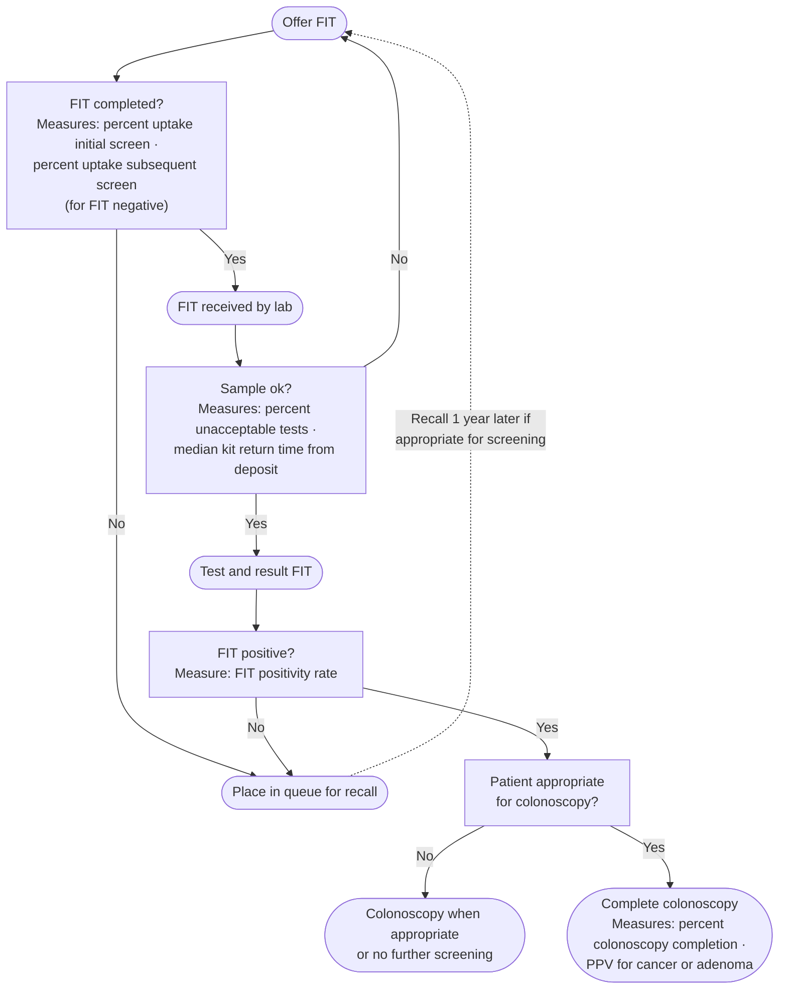

The fecal immunochemical test (FIT) as a **primary screening modality for average-risk individuals** — performance, threshold, sampling, interval, positive-test follow-up and programmatic quality. Where FIT sits among the screening options, and the start/stop ages, belong to [[colorectal-cancer-screening]]; post-polypectomy and post-resection use is on [[colonoscopy-surveillance]] and [[colorectal-cancer]].

## Contents
- [[#Overview and Rationale]]
- [[#Performance Characteristics — Single Application]]
- [[#Threshold (Hemoglobin Cut-off Value)]]
- [[#Qualitative vs Quantitative]]
- [[#Number of Samples]]
- [[#Interval]]
- [[#FIT vs gFOBT]]
- [[#Follow-up of a Positive FIT]]
- [[#Practical Considerations]]
- [[#Programmatic Quality Targets]]
- [[#See Also]]
- [[#Sources]]

---

## Overview and Rationale

- Measures human hemoglobin directly in stool, using antibodies against the globin moiety [[usmstf-2016-fit-screening]]
- vs the guaiac-based fecal occult blood test (gFOBT): not confounded by dietary peroxidase activity; fewer samples (usually 1 or 2 vs 3); better sensitivity and adherence (see [[#FIT vs gFOBT]])
- **American College of Gastroenterology (ACG) 2021 Rec 4:** **[[colonoscopy]] and FIT are the primary screening modalities** for [[colorectal-cancer|colorectal cancer (CRC)]] — Strong; low-quality evidence [[acg-2021-crc-screening]]

## Performance Characteristics — Single Application

**For CRC (meta-analysis of 19 studies, asymptomatic average-risk adults):** [[usmstf-2016-fit-screening]]

- Pooled sensitivity: **~79%** (95% confidence interval (CI), 0.69–0.86)
- Pooled specificity: **~94%** (95% CI, 0.92–0.95)
- With colonoscopy as reference standard only: sensitivity 77%, specificity 94%
- OC FIT-CHEK (large US study, n=9,989 undergoing colonoscopy): sensitivity 74%, specificity 96%

**For advanced adenoma (single application):** [[usmstf-2016-fit-screening]]

- Sensitivity 6–56% across studies, varying with FIT brand and cut-off; specificity 68–99% (Table 2)
- Sessile serrated lesions (SSLs): sensitivity 5–16% (ACG 2021); 5% for sessile serrated polyps ≥1 cm in the large US study above [[acg-2021-crc-screening]] [[usmstf-2016-fit-screening]]

**US Multi-Society Task Force (USMSTF) 2016:** one-time FIT is ~80% sensitive for cancer but only ~20–30% for advanced neoplasia, so repeated applications are needed — **we recommend repeated testing**; patients choosing FIT should understand that testing recurs and that a positive result needs colonoscopy; programs should track testing cycles — **Strong recommendation; moderate-quality evidence** [[usmstf-2016-fit-screening]]

## Threshold (Hemoglobin Cut-off Value)

Meta-analysis data, µg hemoglobin per g feces [[usmstf-2016-fit-screening]]:

| Cut-off | Sensitivity (CRC) | Specificity (CRC) | Positivity rate (1-sample) |
|---|---|---|---|
| <20 µg/g | 0.86 (95% CI, 0.75–0.92) | 0.91 (0.89–0.93) | 5.3–14.2% |
| 20–50 µg/g | Not reported | Not reported | 1.4–7.5% |
| >50 µg/g | 0.67 (95% CI, 0.59–0.74) | 0.96 (0.94–0.98) | Not reported |

- <20 µg/g gave the best combination of sensitivity and specificity for CRC
- **Task Force favors a lower threshold — 20 µg/g or lower** — the cut-off should weigh performance, cost-effectiveness, FIT device and the program's colonoscopy resources — **Weak recommendation; low-quality evidence** [[usmstf-2016-fit-screening]]
  - 20 µg/g itself is included partly because the commonly available US quantitative test uses it
- Simulation modeling (quantitative FIT, cut-offs 10–150 µg/g): 10 µg/g was the most efficient and cost-effective for CRC screening, assuming specificity 95.8%
- A later meta-analysis cited by ACG 2021: sensitivity 91%, specificity 90% for CRC at a quantitative cut-off of 10 µg/g [[acg-2021-crc-screening]]
- Barcelona program (n=3,109): fecal hemoglobin >177 µg/g → nearly 4× more likely to harbor advanced neoplasia (odds ratio (OR) 3.80; 95% CI, 3.07–4.71)

## Qualitative vs Quantitative

- **Quantitative FIT preferred** over qualitative — **Weak recommendation; low-quality evidence** [[usmstf-2016-fit-screening]]
- Rationale: improved quality control with automated reading; adjustable hemoglobin cut-off; performance otherwise generally similar
- Pooled sensitivity: quantitative 77% vs qualitative 85% for CRC; specificity 94% both
- US Food and Drug Administration (FDA) requires every quantitative FIT to be reported as positive or negative — the hemoglobin concentration is not reported [[usmstf-2016-fit-screening]] [[acg-2021-crc-screening]]
- FDA-cleared quantitative systems in the US (2016): OC-Auto Micro 80 and OC-Sensor Diana (Polymedco), i-Chroma (Boditech); most FDA-cleared devices are qualitative

## Number of Samples

- **1-sample annual approach is suggested** — **Weak recommendation; low-quality evidence** [[usmstf-2016-fit-screening]]
- 2-sample FIT gave higher advanced neoplasia detection in a Dutch study (4.1% vs 3.1%); cost-effectiveness modeling (MIcrosimulation SCreening ANalysis [MISCAN]-Colon) found 1-sample testing at shorter intervals more cost-effective than 2-sample testing
- Pooled sensitivities for CRC: 1-sample 0.79, 2-sample 0.77, 3-sample 0.80 — similar regardless of sample number

## Interval

- **ACG 2021 Rec 7: FIT every 1 y** — Strong; low-quality evidence [[acg-2021-crc-screening]]; USMSTF 2016 likewise suggests annual 1-sample testing (above)
- Programmatic annual gFOBT reduces CRC-related mortality by up to 33%
- Optimal FIT interval unclear [[usmstf-2016-fit-screening]]
  - 2 ongoing randomized controlled trials (RCTs) compare colonoscopy with annual or biennial FIT (CRC incidence and mortality; results ≥10 y away in 2016)
  - Modeling: annual high-sensitivity FIT gave life-years similar to colonoscopy every 10 y
  - Dutch program: advanced neoplasia detection unaffected by intervals of 1–3 y
- ACG 2021: no RCTs compare screening intervals; biennial FIT gives similar neoplasia yield with lower screening burden, but **annual is preferred** — larger effect of annual fecal occult blood testing in trials and the effectiveness of annual FIT programs [[acg-2021-crc-screening]]

## FIT vs gFOBT

- **Use FIT over gFOBT** — **Strong recommendation; high-quality evidence** [[usmstf-2016-fit-screening]]
- Meta-analysis: cancer detection relative risk (RR) 1.96 (95% CI, 1.2–3.2); advanced neoplasia detection RR 2.28 (95% CI, 1.68–3.10); adherence RR 1.16 (95% CI, 1.03–1.30)
- At thresholds matched for positivity, FIT sensitivity for CRC ~2× gFOBT (73.3% vs 33.3%) with similar specificity (>95%)
- Adherence: ~10% absolute increase in ≥4 RCTs; ~20% greater participation in 2 meta-analyses — driven by fewer samples and no diet/medication restriction

## Follow-up of a Positive FIT

- **Colonoscopy is the recommended test after a positive FIT** in screen-eligible individuals — **not a repeat FIT** — **Strong recommendation; moderate-quality evidence** [[usmstf-2016-fit-screening]]
  - Positive predictive value (PPV) of FIT across populations (Table 3): cancer 2.9–7.8%, advanced neoplasia 33.9–54% — vs cancer 0.5–1% and advanced neoplasia 5–10% detected at screening colonoscopy
- Computed tomographic colonography (CTC) (sensitivity for ≥6 mm 89%, specificity 75.4%) and colon [[capsule-endoscopy|capsule endoscopy]] (sensitivity 95%, specificity 65%; complete in 73%) have been studied after a positive stool test; specificity is the weakness
- **Positive FIT + negative colonoscopy → no upper gastrointestinal (GI) evaluation** in the absence of [[iron-deficiency-anemia|iron-deficiency anemia]] or signs/symptoms of upper GI pathology — **Weak recommendation; very low quality evidence**
- **Positive FIT after a recent colonoscopy** (before repeat endoscopy is due): generally offer repeat colonoscopy, weighing clinical context (other worrisome signs, symptoms, labs), patient factors (advanced-neoplasia risk, preference) and prior exam quality ([[bowel-preparation|poor bowel preparation]], endoscopist adenoma detection rate (ADR)) — **Weak recommendation; low-quality evidence**
- **ACG 2021 Rec 21:** to improve follow-up of a positive screening test, suggest mail and phone reminders, patient navigation and provider interventions — Conditional; very low-quality evidence [[acg-2021-crc-screening]]

> [!pearl] FIT is a lower-tract test
> Hemoglobin is degraded as it moves through the GI tract, so FIT is viewed as specific for lower-tract bleeding and less likely to be falsely positive with upper-tract disease such as severe esophagitis or gastritis ([[usmstf-2016-fit-screening]]).

## Practical Considerations

| Issue | Recommendation | Strength | Evidence |
|---|---|---|---|
| Diet and medications (incl. anticoagulants, antiplatelets) | No adjustment needed — instruct patients explicitly that they need not change diet or medications | Strong | Moderate |
| Sample collection | Spontaneously passed stool; NOT an in-office digital rectal examination (DRE) sample | Weak | Very Low |
| Sample return time | No strong evidence that delays up to 10 days harm performance; tell participants to return the kit promptly (preferably within 24 h of sampling); programs monitor return times and request a repeat sample when outside the manufacturer's limit | Weak | Very Low |
| Ambient temperature / season | Need not adjust distribution or mailing for temperature; follow manufacturer storage and transport specifications | Weak | Low |

## Programmatic Quality Targets

- **Programs using FIT should establish quality-assurance practices to monitor key quality metrics** — Weak; very low [[usmstf-2016-fit-screening]]
- Suggested targets (Weak recommendation; very low quality evidence):

| Metric | Target |
|---|---|
| FIT completion rate among those offered testing | ≥60% |
| Proportion of returned FITs that cannot be processed by the lab | <5% |
| Colonoscopy completion rate for FIT-positive individuals | ≥80% |

**ADR on follow-up colonoscopy after a positive FIT** is a distinct benchmark from the screening-colonoscopy ADR, and lives with the other detection targets on [[colonoscopy-quality-indicators]].

*Key processes in a FIT-based program and the quality measure at each step*
*Source: redrawn from the USMSTF 2016 FIT process-flow figure*
*[[usmstf-2016-fit-screening|USMSTF 2016 FIT Screening]]*
*FIT = fecal immunochemical test · PPV = positive predictive value*

---

## See Also

[[colorectal-cancer-screening]], [[colorectal-cancer]], [[colonoscopy]], [[colonoscopy-quality-indicators]], [[colonoscopy-surveillance]], [[capsule-endoscopy]], [[iron-deficiency-anemia]], [[bowel-preparation]]

---

## Sources

1. [[usmstf-2016-fit-screening|USMSTF 2016 — Recommendations on Fecal Immunochemical Testing to Screen for Colorectal Neoplasia]]
2. [[acg-2021-crc-screening|ACG 2021 Colorectal Cancer Screening Guidelines]]
