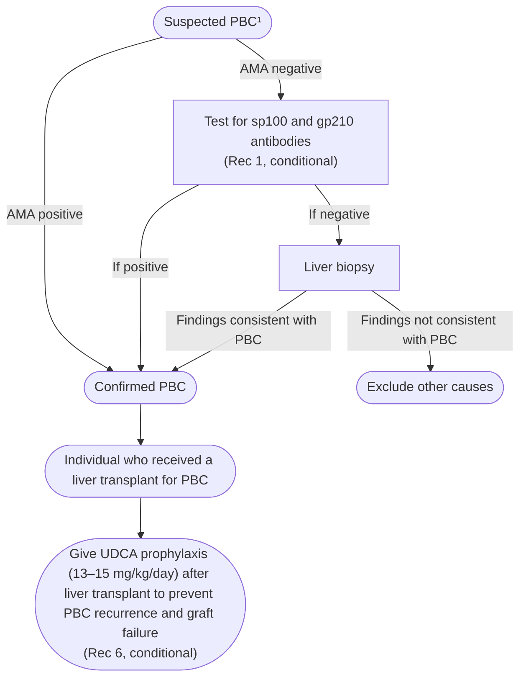
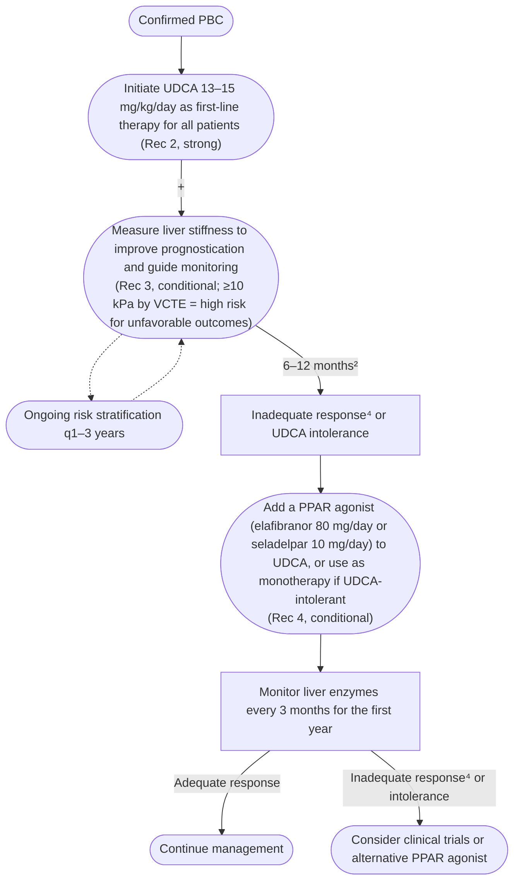
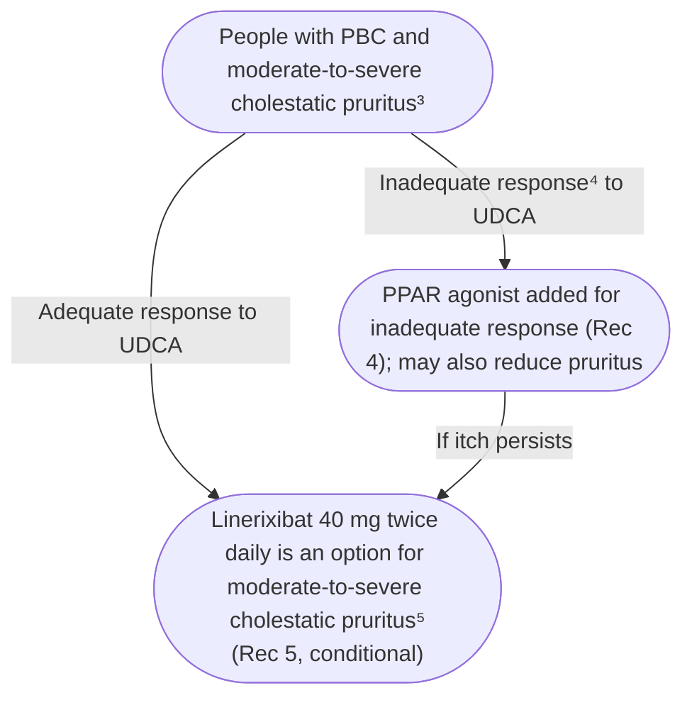

## Bibliographic Info

- **Article:** [Levy C, Mayo MJ, Carey EJ, Chen VL, Assis DN, Goel A, et al. AASLD AGA Clinical Practice Guideline on Management of Primary Biliary Cholangitis. Hepatology. 2026.](https://doi.org/10.1097/HEP.0000000000001875)
- **Authors:** Cynthia Levy, Marlyn J. Mayo, Elizabeth J. Carey, Vincent L. Chen, David N. Assis, Aparna Goel, Mai Sedki, Shahnaz Sultan, Tamar Taddei, Therese Bittermann, Perica Davitkov
- **Year:** 2026 (received and accepted 22 September 2026; volume and page numbers not yet assigned in this version)
- **Journal/Publisher:** Hepatology (Wolters Kluwer); jointly published in Gastroenterology (Elsevier) — the two articles are stated to be identical apart from minor style differences, and either citation may be used
- **DOI:** [10.1097/HEP.0000000000001875](https://doi.org/10.1097/HEP.0000000000001875)
- **Type:** guideline — joint American Association for the Study of Liver Diseases (AASLD) and American Gastroenterological Association (AGA) clinical practice guideline; Grading of Recommendations Assessment, Development and Evaluation (GRADE) methodology; 6 recommendations

## Summary

- Joint AASLD–AGA GRADE guideline on adults with [[primary-biliary-cholangitis|primary biliary cholangitis (PBC)]]. Panel of 11 (content experts + methodologists); systematic reviews for 6 PICO (population, intervention, comparator, outcome) questions; certainty of evidence ranges from moderate to very low (Abstract; Methods).
- Six recommendations (Table 1): sp100/gp210 antibody testing in antimitochondrial antibody (AMA)–negative suspected PBC; [[ursodeoxycholic-acid|ursodeoxycholic acid (UDCA)]] as first-line therapy (the only **strong** recommendation); [[liver-stiffness-measurement|liver stiffness measurement (LSM)]] for prognostication; peroxisome proliferator–activated receptor (PPAR) agonists (elafibranor, seladelpar) for inadequate response to or intolerance of UDCA; linerixibat for moderate to severe cholestatic pruritus; UDCA prophylaxis after [[liver-transplantation|liver transplantation (LT)]].
- Central themes: a positive anti-sp100/anti-gp210 antibody can replace [[liver-biopsy|liver biopsy]] but a negative result does not exclude PBC; UDCA 13–15 mg/kg/d for everyone at diagnosis, continued even with persistent alkaline phosphatase (ALP) elevation; response assessed at 6–12 months; vibration controlled transient elastography (VCTE) LSM ≥10 kPa marks high risk and favors closer monitoring, ALP normalization as the goal, and possible escalation; risk-based rather than rigid threshold-based escalation (Recs 2–4; Discussion; Conclusions).
- Not addressed by a recommendation: obeticholic acid (appears only in cited cohort data and as a possible future combination partner), saroglitazar (not approved by the US Food and Drug Administration [FDA], so excluded), fatigue, metabolic bone disease, PBC–[[autoimmune-hepatitis|autoimmune hepatitis]] overlap (listed as unresolved questions in Conclusions). For other antipruritics (bile acid binding resins, opioid inhibitors, rifampin, sertraline) the guideline refers readers to the AASLD 2018 guidance ([[aasld-2018-pbc]]) (Rec 5 Discussion).

## Key Findings / Claims

### Recommendations (Table 1)

"Recommend" = strong; "suggest" = conditional (Development of recommendations). Wording near-verbatim from Table 1.

| # | Recommendation | Strength | Certainty of evidence |
|---|---|---|---|
| 1 | In people with suspected PBC and negative serum AMA, the societies (AGA and AASLD) **suggest** testing for sp100 and gp210 antibodies. | Conditional | Very Low |
| 2 | In people with treatment-naïve PBC, the societies **recommend** using UDCA compared with no treatment. | Strong | Moderate |
| 3 | In people with PBC, the societies **suggest** measuring liver stiffness to improve prognostication. | Conditional | Moderate |
| 4 | In people with PBC who have inadequate response or are intolerant of UDCA, the societies **suggest** PPAR agonists (elafibranor, seladelpar) — as add-on therapy to UDCA for inadequate response, or as alternative monotherapy for UDCA intolerance. | Conditional | Low |
| 5 | In people with PBC, the societies **suggest** linerixibat as an option for treatment of moderate to severe cholestatic pruritus. People who place a higher value on avoiding potential gastrointestinal (GI) side effects (eg, diarrhea, abdominal pain) or costs, and lower value on variable benefits (eg, pruritus, sleep interference), may reasonably choose not to use it. | Conditional | Low |
| 6 | In people who have received a liver transplant for PBC, the societies **suggest** UDCA prophylaxis to prevent recurrence of PBC and graft failure. | Conditional | Very Low |

- Implementation considerations under each recommendation are ungraded (Table 1); they are captured below per recommendation.

### Rec 1 — sp100 and gp210 antibodies in AMA-negative suspected PBC

**Implementation considerations (ungraded; Table 1):**
- Test anti-gp210 and anti-sp100 **before liver biopsy** in cholestatic liver disease with negative AMA — a positive result may obviate biopsy and allow earlier therapy.
- **Both negative + strong clinical suspicion** → liver biopsy remains appropriate to establish or exclude PBC (sensitivity is low).
- Use in the evaluation of suspected cholestatic liver disease, **not** general population screening.

**Evidence and rationale (Rec 1 Summary of the evidence; Benefits and harms; Discussion):**

| Antibody | Studies (participants) | Pooled sensitivity (95% confidence interval [CI]) | Pooled specificity (95% CI) |
|---|---|---|---|
| Anti-sp100 | 12 (3729) | 22.7% (12.9%–36.6%) | 96.5% (93.9%–98.0%) |
| Anti-gp210 | 12 (3660) | 19.7% (10.2%–34.6%) | 99.0% (97.7%–99.6%) |

- Rule-in, not rule-out: specificity >95% across all studies; sensitivity ~20% → a negative result does not exclude PBC; persistent cholestasis with strong suspicion → further workup incl. liver biopsy and genetic testing when appropriate.
- Anti-gp210 (higher specificity) is particularly useful as a confirmatory marker; anti-sp100 adds modest yield at a slightly higher false-positive rate.
- At 1% prevalence, per 100,000 tested: anti-sp100 ≈227 true positives, ≈773 missed, ≈3465 false positives; anti-gp210 ≈197 true positives, ≈803 missed, ≈990 false positives.
- Estimated pretest prevalence of AMA-negative PBC among people with cholestatic liver test abnormalities 0.3%–1%; a positive result has a substantial chance of being false (estimated 83% at 1% prevalence). Main false-positive conditions (drug-induced cholestasis, sarcoidosis, genetic cholestatic syndromes) may themselves respond to UDCA, partly mitigating misclassification.
- Most studies case-control; certainty rated down for risk of bias, inconsistency (sensitivity range ~2.6%–64.7% for sp100, 0%–60% for gp210) and imprecision.

### Rec 2 — UDCA first-line

**Implementation considerations (ungraded; Table 1):**
- UDCA is first-line therapy and should be offered to **every person at the time of diagnosis**.
- Dose **13–15 mg/kg/d** — shown to improve liver chemistries, delay histologic progression, and improve transplantation-free survival.
- Increasing beyond **15 mg/kg/d** is not indicated to improve symptoms or to treat persistently elevated ALP.
- **Continue UDCA even with persistent ALP elevation** — it still provides sustained survival benefit.

**Evidence and rationale (Rec 2 Summary of the evidence; Benefits and harms; Discussion):**
- Cochrane review: 16 randomized controlled trials (RCTs), 1447 people; median duration 24 months (range 3–92).
- No reduction in all-cause mortality (6.4% vs 6.6%; relative risk [RR] 0.97, 95% CI 0.67–1.42) or mortality/LT (12.1% vs 12.6%; RR 0.96, 0.74–1.25) within trial durations.
- Lowered bilirubin by a mean 8.69 μmol/L (0.5 mg/dL) and ALP by a mean 257 U/L; slowed histologic progression (23.5% vs 38.2%; RR 0.62, 0.44–0.88; 145 fewer per 1000).
- Did not improve pruritus (RR 0.96, 0.84–1.09) or fatigue (RR 0.90, 0.81–1.00).
- Harms limited: serious adverse events (SAEs) 13.5% vs 15.6% (RR 0.87, 0.68–1.12); non-SAEs (GI symptoms — diarrhea, nausea, vomiting; possible weight gain) 4.2% vs 2.8% (RR 1.46, 0.83–2.56).
- Global PBC Study Group observational cohort (3902 people): UDCA associated with lower risk of LT or death (hazard ratio [HR] 0.46); 5-year number needed to treat 11 to prevent 1 LT or death, lower in higher-risk people (cirrhosis, elevated ALP).
- Inadequate biochemical response ≠ treatment futility: keep UDCA and consider adjunctive second-line therapy; even partial improvement on UDCA is associated with better outcomes than no therapy.
- No subgroup exempted: panel supported continued use across the disease spectrum (advanced fibrosis, decompensated cirrhosis, awaiting LT) unless intolerance develops.
- Normalization of ALP and bilirubin is considered an ideal biochemical response, especially in more advanced disease; defining response criteria was outside the guideline's scope (Rec 2 Discussion).

### Rec 3 — Liver stiffness for prognostication

**Implementation considerations (ungraded; Table 1):**
- LSM improves risk stratification. **LSM ≥10 kPa by VCTE** = increased risk of adverse clinical outcomes → may warrant closer monitoring and/or possible therapy escalation.
- With serial measurements, the **most recent LSM** appears more strongly associated with outcomes than the change between measurements.

**LSM bands and monitoring (Rec 3 Discussion):**

| LSM by VCTE | Implication / suggested monitoring |
|---|---|
| <10 kPa | Relatively low likelihood of a clinically meaningful LSM change |
| 7–10 kPa | Monitor case by case for changes indicating progression to advanced chronic liver disease |
| ≥10 kPa | High risk (consensus threshold); **annual VCTE** suggested |
| Any LSM, after a change in therapy | **Annual VCTE** suggested (most LSM change follows a treatment change) |

- Published high-risk cutoffs ranged 9.3–11.0 kPa; panel chose 10 kPa as a reasonable consensus threshold.
- VCTE frequency should depend on fibrosis severity and the probability that a repeat will show meaningful change; optimal interval not well defined. Figure 1 shows ongoing risk stratification every 1–3 years.
- Cholestasis (ALP ≥1.5× upper limit of normal [ULN] or elevated bilirubin) may make LSM a less reliable indicator of [[portal-hypertension|portal hypertension]] (not seen in all PBC studies); Baveno rule-of-5 cutoffs not fully validated in PBC.
- Other factors affecting accuracy: body habitus, liver inflammation or cholestasis, nonfasting status, operator expertise, type of elastography.
- Alternatives: shear wave elastography reasonable where VCTE unavailable; magnetic resonance elastography if VCTE unlikely to be technically feasible (eg, severe abdominal obesity). Prognostic evidence most robust for VCTE.
- LSM had superior prognostic accuracy vs blood-based scores (Globe, UK-PBC, Model for End-Stage Liver Disease, Fibrosis-4 Index).

**Evidence (Rec 3 Summary of the evidence):**
- No trial compared LSM-guided care with usual care; 3 retrospective VCTE cohorts, 3698 people.
- Pooled covariate-adjusted HR 1.07 (95% CI 1.05–1.08) per 1-kPa increase for cirrhosis decompensation, LT or death.
- Serial data: 10%–20% or 1-kPa annual increase associated with worse outcomes in some studies; another found trends add no prognostic information beyond the most recent LSM. Seladelpar post hoc analysis (114 participants, 36 months): 8/84 (15%) with baseline LSM <10.7 kPa rose to ≥10.7 kPa; 13/30 (43%) with baseline ≥10.7 kPa fell below 10.7 kPa; most change by 12 months (Rec 3 Discussion).
- All prognostic LSM studies predate seladelpar/elafibranor approval; how LSM should enter stopping/continuation rules is unknown (Evidence gaps).

### Rec 4 — PPAR agonists for inadequate response or UDCA intolerance

**Implementation considerations (ungraded; Table 1):**
- Assess biochemical response to UDCA ideally **after ≥6 months and no later than 12 months** from starting it.
- Inadequate response is variably defined; most clinical studies use **failure to achieve ALP <1.5–1.67× ULN and normal total bilirubin at 12 months**.
- **ALP normalization is the ideal goal** when possible — particularly desirable with LSM ≥10 kPa.
- Interpreting biochemistry, deciding to start second-line therapy and choosing the agent → in the context of disease severity, prognostic data and symptom burden, by shared decision-making.
- **Elafibranor 80 mg/d** and **seladelpar 10 mg/d** have accelerated FDA approval as second-line therapy for inadequate response to or intolerance of UDCA.
- Fibrates (fenofibrate, bezafibrate) — less extensively studied; sometimes used **off-label** as second-line therapy. Bezafibrate is not commercially available in the US.
- Moderate to severe pruritus: PPAR agonists may reduce pruritus intensity.
- After starting a PPAR agonist: monitor response and tolerability longitudinally — **quarterly laboratory testing during the first year** (expert opinion), less often once benefit and tolerability are established.
- **Do not use PPAR agonists in pregnancy, breastfeeding, or decompensated cirrhosis** (lack of efficacy and safety data).

**Response definitions used in the guideline:**

| Term | Criteria | Locator |
|---|---|---|
| Inadequate response (most clinical studies) | Failure to achieve ALP <1.5–1.67× ULN **and** normal total bilirubin at 12 months | Table 1 (Rec 4); Figure 1 note 4 |
| POISE criteria (primary endpoint of the elafibranor and seladelpar phase 3 trials) | ALP <1.67× ULN, **and** ALP decrease ≥15% from baseline, **and** normal total bilirubin, at 12 months | Rec 4 Discussion |
| Complete biochemical response (BEZURSO trial) | Normal ALP, total bilirubin, aspartate aminotransferase, alanine aminotransferase, prothrombin time and albumin | Rec 4 Discussion |
| Ideal treatment goal | ALP normalization (especially LSM ≥10 kPa) | Table 1 (Rec 4) |

**Second-line agents (Rec 4 Benefits and harms; Discussion):**

| Agent | Dose / status | Efficacy vs placebo | Harms | Certainty |
|---|---|---|---|---|
| Elafibranor | 80 mg/d; accelerated FDA approval | Biochemical response RR 6.26 (95% CI 2.39–16.39), 387 more per 1000; ALP normalization RR 9.32 (1.22–70.95), 12 more per 1000 | No increase in SAEs (RR 0.77), discontinuation (RR 1.08) or muscle toxicity | Low |
| Seladelpar | 10 mg/d; accelerated FDA approval | Biochemical response RR 4.20 (2.11–8.36), 529 more per 1000; ALP normalization RR 32.34 (4.52–231.64), 27 more per 1000 | No increase in SAEs (RR 0.88), discontinuation (RR 1.10), myalgia (RR 0.81) or significant liver enzyme elevations | Low |
| Bezafibrate | Off-label; not available in the US; no dose given | ALP −49.5% from baseline; ALP normalization 61.8% vs 15.6% (RR 4.27, 2.37–7.66) | SAEs similar (15.8% vs 15.9%); myalgia 10.1% vs 5.4% (nonsignificant); creatinine rise ~3%–5%; rhabdomyolysis rare (1/50, on a statin) | Very low |
| Fenofibrate | Off-label; no dose given | ALP normalization RR 2.13 (1.21–2.64), 165 more per 1000; no blinded or placebo-controlled trial | Low-grade, transient transaminase and creatinine elevations; no rhabdomyolysis reported | Very low |

*RR = relative risk · CI = confidence interval · ALP = alkaline phosphatase · SAE = serious adverse event · FDA = US Food and Drug Administration*

- Elafibranor and seladelpar appeared to have lower drug-induced liver injury and muscle toxicity than fibrates (indirect comparison; no head-to-head trials).
- Pruritus: clearest data for **seladelpar and bezafibrate**. Seladelpar met the key secondary pruritus endpoint (clinically meaningful reduction); elafibranor did not meet the Worst Itch Numerical Rating Scale (WI-NRS) endpoint but improved the 5-D Itch Scale and PBC-40 itch domains; bezafibrate superior to placebo in a 21-day trial of moderate to severe cholestatic pruritus.
- Similar responses across PPAR agonists suggest a possible class effect.
- **ALP 1.0–1.5× ULN or total bilirubin 0.6–1× ULN:** limited evidence to start a second-line PPAR agonist. A retrospective cohort of 1047 patients found those with **LSM ≥10 kPa and age ≤62 years** benefited from ALP normalization and total bilirubin <0.6× ULN (improved 10-year complication-free survival; validated in a US cohort) — preliminary support for more aggressive targets in compensated advanced chronic liver disease; panel favors **risk-based over threshold-based** management for this subset.
- Figure 1 note 2: assess response at **6 months** (rather than 12) if high-risk features are present, including but not limited to LSM ≥10 kPa and age <62 years.
- No data guide care of people without adequate response after 12 months of a PPAR agonist (switching agents or combinations untested); Figure 1 shows "consider clinical trials or alternative PPAR agonist."
- Link between biochemical response to PPAR agonists and clinical outcomes shown so far only for bezafibrate (retrospective); post-approval outcome studies for elafibranor and seladelpar ongoing.

### Rec 5 — Linerixibat for moderate to severe cholestatic pruritus

**Implementation considerations (ungraded; Table 1):**
- Shared decision-making is essential in deciding when to use an ileal bile acid transporter (IBAT) inhibitor for pruritus.
- Insufficient evidence for IBAT inhibitors in **mild** cholestatic pruritus.
- **Linerixibat 40 mg twice daily:** a **2- to 12-week trial** is sufficient to assess efficacy and tolerability in moderate to severe cholestatic pruritus due to PBC; consider longer-term continuation based on clinical response.

**Evidence and rationale (Rec 5 Summary of the evidence; Benefits and harms; Discussion):**
- 2 RCTs (1 phase 2b, 1 phase 3), 296 people with moderate to severe pruritus, defined in trials as WI-NRS ≥4 (on a 0–10 scale; mild = 1–3).
- WI-NRS reduction 0.78 points vs placebo (95% CI −1.25 to −0.31); ≥2-point improvement RR 1.11 (0.93–1.32); ≥3-point improvement RR 1.30 (1.00–1.69); no difference on PBC-40 Itch; sleep interference improved 0.52 points.
- Harms: diarrhea RR 3.57 (2.43–5.23); abdominal pain RR 3.67 (1.57–8.60); discontinuation for adverse effects RR 2.92 (1.24–6.90). Magnitude judged moderate.
- Itch improvement seen by 2 weeks, plateau at ~12 weeks; individual response heterogeneous → therapeutic trial is the best way to identify responders (no predictive biomarker; baseline serum bile acids correlated poorly).
- Managing diarrhea: maximum diarrhea scores at week 3; temporarily reduce the dose, or add loperamide and/or dicyclomine if needed; most GI symptoms mild and improve over time; 86% in the phase 3 study reported their diarrhea resolved.
- "Moderate to severe" in practice: shared decision-making using the patient's own view of itch impact (sleep, activities) is reasonable rather than the trial WI-NRS cutoff; the FDA label specifies no itch severity.
- **Decompensated cirrhosis was excluded** from linerixibat trials — safety unknown there.
- Linerixibat was the only FDA-approved treatment for PBC-related pruritus at publication. Other options (bile acid binding resins, opioid inhibitors, rifampin, sertraline) are not graded here; readers are referred to the AASLD 2018 guidance ([[aasld-2018-pbc]]). No comparative studies vs resins or rifampicin; combination with seladelpar or elafibranor not studied (22% of phase 3 participants were on a fibrate).
- Figure 1 note 3: itch severity is determined by the person living with PBC; if they also have inadequate response or intolerance to UDCA, the panel suggests **starting with a PPAR agonist**; the role of a PPAR agonist for pruritus with an adequate UDCA response is not yet defined.

### Rec 6 — UDCA prophylaxis after liver transplantation

**Implementation consideration (ungraded; Table 1):**
- Start UDCA prophylaxis **as soon as possible after LT** at **13–15 mg/kg/d**.

**Evidence and rationale (Rec 6 Summary of the evidence; Benefits and harms; Discussion):**
- No trial; 2 retrospective comparative cohorts, 1084 recipients. Main study (Global PBC Study Group, 2020): 790 recipients, 24% received UDCA 10–15 mg/kg/d started within 2 weeks of LT.
- Graft failure reduced (RR 0.35, 95% CI 0.15–0.79); recurrent PBC (rPBC) RR 0.73 (0.54–1.00) in the 2020 study alone and 0.84 (0.63–1.12) with both studies pooled; no reduction in all-cause (RR 0.78) or liver-related mortality (RR 1.10). In the 2020 study's adjusted analysis: rPBC HR 0.41, graft loss HR 0.33, liver-related death HR 0.69; survival gain 2.26 years over 20 years.
- No post-transplant harm data; harms inferred from the nontransplant setting. UDCA has little to no serious interaction with typical post-transplant medications.
- rPBC: median time to recurrence 3–6 years; ~20%–30% at 10 years, 50% at 20 years. Associated with graft loss (HR 2.01) and lower patient survival (HR 1.72).
- rPBC diagnosis requires **histology** (lymphoid infiltrates with granulomatous or lymphocytic destructive cholangitis, ± ductopenia, without infectious, immunologic, obstructive or toxic causes); **AMA is not helpful after transplant**.
- Unknown: whether all recipients benefit (eg, older at transplant), and when to stop prophylaxis (Evidence gaps).

### Clinical decision support tool (Figure 1)

Figure 1 is split here at its own seams: diagnosis and post-transplant prophylaxis, the treatment pathway, and the pruritus pathway.

*Diagnosis of suspected PBC and prophylaxis after liver transplant*
*Source: redrawn from Figure 1 (clinical decision support tool) of the AASLD AGA 2026 PBC guideline*
*[[aasld-aga-2026-pbc|AASLD AGA 2026 PBC Guideline]]*
*PBC = primary biliary cholangitis · AMA = antimitochondrial antibody · UDCA = ursodeoxycholic acid · Rec = recommendation*

*Treatment pathway after confirmed PBC*
*Source: redrawn from Figure 1 (clinical decision support tool) of the AASLD AGA 2026 PBC guideline*
*[[aasld-aga-2026-pbc|AASLD AGA 2026 PBC Guideline]]*
*PBC = primary biliary cholangitis · UDCA = ursodeoxycholic acid · VCTE = vibration controlled transient elastography · PPAR = peroxisome proliferator–activated receptor · Rec = recommendation*

*Pruritus pathway*
*Source: redrawn from Figure 1 (clinical decision support tool) of the AASLD AGA 2026 PBC guideline*
*[[aasld-aga-2026-pbc|AASLD AGA 2026 PBC Guideline]]*
*PBC = primary biliary cholangitis · UDCA = ursodeoxycholic acid · PPAR = peroxisome proliferator–activated receptor · Rec = recommendation*

Figure 1 notes (as printed):
1. Suspected PBC = chronic ALP elevation above the ULN, of hepatic origin, without evidence of biliary obstruction and without alternative explanation.
2. Assess response at 6 months if high-risk features are present, including but not limited to LSM ≥10 kPa and age <62 years.
3. Itch severity is determined by the person living with PBC; shared decision-making decides the need for and choice of drug. Start with a PPAR agonist if there is also inadequate response or intolerance to UDCA; the role of a PPAR agonist for pruritus with an adequate UDCA response is not yet defined.
4. Inadequate response = failure to achieve ALP <1.5–1.67× ULN and normal total bilirubin at 12 months.
5. Clinicians may choose alternative ways to manage pruritus based on the tradeoff between side effects and persistence of itching.

### GRADE interpretation (Table 3, condensed)

| Implications | Strong recommendation | Conditional recommendation |
|---|---|---|
| For patients | Most would want the recommended course; only a small proportion would not | The majority would want the suggested course, but many would not |
| For clinicians | Most individuals should receive the intervention | Different choices fit different patients; use shared decision-making |
| For policy makers | Can be adapted as policy or performance measure in most situations | Requires substantial debate and stakeholder involvement |

- Certainty levels (Table 2): high, moderate, low, very low — from "very confident" to "very little confidence" that the true effect lies close to the estimate.

### Figures

- Licence: the article carries no Creative Commons licence — "All rights are reserved, including those for text and data mining, AI training, and similar technologies" (copyright line, page 1). Figure 1 is therefore redrawn above, not reproduced.

## Relevance to Wiki

- [[primary-biliary-cholangitis]] — main update: AMA-negative diagnosis (Rec 1, test characteristics, biopsy when both negative), UDCA (Rec 2), LSM risk bands and monitoring (Rec 3), response assessment at 6–12 months and the inadequate-response definition, PPAR agonists as second-line therapy with doses and contraindications (Rec 4), linerixibat for pruritus (Rec 5), post-transplant UDCA (Rec 6); Figure 1 algorithm. Rec 4 supersedes the obeticholic acid–based second-line pathway of [[aasld-2018-pbc]].
- [[ursodeoxycholic-acid]] — first-line dose 13–15 mg/kg/d, no escalation above 15 mg/kg/d, continue despite persistent ALP elevation, post-LT prophylaxis 13–15 mg/kg/d started as soon as possible.
- [[liver-stiffness-measurement]] — PBC-specific prognostic use: ≥10 kPa by VCTE high risk; annual VCTE if ≥10 kPa or after a therapy change; 7–10 kPa case by case; cholestasis caveat; shear wave and magnetic resonance elastography as alternatives.
- [[liver-biopsy]] — AMA-negative PBC: biopsy when anti-sp100 and anti-gp210 are both negative and suspicion is strong; rPBC diagnosis is histologic.
- [[liver-transplantation]] — UDCA prophylaxis after LT for PBC; rPBC rates and impact.
- [[loperamide]] — named for managing linerixibat-associated diarrhea (Rec 5 Discussion).
- [[aasld-2018-pbc]], [[aasld-2021-pbc]] — superseded where they conflict (see below).
- Also covers elafibranor, seladelpar, bezafibrate, fenofibrate (PPAR agonists) and linerixibat (IBAT inhibitor).

## Contradictions / Open Questions

This 2026 joint AASLD–AGA guideline is newer US tier-1 guidance and wins over [[aasld-2018-pbc]] and [[aasld-2021-pbc]] where they differ.

- **Second-line therapy changed.** [[aasld-2018-pbc]] Statement 8 made obeticholic acid (OCA) 5 mg/day the second-line agent for inadequate UDCA responders, with fibrates off-label (Statement 9) and OCA contraindicated in advanced cirrhosis from 2021. 2026 Rec 4 suggests the PPAR agonists elafibranor 80 mg/d or seladelpar 10 mg/d (add-on, or monotherapy if UDCA-intolerant); fibrates remain off-label; **OCA gets no recommendation** and appears only in cited cohort data. The guideline does not state a reason for omitting OCA.
- **Timing of response assessment.** 2018 Statement 7: evaluate response at 12 months. 2026: ideally after ≥6 months and no later than 12 months (Rec 4), and at 6 months if high-risk features such as LSM ≥10 kPa and age <62 years (Figure 1 note 2).
- **Response criteria.** 2018 tabulated several named systems (Paris I/II, Toronto, Rochester, GLOBE…). 2026 gives a single working definition (ALP <1.5–1.67× ULN and normal total bilirubin at 12 months), calls ALP normalization the ideal goal, and explicitly prefers risk-based over rigid threshold-based escalation.
- **LSM threshold.** [[aasld-2018-pbc]] cited >9.6 kPa (5× risk of decompensation, death or transplant); 2026 adopts **≥10 kPa by VCTE** as a consensus high-risk cutoff (published range 9.3–11.0 kPa) and adds monitoring intervals. The 2018 ≥17 kPa triggers for variceal screening and hepatocellular carcinoma surveillance are not addressed by 2026.
- **Decompensated cirrhosis.** 2021: OCA contraindicated in advanced cirrhosis; fibrates discouraged in decompensated disease. 2026: PPAR agonists should not be used in decompensated cirrhosis (also pregnancy and breastfeeding); linerixibat safety unknown there (excluded from trials); UDCA continued across the disease spectrum.
- **Pruritus.** 2018 Statement 11 put anion-exchange resins first, with other agents for refractory itch. 2026 grades only linerixibat (Rec 5, the only FDA-approved PBC itch drug at publication) and suggests a PPAR agonist first when there is also inadequate UDCA response (Figure 1 note 3); it does not re-grade resins, rifampin, opioid inhibitors or sertraline and refers readers to the 2018 guidance for an overview of them; it states no order between those drugs and linerixibat.
- **AMA-negative PBC.** Concordant direction with 2018 (sp100/gp210 can establish the diagnosis without biopsy), now graded (conditional, very low certainty) and with explicit test characteristics: sensitivity ~20%, so a negative result does not exclude PBC and biopsy remains appropriate when suspicion is strong.
- **Post-transplant UDCA.** 2018 reported preventive UDCA associated with lower recurrence; 2026 makes it a graded recommendation (Rec 6, conditional, very low) with dose 13–15 mg/kg/d started as soon as possible after LT.
- **Internal inconsistency — age cutoff.** Figure 1 note 2 says age **<62** years; the Rec 4 Discussion (cohort of 1047 patients) says age **≤62** years.
- **Open questions (from the guideline):** management after inadequate response to a PPAR agonist; whether to start a PPAR agonist at ALP 1.0–1.5× ULN or bilirubin 0.6–1× ULN; PPAR agonist for itch with adequate UDCA response; IBAT inhibitors in mild itch and in combination with PPAR agonists; LSM's role in stopping rules; when to stop post-LT UDCA; fatigue, bone disease and PBC–autoimmune hepatitis overlap need guidance (Conclusions).
- The text cites the 2018 AASLD guidance as reference 101 when it says "most recent AASLD guidance paper" for other antipruritics.
