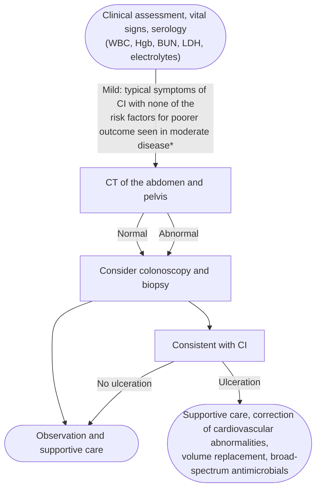
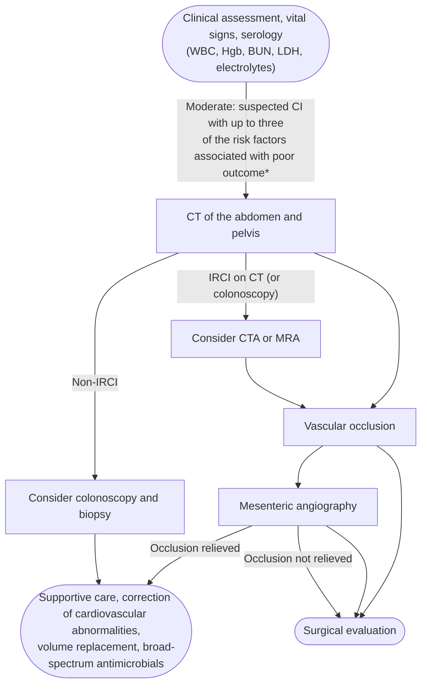
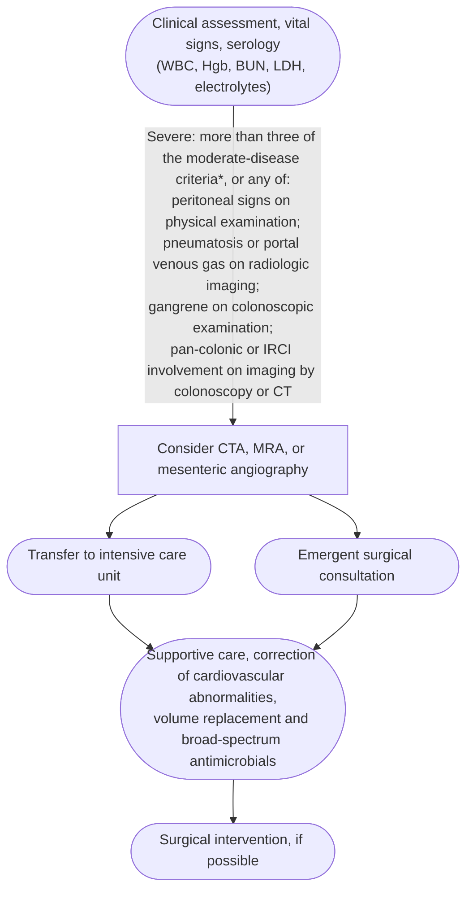

## Bibliographic Info

- **Article:** [Brandt LJ, Feuerstadt P, Longstreth GF, Boley SJ; American College of Gastroenterology. ACG Clinical Guideline: Epidemiology, Risk Factors, Patterns of Presentation, Diagnosis, and Management of Colon Ischemia. *American Journal of Gastroenterology* 2015;110:18–44.](https://doi.org/10.1038/ajg.2014.395)
- **Authors:** Brandt LJ, Feuerstadt P, Longstreth GF, Boley SJ; American College of Gastroenterology
- **Year:** 2015
- **Journal/Publisher:** *American Journal of Gastroenterology* 2015;110:18–44
- **DOI:** [10.1038/ajg.2014.395](https://doi.org/10.1038/ajg.2014.395)
- **Type:** Guideline (GRADE system)

---

## Summary

This American College of Gastroenterology (ACG) guideline provides Grading of Recommendations Assessment, Development and Evaluation (GRADE)-based recommendations on colon ischemia (CI), covering its epidemiology, risk factors, clinical presentation, diagnostic workup, and management. CI can range from mild transient mucosal disease to fulminant pancolonic necrosis.

The guideline emphasizes early computed tomography (CT) with intravenous (IV) and oral contrast as the first imaging modality, followed by colonoscopy within 48 hours to confirm the diagnosis. Most CI is mild and resolves with supportive care; antimicrobial therapy should be considered for moderate or severe disease. Surgery should be considered for CI with hypotension + tachycardia + abdominal pain **without** rectal bleeding, for isolated right colon ischemia (IRCI) and pan-colonic CI, and for gangrene.

**The guideline's central operational contribution is Table 6** — a proposed (explicitly non-validated) mild/moderate/severe classification built from ten specific poor-outcome factors, with a **count rule** (≤3 factors = moderate; >3 factors, or any of four hard findings, = severe) that drives whether the patient gets observation, antibiotics + surgical consultation, or the intensive care unit (ICU). Reproduced in full below; it is the reason to open this source.

Risk factors include inferior mesenteric artery (IMA)-sacrificing surgery, shock states, constipation-inducing medications, irritable bowel syndrome (IBS), chronic kidney disease (CKD) and chronic obstructive pulmonary disease (COPD), though in most patients no precipitating factor is identified. The distinction between colon ischemia and acute mesenteric ischemia (AMI) is clinically important, and the guideline handles it explicitly: **multiphasic computed tomography angiography (CTA) is required — not withheld — whenever IRCI is suspected or AMI cannot be excluded.**

---

## Key Findings / Claims

**Epidemiology**
- CI is the etiology in **9–24%** of all patients hospitalized for acute lower gastrointestinal (GI) bleeding, ranking first to third behind colorectal malignancy in large surveys.
- Annual incidence **15.6–17.7 per 100,000** across the large population/claims studies (Kaiser San Diego 15.6/100,000 — women 22.6, men 8.0; national claims 17.7/100,000; a further population study 16.3/100,000 person-years with a near four-fold rise over 34 years). A claims study surveying few patients ≥60 y reported only 7.2/100,000.
- Increases with age, **especially after age 49**; female predominance (57–76% of large series), particularly marked after age 69.
- **Mortality in large series 4–12%.** Cumulative recurrence 3% at 1 y, 5% at 2–3 y, 6% at 4 y, 10% at 5–6 y in one study; 3.3% at 2 y and 7.5% at 5 y in another.

**Presentation and distribution**
- Diagnosis usually established by sudden cramping **mild** abdominal pain, an urgent desire to defecate, and passage of bright red or maroon blood / bloody diarrhea **within 24 h**.
- Watershed anatomy: splenic flexure (Griffith's point) and sigmoid (Sudeck's point). The **rectum is uncommonly affected** because of its dual splanchnic + systemic supply.
- **IRCI** presents most often as acute abdominal pain **without** rectal bleeding (59%); atrial fibrillation, coronary artery disease (CAD) and CKD are more frequent than in other patterns.
- **IRCI outcomes are the worst:** 30-day mortality **20.3% vs 9.0%** for non-IRCI (n = 313, pathologically confirmed, P < .01); in a separate 273-patient series, 30-day mortality 22.5% vs 11.9% (P = .03), need for surgery **54.9% vs 10.9%** (P < .001), unfavorable outcome 59.2% vs 17.3%.
- **Pan-colonic CI carries a similar prognosis — mortality 21.7%.** IRCI + pan-colonic together accounted for 61% of episodes requiring surgery (hazard ratio 14.6, P < .001).
- Type I (nonocclusive, no cause identified — most cases) vs Type II (identified cause, usually hypotension, low cardiac output, or aortic surgery). Rarely used clinically, but Type II allows cause-directed therapy.

**Imaging performance (read the denominators — these are vascular-occlusion figures, not CI-diagnosis figures)**
- CT findings suggesting CI: bowel wall thickening, edema, thumbprinting, pericolonic fat stranding.
- No data exist on CT sensitivity/specificity for vascular occlusion **in CI**; the figures below come from **AMI** studies:
  - Meta-analysis (3 prospective + 3 retrospective studies, mesenteric arterial embolism/thrombosis and mesenteric venous thrombosis): CT sensitivity and specificity **93.3% and 95.9%**; all tertiary referral centers, so accuracy may be lower in community practice.
  - Triple-phase CT, 39 pathologically confirmed AMI vs 41 suspected AMI with another diagnosis: superior mesenteric artery (SMA) thrombus/occlusion specificity approaching **100%**, sensitivity **26%**; celiac and IMA thrombus specificity **98%**, sensitivity **5%**.
- **Pneumatosis plus portomesenteric gas for transmural infarction (121 patients with transmural colon necrosis, 87 with limited necrosis): specificity 83%, sensitivity 17%** — the two findings together did not reach statistical significance for predicting transmural CI.
- Ultrasound in one 58-patient series: symmetric bowel wall thickening 100%, segmental involvement 80%, preserved wall stratification 66%.

**Strength of diagnosis — Table 8 (modified Brandt & Boley criteria)**

| Strength of diagnosis | Clinical | Colonoscopy | Pathologic | Culture |
|---|---|---|---|---|
| Definite CI | Consistent with CI | Consistent with CI | Consistent with CI | Negative |
| Probable CI | Consistent with CI | Consistent with CI | Not performed or negative within 72 h | Negative after 12 h of antimicrobial therapy |
| Possible CI | Consistent with CI | Not performed, negative, or nonspecific changes within 72 h | Not performed or negative within 72 h | Culture not performed |

*Source: Table 8, [[acg-2015-colon-ischemia|ACG 2015 Colon Ischemia Guideline]] (modified from Brandt & Boley)*

**Colonoscopy practice statements in the text (unnumbered, ungraded)**
- Carbon dioxide (CO2) appears to be the best insufflating agent in CI and should be used whenever available (never formally studied in humans with CI; evidence indirect).
- Screening colonoscopy should not be performed at the time of presentation with CI — minimal colon manipulation and distension avoids further damage from insufflation-related reduction in blood flow.

**Post–abdominal aortic aneurysm (AAA)-repair CI (stratified — the overall figure alone is misleading)**
- Overall post-operative CI after AAA repair **2.2%**; **ruptured AAA 8.9%**, open elective repair **1.9%**, endovascular repair **0.5%**.
- Conversely, AAA repair preceded CI in only <1–2% of CI cases.

**Course and complications**
- Symptoms generally resolve within 2–3 days and the colon heals in **1–2 weeks**; with severe injury healing may take up to **6 months**.
- Complications: gangrene, fulminant colitis, stricture, and rarely chronic ischemic colitis. Published **stricture rates are likely overestimates** (studies lack clear definitions); most strictures are asymptomatic and **symptomatic strictures are rare**.
- Because CI can be distal to an obstructing lesion, **the colon should be screened for cancer by colonoscopy several weeks after recovery** if the patient has not been screened recently. (Stated in the text as practice, not as a graded recommendation; no specific interval is given.)

**Management outcomes**
- In the O'Neill systematic review (1,049 patients, biopsy-proven): **80.3% managed medically, mortality 6.2%; 19.6% managed surgically, mortality 39.3%.** Mortality after surgery across series ranges **37–47%**.
- Medical management most commonly comprised fasting, IV fluids, parenteral nutrition, antibiotics, and heparin prophylaxis.

**Severity classification — Table 6 (the decision tool; explicitly non-validated)**

| Severity | Criteria | Treatment |
|---|---|---|
| **Mild** | Typical symptoms of CI with a segmental colitis **not isolated to the right colon** and **none** of the moderate-disease risk factors | Observation; supportive care |
| **Moderate** | Any patient with CI and **up to three** of: male gender · hypotension (systolic blood pressure [SBP] <90 mm Hg) · tachycardia (heart rate [HR] >100/min) · abdominal pain **without** rectal bleeding · blood urea nitrogen (BUN) >20 mg/dL · hemoglobin (Hgb) <12 g/dL · lactate dehydrogenase (LDH) >350 U/L · serum sodium <136 mEq/L · white blood cell count (WBC) >15 ×10⁹/L · colonoscopically identified mucosal ulceration | Correction of cardiovascular abnormalities (e.g. volume replacement); broad-spectrum antibiotics; surgical consultation |
| **Severe** | Any patient with CI and **more than three** of the moderate criteria, **or any** of: peritoneal signs on exam · pneumatosis or portal venous gas on imaging · gangrene on colonoscopy · pan-colonic distribution or IRCI on imaging/colonoscopy | Emergent surgical consultation (treatment likely surgical); ICU transfer; correction of cardiovascular abnormalities; broad-spectrum antibiotics |

*Note the combination rule: the ten moderate factors are counted, and the count (≤3 vs >3) is what separates moderate from severe — while any single one of the four hard findings makes the case severe regardless of count.*

**Predictors of severity — Table 7** (factors from multiple studies significantly associated with need for surgery and/or mortality; several predictors have one row per study)

| Predictor | Odds ratio (95% confidence interval) | P value | Guideline ref. |
|---|---|---|---|
| *Epidemiologic factors* | | | |
| Antibiotic treatment | 3.94 (1.23–12.64) | <0.05 | 9 |
| Chronic obstructive pulmonary disease | 2.70 (2.34–3.06) | <0.01 | 7 |
| Chronic kidney disease | 8.50 (1.2–58.8) | 0.03 | 24 |
| Hepatitis C positivity | 9.60 (1.6–56.5) | <0.05 | 107 |
| History of cancer | 3.20 (1.2–11.9) | <0.05 | 107 |
| Male gender | 3.94 (1.46–7.05) | <0.05 | 9 |
| Male gender | 9.50 (1.8–51.2) | <0.01 | 24 |
| Warfarin use | 4.33 (1.21–15.47) | <0.05 | 9 |
| *Presentation of disease* | | | |
| Abdominal pain without rectal bleeding | 3.90 (1.6–9.3) | <0.05 | 17 |
| Nonbloody diarrhea | 10.00 (3.7–27.4) | <0.05 | 17 |
| Peritoneal signs | 7.30 (2.7–19.6) | <0.05 | 17 |
| Peritoneal signs | 48.70 (10.6–222.1) | <0.001 | 108 |
| Peritoneal signs | 4.70 (1.2–18.4) | <0.05 | 107 |
| Symptom onset after admission | 7.48 (2.19–25.54) | <0.01 | 9 |
| *Vital signs* | | | |
| Pulse >100 beats/min | 4.40 (1.46–13.26) | <0.01 | 9 |
| Pulse >100 beats/min | 7.36 (1.71–31.5) | <0.01 | 108 |
| Pulse >90 beats/min | 4.60 (4.0–5.2) | 0.01 | 144 |
| Systolic blood pressure <90 mm Hg | 4.45 (1.18–16.76) | <0.05 | 9 |
| *Serology* | | | |
| Hemoglobin <12 mg/dl (as printed) | 4.50 (1.8–10.7) | <0.05 | 17 |
| Hemoglobin <12 mg/dl (as printed) | 5.31 (1.47–19.08) | <0.01 | 108 |
| Na <136 mEq/l (mmol/l) | 4.98 (1.47–16.8) | <0.01 | 108 |
| LDH >450 U/l | 14.25 (1.5–138.2) | <0.05 | 107 |
| BUN >28.0 mg/dl | 4.35 (1.1–16.8) | <0.05 | 107 |
| *Colonoscopic finding* | | | |
| Ulceration | 2.30 (1.49–3.11) | <0.01 | 144 |
| *Distribution of disease* | | | |
| Bilateral or right-side disease distribution | 14.64 (4.82–44.50) | <0.001 | 9 |
| Isolated right colon involvement | 5.75 (1.5–21.9) | <0.05 | 107 |

*Source: Table 7, [[acg-2015-colon-ischemia|ACG 2015 Colon Ischemia Guideline]] (reference numbers are the guideline's bibliography)*

**Ischemic Colitis Mortality Risk (ICMR) score — for patients going to surgery**
- Five factors, **1 point each**: **low-output heart failure** (e.g., cardiac ejection fraction **<20%** on echocardiogram) · acute kidney injury · **lactate >2.5 mmol/L** · subtotal or total colectomy · pre- and intra-operative catecholamine administration.

| ICMR score | Mortality |
|---|---|
| 0 | 10.5% |
| 1 | 28.9% |
| 2 | 37.1% |
| 3 | 50.0% |
| 4 | 76.7% |
| 5 | 100.0% |

- Validated in a separate 115-patient surgical cohort (37% post-surgical mortality). In that validation, independent predictors of death were American Society of Anesthesiologists (ASA) class >4 (odds ratio [OR] 6.91), peak pre-operative lactate (OR 1.26), post-operative dialysis (OR 5.11), intra-operative vasopressor requirement (OR 2.07), total ICMR score (OR 2.11), and blood loss >500 mL (OR 2.63).
- Limitations acknowledged: difficulty distinguishing occlusive from nonocclusive CI acutely, and mortality after colectomy may reflect injury extent/blood loss/hemodynamic instability rather than the operation.

**Management algorithm — Figure 1 (one chart per severity column)**
- \* Figure 1 risk factors associated with poor outcome: male gender, hypotension (SBP <90 mm Hg), tachycardia (HR >100 beats per min), abdominal pain without rectal bleeding, BUN >20 mg/dl, Hgb <12 g/dl, LDH >350 U/l, serum sodium <136 mEq/l (mmol/l), WBC >15 x 10⁹/cmm.

*Mild colon ischemia: diagnosis and treatment*
*Source: redrawn from ACG 2015 colon ischemia guideline Figure 1*
*[[acg-2015-colon-ischemia|ACG 2015 Colon Ischemia Guideline]]*
*WBC = white blood cell count · Hgb = hemoglobin · BUN = blood urea nitrogen · LDH = lactate dehydrogenase · CI = colon ischemia · CT = computed tomography*

*Moderate colon ischemia: diagnosis and treatment*
*Source: redrawn from ACG 2015 colon ischemia guideline Figure 1*
*[[acg-2015-colon-ischemia|ACG 2015 Colon Ischemia Guideline]]*
*WBC = white blood cell count · Hgb = hemoglobin · BUN = blood urea nitrogen · LDH = lactate dehydrogenase · CI = colon ischemia · CT = computed tomography · IRCI = isolated right colon ischemia · CTA = computed tomography angiography · MRA = magnetic resonance angiography*

*Severe colon ischemia: diagnosis and treatment*
*Source: redrawn from ACG 2015 colon ischemia guideline Figure 1*
*[[acg-2015-colon-ischemia|ACG 2015 Colon Ischemia Guideline]]*
*WBC = white blood cell count · Hgb = hemoglobin · BUN = blood urea nitrogen · LDH = lactate dehydrogenase · CI = colon ischemia · IRCI = isolated right colon ischemia · CT = computed tomography · CTA = computed tomography angiography · MRA = magnetic resonance angiography*

**Antimicrobials and other medical therapy (text)**
- Antimicrobials for moderate or severe CI (Severity and Treatment Recommendation 3 below) are based on expert opinion (murine models, retrospective human studies, personal experience); which agents are most efficacious is unanswered.
- Broad regimen to cover anaerobes; possible regimens: an anti-anaerobic agent **plus** a fluoroquinolone **or** an aminoglycoside **or** a third-generation cephalosporin.
- Duration: optimal duration unclear (not studied). Once started, continue **at least 72 h**, then re-evaluate:
  - Not clinically improved → consider consultation with an infectious disease expert to help define the regimen.
  - Symptomatically improved after 72 h → consider a 7-day course.
- **Glucocorticoids are not recommended for CI** (unnumbered text statement), except when CI is a complication of a vasculitis — then steroids treat the vasculitis, not the CI.

**Indications for surgery — Table 9**

| Timing | Indications |
|---|---|
| Acute | Peritoneal signs · massive bleeding · universal fulminant colitis with or without toxic megacolon · portal venous gas and/or pneumatosis intestinalis on imaging · deteriorating clinical condition |
| Subacute | Failure of an acute segmental ischemic colitis to respond to treatment within 2–3 weeks with continued symptoms or a protein-losing colopathy · apparent healing but with recurrent bouts of sepsis |
| Chronic | Symptomatic colon stricture · symptomatic segmental ischemic colitis |

*Source: Table 9, [[acg-2015-colon-ischemia|ACG 2015 Colon Ischemia Guideline]]*

**Laboratory testing**
- Recommended initial serology and stool studies for suspected CI (Table 5):

| Blood tests | Stool tests |
|---|---|
| Albumin | *Clostridium difficile* toxin assay |
| Amylase | Culture |
| Complete blood count | Ova and parasite |
| Comprehensive electrolyte panel | |
| Creatine kinase (CK) | |
| Lactate | |
| LDH | |

*Source: Table 5, [[acg-2015-colon-ischemia|ACG 2015 Colon Ischemia Guideline]]*

- *Escherichia coli* O157:H7 may be etiologic for CI and should be tested for in all patients with bloody diarrhea (text, Laboratory testing).
- **Decreased hemoglobin, low serum albumin, and metabolic acidosis** predict severity. No single test is diagnostic.

---

## Relevance to Wiki

- [[colon-ischemia]] — the disease script this source anchors. Supplies the **Table 6 severity criteria with the ≤3 / >3 count rule**, the ICMR score, the IRCI and pan-colonic mortality figures, and the verbatim recommendations.
- [[acute-lower-gi-bleeding]] — CI causes **9–24%** of acute lower GI bleeding (LGIB) hospitalizations, ranking first to third behind malignancy.
- [[acute-mesenteric-ischemia]] — the CI-vs-AMI decision: multiphasic CTA is **mandated** when IRCI is suspected or AMI cannot be excluded, and traditional splanchnic angiography should be considered (conditional recommendation, low level of evidence) if the multiphasic CT is negative for vascular occlusive disease in a patient whose CI may herald AMI.
- [[colonoscopy]] — timing (within 48 h), minimal insufflation, halt at the distalmost extent, biopsy except in gangrene, and the absolute contraindications (peritonitis, gangrene, pneumatosis).

---

## Contradictions / Open Questions

- **The severity classification is explicitly non-validated.** The guideline states Table 6 "is currently a non-validated guide to rating disease severity but incorporates the most up-to-date knowledge of risk factors." Use it as the guideline's proposal, not a validated instrument.
- Antimicrobial therapy should be considered for moderate or severe disease (strong recommendation, very low level of evidence); studies differ in whether their management algorithms include antimicrobials. Optimal duration is unclear and unstudied; the guideline still advises **≥72 h** then re-evaluation (improved → consider a 7-day course; not improved → infectious disease consultation) — see *Antimicrobials and other medical therapy* above.
- No randomized controlled trials underpin any management recommendation — the evidence is entirely observational, and the guideline endorses a cited systematic review's conclusion that "there is very little evidence base for the management of this condition."
- **Published stricture rates are probably overestimates** — the underlying studies lack a clear definition of stricture, and the guideline notes symptomatic strictures are rare.
- The surgical-mortality literature is confounded by indication: patients taken to surgery are the sickest, so the 37–47% figure is not attributable to the operation.
- ICMR limitations: occlusive vs nonocclusive CI is hard to distinguish acutely, and post-colectomy mortality may reflect injury extent, blood loss, or hemodynamic instability rather than the surgery.
- **No specific post-recovery colonoscopy interval is given.** The text advises screening the colon for cancer "several weeks following recovery" if not recently screened; ACG 2015 gives no more precise interval.

---

## Recommendations

Verbatim from Table 1 (*Recommendations and summary statements*), with the guideline's own strength and evidence ratings.

### Clinical Presentation

| # | Recommendation | Strength | Evidence |
|---|---|---|---|
| 1 | The diagnosis of CI is usually established in the presence of symptoms including sudden cramping, mild, abdominal pain; an urgent desire to defecate; and passage within 24 h of bright red or maroon blood or bloody diarrhea. | Strong | Very low |
| 2 | A diagnosis of non-isolated right colon ischemia (non-IRCI) should be considered when patients present with hematochezia. | Strong | Very low |

### Imaging of CI

| # | Recommendation | Strength | Evidence |
|---|---|---|---|
| 1 | CT with intravenous and oral contrast should be the first imaging modality of choice for patients with suspected CI to assess the distribution and phase of colitis. | Strong | Moderate |
| 2 | The diagnosis of CI can be suggested based on CT findings (e.g., bowel wall thickening, edema, thumbprinting). | Strong | Moderate |
| 3 | **Multiphasic CTA should be performed on any patient with suspected IRCI or in any patient in whom the possibility of AMI cannot be excluded.** | Strong | Moderate |
| 4 | CT or MRI [magnetic resonance imaging] findings of colonic pneumatosis and porto-mesenteric venous gas can be used to predict the presence of transmural colonic infarction. | Strong | Moderate |
| 5 | In a patient in whom the presentation of CI may be a heralding sign of AMI (e.g., IRCI, severe pain without bleeding, atrial fibrillation), and the multiphasic CT is negative for vascular occlusive disease, traditional splanchnic angiography should be considered for further assessment. | Conditional | Low |

### Colonoscopy in the Diagnosis of CI

| # | Recommendation | Strength | Evidence |
|---|---|---|---|
| 1 | Early colonoscopy (within 48 h of presentation) should be performed in suspected CI to confirm the diagnosis. | Strong | Low |
| 2 | When performing colonoscopy on a patient with suspected CI, the colon should be insufflated minimally. | Conditional | Very low |
| 3 | In patients with severe CI, CT should be used to evaluate the distribution of disease. Limited colonoscopy is appropriate to confirm the nature of the CT abnormality. Colonoscopy should be halted at the distalmost extent of the disease. | Strong | Low |
| 4 | Biopsies of the colonic mucosa should be obtained except in cases of gangrene. | Strong | Very low |
| 5 | Colonoscopy should not be performed in patients who have signs of acute peritonitis or evidence of irreversible ischemic damage (i.e., gangrene and pneumatosis). | Strong | Very low |

### Severity and Treatment of CI

| # | Recommendation | Strength | Evidence |
|---|---|---|---|
| 1 | Most cases of CI resolve spontaneously and do not require specific therapy. | Strong | Low |
| 2 | Surgical intervention should be considered in the presence of CI accompanied by **hypotension, tachycardia, and abdominal pain without rectal bleeding**; for **IRCI and pan-colonic CI**; and in the presence of **gangrene**. | Strong | Moderate |
| 3 | Antimicrobial therapy should be considered for patients with moderate or severe disease. | Strong | Very low |

### Summary Statements (GRADE system not applicable)

*The shaded box in the Risk Factors section words Statement 4 as "chronic kidney disease and chronic obstructive pulmonary disease" and Statement 7 as "should be sought"; Table 1 wording is used below.*

**Risk factors**
1. Comorbid cardiovascular disease and diabetes mellitus should increase consideration of CI in patients with typical clinical features.
2. A history of IBS and constipation should be sought in patients suspected to have CI.
3. Selective cardiology consultation is justified in patients with CI, particularly if a cardiac source of embolism is suspected.
4. **Chronic kidney disease** is associated with increased mortality from CI.
5. Evaluation for thrombophilia should be considered in young patients with CI and in all patients with recurrent CI.
6. Surgical procedures in which the inferior mesenteric artery (IMA) has been sacrificed, such as abdominal aortic aneurysm repair and other abdominal operations, should increase consideration of CI in patients with typical clinical features.
7. In patients suspected of having CI, a history of medication and drug use is important, especially constipation-inducing medications, immunomodulators, and illicit drugs.

**Clinical presentation**
1. IRCI is associated with higher mortality rates compared with other patterns of CI.

**Laboratory tests in CI**
1. Laboratory testing should be considered to help predict CI severity.
2. Decreased hemoglobin levels, low serum albumin, and the presence of metabolic acidosis can be used to predict severity of CI.

**Severity and treatment of CI**
1. When considering mortality risk for patients undergoing surgical intervention for acute CI, the Ischemic Colitis Mortality Risk (ICMR) factors should be utilized.

## See Also

[[colon-ischemia]], [[acute-mesenteric-ischemia]], [[acute-lower-gi-bleeding]], [[colonoscopy]]
