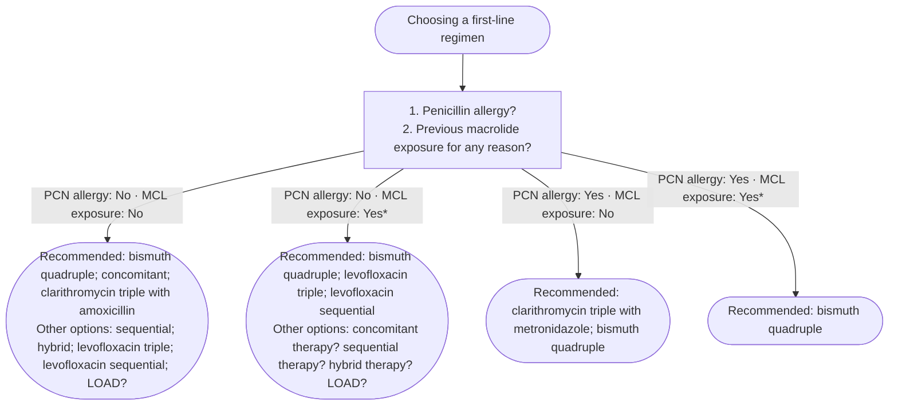
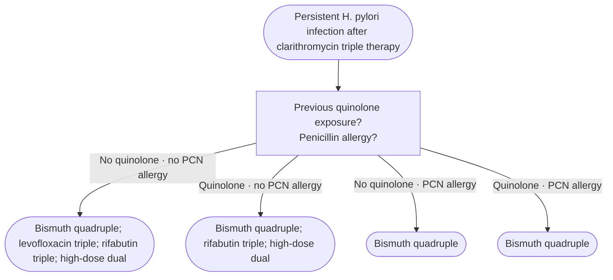
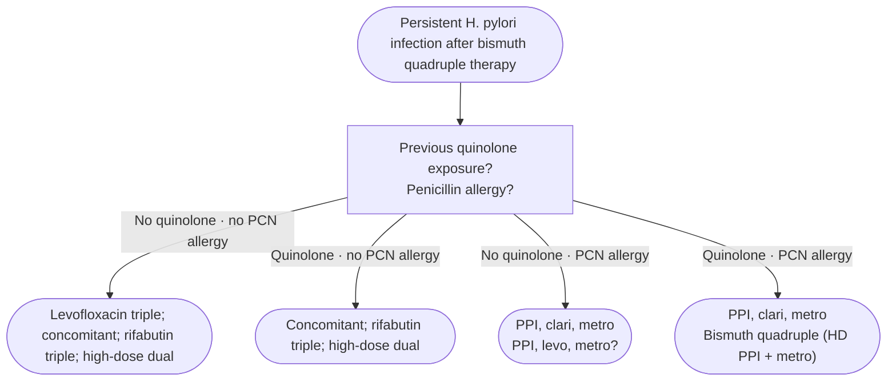

**Superseded.** This 2017 guideline has been replaced by the later American College of Gastroenterology (ACG) guideline on the same topic, [[acg-2024-hp-treatment|ACG 2024: Treatment of *H. pylori* Infection]]. Use ACG 2024 for current practice; this page records what the 2017 guideline said.

## Bibliographic Info

- **Article:** [Chey WD, Leontiadis GI, Howden CW, Moss SF. ACG Clinical Guideline: Treatment of Helicobacter pylori Infection. *Am J Gastroenterol* 2017;112:212–238.](https://doi.org/10.1038/ajg.2016.563)
- **Authors:** William D. Chey, Grigorios I. Leontiadis, Colin W. Howden, Steven F. Moss
- **Year:** 2017 (received 28 June 2016; accepted 7 October 2016; published online 10 January 2017; February 2017 issue)
- **Journal/Publisher:** The American Journal of Gastroenterology, vol 112, pp 212–238 — ACG
- **DOI:** [10.1038/ajg.2016.563](https://doi.org/10.1038/ajg.2016.563)
- **Type:** Guideline
- **Copyright:** "© 2017 by the American College of Gastroenterology"
- **Method (p. 212–213):** Grading of Recommendations Assessment, Development and Evaluation (GRADE) system; statements built from patient population, intervention, comparison, outcome (PICO) questions; literature search of MEDLINE, EMBASE and Cochrane CENTRAL from 2000 to 11 September 2014. Quality of evidence: high / moderate / low / very low. Strength: strong or conditional. Some statements are labelled "factual statement" or "no recommendation" instead.
- **Scope (p. 212):** clinicians in North America, defined as the United States and Canada; updates the 2007 ACG guideline.
- **Wording convention (p. 220):** in the regimen statements the authors use "recommended" vs "suggested" to signal their preference.
- **Statement numbering:** the guideline does not number its statements; they are grouped under nine questions (Table 1, p. 214–215). This page cites them as "Q*n*" plus the page where the statement is printed.

## Summary

*Helicobacter pylori* (*H. pylori*) causes peptic ulcer disease and gastric cancer and may play a role in uninvestigated and functional dyspepsia, ulcer risk with low-dose aspirin or a new non-steroidal anti-inflammatory medication, unexplained iron deficiency anemia, and idiopathic thrombocytopenic purpura (abstract, p. 212). Every patient with a positive test of active infection should be offered treatment, so the guideline frames the question as whom to test (Q2).

Before choosing a regimen, ask about previous antibiotic exposure. Clarithromycin triple therapy is confined to patients with no previous macrolide exposure in regions where clarithromycin resistance is known to be <15%. Most patients are better served by first-line bismuth quadruple therapy or concomitant therapy (a proton pump inhibitor [PPI], clarithromycin, amoxicillin and metronidazole) (abstract; Q3; Figure 1).

When first-line therapy fails, the salvage regimen should avoid antibiotics previously used. After a clarithromycin-containing first-line regimen, bismuth quadruple or levofloxacin salvage is preferred; after first-line bismuth quadruple therapy, clarithromycin- or levofloxacin-containing salvage is preferred (abstract; Q8; Figure 3). Testing to prove eradication should follow every treatment (Q7). Patients with a penicillin-allergy history should be considered for allergy testing after first-line failure (Q9).

## Recommendations

Every statement from Table 1 (p. 214–215), each also printed under its question in the text. Strength and quality of evidence exactly as printed.

### Q1 — Epidemiology and High-Risk Groups (p. 213)

| Statement | Strength; quality of evidence |
|---|---|
| *H. pylori* infection is chronic and usually acquired in childhood; exact means of acquisition not always clear. Incidence and prevalence generally higher among people born outside North America than among people born here. Within North America, prevalence is higher in certain racial and ethnic groups, the socially disadvantaged, and people who have immigrated to North America | Factual statement; low |

### Q2 — Indications to Test For, and to Treat (p. 213, 215)

| Statement | Strength; quality of evidence |
|---|---|
| All patients with a positive test of active infection should be offered treatment, so the critical issue is **which patients should be tested** | Strong; not applicable |
| **Test** all patients with active peptic ulcer disease (PUD); a past history of PUD (unless previous cure of *H. pylori* has been documented); low-grade gastric mucosa-associated lymphoid tissue (MALT) lymphoma; or a history of endoscopic resection of early gastric cancer (EGC). Offer treatment to those who test positive | Strong; high for active or history of PUD, low for MALT lymphoma, low for history of endoscopic resection of EGC |
| **Uninvestigated dyspepsia**, age under 60 years, without alarm features: non-endoscopic testing for *H. pylori* is a consideration; offer eradication therapy if positive | Conditional; high for efficacy, low for the age threshold |
| When upper endoscopy is undertaken in patients with **dyspepsia**, take gastric biopsies to evaluate for *H. pylori*; offer eradication therapy if infected | Strong; high |
| Typical symptoms of gastroesophageal reflux disease (GERD) without a history of PUD: **need not be tested**. If tested and infected, offer treatment, acknowledging that effects on GERD symptoms are unpredictable | Strong; high |
| **Long-term, low-dose aspirin:** testing could be considered to reduce the risk of ulcer bleeding; offer eradication therapy if positive to reduce that risk | Conditional; moderate |
| **Initiating chronic non-steroidal anti-inflammatory drug (NSAID) treatment:** test for *H. pylori*; offer eradication therapy if positive | Strong; moderate |
| **Already taking an NSAID:** the benefit of testing and treating remains unclear | Conditional; low |
| **Unexplained iron deficiency anemia** despite an appropriate evaluation: test; offer eradication therapy if positive | Conditional; **low** in Table 1 (p. 214) — **high** in the statement printed under Q2 (p. 215) |
| **Adults with idiopathic thrombocytopenic purpura (ITP):** test; offer eradication therapy if positive | Conditional; very low |
| **Insufficient evidence** to support routine testing for and treatment of *H. pylori* in asymptomatic individuals with a family history of gastric cancer, or in patients with lymphocytic gastritis, hyperplastic gastric polyps, or hyperemesis gravidarum | No recommendation; very low |

### Q3 — First-Line Treatment in North America (p. 219–220)

| Statement | Strength; quality of evidence |
|---|---|
| Ask about any previous antibiotic exposure(s) and take it into consideration when choosing a regimen | Conditional; moderate |
| **Clarithromycin triple** (PPI + clarithromycin + amoxicillin or metronidazole) for **14 days** remains a recommended treatment option in regions where *H. pylori* clarithromycin resistance is known to be **<15%** and in patients with **no previous history of macrolide exposure for any reason** | Conditional; low (for duration: moderate) |
| **Bismuth quadruple** (PPI + bismuth + tetracycline + a nitroimidazole) for **10–14 days** is a recommended first-line option; particularly attractive with any previous macrolide exposure or penicillin allergy | Strong; low |
| **Concomitant** (PPI + clarithromycin + amoxicillin + a nitroimidazole) for **10–14 days** is a recommended first-line option | Strong; low (for duration: very low) |
| **Sequential** (PPI + amoxicillin for 5–7 days, then PPI + clarithromycin + a nitroimidazole for 5–7 days) is a suggested first-line option | Conditional; low (for duration: very low) |
| **Hybrid** (PPI + amoxicillin for 7 days, then PPI + amoxicillin + clarithromycin + a nitroimidazole for 7 days) is a suggested first-line option | Conditional; low (for duration: very low) |
| **Levofloxacin triple** (PPI + levofloxacin + amoxicillin) for **10–14 days** is a suggested first-line option | Conditional; low (for duration: very low) |
| **Fluoroquinolone sequential** (PPI + amoxicillin for 5–7 days, then PPI + fluoroquinolone + nitroimidazole for 5–7 days) is a suggested first-line option | Conditional; low (for duration: very low) |

### Q4–Q7 — Predictors, Resistance, Resistance Testing, Test of Cure (p. 225–227)

| Question | Statement | Strength; quality of evidence |
|---|---|---|
| Q4 Predictors of success (p. 225) | Main determinants of successful eradication: choice of regimen, adherence to a multi-drug regimen with frequent side-effects, and sensitivity of the strain to the antibiotics given | Factual statement; moderate |
| Q5 Resistance in North America (p. 226) | Data on antibiotic resistance among North American strains remain scarce; organized efforts are needed to document local, regional and national resistance patterns to guide therapy | Strong; low |
| Q6 Resistance testing (p. 226) | Antimicrobial resistance can be determined by culture and/or molecular testing; these tests are currently not widely available in the United States | Strong; moderate |
| Q7 Test of cure (p. 227) | Whenever *H. pylori* is identified and treated, **test to prove eradication** with a urea breath test, fecal antigen test or biopsy-based testing **at least 4 weeks after** completing antibiotics and **after PPI therapy has been withheld for 1–2 weeks** | Strong; low (for the choice of methods to test for eradication: moderate) |

### Q8 — Salvage Therapy (p. 227–228)

| Statement | Strength; quality of evidence |
|---|---|
| Persistent infection: every effort should be made to **avoid antibiotics previously taken** by the patient (unchanged from the previous ACG guideline) | Strong; moderate |
| First-line regimen **contained clarithromycin** → bismuth quadruple or levofloxacin salvage regimens preferred. Choose by local antimicrobial resistance data and the patient's previous antibiotic exposure | Conditional; see individual statements |
| First-line **bismuth quadruple** → clarithromycin- or levofloxacin-containing salvage regimens preferred. Choose by local antimicrobial resistance data and the patient's previous antibiotic exposure | Conditional; see individual statements |
| **Bismuth quadruple for 14 days** — recommended salvage regimen | Strong; low |
| **Levofloxacin triple for 14 days** — recommended salvage regimen | Strong; moderate (for duration: low) |
| **Concomitant for 10–14 days** — suggested salvage regimen | Conditional; very low |
| **Clarithromycin triple should be avoided** as salvage | Conditional; low |
| **Rifabutin triple** (PPI + amoxicillin + rifabutin) **for 10 days** — suggested salvage regimen | Conditional; moderate (for duration: very low) |
| **High-dose dual** (PPI + amoxicillin) **for 14 days** — suggested salvage regimen | Conditional; low (for duration: very low) |

### Q9 — Penicillin Allergy (p. 232)

| Statement | Strength; quality of evidence |
|---|---|
| Most patients with a history of penicillin allergy do not have true penicillin hypersensitivity. After failure of first-line therapy, consider referral for **allergy testing**, since the vast majority can ultimately be given amoxicillin-containing salvage regimens safely | Strong; low |

## Regimen Tables

### First-Line Regimens (Table 2, p. 221)

"Recommended first-line therapies for *H pylori* infection." The guideline prints no entry in the blank cells.

| Regimen | Drugs (doses) | Dosing frequency | Duration (days) | Food and Drug Administration (FDA) approval |
|---|---|---|---|---|
| **Clarithromycin triple** | PPI (standard or double dose) | twice daily (BID) | 14 | Yes ᵃ |
| | Clarithromycin (500 mg) | | | |
| | Amoxicillin (1 grm) or Metronidazole (500 mg three times daily [TID]) | | | |
| **Bismuth quadruple** | PPI (standard dose) | BID | 10–14 | No ᵇ |
| | Bismuth subcitrate (120–300 mg) or subsalicylate (300 mg) | four times daily (QID) | | |
| | Tetracycline (500 mg) | QID | | |
| | Metronidazole (250–500 mg) | QID (250); TID to QID (500) | | |
| **Concomitant** | PPI (standard dose) | BID | 10–14 | No |
| | Clarithromycin (500 mg) | | | |
| | Amoxicillin (1 grm) | | | |
| | Nitroimidazole (500 mg) ᶜ | | | |
| **Sequential** | PPI (standard dose) + Amoxicillin (1 grm) | BID | 5–7 | No |
| | PPI, Clarithromycin (500 mg) + Nitroimidazole (500 mg) ᶜ | BID | 5–7 | |
| **Hybrid** | PPI (standard dose) + Amox (1 grm) | BID | 7 | No |
| | PPI, Amox, Clarithromycin (500 mg), Nitroimidazole (500 mg) ᶜ | BID | 7 | |
| **Levofloxacin triple** | PPI (standard dose) | BID | 10–14 | No |
| | Levofloxacin (500 mg) | once daily (QD) | | |
| | Amox (1 grm) | BID | | |
| **Levofloxacin sequential** | PPI (standard or double dose) + Amox (1 grm) | BID | 5–7 | No |
| | PPI, Amox, Levofloxacin (500 mg QD), Nitroimidazole (500 mg) ᶜ | BID | 5–7 | |
| **LOAD** | Levofloxacin (250 mg) | QD | 7–10 | No |
| | PPI (double dose) | QD | | |
| | Nitazoxanide (500 mg) | BID | | |
| | Doxycycline (100 mg) | QD | | |

- ᵃ Several PPI, clarithromycin and amoxicillin combinations have achieved FDA approval. PPI, clarithromycin and metronidazole is not an FDA-approved regimen.
- ᵇ PPI, bismuth, tetracycline and metronidazole prescribed separately is not an FDA-approved regimen. Pylera (a combination product containing bismuth subcitrate, tetracycline and metronidazole) combined with a PPI for 10 days is an FDA-approved regimen.
- ᶜ Metronidazole or tinidazole.
- LOAD = levofloxacin, omeprazole, nitazoxanide (Alinia) and doxycycline (p. 224).

### Salvage Regimens (Table 4, p. 232)

"Salvage therapies for *H pylori* infection."

| Regimen | Drugs (doses) | Dosing frequency | Duration (days) | FDA approval |
|---|---|---|---|---|
| **Bismuth quadruple** | PPI (standard dose) | BID | 14 | No ᵃ |
| | Bismuth subcitrate (120–300 mg) or subsalicylate (300 mg) | QID | | |
| | Tetracycline (500 mg) | QID | | |
| | Metronidazole (500 mg) | TID or QID | | |
| **Levofloxacin triple** | PPI (standard dose) | BID | 14 | No |
| | Levofloxacin (500 mg) | QD | | |
| | Amox (1 grm) | BID | | |
| **Concomitant** | PPI (standard dose) | BID | 10–14 | No |
| | Clarithromycin (500 mg) | BID | | |
| | Amoxicillin (1 grm) | BID | | |
| | Nitroimidazole (500 mg) | BID or TID | | |
| **Rifabutin triple** | PPI (standard dose) | BID | 10 | No |
| | Rifabutin (300 mg) | QD | | |
| | Amox (1 grm) | BID | | |
| **High-dose dual** | PPI (standard to double dose) | TID or QID | 14 | No |
| | Amox (1 grm TID or 750 mg QID) | TID or QID | | |

- ᵃ Same footnote as Table 2 ᵇ: separately prescribed bismuth quadruple is not FDA-approved; Pylera + a PPI for 10 days is.
- The text and the Figure 3 legend refer to the salvage table as "Table 3"; the table itself is printed as Table 4 (Table 3 is the resistance table).

## Treatment-Selection Algorithms

### First-Line Selection (Figure 1, p. 222)

Two key questions: is there a penicillin (PCN) allergy, and has there been previous macrolide (MCL) exposure for any reason?

*First-line H. pylori regimen by penicillin allergy and macrolide exposure*
*Source: redrawn from Figure 1 of the ACG 2017 H. pylori guideline*
*[[acg-2017-hp-guidelines|ACG 2017: Treatment of H. pylori Infection]]*
*PCN = penicillin · MCL = macrolide · LOAD = levofloxacin, omeprazole, nitazoxanide, doxycycline*

- \* In regions where clarithromycin resistance is known to be >15%, use the recommendations for patients with a history of macrolide exposure (Figure 1 footnote).
- The question marks after the "other options" are the guideline's own. Drugs, doses and durations: Table 2 above.

### Salvage Selection (Figure 3, p. 229)

Persistent infection: branch on the first-line regimen received, then on previous quinolone exposure and penicillin allergy.

*Salvage regimen after failed clarithromycin triple therapy*
*Source: redrawn from Figure 3 (left half) of the ACG 2017 H. pylori guideline*
*[[acg-2017-hp-guidelines|ACG 2017: Treatment of H. pylori Infection]]*
*PCN = penicillin*

*Salvage regimen after failed bismuth quadruple therapy*
*Source: redrawn from Figure 3 (right half) of the ACG 2017 H. pylori guideline*
*[[acg-2017-hp-guidelines|ACG 2017: Treatment of H. pylori Infection]]*
*PCN = penicillin · PPI = proton pump inhibitor · clari = clarithromycin · levo = levofloxacin · metro = metronidazole · HD = high dose*

- The question mark in "PPI, Levo, Metro?" is the guideline's own. Drugs, doses and durations: Table 4 above.

## Key Findings / Claims

Supporting text behind the statements; grades are in [[#Recommendations]].

### Who to Test (Q2 text, p. 216–219)

- No justification in North America for universal or population-based screening (p. 216)
- **PUD:** test all new or past PUD with a test of active infection (urea breath test, fecal antigen test, or mucosal biopsy-based testing at endoscopy). Documented PUD is a rare group where an IgG *H. pylori* antibody test is acceptable (higher pretest probability); otherwise tests of active infection are preferred over antibody testing. History of PUD already treated for *H. pylori* → eradication testing with urea breath test or fecal antigen test; treat ongoing infection (p. 216)
- **Gastric MALT lymphoma:** remains a key indication to test for and eradicate *H. pylori*; tumor regression in 60–93% after eradication in a 2009 review of six prospective cohorts (p. 216)
- **After endoscopic resection of gastric neoplasm:** eradication reduced metachronous gastric cancer — pooled odds ratio (OR) 0.42 (95% confidence interval [CI] 0.32–0.56) across 13 studies; incidence rate ratio 0.54 (95% CI 0.46–0.65) in a 24-study meta-analysis (p. 216)
- **Functional dyspepsia (FD):** number needed to treat (NNT) 14 to cure one patient (Cochrane, 17 randomized controlled trials [RCTs]; updated review of 21 trials, 95% CI 10–20). The text states "we recommend testing for, and treating, *H. pylori* in patients with FD" — this sentence is not one of the Table 1 statements (p. 217)
- **GERD:** no indication to test typical GERD unless there is also a history of PUD or dyspeptic symptoms; infected patients found for any reason should be offered treatment, acknowledging GERD symptoms are unlikely to improve (p. 217)
- **Low-dose aspirin:** "we suggest testing for *H. pylori* when starting prophylactic low-dose aspirin," acknowledging a weak evidence base (p. 218)
- **NSAIDs:** eradication before starting NSAIDs reduces ulcers and ulcer bleeding; in patients already on chronic NSAIDs, PPI therapy is a more effective ulcer risk-reduction strategy than eradication (p. 218)
- **Asymptomatic adults / gastric cancer:** Cochrane meta-analysis of six RCTs — gastric cancer 1.6% treated vs 2.4% untreated (relative risk [RR] 0.66; 95% CI 0.46–0.95); overall NNT 124. Estimated US NNT to prevent one case: 95 for men, 163 for women (p. 219)
- **ITP:** the American Society of Hematology (ASH) 2011 guideline suggested screening adults with ITP in whom eradication would be used if positive, and recommended against testing children with ITP (p. 218–219)

### First-Line Regimens (Q3 text, p. 220–225)

- Few, if any, regimens consistently achieve eradication rates exceeding 90% (p. 220)
- **Clarithromycin triple:**
  - 7 or 10 days in US/Canadian RCTs gave eradication below 80%; Cochrane: 14 vs 7 days RR 0.65 (NNT 12), 14 vs 10 days RR 0.69 → when used in North America, give for 14 days (p. 220)
  - University of Michigan 2001–15, 10–14 days first-line: overall 79.5% eradication in 662 patients, no significant difference across 5-year blocks (Figure 2, below) (p. 220, 222)
  - Eradication 22% with clarithromycin-resistant vs 90% with clarithromycin-sensitive strains (2010 meta-analysis) (p. 220)
  - Where clarithromycin resistance exceeds 15%, avoid clarithromycin triple. Ask all patients about previous macrolide exposure for any reason; if present, avoid clarithromycin triple (p. 221)
  - Ask about previous antibiotic exposure for any reason, particularly macrolides and fluoroquinolones, as a proxy for resistance; previous macrolide therapy for greater than 2 weeks is linked to treatment failure (p. 221)
- **Bismuth quadruple:** 10–14 days recommended; efficacy not affected by clarithromycin resistance; metronidazole resistance has less impact than clarithromycin resistance has on clarithromycin triple. Where clarithromycin resistance is known to be high, or after previous macrolide treatment for any reason, strongly consider bismuth quadruple as the initial choice (p. 223)
- **Concomitant:** no North American RCTs; meta-analysis mean cure 88%; at least as effective as clarithromycin triple with similar tolerability → recommended; duration of at least 10–14 days seems appropriate (p. 223)
- **Sequential:** 10-day sequential is a viable alternative to 14-day clarithromycin triple but cannot be endorsed as superior in North America; its complexity detracts from first-line relevance (p. 224)
- **Hybrid:** no North American RCTs; 14-day course promising; complexity may dampen enthusiasm (p. 224)
- **Levofloxacin-based:** fluoroquinolone resistance in North America may be as high as or higher than clarithromycin resistance. Fluoroquinolone sequential for 10–14 days or LOAD for 7–10 days "appear most promising" (p. 225). LOAD (US open-label RCT, 270 patients): 89% (7 days) and 90% (10 days) vs 73% for 10 days of lansoprazole, amoxicillin and clarithromycin (p. 224)
- **Probiotics:** meta-analysis of 10 trials — higher cure rates (pooled OR 2.07) and fewer side effects, but mostly Chinese studies at high risk of bias; optimal dose, timing and duration unknown. No graded statement (p. 225)

*University of Michigan first-line clarithromycin triple therapy eradication rates (Figure 2, p. 222)*

| Period | Patients (N) | Eradication (%) |
|---|---|---|
| Overall 2001–15 | 662 | 79.5 |
| 2001–05 | 162 | 79.6 |
| 2006–10 | 321 | 80.1 |
| 2011–15 | 179 | 78.2 |

### Predictors and Resistance (Q4–Q6 text, p. 225–227)

- Adherence: drop-out linked to number of daily doses; discuss benefits and adverse events with the patient to maximize adherence (p. 225)
- Smoking and diabetes associated with treatment failure (summary OR 1.95 and 2.19) (p. 225)
- Resistance to amoxicillin, tetracycline and rifabutin remains rare (under 5% each) (p. 225)
- Clarithromycin resistance reduces clarithromycin triple success by ~50%; levofloxacin resistance lowers levofloxacin regimens by ~20–40%; metronidazole resistance reduces eradication by ~25% in triple therapies, less in quadruple therapies; in vitro metronidazole resistance is not an absolute predictor of failure (p. 225–226)
- Molecular resistance testing (23S rRNA point mutations for clarithromycin; DNA gyrase subunit A mutations for levofloxacin) is not suitable for metronidazole and is not FDA- or CLIA-approved in the US (p. 226–227)
- In the absence of resistance testing, review prior antibiotic use and assume previous exposure is a surrogate for resistance to levofloxacin, clarithromycin or metronidazole (p. 227)

*Antibiotic resistance rates of H. pylori strains in the United States, 2009–2011 (Table 3, p. 226)*

| Antibiotic | Resistance rate (%) |
|---|---|
| Metronidazole | 20 |
| Clarithromycin | 16 |
| Levofloxacin | 31 |
| Tetracycline | <2 |
| Amoxicillin | <2 |
| Rifabutin | <2 |

- Table 3 data: single-center study of 128 strains from US veterans (Houston), and for rifabutin a review. Multiple resistance in 17% of strains (p. 226)

### Test of Cure (Q7 text, p. 227)

- Test at least 4 weeks after the end of therapy, off PPIs for 1–2 weeks; urea breath test, fecal antigen test and endoscopic tests are all highly sensitive and specific when done properly; choose by need for repeat endoscopy, availability, cost and payer
- Modeling supports cost-effectiveness of confirming eradication after bleeding peptic ulcer; may not be cost-effective for uncomplicated duodenal ulcer
- In functional dyspepsia, post-treatment testing helps decide whether to pursue other diagnoses
- In the overwhelming majority of situations where treatment is offered, eradication testing should be offered

### Salvage Regimens (Q8 text, p. 228–232)

- **Antibiotic re-use (p. 228):** do not re-use clarithromycin, fluoroquinolones or rifabutin empirically — resistance is not overcome by higher dose, longer duration or more frequent dosing. Amoxicillin or tetracycline can be re-used (resistance rare even after prior use). Generally avoid re-using metronidazole; if alternatives are predicted to be clearly inferior, it could be re-used within a 14-day bismuth quadruple course, especially if prior use was brief or low dose
- **Bismuth quadruple:** 14 vs 7 days RR 1.14 (four RCTs) → 14 days encouraged; pooled 14-day eradication 80% (p. 228–229)
- **Levofloxacin triple:** 10 or 14 days significantly more effective than 7 days; 500 mg once or twice daily showed no difference (p. 229–230)
- **Concomitant:** when a clarithromycin-containing salvage regimen is chosen, the committee recommends concomitant over clarithromycin triple (p. 230)
- **Clarithromycin triple repeated** after failure of the same regimen: pooled eradication 46% (p. 231)
- **Rifabutin triple:** 300 mg once daily for 10 days is appropriate; myelotoxicity (rare, almost always reversible) tends to occur at doses greater than 600 mg per day or with prolonged use; also weigh high cost and concern for inducing resistance in *Mycobacterium tuberculosis* (p. 231)
- **High-dose dual:** defined as total daily amoxicillin ≥3 g with dosing frequency ≥3/day; pooled eradication 78% across three RCTs (p. 231)
- **Not recommended as salvage:** sequential therapy (discouraging data); furazolidone (not available in the US; no RCTs; potential harms) (p. 231–232)
- **No recommendation as salvage:** hybrid therapy — insufficient evidence to support a recommendation (p. 232)

### Penicillin Allergy (Q9 text, p. 232)

- Regimens without amoxicillin, most notably bismuth quadruple, can be used in true allergy
- 5–10% of the US population report penicillin allergy; ~90% of them have negative skin testing and tolerate penicillin
- After 1 or 2 failed eradication attempts in a "penicillin-allergic" patient, consider investigating for true allergy; once excluded, prescribe amoxicillin-containing salvage regimens as for non-allergic patients

### Authors' Summary (p. 232–233)

- Concomitant therapy seems the best choice of the clarithromycin-containing quadruple therapies for both first-line and salvage therapy
- Levofloxacin sequential therapy offers the most robust first-line efficacy data among levofloxacin regimens (none evaluated in North America); levofloxacin triple remains an evidence-based salvage option
- Compared with the Toronto Consensus: both restrict clarithromycin triple and strengthen bismuth quadruple and concomitant therapy; Toronto recommends against sequential therapy and does not endorse hybrid or high-dose dual, whereas ACG 2017 conditionally recommends sequential and hybrid first-line and high-dose dual as rescue

## Relevance to Wiki

- Superseded by [[acg-2024-hp-treatment]], which governs [[helicobacter-pylori-infection]] and [[bismuth-quadruple-therapy]]; this page is the record of the 2017 positions
- Indications to test: [[peptic-ulcer-disease]], [[gastric-malt-lymphoma]], [[dyspepsia]], [[functional-dyspepsia]], [[gerd]], [[iron-deficiency-anemia]], [[test-and-treat]]
- Regimens and acid suppression: [[bismuth-quadruple-therapy]], [[proton-pump-inhibitors]]

## Contradictions / Open Questions

- **Iron deficiency anemia statement — quality of evidence printed two ways:** "low quality of evidence" in Table 1 (p. 214) vs "high quality of evidence" in the statement under Q2 (p. 215). Both say conditional recommendation.
- **Salvage table numbering:** the Q8 text ("A listing of available salvage treatment options can be found in Table 3", p. 228) and the Figure 3 legend point to "Table 3", but the salvage table is printed as Table 4 (p. 232); Table 3 is the US resistance-rate table (p. 226).
- **Bismuth quadruple metronidazole dose differs by line:** first-line 250–500 mg (QID for 250 mg; TID to QID for 500 mg; Table 2) vs salvage 500 mg TID or QID (Table 4).
- **Concomitant dosing frequency:** Table 2 gives a frequency only for the PPI (BID); Table 4 gives clarithromycin and amoxicillin BID and nitroimidazole BID or TID.
- **Clarithromycin resistance cut-off:** statements and Figure 1 use 15% (<15% to use; >15% treat as macrolide-exposed); the text cites Maastricht/Florence advice against triple therapy when resistance exceeds 15–20% (p. 220–221).
- Few North American trials exist for concomitant, sequential, hybrid or levofloxacin-based regimens; the authors call for North American trials and organized resistance surveillance (p. 220, 226).

## See Also

[[acg-2024-hp-treatment]], [[helicobacter-pylori-infection]], [[bismuth-quadruple-therapy]], [[test-and-treat]], [[peptic-ulcer-disease]], [[gastric-malt-lymphoma]], [[proton-pump-inhibitors]]
