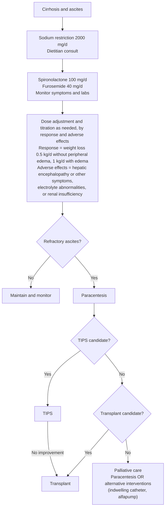

## Bibliographic Info
- **Article:** [Orman ES, Fortune BE, John BV, Asrani SK. AGA Clinical Practice Update on the Management of Ascites, Volume Overload, and Hyponatremia in Cirrhosis: Expert Review. Gastroenterology 2025;169:1547–1557.](https://doi.org/10.1053/j.gastro.2025.08.029)
- **Authors:** Eric S. Orman, Brett E. Fortune, Binu V. John, Sumeet K. Asrani
- **Year:** 2025
- **Journal/Publisher:** Gastroenterology (AGA Institute)
- **DOI:** [10.1053/j.gastro.2025.08.029](https://doi.org/10.1053/j.gastro.2025.08.029)
- **Type:** guideline (American Gastroenterological Association [AGA] Clinical Practice Update — Expert Review)

## Summary
AGA Expert Review on the practical management of three overlapping consequences of decompensated cirrhosis: ascites, volume overload (including hepatic hydrothorax and anasarca), and hyponatremia. Foundations are dietary sodium restriction and the lowest effective diuretic dose, with identification/treatment of decompensation triggers and early liver-transplant referral for refractory disease. The update extends standard ascites care to hepatic hydrothorax (therapeutic thoracentesis; transjugular intrahepatic portosystemic shunt [TIPS] for refractory cases), to inpatient volume overload (intravenous [IV] loop diuretics by bolus or continuous infusion, with cautious escalation), and to refractory anasarca (nephrology co-management — acetazolamide for contraction alkalosis, second-mechanism agents such as metolazone, or ultrafiltration). Hyponatremia is split into asymptomatic outpatient management (sodium + fluid restriction) and severe/symptomatic inpatient management (albumin, vasoconstrictors, hypertonic saline, vaptans, or renal replacement), all coordinated multidisciplinarily.

## Key Findings / Claims — Best Practice Advice (verbatim)

> ⚠ **Ungraded, and the document says so in its own Methods.** "Because formal systematic reviews were not performed, these BPA statements **do not carry formal ratings of the quality of evidence or strength** of the presented considerations." The statements **are** numbered 1–13 by the document itself. Never attach a GRADE rating or a strength to any of them.

> ⚠ **BPA 4 appears twice in the document, with two different populations, and the difference changes who gets referred.** The front-matter statement list (p 1547) says "**All patients with refractory ascites and/or hepatic hydrothorax**"; the in-text statement (p 1550) says "**All patients with ascites and/or HH**" — no *refractory*. The surrounding rationale supports the **broader** reading: "Given these poor outcomes, **all patients with cirrhosis and ascites** should be considered for transplantation, regardless of MELD score," with ascites-related 1-year mortality of 20%–50% regardless of MELD, annual mortality rising from <5% to 20% once ascites develops, and ascites as an independent predictor of mortality beyond MELD. **Refer on first ascites, not on refractoriness** — item 4 below quotes the narrower front-matter wording, which is what the published statement list prints.
1. **Best Practice Advice (BPA) 1:** Patients with cirrhosis with ascites, hepatic hydrothorax, or volume overload should be managed with dietary sodium restriction and diuretics at the lowest effective dose, with dose escalation guided by symptoms, weight, urine output, and electrolyte/renal monitoring. Education and referral to a dietitian should be provided for dietary management. Triggers of liver decompensation should be identified and addressed.
2. **BPA 2:** Patients with cirrhosis with new-onset ascites, or those admitted to the hospital for symptoms related to ascites or encephalopathy should receive diagnostic paracentesis as soon as possible. Testing should include serum ascites albumin gradient and cell count, Gram stain, and culture.
3. **BPA 3:** Patients with hepatic hydrothorax with dyspnea and/or hypoxemia should undergo a therapeutic thoracentesis for both symptom relief and expansion of the underlying lung.
4. **BPA 4:** All patients with refractory ascites and/or hepatic hydrothorax should be considered for liver transplantation evaluation, regardless of their Model for End-Stage Liver Disease score.
5. **BPA 5:** Refractory ascites and/or hydrothorax should be managed with therapeutic paracentesis and/or thoracentesis, respectively, with the frequency guided by recurrence.
6. **BPA 6:** When the volume of ascites removed is >5 L, 20%–25% intravenous albumin 6–8 g per every total liter removed should be administered. For patients with hypotension, renal insufficiency, or electrolyte abnormalities, albumin should also be considered for removal of smaller volumes.
7. **BPA 7:** Well-selected patients with refractory ascites, hepatic hydrothorax, volume overload, or hyponatremia should be referred for transjugular intrahepatic portosystemic shunt.
8. **BPA 8:** Diagnostic workup for the etiology of hyponatremia in cirrhosis should include dietary and medication history (diuretics, bowel regimen); review of electrolyte and kidney function; gastrointestinal bleeding assessment; infectious workup, including diagnostic paracentesis; and evaluation of secondary causes (thyroid or adrenal dysfunction).
9. **BPA 9:** Outpatient management of asymptomatic hypervolemic hyponatremia in liver cirrhosis entails both sodium and water restriction (aiming for 1–1.5 L of daily fluid intake), modification of diuretics and laxatives, and monitoring of electrolytes.
10. **BPA 10:** Inpatient management of severe or symptomatic hypervolemic hyponatremia in liver cirrhosis includes both sodium and water restriction; modification or discontinuation of diuretics and laxatives; and additional measures, such as intravenous albumin based on volume assessment or oral vasoconstriction therapy.
11. **BPA 11:** Recurrent or refractory hyponatremia management should involve a multidisciplinary approach (including the liver transplantation team when appropriate) and can consider several therapeutic options, including intravenous vasoconstrictor therapy, infusion of hypertonic saline, use of vasopressin receptor antagonist (vaptans), or use of renal replacement therapy.
12. **BPA 12:** Inpatient management of volume overload includes escalation or trial of intravenous loop diuretics (furosemide or bumetanide) in bolus (2–3 times per day) or continuous fashion. Cautious escalation can be done every 2–3 days with monitoring of volume status, kidney function, daily weights, and symptoms.
13. **BPA 13:** Advanced strategies in refractory anasarca should be coordinated with nephrology for consideration of diuretics in the setting of contraction alkalosis (eg, addition of acetazolamide), second agent with alternate mechanism of action (eg, thiazide diuretics, such as metolazone), or need for ultrafiltration.

### Table 1 — the four "refractory" definitions the BPAs turn on

| Term | Definition as the document gives it |
|---|---|
| **Refractory ascites** | Ascites that **cannot be mobilized**, or the **early recurrence of which cannot be satisfactorily prevented by medical therapy**. Subcategorized as **diuretic-resistant** (nonresponse to sodium restriction and diuretics) or **diuretic-intractable** (complications that prevent effective diuretic dose escalation) |
| **Refractory hepatic hydrothorax** | Hepatic hydrothorax (HH) **unresponsive to salt restriction and diuretic therapy**, requiring therapeutic thoracentesis |
| **Refractory hyponatremia** | **Ongoing hyponatremia despite maximal medical therapy** |
| **Refractory anasarca** | **Lack of improvement in volume status despite maximal diuretics and persistent low urine sodium** |

### Figure 1 — management of ascites in cirrhosis

*Figure — suggested dose ranges are **50–400 mg/d spironolactone** and **20–160 mg/d furosemide**. Recreated from Figure 1; the published figure is a line-art flowchart with no endoscopic or radiologic imagery. ([[aga-2025-ascites-cirrhosis]])*

### Other decision inputs the document supplies

- **Diuretic regimen:** combined furosemide and spironolactone in a **40:100 ratio** enhances natriuresis and diuresis while maintaining normokalemia, outperforming mineralocorticoid-receptor-antagonist monotherapy or sequential use. **Spironolactone typically started at 100 mg daily (range 50–400 mg), ideally as a once-daily morning dose** because of its long half-life and to avoid nocturia with evening dosing. **Furosemide usually starts at 40 mg daily (range 20–160 mg).** Amiloride and eplerenone are options for spironolactone-intolerant patients, **although they are less effective**. **Asymptomatic ascites may be managed with low-dose diuretics or sodium restriction alone.**
- **Diet:** sodium restriction **ideally <2000 mg/d**; **≥35 kcal/kg/d** (non-obese), micronutrient repletion, protein **1.2–1.5 g/kg**. Diets must not become so restrictive that they cause caloric or protein deficiency in an often-malnourished patient. **Fluid restriction is not needed in the absence of significant hyponatremia.**
- **Paracentesis fluid interpretation:** **SAAG ≥1.1 g/dL** strongly suggests portal hypertension; **<1.1 g/dL** warrants evaluation for other causes. Heart failure typically gives **SAAG ≥1.1 g/dL with high ascitic fluid protein (>2.5 g/dL)**. **Paracentesis within 12–24 hours of admission is associated with lower hospital mortality.** Culture by **bedside inoculation into blood culture bottles**.
- **Spontaneous bacterial peritonitis (SBP) and spontaneous bacterial empyema (SBE) share a threshold: neutrophil count >250/mm³**, with or without culture positivity, and without evidence of secondary peritonitis (SBP) or an alternative infectious source (SBE). **Thoracentesis is indicated for all hospitalized patients with cirrhosis and new-onset HH** because of the high risk of SBE, **even without signs of infection**.
- **Hepatic hydrothorax carries a >4-fold increase in mortality compared with refractory ascites.** It causes symptoms at **much lower fluid volumes** than ascites. **Chest tube placement for HH carries high morbidity and mortality and should be avoided**; indwelling tunneled pleural catheters have relatively low complication rates and may serve as palliation for non-transplant candidates or as a bridge for patients with short wait times.
- **Post-paracentesis bleeding is rare even with coagulopathy or thrombocytopenia; prophylactic transfusions are not advised.**
- **MELD exception:** the Organ Procurement and Transplantation Network currently offers **no standard MELD exception for HH**, although nonstandard exceptions may be granted individually for patients meeting criteria — **≥1 thoracentesis of >1 L weekly for 4 weeks, transudative fluid, no heart failure, negative cultures and cytology, and contraindications to TIPS**.

## Relevance to Wiki
- Updates [[ascites]] — adds hepatic hydrothorax management, inpatient IV loop diuretic strategy, refractory anasarca/nephrology co-management, and an expanded hyponatremia workup/treatment ladder (vasoconstrictors, renal replacement therapy [RRT]).
- Corroborates existing American Association for the Study of Liver Diseases (AASLD) 2021 ascites content (serum-ascites albumin gradient [SAAG]/cell-count paracentesis, albumin 6–8 g/L for large-volume paracentesis [LVP] >5 L, TIPS for refractory ascites, liver transplant [LT] referral, vaptan cautions).
- Cross-links: [[spontaneous-bacterial-peritonitis]], [[aki-in-cirrhosis]], [[hepatic-encephalopathy]], [[portal-hypertension]], [[liver-transplantation]] (TIPS recommended for well-selected refractory cases).

## Contradictions / Open Questions

- **Internal to the document: BPA 4's population differs between its two printings** — "all patients with **refractory** ascites and/or HH" in the front-matter statement list versus "all patients with ascites and/or HH" in the body, where the rationale clearly argues the broader case. See the flag above the statement list. This is the one place where quoting the published statement verbatim would narrow the referral population against the document's own reasoning.
- Otherwise **consistent with [[aasld-2021-ascites-sbp-hrs]]; no material conflict.** The AGA Clinical Practice Update (CPU) is the newer same-tier (guideline) source and extends rather than overturns AASLD recommendations.
- **No numeric trigger is given for "well-selected" in BPA 7** (referral for transjugular intrahepatic portosystemic shunt). The document names TIPS candidacy as a decision node in Figure 1 but defers the selection criteria themselves; they live on [[tips]].
- **BPA 12 gives the loop-diuretic *strategy* (bolus 2–3 times per day or continuous, escalate every 2–3 days) but no intravenous doses** for furosemide or bumetanide. The oral starting doses in Figure 1 are the only numbers the document prints.

## See Also

[[ascites]], [[hepatic-hydrothorax]], [[cirrhosis]], [[spontaneous-bacterial-peritonitis]], [[aki-in-cirrhosis]], [[hepatic-encephalopathy]], [[portal-hypertension]], [[liver-transplantation]], [[tips]], [[nutrition-in-liver-disease]]
