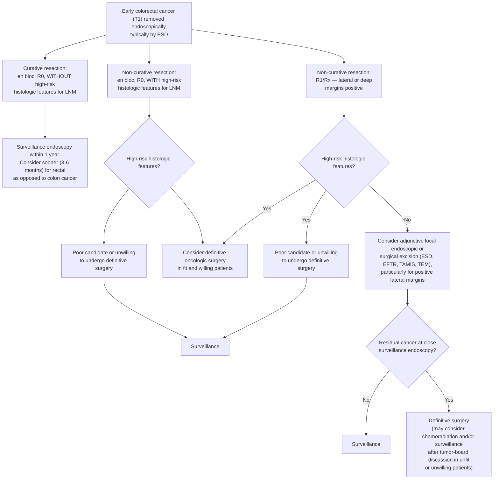

# AGA Clinical Practice Update on Endoscopic Resection for Early Colorectal Cancer: Commentary (2025)

## Bibliographic Info
- **Article:** [Ngamruengphong S, Othman MO, Wang AY, Yang D. AGA Clinical Practice Update on Endoscopic Resection for Early Colorectal Cancer: Commentary. Gastroenterology 2025;169:1558–1564.](https://doi.org/10.1053/j.gastro.2025.09.001)
- **Authors:** Saowanee Ngamruengphong, Mohamed O. Othman, Andrew Y. Wang, Dennis Yang
- **Year:** 2025
- **Journal/Publisher:** Gastroenterology 2025;169(7):1558–1564
- **DOI:** [10.1053/j.gastro.2025.09.001](https://doi.org/10.1053/j.gastro.2025.09.001)
- **Type:** American Gastroenterological Association (AGA) Institute Clinical Practice Update — **Expert Commentary format**

**Format.** Commissioned and approved by the AGA Clinical Practice Updates Committee and the AGA Governing Board, with internal and external peer review. As an Expert Commentary it issues **no Best Practice Advice statements, no numbered recommendations, and no evidence-quality or strength-of-recommendation ratings** — all guidance is narrative expert opinion. Every item below is ungraded; any numbering is the wiki's, not the document's.

Stated target audience: primary care, gastroenterology, pathology, and surgical health care professionals.

## Summary
AGA Expert Commentary on the endoscopic management of T1 colorectal cancer (CRC) — cancer with invasion confined to the submucosa, without invasion of the muscularis propria. It reviews the definition of early CRC, the role of endoscopic resection, histopathologic factors driving risk of lymph node metastasis (LNM) and recurrence, and post-resection management (surveillance vs adjuvant surgery). Its clinical claims are drawn largely from US Multi-Society Task Force on Colorectal Cancer (USMSTF), European Society of Gastrointestinal Endoscopy (ESGE), and Japan Gastroenterological Endoscopy Society (JGES)/Japanese Society for Cancer of the Colon and Rectum (JSCCR) guidance.

Optical lesion assessment is the first critical step. Endoscopists should recognize features suggesting submucosal invasion (SMI) — depressed/excavated lesions, irregular pit/vascular pattern, Narrow-Band Imaging International Colorectal Endoscopic Classification (NICE) type 3, and lateral-spreading granular-mixed or nongranular lesions. Optical diagnosis alone is highly operator-dependent, with sensitivity for cancer in the 40%–50% range among Asian and non-Asian endoscopists alike; when diagnosis is unclear or CRC is highly suspected, refer to a high-volume center with resection and pathology expertise. Suspected T1 CRC should ideally be removed **en bloc**, because piecemeal resection prevents accurate histologic assessment and is itself an independent risk factor for luminal recurrence.

Endoscopic submucosal dissection (ESD), with its higher en-bloc rate than endoscopic mucosal resection (EMR) regardless of size, is often the preferred strategy for suspected superficially invasive T1 CRC; endoscopic full-thickness resection (EFTR) is a reasonable alternative for select T1 CRCs <2 cm where deep SMI is suspected. Resection is considered curative when all five criteria are met. Importantly, emerging data downgrade deep SMI as a solitary risk factor: in a meta-analysis (Zwager et al), SMI alone carried an absolute LNM risk of only ~2.6% and was **not** an independent predictor of LNM. Lymphovascular invasion (LVI) is the strongest predictor of LNM; tumor budding (Bd 2/3) and adverse histology (G3/G4, signet ring, mucinous) also confer high risk.

Recurrence after curative endoscopic resection of low-risk T1 CRC is low (~0.7%) vs 7.0% for high-risk (noncurative) T1 CRC; most recurrences occur within 36 months and 96% within 72 months. For high-risk T1 CRC surgery remains standard, but >80% of "high-risk" cases have no LNM at surgery, so the decision should be individualized against operative morbidity. Rectal T1 CRC carries higher local-recurrence and LNM risk than colonic, but rectal surgery is more morbid — favoring organ-preserving strategies. Full-thickness scar resection (EFTR, transanal minimally invasive surgery [TAMIS], combined endo-lap) is an emerging alternative to completion surgery after R1/Rx margins without other risk factors.

## Key Findings / Claims
- **Definitions:** T1 CRC = neoplastic invasion through muscularis mucosae into submucosa, without muscularis propria invasion ("malignant polyp"); this is the National Comprehensive Cancer Network (NCCN) clinical definition of CRC. Without SMI the word *cancer* should be avoided, and so should *intramucosal adenocarcinoma* and *in situ adenocarcinoma* — those lesions are confined to the lamina propria, and including the word *adenocarcinoma* leads to misinterpretation and mismanagement.
- **Optical assessment and what to do when SMI is suspected:**
  - Recognize the morphologic features of SMI (depressed/excavated, irregular pit/vascular pattern, NICE type 3, lateral-spreading granular-mixed or nongranular) — they direct management.
  - Unclear diagnosis or high suspicion of CRC → **refer to a high-volume center** with endoscopic-resection and pathology expertise; misclassification risks unnecessary surgery for an endoscopically resectable lesion.
  - **Tattoo carefully**, so the tattoo does not spread underneath the lesion, to allow later endoscopic and surgical localization — **except** lesions in the **cecum or lower rectum**.
  - Suspicious for deep SMI (NICE type 3, excavated) → **biopsy + consideration for surgery** is reasonable. But underdiagnosis from biopsy alone (inadequate sampling/interpretation) is common and should not be underestimated — so **endoscopic local excision**, when technically feasible, is also a viable diagnostic strategy with curative potential, because patients needing additional surgery after noncurative endoscopic resection have long-term outcomes similar to primary surgery.
- **En-bloc imperative:** Suspected T1 CRC should be approached with en-bloc resection (USMSTF/ESGE/JGES). Piecemeal resection impairs histology and is an independent risk factor for luminal recurrence; NCCN states piecemeal-removed T1 inevitably requires adjuvant surgery (risk of understaging from compromised pathologic interpretation, plus local-recurrence risk).
- **Resection modality:** ESD preferred for suspected superficial T1 CRC (higher en-bloc rate irrespective of size); limited by complexity, learning curve, and inability to confidently resect deep SMI. EFTR reasonable for select T1 CRC <2 cm with suspected deep SMI.
- **Curative resection criteria (USMSTF/ESGE/JGES) — ALL five required:** (1) complete resection with histopathologic margins free of tumor; (2) superficial SMI (<1000 μm); (3) absence of LVI; (4) well-to-moderately differentiated histology (G1/G2); (5) low or absent tumor budding.
- **Depth of SMI:** Measured in micrometers by the JSCCR method — for **nonpedunculated** lesions, from the bottom of the muscularis mucosae, or from the surface of the lesion where the muscularis mucosae is not identifiable, to the invasive front. **Deep SMI = ≥1000 μm**.
- **Pedunculated lesions — depth is estimated by the Haggitt classification**, 5 levels:

| Level | Extent of invasion |
|---|---|
| 0 | Neoplastic cells confined to the mucosa |
| 1 | Invasion into the submucosa, but limited to the **head** of the polyp |
| 2 | Invasion extends into the **neck** of the polyp |
| 3 | Invasion into **any part of the stalk** |
| 4 | Invasion into the submucosa of the **underlying bowel wall below the stalk**, but above the muscularis propria |

- **Deep SMI is a weaker solitary risk factor than historically believed:** >95% of patients with deep SMI as the *only* high-risk criterion have no LNM. Meta-analysis (Zwager et al, 8 studies, 1146 pts): SMI as solitary risk factor → absolute LNM risk 2.6% (pooled incidence 2.83; 95% confidence interval [CI] 1.66–4.78); deep SMI was NOT an independent predictor of LNM; 37.9% of deep-SMI cancers had no other high-risk feature.
- **Operative risk:** Population cohort of 5170 surgical T1 CRC pts — 30-day mortality 1.7%, severe adverse events requiring re-intervention 8.3%.
- **LVI:** Neoplastic cells in a space bordered by a defined endothelium (lymphatics or blood vessels). **Strongest independent predictor of LNM** (relative risk [RR] 5.2; 95% CI 4.0–6.8). Reporting should ideally distinguish small- from large-vessel involvement — small-vessel involvement is more strongly associated with LNM. USMSTF/JSCCR/ESGE all consider LVI a high-risk criterion that should prompt surgery when present. Perineural invasion (PNI), though less well described in the endoscopic literature, is also a risk factor for LNM.
  - Immunostaining of lymphovascular endothelium improves interobserver agreement, but its role beyond hematoxylin and eosin (H&E) staining is not fully elucidated — unknown whether higher LVI-positivity rates translate into oncologic benefit or into overtreatment.
- **Tumor budding:** Single tumor cell or cluster of ≤4 cells at invasive margin. Bd1 = 0–4 buds (low); Bd2 = 5–9 (intermediate); Bd3 = ≥10 (high). Bd2/Bd3 → increased LNM (odds ratio [OR] 2.83 per Zwager). High-risk criterion (USMSTF/JSCCR/ESGE).
- **Adverse histology:** Poorly differentiated (G3), undifferentiated (G4), signet ring cell, mucinous → higher LNM and recurrence than well-to-moderately differentiated adenocarcinoma; independent LNM risk factor (OR 2.14, meta-analysis of 67 studies/21,238 pts). JSCCR classes poorly differentiated adenocarcinoma, signet ring cell carcinoma, and mucinous carcinoma as **advanced histology** and recommends surgery as additional treatment; USMSTF and ESGE likewise treat "poor"/"undifferentiated" histology as high-risk.
- **Pathology handling and its pitfalls:**
  - All CRC specimens, particularly after endoscopic resection, should be **reviewed by dedicated gastroenterology expert pathologists and discussed in a multidisciplinary board**.
  - No consensus on reporting histologic type when several differentiation levels coexist in one specimen: the World Health Organization (WHO) suggests grading by the **lowest** level of differentiation, Japanese guidelines by the **predominant** one.
  - Pathologic assessment of malignant polyps varies significantly between observers.
  - Residual **submucosal lifting agent** on the resected specimen can appear as amorphous substance **mimicking gastrointestinal mucin**.
- **Resection margins:** R0 = complete resection with both horizontal and vertical margins microscopically free of tumor. Lateral/horizontal positivity usually denotes risk of **local recurrence**; positive vertical/deep margin usually denotes **deeper tumor invasion and LNM** risk.
  - **Positive margin, as defined by both USMSTF and JSCCR** = carcinoma identified **at the submucosal margin** of the resected specimen.
  - **ESGE**: R0 resection should preferably have a **vertical margin ≥1 mm**; those **<1 mm but free of tumor** need **stricter follow-up, or surgery if other poor prognostic histologic features are present** (e.g., tumor budding).
  - The <1 mm cut-point is unsettled. Small observational studies linked margins <1 mm to residual cancer; a more recent multicenter T1 CRC study found local recurrence **not** significantly higher at **0.1–1 mm** (0.8%; 95% CI 0.1%–4.4%) vs >1 mm, in the absence of tumor budding. There is no clear consensus on what constitutes "free resection margins," and the commentary states that what constitutes margin positivity needs further research.
- **Surveillance after curative low-risk T1 CRC:** In a meta-analysis of 5167 endoscopically treated T1 CRC patients, pooled recurrence (local or distant) was **0.7% for low-risk (curative) vs 7.0% for high-risk (noncurative)** resection; **60% of recurrences within 36 mo, 96% within 72 mo**. Most low-risk recurrences are local with relatively low LNM risk → **surveillance colonoscopy alone, without nodal or distant-metastasis imaging**, is reasonable after curative resection of low-risk T1 CRC (long-term prospective data still needed).
  - Optimal intervals are not defined by clear evidence. For reference, metachronous CRC/recurrence was found in **1.7%** at surveillance colonoscopy 1 year after curative **surgical** CRC resection.
  - **JSCCR and ESGE:** surveillance colonoscopy **within 1 year** after endoscopic resection.
  - **NCCN:** surveillance colonoscopy at **1 year** after endoscopic curative resection of **colon** cancer, but **more frequent** surveillance for **rectal** cancer.
  - Outcomes after local excision of early-stage rectal cancer may be worse than for colon cancer → **sooner, more frequent surveillance after endoscopic resection of low-risk T1 rectal cancer is reasonable**.
- **High-risk T1 CRC:** Surgery is the standard of care, but the accepted prognostic factors do not weigh equally on LNM risk and **>80% of cases deemed high risk have no evidence of LNM at surgery** → individualize, balancing LNM/recurrence risk against the morbidity of surgery. **High-risk *rectal* T1 CRC treated endoscopically has significantly higher local recurrence and LNM than colonic lesions, yet rectal surgery is more morbid** → organ preservation is especially attractive there.
- **R1/Rx margins without other histologic risk factors:** Risk of intramural residual cancer **5%–11%** and of LNM **8%–9%**.
  - **ESGE and JSCCR:** endoscopic surveillance at **3–6 months** when only the **lateral** margin is positive and no other high-risk features are present.
  - **NCCN:** adjuvant surgery whenever a margin is positive, **irrespective of location** (lateral, vertical, or both).
  - **Full-thickness scar resection** — EFTR, TAMIS for rectal lesions, or combined endoscopic-laparoscopic surgery for colonic lesions — is an emerging alternative to completion surgery. Retrospective long-term data (median follow-up 64 mo) in T1 CRC with R1/Rx margins as the sole risk factor: CRC recurrence **2.2% (n=7) after adjuvant surgery vs 9.0% (n=8) after EFTR**; disease-free survival lower in the full-thickness group (**96.8% vs 89.9%; P = .019**), but 5 of the 8 recurrences were adequately salvaged by adjuvant surgery, giving **similar 5-year metastasis-free and overall survival**. Long-term and prospective data are still needed (prospective studies underway).

## Post-Resection Management Algorithm

Figure 2 of the commentary — suggested surveillance for malignant colorectal lesions removed by endoscopic resection. **Does not apply to hereditary cancer syndromes or inflammatory bowel disease (IBD).** High-risk histologic features in the algorithm are: poorly/undifferentiated histology; LVI or PNI; increased tumor budding. TEM in the algorithm is transanal endoscopic microsurgery.

*Figure 2 — suggested surveillance for malignant colorectal lesions removed by endoscopic resection; recreated from the commentary.*

## Conclusions of the Commentary

- Optimal management of T1 CRC remains complex and evolving; the decision to proceed with surgery should be individualized.
- Current prognostic factors all rely on histologic assessment and do not weigh equally on LNM risk.
- Because lesions are hard to categorize accurately and histopathology is needed for risk stratification, **en-bloc endoscopic resection — specifically ESD — can serve as both a diagnostic and a potentially curative initial approach in select cases**, given its lower morbidity and mortality than surgery and the similar long-term outcomes of secondary surgery after noncurative endoscopic resection.
- ESD is technically complex and may not be widely available in the community → **EFTR is a potential alternative in selected T1 CRC**.
- Future work: validate efficacy/safety of endoscopic resection for T1 CRC, refine selection criteria, and develop predictive models.

## Relevance to Wiki
- **[[colorectal-esd]]** — primary update: en-bloc imperative for suspected T1 CRC; ESD-preferred and EFTR (<2 cm deep SMI) framing; unified 5-point curative-resection criteria (USMSTF/ESGE/JGES); updated deep-SMI LNM data (Zwager: ~2.6% absolute risk, not independent predictor); post-resection surveillance for low-risk vs high-risk/noncurative T1; R1/Rx scar-resection alternative.
- **[[colorectal-cancer]]** — corroborates and dates the endoscopic-vs-surgical decision for early T1 CRC; adds individualization for high-risk T1 (>80% have no LNM) and rectal-vs-colonic distinctions.
- **[[polypectomy]]** — Haggitt levels 0–4 with their criteria; optical features of SMI and the tattooing rule (not in cecum or lower rectum; avoid spread under the lesion); biopsy vs endoscopic local excision when deep SMI is suspected.
- **[[endoscopic-full-thickness-resection]]** / **[[endoscopic-mucosal-resection]]** — EFTR for select T1 CRC <2 cm with suspected deep SMI, and full-thickness scar resection after R1/Rx; ESD's higher en-bloc rate than EMR irrespective of lesion size.

## Contradictions / Open Questions
- **Deep SMI as a surgical trigger:** Historically (and in the existing [[polypectomy]] "Favorable vs Unfavorable" table) deep SMI (≥1 mm) is an unfavorable criterion prompting surgical evaluation. This 2025 Clinical Practice Update (CPU) nuances that — deep SMI *in isolation* carries only ~2.6% LNM risk and is not an independent predictor — supporting individualized, organ-preserving decisions rather than automatic surgery.
- **Margin <1 mm:** Traditional ≥1 mm clear-margin threshold (USMSTF 2020) is questioned by newer multicenter data showing no significantly higher recurrence at 0.1–1 mm absent tumor budding; still unsettled.
- **Margin positivity — NCCN vs ESGE/JSCCR.** For an R1/Rx resection with no other high-risk feature, ESGE and JSCCR accept endoscopic surveillance at 3–6 months when only the lateral margin is positive; NCCN calls for adjuvant surgery for any positive margin, lateral or vertical. This commentary presents both and endorses an individualized approach, including local excision of the resection scar.
- **Definition of "free margin" is unsettled** — no consensus on what constitutes a free resection margin, and further research is needed on what counts as margin positivity and what it means for recurrence and metastasis.
- **Histologic grading rule differs between bodies** (WHO vs Japanese guidelines), so the same specimen can be graded differently.
- **Surveillance intervals after curative endoscopic resection of T1 CRC are not well defined** (no clear evidence); most data originate from Europe/Asia — additional study of regional and racial differences is needed before applying these findings to North American populations.

## See Also

[[colorectal-esd]], [[endoscopic-mucosal-resection]], [[endoscopic-full-thickness-resection]], [[polypectomy]], [[colorectal-cancer]], [[colonoscopy]]
