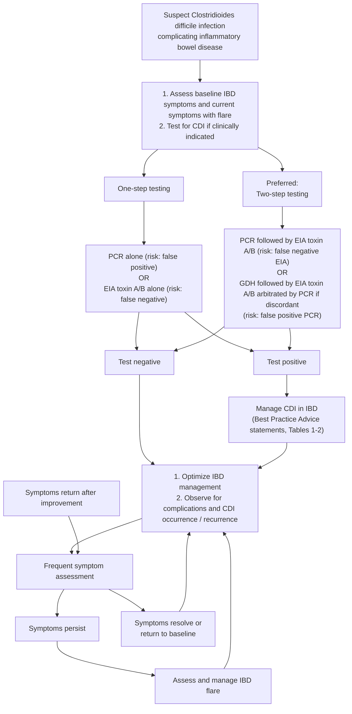

## Bibliographic Info
- **Article:** [Khanna S, Allegretti JR, Hashash JG, Feuerstadt P. AGA Clinical Practice Update on Management of Clostridioides difficile Infection in Inflammatory Bowel Disease: Expert Review. Gastroenterology 2026;171:184–192.](https://doi.org/10.1053/j.gastro.2026.03.008)
- **Authors:** Sahil Khanna, Jessica R. Allegretti, Jana G. Hashash, Paul Feuerstadt
- **Year:** 2026
- **Journal/Publisher:** Gastroenterology 2026;171:184–192
- **DOI:** [10.1053/j.gastro.2026.03.008](https://doi.org/10.1053/j.gastro.2026.03.008)
- **Type:** guideline (AGA Clinical Practice Update — Expert Review; Best Practice Advice, no formal evidence ratings)

## Summary

American Gastroenterological Association (AGA) Expert Review on managing *Clostridioides difficile* infection (CDI) specifically in patients with inflammatory bowel disease (IBD), who face higher CDI risk, greater severity, and higher recurrence than non-IBD patients. CDI drives IBD flares, hospitalization, intensified/failed therapy, and higher surgical rates, creating dilemmas around antibiotic choice and timing of IBD therapy.

Key shifts from general CDI guidance: **fidaxomicin is preferred over vancomycin** for an initial CDI episode in IBD (metronidazole should not be used), a **multistep toxin-based assay should be used** because nucleic acid amplification testing (NAAT) alone over-diagnoses colonization (common in IBD), and **immunosuppressive IBD therapy should be continued** during acute CDI. **Microbiome-based therapies** (US Food and Drug Administration [FDA]-approved fecal microbiota live-jslm [RBL] and fecal microbiota spores live-brpk [VOS], or unapproved fecal microbiota transplantation [FMT]) are advised after ≥1 recurrence. Probiotics are not advised for prevention.

**Numbering and grading.** The document numbers its own statements **Best Practice Advice (BPA) 1–12**; the numbering below is the document's, not the wiki's. Because no formal systematic review was performed, **none of the 12 statements carries a rating of evidence quality or strength** — there is no Grading of Recommendations Assessment, Development and Evaluation (GRADE) scheme, no "strong/conditional" vocabulary, and no evidence levels anywhere in the document. Supporting structure is carried instead by two tables (management outline; common pitfalls), one management algorithm (Figure 1), and three online supplementary tables.

## Key Findings / Claims

**Best Practice Advice (statement text verbatim; numbering the document's own; all ungraded).** Operative detail the document supplies for each statement is indented beneath it. Doses, durations and the stepwise testing algorithm live in *Table 1* below; co-management failure modes in *Table 2*.

1. In patients with IBD who have new or worsening diarrhea, CDI should be excluded, especially among those with colonic involvement, as they are at increased risk of CDI. Clinicians should consider and treat CDI in patients with end ileostomy or ileo-anal pouch anastomosis with worsening diarrhea.
   - Magnitude of risk: CDI risk is **up to 8× the general population** in IBD with colonic involvement, **even in the absence of antibiotic use**.
   - **Apart from prior CDI** (which confers higher CDI risk), **no clinical feature distinguishes CDI complicating IBD from an IBD flare** — hence test rather than attribute.
   - Symptom threshold used for CDI: **≥3 liquid stools in a 24-hour period, for 2 consecutive days**.
   - Pouch/ostomy: CDI detected in **10%–18%** of patients with ileal pouch–anal anastomosis; *C difficile* enteritis is increasingly recognised in end ileostomy with high stoma output.
   - Adjunctive tests do **not** discriminate: fecal calprotectin is raised by CDI itself (reducing its positive predictive value for an IBD flare during CDI); imaging shows nonspecific inflammatory change and is more useful for complications.
   - Institute infection-control precautions for suspected or confirmed CDI in IBD.
2. In patients with IBD and suspected CDI, a multistep toxin-based assay should be used for diagnostic evaluation.
   - **Preferred 2-step approach:** a highly sensitive first test — glutamate dehydrogenase (GDH) enzyme immunoassay (EIA) or nucleic acid amplification test/polymerase chain reaction (NAAT/PCR) — then a highly specific **toxin A/B EIA** to confirm active infection.
   - **NAAT/PCR positive + toxin A/B EIA negative → patient is likely a carrier, assumed not to have active CDI.** But EIA false negatives occur: if clinical suspicion is high, exercise clinical judgment.
   - **GDH positive + toxin A/B EIA negative** could mean a non–toxin-producing organism; because EIA sensitivity for toxins A/B is low, **PCR for the toxin genes arbitrates**.
   - Why not NAAT alone in IBD: asymptomatic colonization is more prevalent in IBD, so PCR positivity may reflect carriage rather than infection. The gold-standard cytotoxicity neutralization assay is time-consuming, expensive and impractical.
3. In patients with IBD and recent CDI who have been treated successfully with antibiotics, recurrent diarrhea should prompt retesting for CDI.
   - **Recurrent CDI (rCDI) defined:** recurrence of diarrhea **plus a confirmatory positive test** for CDI **within 8 weeks** of CDI treatment.
   - **Timing of the retest: at least 72 hours after stopping vancomycin**, to avoid false-negative results. The 2-step algorithm is again preferred, given the colonization rate in this population.
   - Scale of the problem: ~**20%–30%** of non-IBD patients recur after an initial episode and rates rise with each subsequent episode; rCDI rates are **33% higher** in IBD than non-IBD. Because diarrhea in IBD has several causes, rCDI must always be excluded rather than assumed.
4. In patients with IBD who develop an initial episode of CDI, clinicians should preferentially use fidaxomicin or use vancomycin if fidaxomicin is unavailable or cost-prohibitive. Metronidazole should not be used.
   - **Why fidaxomicin:** narrow spectrum, targets *C difficile* and preserves gut microbiota diversity — important where dysbiosis and mucosal integrity are already compromised. Cure rates in IBD approximately **80%–90%**; similar cure to vancomycin but **significantly lower recurrence**.
   - Minimal systemic absorption of fidaxomicin and its metabolite OP-1118 in IBD, with high stool concentrations (phase IIIb/IV pharmacokinetic study).
   - **EXTEND** open-label trial (inpatients ≥60 years, CDI without IBD): extended-pulsed fidaxomicin vs standard 10-day vancomycin — sustained clinical cure **70% vs 59%**.
   - Patients with active CDI **on concomitant systemic antibiotics** may benefit from fidaxomicin instead of vancomycin.
   - **Metronidazole:** vancomycin is superior for initial clinical response; metronidazole is not recommended owing to high resistance and treatment failure.
   - Trial evidence is limited in IBD — most CDI trials exclude IBD because end points cannot be identified.
5. Clinicians should strongly consider hospitalization for patients with IBD and CDI who demonstrate features of severe colitis or systemic toxicity (eg, more than 6 bowel movements per day, severe abdominal pain, marked leukocytosis, hemodynamic instability, or other evidence of sepsis).
   - The listed features are the operative trigger. They have **not been combined into a validated score** — each is individually associated with medically refractory colitis and progression to fulminant CDI.
   - **Fulminant CDI is defined as severe CDI accompanied by hypotension, shock, ileus, or megacolon.**
   - Fulminant CDI in IBD needs a **multidisciplinary team** (infectious disease, gastroenterology, surgery). For patients failing conventional treatment, **early surgical consultation** is advised — timely colectomy can be life-saving in toxic megacolon or refractory colitis.
   - CDI is associated with higher in-hospital death rates in IBD.
6. When selecting an immunosuppressive therapy to treat IBD, no class or mechanism of action has a differential risk of CDI and, therefore, clinicians should choose the therapy that is best to treat the IBD.
   - Vedolizumab selectively inhibits lymphocyte trafficking to the intestine, raising concern for gastrointestinal infection, but **no association between CDI and vedolizumab vs anti–tumor necrosis factor (TNF) agents** has been found.
   - The CDI risk of each class of biologic and small molecule **has not been assessed** — so choose on what best treats the IBD, not on CDI risk.
7. In patients with IBD and acute CDI, concurrent treatment of IBD is critical and clinicians should continue therapy with the required immunosuppressive therapies (ie, immunomodulators, biologics, or small molecules). Steroids can also be used if deemed necessary while CDI is treated with antibiotics.
   - **Obtain the stool sample before antibiotics** — testing after antibiotics have started may give false negatives. If CDI results will be delayed, start CDI-directed antibiotics (after the sample is taken) at the same time as treating the inflammatory driver.
   - **Steroids:** associated with higher rates of adverse outcomes in IBD, including increased infection risk and worsening of CDI. Aim to start steroids **after** appropriate CDI-directed antibiotics; if CDI results are delayed and suspicion of an IBD flare is high, steroids can be started while waiting. Case-by-case risk–benefit, since poorly controlled IBD is itself life-threatening.
   - **Exception — fulminant CDI:** consider a **temporary hold of nonessential immunosuppressants** until there is some clinical improvement of the CDI.
   - Evidence base: retrospective analyses suggest continuing or escalating immunosuppression in IBD with CDI is safe when indicated; **randomized trials are lacking**, and data for newer biologics and small molecules (eg, Janus kinase inhibitors) on whether to hold, continue or escalate during acute CDI are not available.
8. Clinicians should consider endoscopic evaluation for IBD activity and exclusion of concomitant cytomegalovirus [CMV] infection if symptoms persist 48–72 hours after initiation of treatment for CDI.
   - Choose **flexible sigmoidoscopy or colonoscopy** according to the patient's historical IBD distribution and clinical status — it gives mucosal assessment, distribution of colitis, and histology.
   - Differential at 48–72 hours of non-response: IBD flare or another opportunistic infection such as CMV.
   - Patients with CDI and IBD **rarely have pseudomembranes**; they show **mucopurulent exudate** instead, so the two entities are hard to separate endoscopically — histology and historical appearance matter.
9. Clinicians may consider loperamide in patients with improving inflammation and infection but ongoing diarrhea.
   - **Not while the workup is under way**, and not in untreated or fulminant CDI — the historical concern is toxin retention in the colon and increased toxic megacolon risk.
   - Permitted once **anti-CDI antibiotics have been started and the patient is clinically improving**, in outpatients with ongoing diarrhea whose other systemic symptoms are improving. In a study of mild–moderate CDI treated with metronidazole or vancomycin plus an antimotility agent, no complications occurred, although the antimotility agent did not decrease symptom duration.
10. Clinicians should offer microbiome-based therapies (eg, fecal microbiota, live-jslm, fecal microbiota spores, live-brpk, or unapproved fecal microbiota transplantation) to patients with IBD with at least 1 recurrence of CDI to prevent future infection.
    - **RBL** — broad consortium, **single-dose enema given 1–3 days after completion of antimicrobials**.
    - **VOS** — encapsulated selective group of *Firmicutes* spores, **4 capsules daily for 3 consecutive days, 2–4 days after antimicrobials and a bowel lavage**.
    - Give microbiome therapy **after** completing antibiotics, with a washout (see *Table 1*); these therapies prevent recurrence rather than treat active infection.
    - **IBD-specific efficacy (RBL):** large phase 3 open-label study including **74 patients with IBD** — safety and efficacy consistent with conventional FMT; **treatment success 78.9% at 8 weeks**, **sustained clinical response 91.1% at 6 months**, comparable with non-IBD participants.
    - **No data for VOS in CDI with IBD.** Given similar mechanism and response it is reasonable to use **either** RBL or VOS in IBD on mild-to-moderate immunocompromising medications.
    - **FMT:** one prospective trial reported **90% efficacy at 8 weeks** in IBD. Concern that FMT might trigger an IBD flare was **not** borne out in that trial. In fulminant disease, FMT must be planned carefully around both the CDI and the IBD.
    - RBL and VOS are now the main options for microbiota restoration because major stool banks no longer provide specimens in the United States.
    - **Bezlotoxumab** (monoclonal antibody against toxin B, which reduced rCDI in high-risk populations including IBD) **was discontinued for commercial reasons — not for safety or efficacy.**
11. In patients with IBD, clinicians should not advise probiotics for primary or secondary prevention of CDI.
    - Evidence does not support routine use for either primary or secondary prevention in IBD; data in IBD specifically are limited and contradictory.
    - Rare but serious adverse events — **bacteremia and fungemia** — have been documented, especially in immunocompromised or severely ill patients.
    - Commonly used strains (*Lactobacillus*, *Bifidobacterium*) are **susceptible to vancomycin**, which undercuts the theoretical benefit of giving probiotics during CDI treatment.
12. In patients with IBD and a history of CDI who are receiving systemic antibiotics, clinicians may consider oral vancomycin prophylaxis as secondary prevention.
    - **The regimen, in full:** oral vancomycin **125 mg once to twice daily, started with the systemic antibiotics and continued until 5 days after they are completed**. Offered as a "may be used in high-risk patients **after informed decision making**" — the document explicitly attaches this to **weak evidence**.
    - **The trial behind the caution:** placebo-controlled, double-blind randomized trial of **81 adults (patients with IBD excluded)** who had completed CDI treatment within the past 180 days and were receiving systemic antibiotics. rCDI **43.6% with oral vancomycin prophylaxis vs 57.1% with placebo — not statistically significant**, likely because the study was underpowered.
    - **Harm signal:** vancomycin-resistant *Enterococcus* carriage was higher in the vancomycin group (**50% vs 24%**) at 8 weeks post treatment.
    - Supporting retrospective studies and meta-analyses suggest a reduction in rCDI risk in high-risk patients, but **the quality of evidence remains low**.

### Table 1 — Outline for management of CDI and IBD

| Step | Detail | Action |
|---|---|---|
| **1. Risk factors and patient assessment** | Medication history: recent or ongoing antibiotics · current immunosuppressive therapy · proton pump inhibitor use Disease status: active IBD flare or recent hospitalization · chronic comorbidities Health care exposure: frequent clinic or hospital visits · recent surgery or procedures | Identify and minimize modifiable risk factors (eg, stop unnecessary antibiotics, consider de-escalation of proton pump inhibitors if possible) |
| **2. Diagnostic considerations** | Symptom check: new-onset or worsening diarrhea (**3 or more loose stools per day**) · abdominal pain, fever, elevated inflammatory markers (eg, C-reactive protein and white blood cell count) Diagnostic tests — use a stepwise algorithm to separate true CDI from colonization, especially in symptomatic IBD flares: 1. **GDH + toxin EIA** — both positive → diagnose CDI; both negative → rule out CDI; GDH positive and toxin negative → confirm with NAAT (PCR) 2. **NAAT (PCR) alone** for *C difficile* toxin genes — highly sensitive but can detect colonization rather than active infection; interpret with caution in IBD 3. **NAAT (PCR) plus toxin EIA** — positive EIA with NAAT confirms the diagnosis; positive NAAT with negative EIA must be read with caution given low EIA sensitivity 4. **Toxin EIA** — more specific but less sensitive than NAAT 5. **Flexible sigmoidoscopy** (select cases) — may be indicated to rule out other causes of colitis flare or if the diagnosis is uncertain | Assess response to CDI antibiotic therapy and escalate care as needed |
| **3. Antibiotic management** | First-line: **oral fidaxomicin** (preferred, lower recurrence rates) · **oral vancomycin** if fidaxomicin is unavailable or cost-prohibitive · **do not use metronidazole** Duration: typically **10 days**; consider the **fidaxomicin EXTEND regimen** (eg, 200 mg orally twice daily for 5 days, then 200 mg once every other day for days 7–25). Consider **prolonged vancomycin (21–42 days)** for initial infection, or **vancomycin taper-pulse** regimens for complicated/recurrent cases | Adjust antibiotic choice — fidaxomicin over vancomycin |
| **4. Management of IBD therapy during active CDI** | Assess disease activity: distinguish CDI from IBD flare to avoid premature escalation of immunosuppression **Corticosteroids:** may be continued or initiated if there is high concern for a concurrent moderate-to-severe IBD flare, with caution and close monitoring of the infection response **Immunomodulators / biologics / small molecules:** continue if clinically indicated for IBD control; avoid abrupt cessation where possible, because uncontrolled IBD also worsens outcomes. In **fulminant CDI**, consider a temporary hold of nonessential immunosuppressants until there is some clinical improvement of CDI | Balance risk of worsening infection against risk of unchecked IBD inflammation; individualize on the severity of **both** CDI and IBD |
| **5. Recurrent or difficult-to-treat CDI — microbiome therapies and adjuncts** | Extended taper of oral vancomycin **Fidaxomicin for recurrence** — often effective for first or second recurrences **Microbiome-based therapies** — used after completion of antibiotics and a **washout (eg, 1–3 days off antibiotics)** for rCDI   · **FMT** — considered for **multiple recurrent (2 or more episodes)** CDI, or **fulminant CDI not responding to standard therapies**; efficacy in active IBD remains high   · **FDA-approved donor-derived therapies** — have shown efficacy and safety in CDI complicating IBD **Probiotics — do not use** | Use FMT for rCDI or refractory CDI per established protocols; counsel patients on potential benefits and risks |
| **6. Supportive care and follow-up** | Hydration and electrolytes: ensure fluid resuscitation and correct electrolyte imbalances Follow-up testing: routine **"test for cure" not advised unless symptoms persist**; monitor for recurrence (new or worsening symptoms) IBD activity monitoring: close gastroenterology follow-up to assess IBD disease activity and ensure adequate control during and after CDI treatment | Emphasize adequate hydration, symptom tracking and timely follow-up to detect recurrence or IBD flare early |

Table footnotes: fulminant CDI is defined as severe CDI accompanied by hypotension, shock, ileus, or megacolon. FMT may not be readily available at most United States sites as of 2025. FDA-approved donor-derived therapies are RBL and VOS; as of writing (2025), data for CDI in IBD are available for RBL.

### Table 2 — Common pitfalls in the co-management of CDI and IBD

| Pitfall | Why it occurs | Mitigation |
|---|---|---|
| **Failing to suspect CDI in an IBD flare** | New or worsening diarrhea in IBD is sometimes attributed solely to the flare, delaying CDI testing | Maintain high suspicion for CDI in any IBD flare with increased stool frequency; test promptly (eg, GDH/toxin or NAAT) |
| **Misinterpreting positive PCR — colonization vs infection** | NAAT (PCR) positivity may reflect colonization rather than true infection, especially in IBD | Use a 2-step approach (eg, GDH + toxin EIA, then PCR if discordant; or PCR screen followed by EIA/GDH confirmation) to confirm active CDI; interpret PCR in the clinical context (presence of symptoms) |
| **Inappropriate choice of CDI treatment** | Persisting with metronidazole, or suboptimal regimens for severe or recurrent CDI (eg, not opting for oral vancomycin prophylaxis) | Follow updated guidelines — fidaxomicin (preferred) or vancomycin over metronidazole for most CDI cases |
| **Delaying IBD therapy escalation when needed** | Fear of using immunosuppressants or biologics during CDI, resulting in undertreatment of an active flare | Differentiate active CDI from active IBD; **give 2–3 days of standard-of-care antibiotics before escalating IBD therapy**; collaborate with gastroenterology and/or infectious disease teams to adjust IBD therapy as clinically indicated |
| **Abruptly stopping immunomodulators or biologics** | Stopping IBD treatment out of fear of worsening infection can lead to an uncontrolled IBD flare | Evaluate severity of infection vs IBD activity before altering immunosuppressive regimens; consider temporary hold only if clinically justified |
| **Overuse of proton pump inhibitors** | Proton pump inhibitors can increase CDI risk through changes in gastric pH and gut microbiota, but are frequently prescribed for gastrointestinal symptoms without ongoing need | Re-evaluate the indication at each visit; use the lowest effective dose or discontinue if no clear indication |
| **Lack of follow-up after CDI treatment** | Patients may not be monitored closely post-treatment, risking missed recurrences or complications in a population with baseline gastrointestinal symptoms | Schedule follow-up appointments to assess symptom resolution or recurrence; encourage prompt reporting of new or worsening diarrhea |
| **Delayed or underused microbiota-based therapies** | rCDI in IBD can be severe, yet clinicians may be slow to implement FMT over concerns about possible IBD flares or unfamiliarity with FMT protocols | Consider microbiota-based therapies after initial or multiple recurrences, or failure of first-line treatments; coordinate with experienced centers for optimal patient selection and procedure safety |

### Figure 1 — Proposed management algorithm for CDI in patients with IBD

*Figure 1 — proposed management algorithm for CDI in patients with IBD, redrawn from the source figure. ([[aga-2026-cdiff-ibd]])*

## Relevance to Wiki
- [[clostridioides-difficile]] — updates the IBD special-population guidance (fidaxomicin-preferred initial therapy; cytomegalovirus (CMV) exclusion at 48–72h; loperamide adjunct; microbiome therapy after first recurrence; oral vancomycin prophylaxis (OVP) for secondary prevention; treat end-ileostomy/pouch).
- [[ulcerative-colitis]], [[crohns-disease]], [[inflammatory-bowel-disease]] — concurrent IBD therapy continuation during CDI; no drug-class differential CDI risk.
- [[aga-2024-fmt]], [[probiotics]] — corroborates microbiome therapy for recurrent CDI and against probiotics.

- [[fmt]] — administration detail for the two FDA-approved products in this setting (RBL single-dose enema 1–3 days after antimicrobials; VOS 4 capsules daily × 3 days, 2–4 days after antimicrobials plus bowel lavage), the 1–3 day washout, and the IBD-specific RBL efficacy data.
- [[cdiff-antibiotics]] — fidaxomicin EXTEND regimen, prolonged vancomycin 21–42 days, taper-pulse for complicated/recurrent cases in IBD.

## Contradictions / Open Questions
- **Oral vancomycin prophylaxis (OVP) — the two 2026 AGA updates disagree.** This IBD-specific CPU (BPA 12) says clinicians **may consider** OVP as secondary prevention in IBD with prior CDI receiving systemic antibiotics, giving the regimen (125 mg once to twice daily, through the systemic course plus 5 days) and explicitly calling the evidence weak. The same-year [[aga-2026-cdiff-adults|AGA 2026 CPU on CDI in adults]] (BPA 12) advises **against** vancomycin during systemic antibiotics to prevent CDI. Both read the same underpowered 81-patient trial; this update additionally reports higher vancomycin-resistant *Enterococcus* carriage (50% vs 24%). The general adult page follows the adults CPU; the IBD-specific permission is retained as narrower guidance for this population. Surfaced on [[clostridioides-difficile]].
- **Initial-episode antibiotic choice:** This 2026 Clinical Practice Update (CPU) prefers **fidaxomicin** first-line for initial CDI in IBD, whereas the older [[acg-2021-cdiff]] lists vancomycin 125 mg 4 times daily (QID) (≥14 days) as the IBD first-line. As the newer same-tier guideline, the AGA 2026 preference is what the page asserts; the American College of Gastroenterology (ACG) vancomycin pathway remains acceptable when fidaxomicin is unavailable/cost-prohibitive. Surfaced on [[clostridioides-difficile]].
