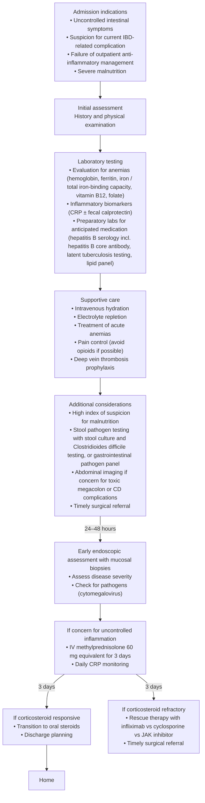
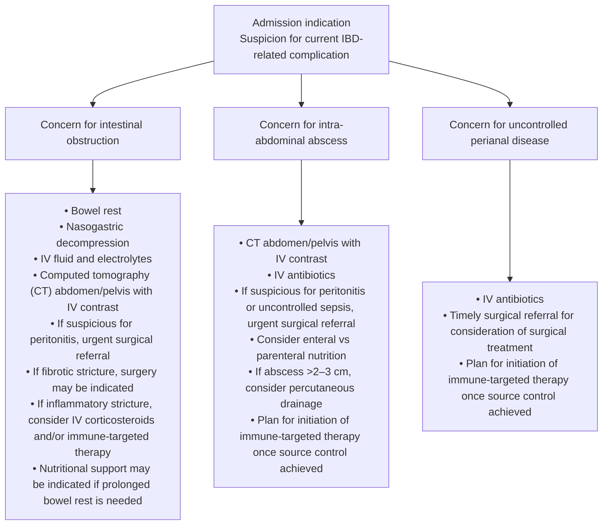

## Bibliographic Info
- **Article:** [Cohen-Mekelburg S, Hashash JG, Loftus EV Jr, Rubin DT. AGA Clinical Practice Update on Inpatient Management of Adults With Inflammatory Bowel Disease: Expert Review. Gastroenterology 2026;170:408–417.](https://doi.org/10.1053/j.gastro.2025.08.039)
- **Authors:** Shirley Cohen-Mekelburg, Jana G. Hashash, Edward V. Loftus Jr, David T. Rubin
- **Year:** 2026
- **Journal/Publisher:** Gastroenterology 2026;170:408–417
- **DOI:** [10.1053/j.gastro.2025.08.039](https://doi.org/10.1053/j.gastro.2025.08.039)
- **Type:** guideline (AGA Clinical Practice Update — Expert Review; Best Practice Advice, no formal evidence ratings)
- **Dates:** received May 14, 2025; accepted August 20, 2025

## Contents
- [[#Bibliographic Info]]
- [[#Summary]]
- [[#Methods and Grading]]
- [[#Best Practice Advice]]
- [[#Figure 1 — Inpatient Management of IBD-Related Inflammation]]
- [[#Figure 2 — Inpatient Management of CD-Related Complications]]
- [[#Supporting Detail]]
  - [[#Admission — BPA 1]]
  - [[#Supportive Care — BPA 2]]
  - [[#Complications and Concomitant Infections — BPA 3]]
  - [[#Disease Activity — BPA 4]]
  - [[#VTE Prophylaxis — BPA 5]]
  - [[#Colectomy Counseling and Surgical Referral — BPA 6]]
  - [[#Intravenous Corticosteroids — BPA 7]]
  - [[#72-Hour Response Assessment — BPA 8]]
  - [[#Rescue Therapy — BPA 9]]
  - [[#CD with Intestinal Obstruction — BPA 10]]
  - [[#CD with Intra-abdominal Abscess — BPA 11]]
  - [[#CD with Active Perianal Symptoms — BPA 12]]
  - [[#Discharge — BPA 13]]
  - [[#Future Directions]]
- [[#Relevance to Wiki]]
- [[#Contradictions / Open Questions]]
- [[#See Also]]

## Summary

American Gastroenterological Association (AGA) Expert Review on inpatient management of hospitalized adults with inflammatory bowel disease (IBD) — both ulcerative colitis (UC) and Crohn's disease (CD). Hospitalization rates are 8.2–12.4 per 100,000 people annually for UC and 9.3–17.1 per 100,000 for CD; IBD-specific hospitalizations are falling as outpatient therapy improves, but inpatient care remains challenging — variable hospital-acquired complications, delays in surgery, and high 30-day readmission rates. Provides Best Practice Advice (BPA) across admission criteria, supportive care, complication and infection workup, venous thromboembolism (VTE) prophylaxis, acute severe ulcerative colitis (ASUC) treatment and monitoring, rescue therapy, CD complications (obstruction, abscess, perianal disease), and discharge planning.

Notable themes: patients are now more often admitted for **failing outpatient therapy** than for a fulminant presentation (refining admission criteria); growing questions about continuing **VTE prophylaxis after discharge**; and growing interest in **Janus kinase (JAK) inhibitors** as initial, potentially corticosteroid-sparing inpatient treatment for ASUC. **All hospitalized IBD patients without absolute contraindications should receive prophylactic anticoagulation.** ASUC: intravenous (IV) methylprednisolone 60 mg/day equivalent, assess response within 72 hours, prepare rescue therapy (infliximab, cyclosporine, or a JAK inhibitor) early, and obtain timely surgical consultation. C-reactive protein (CRP) is the real-time inpatient inflammatory biomarker that drives both admission and day-3 escalation decisions.

## Methods and Grading

- **13 Best Practice Advice statements, numbered 1–13 by the document itself.**
- The document performed **no systematic review**; by its own Methods statement the BPA statements **do not carry formal ratings of the quality of evidence or of the strength of the considerations**. There is no GRADE, no strength label (strong/conditional), and no evidence level anywhere in the paper.
- Statements were drawn from a review of the published literature and from expert opinion; internally peer-reviewed by the AGA Institute Clinical Practice Updates Committee and externally peer-reviewed by *Gastroenterology*.
- Statements are reproduced verbatim below.

## Best Practice Advice

1. Prompt hospitalization should be considered for adult patients with IBD who present with severe disease refractory to outpatient treatment when there is high suspicion for an IBD-related complication, such as intestinal obstruction or intra-abdominal abscess, or when there is significant nutritional risk or failure to thrive.
2. The initial management of hospitalized adult patients with IBD should include supportive care.
3. The initial management of hospitalized adult patients with IBD should include an evaluation for IBD-related complications and concomitant infections.
4. Hospitalized adult patients with IBD should have their disease activity assessed with both biomarkers and endoscopic evaluation, when indicated.
5. Hospitalized adult patients with IBD should receive prophylactic anticoagulation for prevention of venous thromboembolism.
6. Hospitalized adult patients with severe ulcerative colitis should be counseled on the potential need for colectomy and should have a timely referral for surgical consultation.
7. Hospitalized adult patients with severe ulcerative colitis should receive initial treatment with intravenous corticosteroids at a methylprednisolone 60-mg daily dose equivalent.
8. Hospitalized adult patients with severe ulcerative colitis should be monitored for treatment response within 72 hours of medical treatment initiation.
9. Preparations should be made for initiating rescue therapy in hospitalized adult patients with severe ulcerative colitis who are not responsive to intravenous corticosteroid treatment.
10. In hospitalized adult patients with Crohn's disease and intestinal obstruction, medical treatment with intravenous corticosteroids should be considered when there is evidence of active inflammation.
11. In hospitalized adult patients with Crohn's disease and an intra-abdominal abscess, treatment should include infection control with abscess drainage (depending on size and location) and systemic antibiotics, as well as decision making regarding further medical or surgical management.
12. Hospitalized adult patients with Crohn's disease and active perianal symptoms should have a multidisciplinary treatment approach involving both medical and surgical care.
13. Stability of treatment response should be achieved before discharge, and a clear discharge transition plan established.

## Figure 1 — Inpatient Management of IBD-Related Inflammation

*Figure 1 — flow diagram of the inpatient evaluation and management of IBD-related inflammation; redrawn from the source figure. ([[aga-2026-inpatient-ibd]])*

## Figure 2 — Inpatient Management of CD-Related Complications

*Figure 2 — flow diagram of the inpatient evaluation and management of CD-related complications; redrawn from the source figure. ([[aga-2026-inpatient-ibd]])*

## Supporting Detail

### Admission — BPA 1

- **No standard admission criteria exist** for patients with IBD. Presentations for which inpatient care should be considered, to allow expedited multidisciplinary evaluation, IV medical treatment, or surgical intervention:
  - Uncontrolled inflammation not responding to outpatient medical therapy
  - Difficult-to-treat symptoms
  - Suspicion for current or impending IBD-related complication
  - Dehydration and electrolyte derangements · short bowel syndrome · uncontrolled pain · severe anemia requiring transfusion · severe malnutrition requiring enteral or parenteral nutrition
- **ASUC severity definition — Truelove and Witts criteria** (classification home: [[ulcerative-colitis]]): ≥6 bloody bowel movements daily **plus** ≥1 systemic sign — tachycardia (heart rate >90 beats/min), fever (temperature >37.8°C), anemia (hemoglobin <10.5 g/dL), or elevated erythrocyte sedimentation rate (ESR) >30 mm/h.
  - **Colectomy risk rises with the number of criteria met: 8.5% → 48%.**
  - CRP has a shorter half-life than ESR and is more responsive to changes in acute inflammation, so CRP has **replaced ESR** as the real-time biomarker and predictor of colectomy, often guiding the admission decision.
- Epidemiologic shift: with rapid-onset steroid-sparing therapy (e.g., infliximab) and ambulatory infusion units, patients are now **more likely to be hospitalized for refractoriness to multiple steroid-sparing therapies than for acute fulminant ASUC**.
- Suspected bowel obstruction, bowel perforation, or intra-abdominal abscess → hospitalization for evaluation and medical and/or surgical management (BPA 10–11 pathway).

### Supportive Care — BPA 2

- **Standard assessment:** IBD-tailored history, physical examination, laboratory testing (anemia evaluation; CRP and/or fecal calprotectin).
- **Preparatory labs for anticipated medication**, if not recently obtained:
  - Fasting **lipid panel before cyclosporine or a JAK inhibitor**
  - **Latent tuberculosis** — tuberculin skin test *or* interferon-gamma release assay; interferon-gamma release assay preferred if Bacillus Calmette-Guérin vaccinated
  - **Hepatitis B** serology, including hepatitis B core antibody
- **All patients:** IV hydration, electrolyte repletion, treatment for acute anemia, pain control as needed.
- **Malnutrition:** screen all hospitalized IBD patients with a validated tool (e.g., Malnutrition Universal Screening Tool) and refer to a dietitian for a complete evaluation.
- **Micronutrients:** screen for vitamin deficiencies — in particular **vitamin B12 and vitamin D** — and iron deficiency.
- **Intravenous iron** may be considered when oral iron is likely to be less effective: active inflammation, moderate-to-severe anemia (**especially hemoglobin <10 g/dL**), or intolerance to oral iron.
- **Pain:** 1 in 4 hospitalized IBD patients report inadequate pain control. Approach = treat the underlying driver (nasogastric decompression for distention from obstruction, abscess drainage, effective treatment of inflammation) + sequential stepped analgesia + shared decision making + neuromodulators as appropriate.
  - Neuromodulators with demonstrated tolerability and efficacy in chronic gastrointestinal pain: **tricyclic antidepressants, serotonin-norepinephrine reuptake inhibitors, mirtazapine**.
  - **Opioids** carry risk of narcotic bowel syndrome and addiction — avoid in IBD-related pain if possible.
  - **Nonsteroidal anti-inflammatory drugs (NSAIDs)** — use with caution, given potential to exacerbate intestinal ulceration.

### Complications and Concomitant Infections — BPA 3

- **Stool pathogen testing** in all hospitalized patients with diarrhea: stool culture **and** *C. difficile* toxin testing by a **2-step approach** — initial screening with a glutamate dehydrogenase antigen assay, followed by a toxin enzyme immunoassay or nucleic acid amplification test.
- **Cytomegalovirus (CMV)** evaluation when there are worsening gastrointestinal symptoms, systemic toxicity, or lack of response to corticosteroids (see BPA 4).
- **UC with concern for toxic dilatation or megacolon** → timely abdominal film and/or **CT abdomen and pelvis with IV contrast**, plus discussion with colorectal surgery, given the high risk of morbidity.
- **CD with nausea and vomiting, or pain concerning for bowel obstruction or intra-abdominal abscess** — particularly when CRP is elevated out of proportion to luminal symptoms — → cross-sectional imaging (magnetic resonance [MR] or CT) with IV contrast.
- **Intestinal ultrasound:** evolving experience and evidence as a diagnostic and monitoring tool for suspected bowel obstruction.

### Disease Activity — BPA 4

- **Serologic biomarkers** usable at presentation: CRP, leukocyte count, platelet count, albumin. **Not specific to IBD** — can be elevated by other inflammatory conditions or infection.
- **CRP ≥1.2 mg/dL (≥12 mg/L)** — 85% positive predictive value, 95% sensitivity, 82% accuracy for capturing patients with an ESR >30 mm/h, as in the Truelove and Witts criteria.
  - **Action rule:** in a hospitalized patient with ≥6 bloody bowel movements daily **and** ≥1 systemic sign (anemia, fever, tachycardia), a **CRP ≥1.2 mg/dL should trigger initiation of IV corticosteroids in the absence of contraindications**.
- **Albumin** is a negative acute-phase reactant; a **high serum CRP-to-albumin ratio** is independently predictive of active disease.
- **Fecal calprotectin** is sensitive for gastrointestinal inflammation and correlates strongly with endoscopic disease activity, but **processing may take up to 7 days**, limiting inpatient utility — a baseline admission value is still valuable as a benchmark for later trending.
- **Early endoscopy** — assess inflammation and obtain mucosal biopsies for alternative or comorbid diagnoses including CMV:
  - **Flexible sigmoidoscopy with limited preparation** (tap water enemas, or even no preparation) is often sufficient to assess colonic inflammation.
  - **Full [[colonoscopy]]** may be indicated in select cases — isolated Crohn's ileitis, or suspicion for right-sided pathology.
  - **Early colonoscopy or flexible sigmoidoscopy within 48 hours of admission** decreases length of stay and hospital costs.
- **CMV — the decision rule:**
  - Exclude by **mucosal biopsy and histologic examination** (hematoxylin and eosin stain with immunohistochemistry for CMV) in the presence of systemic toxicity, lack of corticosteroid response, or ASUC.
  - Diagnosis is challenging — high rate of nonpathogenic CMV detection.
  - **Serum CMV polymerase chain reaction and immune titers** may be obtained when there is concern (systemic symptom, fever, and/or transaminitis), but are **neither indicated in all hospitalized patients nor sufficient to rule out CMV**.
  - **Treat CMV only** in patients with clinically active IBD who have **high-density histologic CMV involvement (≥5 inclusions)** *and* are **not responsive to corticosteroid treatment**.

### VTE Prophylaxis — BPA 5

- Hospitalized IBD patients are **2 times as likely** to be diagnosed with VTE as patients without IBD. Inflammation and corticosteroid use both contribute to a hypercoagulable state.
- Prophylactic anticoagulation reduces VTE events despite increasing risk of major bleeding — **number needed to treat 35 vs number needed to harm 114**.
- **All hospitalized IBD patients without absolute contraindications** should receive prophylactic anticoagulation with **subcutaneous low-molecular-weight heparin or fondaparinux**.
- Lack of clinician knowledge about VTE risk, plus safety concerns, is a frequently identified reason for suboptimal use.
- **After discharge:** continuation should be decided on an **individual basis** for patients at especially high VTE risk — **recent surgery (within 3 months), active malignancy, lower limb trauma, immobilization, or thrombophilia** — although **data are insufficient** to support the practice.

### Colectomy Counseling and Surgical Referral — BPA 6

- **Overall 10% of hospitalized patients with UC will require surgery.** Medical management is the initial first-line treatment in the absence of peritonitis or bowel ischemia — but anticipate the potential need for surgery, discuss it with the patient, assess and monitor surgical risk, and **engage the surgical team early during hospitalization**.
- **[[toxic-megacolon|Toxic megacolon]] — the definition this document gives:** acute colonic dilation, i.e. **>6 cm dilation of the transverse colon with loss of haustral pattern**, suspected in the context of **systemic toxicity without intestinal obstruction**.
  - Precipitants: infection (*C. difficile* or CMV), antimotility agents, electrolyte derangements.
  - **Often requires emergent surgery.**
- Timely surgical consultation and multidisciplinary care reduce mortality and improve patient satisfaction.
- **Transfer to a high-volume IBD center** should be considered for patients initially managed in a community hospital who do not respond to medical treatment or are at risk of developing an IBD-related complication.
- **Perioperative stress-dose corticosteroids** are sometimes given to patients with prolonged corticosteroid use to prevent secondary adrenal insufficiency, but **systematic review suggests no beneficial role** for this practice.
- An **enhanced recovery after surgery protocol** should be followed to reduce perioperative complications.

### Intravenous Corticosteroids — BPA 7

- First-line therapy for most hospitalized patients with severe UC; efficacious for initial disease response and **predictive of the need for colectomy**. Exceptions: corticosteroids contraindicated, or another inpatient treatment (e.g., infliximab) or surgery is required instead.
- **Optimal dose: methylprednisolone 40–60 mg daily or equivalent**, delivered via bolus, split through the day, or continuous infusion.
  - **>60 mg daily equivalent confers no additional benefit while increasing adverse events.**
  - **Authors' general practice: methylprednisolone 60 mg daily in 2 or 3 divided doses.**
  - **As low as 40 mg daily or equivalent** can be considered in patients at high risk of corticosteroid-related adverse events.
- **Do not delay** corticosteroid initiation while awaiting pathogen testing results (e.g., *C. difficile* or CMV), and **do not discontinue** corticosteroids if those pathogens are detected — treat the pathogens concurrently.
- Existing data for inpatient infliximab, cyclosporine, and emerging data on JAK inhibitors have been for **induction treatment in conjunction with IV corticosteroids**; there is ongoing interest in more limited use of IV corticosteroids, or in **corticosteroid-avoidance strategies (e.g., JAK inhibitor monotherapy for induction)**.

### 72-Hour Response Assessment — BPA 8

- CRP's short serum half-life (**19 hours**) makes it valuable for day-to-day inpatient response assessment.
- **Oxford criteria — day 3 of corticosteroid treatment** (criteria home: [[ulcerative-colitis]]): stool frequency and CRP on day 3 predict future colectomy. **85% of patients with UC on 3 days of corticosteroids who continue to have either ≥8 bowel movements daily, or 3–8 bowel movements daily with a CRP >4.5 mg/dL, will require colectomy.**
- **Continuing IV corticosteroids beyond 7 days in the setting of nonresponse provides no incremental benefit** and increases the risk of complications and mortality.
- **Bedside [[intestinal-ultrasound|intestinal ultrasound]]** can also be used to monitor inpatient treatment response — significant changes in bowel wall thickness can be seen as early as **48 hours after corticosteroid initiation** in responders; feasibility, impact, and prognostic value in inpatient IBD care are to be further elucidated.

### Rescue Therapy — BPA 9

- Re-evaluate the treatment plan and **prepare for rescue or salvage therapy early in the admission**.
- **Options after IV corticosteroid initiation: infliximab, cyclosporine, JAK inhibitors.**
- **Choice depends on:** prior inadequate treatment responses · inflammatory burden · evidence of protein-losing colopathy (**small molecules such as cyclosporine or a JAK inhibitor may be preferred**) · comfort and experience of the treating physician.
- **Infliximab dosing — optimal dose is not known.**
  - A multicenter study of hospitalized adults with ASUC found **no significant difference in clinical response at day 7** between an intensified strategy (infliximab 10 mg/kg, second dose within the first 7 days for nonresponse) and standard induction (infliximab 5 mg/kg).
  - **No significant difference in clinical response at day 14 or colectomy at 3-month follow-up** for accelerated infliximab (5 mg/kg at weeks 0, 1, and 3) vs standard induction (5 mg/kg at weeks 0, 2, and 6).
  - These findings **cannot necessarily be generalized to all patients with ASUC** — the authors **continue to consider accelerated dosing (e.g., 10 mg/kg rather than 5 mg/kg induction)** for patients at risk of infliximab treatment failure secondary to **protein-losing colopathy (low albumin, high CRP, deep colonic ulcers)**.
- **JAK inhibitor dosing — optimal dose for ASUC is not yet known.** Used effectively with reasonable safety profiles:
  - **Standard dosing:** tofacitinib 10 mg twice daily · upadacitinib 45 mg daily
  - **Off-label high-intensity inpatient dosing:** tofacitinib 10 mg three times daily for 9 doses · upadacitinib 30 mg twice daily
  - **Varicella zoster vaccination** should be received before starting a JAK inhibitor, but **treatment initiation should not be delayed at the expense of vaccination** — the recombinant vaccine can be given after the JAK inhibitor is started and the patient is discharged.

### CD with Intestinal Obstruction — BPA 10

- Typical presentation: abdominal distention, nausea, vomiting, without stool or gas passage.
- **In the absence of signs of peritonitis or bowel ischemia** — initial management = **bowel rest, nasogastric decompression, IV fluid and electrolytes**.
- **CT abdomen and pelvis with IV contrast (without oral contrast)** is usually sufficient to evaluate for obstruction, determine whether the obstruction is due to an **intestinal stricture (fibrotic vs inflammatory)** or **intra-abdominal adhesions**, and **rule out perforation**.
- **Predominantly fibrotic stricture, or complicated by perforating disease or abscess → surgery is indicated.**
- **If bowel inflammation is present**, most guidelines recommend IV corticosteroids; some retrospective data suggest corticosteroids do not reduce length of stay or the need for surgery.
- **Preoperative corticosteroid taper:** surgical guidelines recommend tapering to **prednisone 20 mg daily equivalent** preoperatively if possible, to reduce the risk of postoperative infectious complications.
- **Adalimumab**, especially intensive (i.e., weekly) treatment, may be effective for intestinal strictures in several prospective studies.
- **No clear role for endoscopic dilation during acute intestinal obstruction** (evidence limited). **After resolution** of an acute obstruction, endoscopic balloon-assisted dilation could be considered for **short-segment (<5 cm) noninflammatory strictures**.
- **Imaging after resolution:** both CT and MR enterography are reliable for severity of an intestinal stricture, stricture length, and degree of proximal bowel dilation. Bowel wall thickness at the stricture is associated with severity; **degree of bowel dilation proximal to a stricture may have the strongest association with need for surgery in the near term**.
- **Nutritional support** may be indicated if **prolonged bowel rest is needed (i.e., more than 7 days)**, or if there is pre-existing malnutrition or high risk of developing malnutrition.

### CD with Intra-abdominal Abscess — BPA 11

- Typical presentation: abdominal pain and systemic signs of infection (fever, chills, tachycardia). Abscesses may result from uncontrolled transmural inflammation; **size and location are delineated on CT or MR imaging with IV contrast**.
- Once an abscess is identified → **timely multidisciplinary discussion with colorectal surgery, interventional radiology, and gastroenterology**.
- **Initial medical treatment:** IV antibiotics with **gastrointestinal flora coverage (e.g., ciprofloxacin and metronidazole)**.
- **Peritonitis or uncontrolled sepsis → urgent surgical management.**
- **Drainage threshold:** an abscess **>2–3 cm** → pursue **percutaneous drainage** alongside antibiotics and nutritional optimization.
  - **Large (>2–3 cm) percutaneously undrainable abscesses** → trial of IV antibiotics, with subsequent **surgical treatment pursued if there is a lack of clinical response or clinical deterioration**.
- **Immune-targeted therapy:** controlling uncontrolled transmural inflammation also matters — **steroid-sparing immune therapy is acceptable once source control is achieved** with antibiotics and/or drainage.
  - Similar rates of **abscess recurrence** have been reported in patients with CD and abscess resolution who receive anti–tumor necrosis factor (TNF) therapy, **regardless of whether they underwent intestinal resection**.
- **Definitive intestinal resection may be required**, especially with a clinically significant intestinal stricture with proximal dilation, or recurrent abscess formation.
- **Nutrition:**
  - **Oral diet can be resumed** in patients without clinically significant stricturing disease.
  - **Exclusive enteral nutrition** improves outcomes in select patients with **percutaneously undrainable abscesses** — reduced rates of abscess recurrence, need for surgery, and need for stoma creation.
  - **Parenteral nutrition** may be necessary with a symptomatic stricture, malnutrition, or inability to tolerate an enteral diet. **Co-manage with a dietitian.**

### CD with Active Perianal Symptoms — BPA 12

- Perianal disease (fistulas, abscesses) presents with perianal pain or drainage; best served by a **combined medical and surgical approach**.
- **Immediate steps:** **examination under anesthesia with incision and drainage of abscesses, followed by seton placement**.
- **Contrast-enhanced cross-sectional imaging (CT or MR)** may further delineate complex fistula tracts or perianal abscesses.
- **Optimal approach for perianal fistulas and abscesses = surgical therapy + antibiotics + anti-TNF therapy** in combination.
  - **Efficacy of steroid-sparing immune therapies beyond anti-TNFs is less well established.**
- **Outpatient interventions** that could also be considered: fistulotomy for superficial fistulas, advancement flap in the absence of rectal inflammation, ligation of the intersphincteric fistula tract.
- **Severe refractory disease:** diverting colostomy or ileostomy as a **temporizing measure** — recognizing that **not all patients undergo successful ostomy closure**, due to patient preference or recurrence after re-establishment of intestinal continuity.

### Discharge — BPA 13

- IBD-related hospital readmissions are common and increase morbidity and cost.
- **Discharge is appropriate after resolution or stabilization of the acute admission indication** — it **does not necessarily require normalization of inflammatory biomarkers (e.g., CRP) or of imaging findings**.
- **Inpatient monitoring is not required** for the transition from IV to oral systemic corticosteroids, **but may be indicated** in select patients at high risk of failing oral corticosteroid treatment (e.g., readmitted patients).
- **Transition plan should include:**
  - Identification of and communication with the responsible outpatient clinicians
  - Patient education on the treatment transition plan (**corticosteroid tapering plan, outpatient infusion scheduling**)
  - Indications for communicating with the medical team
- **Identify and address social determinants or barriers early** — prior authorizations for new medication prescriptions, copay affordability, transportation challenges.

### Future Directions

Four areas the document names as evolving:
1. Patients are more likely to be hospitalized for **failing outpatient medical management** than for an acute fulminant presentation → need to refine admission criteria.
2. Many **VTE risk factors are not limited to the inpatient setting** → growing questions about the benefit of continuing prophylactic anticoagulation at discharge.
3. Growing interest in **JAK inhibitors as an initial (potentially corticosteroid-sparing) inpatient treatment option for ASUC** — **optimal inpatient dosing and effectiveness in ASUC are yet to be demonstrated**.
4. **Intestinal ultrasound** is increasingly used for assessing inflammation and complications and for monitoring treatment response, **but its role in inpatient IBD care needs to be further elucidated**.

## Relevance to Wiki
- [[inflammatory-bowel-disease]] — inpatient management framework: admission criteria, supportive care (micronutrients, IV iron threshold, pain ladder), VTE prophylaxis with its number needed to treat/harm, discharge criteria and transition plan.
- [[ulcerative-colitis]] — corroborates the ASUC pathway (IV corticosteroids, 72-hour assessment, rescue, surgical consultation); supplies the **CRP ≥1.2 mg/dL action threshold**, the **40–60 mg methylprednisolone dose range** with the >60 mg ceiling, the **7-day futility limit** for IV corticosteroids, and the JAK inhibitor inpatient doses.
- [[crohns-disease]] — inpatient CD complications: obstruction workup and the **<5 cm post-resolution dilation criterion**, **preoperative prednisone 20 mg taper**, abscess **>2–3 cm drainage threshold**, exclusive enteral nutrition for undrainable abscesses.
- [[toxic-megacolon]] — **first ingested guideline to give an explicit dilation criterion: >6 cm transverse colon with loss of haustral pattern, in systemic toxicity without obstruction.**
- [[perianal-fistulizing-crohns-disease]] — examination under anesthesia + incision and drainage + seton first; surgery + antibiotics + anti-TNF as the optimal combination; diverting ostomy as a temporizing measure.
- [[clostridioides-difficile]] — 2-step stool testing on admission; do not stop corticosteroids when *C. difficile* is detected, treat concurrently.
- [[jak-inhibitors]] — inpatient ASUC dosing (standard and off-label high-intensity) and the varicella zoster vaccination sequencing rule.
- [[anti-tnf-agents]] — accelerated vs standard infliximab induction in ASUC; anti-TNF after abscess source control.
- [[calcineurin-inhibitors]] — cyclosporine as a rescue option; fasting lipid panel before initiation.
- [[corticosteroids-ibd]] — IV dose range, routes, 7-day futility limit, no role for perioperative stress dosing.
- [[intestinal-ultrasound]] — 48-hour bowel wall thickness response signal; inpatient role not yet established.
- [[nutrition-in-ibd]], [[nutrition-in-hospitalized-patients]] — malnutrition screening, exclusive enteral nutrition for undrainable abscesses, parenteral nutrition indications, the >7-day bowel rest trigger.
- [[ibd-pain-management]] — neuromodulator classes, opioid avoidance, NSAID caution in the inpatient setting.
- [[iron-deficiency-anemia]] — IV iron when oral is less effective (active inflammation, hemoglobin <10 g/dL, oral intolerance).

## Contradictions / Open Questions
- **JAK inhibitors after IV corticosteroid failure in ASUC — this update disagrees with [[acg-2025-uc]].** ACG 2025 UC states there are **not enough data** to use tofacitinib or upadacitinib after IV corticosteroid failure in ASUC. This 2026 Clinical Practice Update lists **JAK inhibitors alongside infliximab and cyclosporine** as rescue/salvage options and gives inpatient doses (tofacitinib 10 mg twice daily, upadacitinib 45 mg daily; off-label high-intensity tofacitinib 10 mg three times daily × 9 doses, upadacitinib 30 mg twice daily). Same tier, newer publication year → **the AGA 2026 position is what the wiki pages assert**, with the AGA's own caveat that optimal dosing and effectiveness in ASUC remain undemonstrated. Surfaced on [[ulcerative-colitis]].
- **Toxic megacolon dilation cut-point.** This update defines it as **>6 cm transverse colon dilation with loss of haustral pattern**. [[acg-2025-uc]] gives **>5.5 cm transverse colon diameter** with systemic toxicity as a **poor-outcome predictor in severe colitis**, not as a diagnostic cut-point. The two are not strictly in conflict (different claims), but the numbers differ and both should appear on [[toxic-megacolon]], which previously carried no guideline-sourced dilation criterion.
- **Intra-abdominal abscess drainage threshold.** This update: **>2–3 cm → percutaneous drainage**. [[acg-2025-crohns]] Rec 35 (conditional, low): abscess **>2 cm** treated with antibiotics and drainage, **holding immunosuppression until drainage is achieved**. This update instead permits **immune-targeted therapy once source control is achieved** — compatible in direction, different in the size boundary and in how firmly immunosuppression is held. Newer same-tier source wins; surface both on [[crohns-disease]].
- **Surgery after abdominal abscess.** [[acg-2025-crohns]] Rec 59 states patients who develop an abdominal abscess **should undergo surgical resection**, some responding to medical therapy after radiologically guided drainage. This update is less surgery-mandatory — resection **may be required**, especially with a significant stricture with proximal dilation or recurrent abscess.
- **Accelerated infliximab in ASUC.** The trial data in this update show no day-7, day-14, or 3-month colectomy advantage for intensified dosing, yet the authors still use 10 mg/kg for protein-losing colopathy (low albumin, high CRP, deep colonic ulcers) — a practice recommendation that runs ahead of the trial result, and the document says so.
- **Open questions named by the document:** benefit of continuing VTE prophylaxis after discharge (insufficient data); optimal inpatient infliximab dose for ASUC; optimal JAK inhibitor dose and effectiveness in ASUC; role of intestinal ultrasound in inpatient IBD care.
- **Absences worth knowing:** the document gives **no scored severity index for hospitalized CD**, no endoscopic score cut-points, no antibiotic duration for intra-abdominal abscess, and no LMWH or fondaparinux dose.

---

## See Also

[[inflammatory-bowel-disease]], [[ulcerative-colitis]], [[crohns-disease]], [[toxic-megacolon]], [[perianal-fistulizing-crohns-disease]], [[clostridioides-difficile]], [[corticosteroids-ibd]], [[jak-inhibitors]], [[anti-tnf-agents]], [[calcineurin-inhibitors]], [[intestinal-ultrasound]], [[ibd-endoscopic-scoring]], [[ibd-pain-management]], [[nutrition-in-ibd]], [[nutrition-in-hospitalized-patients]], [[iron-deficiency-anemia]], [[ostomy-management]], [[colonoscopy]]
