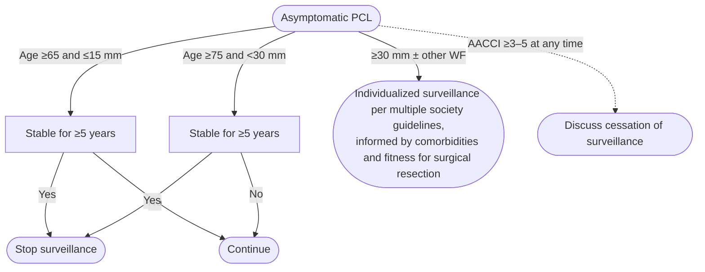
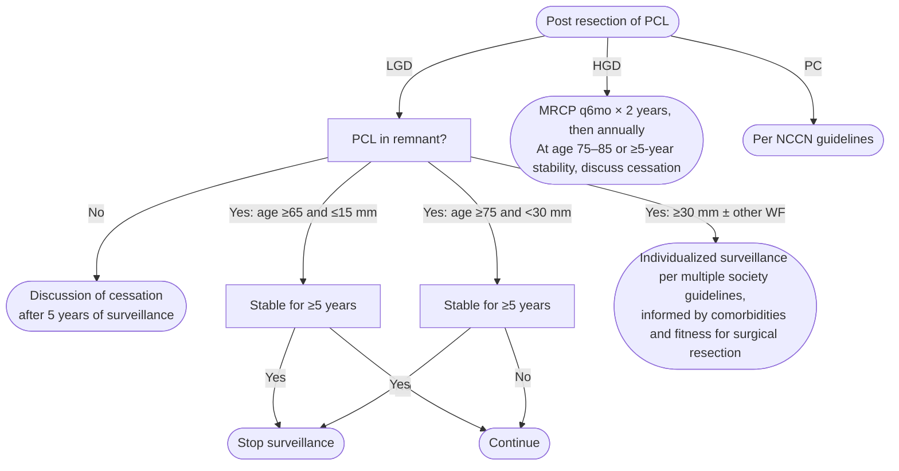
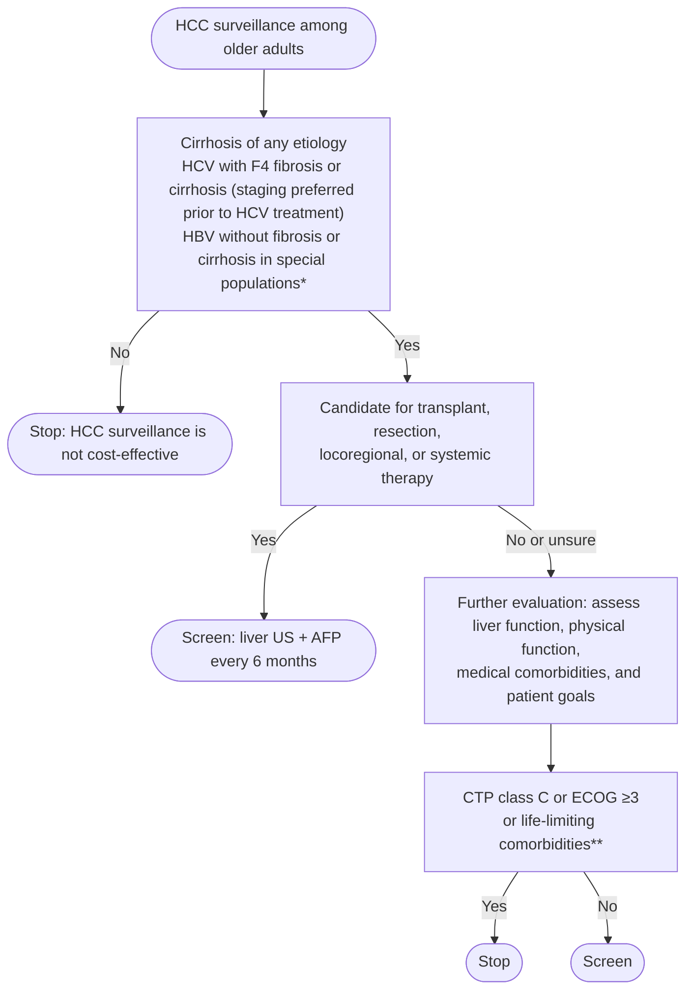

## Bibliographic Info

- **Article:** [Das KK, Serper M, Vege SS. AGA Clinical Practice Update on Surveillance of Pancreatic Cystic Lesions and Hepatocellular Carcinoma in Older Adults: Expert Review. Clin Gastroenterol Hepatol. 2026.](https://doi.org/10.1016/j.cgh.2026.08.005)
- **Authors:** Koushik K. Das, Marina Serper, Santhi Swaroop Vege
- **Year:** 2026 (article in press; volume and page numbers not yet assigned in this version)
- **Journal/Publisher:** Clinical Gastroenterology and Hepatology (Elsevier, on behalf of the American Gastroenterological Association [AGA] Institute)
- **DOI:** [10.1016/j.cgh.2026.08.005](https://doi.org/10.1016/j.cgh.2026.08.005)
- **Type:** guideline — AGA Clinical Practice Update (CPU), expert review; 9 Best Practice Advice (BPA) statements
- **Licence:** open access, CC BY-NC-ND 4.0 ("This is an open access article under the CC BY-NC-ND license (http://creativecommons.org/licenses/by-nc-nd/4.0/)", page 1)

## Summary

- Commissioned and approved by the AGA Institute Clinical Practice Updates Committee and AGA Governing Board; internal peer review by the committee plus external peer review by the journal (Methods).
- **BPAs drawn from a literature review and expert opinion. No systematic reviews were performed, so the BPAs carry no formal ratings of quality of evidence or strength** (Methods).
- Scope: **when to stop** surveillance in older or comorbid adults — of [[pancreatic-cysts|pancreatic cystic lesions (PCLs)]] (BPAs 1–6) and of [[hepatocellular-carcinoma|hepatocellular carcinoma (HCC)]] (BPAs 7–9). Existing guidelines define who to survey but rarely say when to stop (Description).
- Central themes:
  - PCLs: comorbidity by **age-adjusted Charlson comorbidity index (AACCI)**, small and stable cysts after **5 years**, and fitness for surgery decide cessation; post-resection low-grade dysplasia (LGD) is treated like an unresected stable cyst (BPA 5, stated by the authors as an expert-opinion shift not fully aligned with international guidelines).
  - HCC: antivirals lower but do not remove risk; surveillance should be considered in older adults with cirrhosis because age raises risk (BPA 8); discontinue when life expectancy is **<1–2 years** from comorbidities, functional status, or decompensation without a transplant option, eg, Child-Turcotte-Pugh (CTP) C (BPA 9). Uncertain candidacy for treatment prompts further evaluation, not an automatic stop (Figure 2).
- Readers are referred to the companion CPU ([[aga-2026-surveillance-older-adults]], its Table 1) for comorbidity assessment and life-expectancy tools. AACCI scoring, Child-Pugh scoring and the Eastern Cooperative Oncology Group (ECOG) performance status scale are in this article's online Supplementary Tables 1–3, not in the article PDF.

## Key Recommendations

### Best Practice Advice Statements (BPA 1–9)

Ungraded (Methods). Wording near-verbatim from the statement list (pages 1–2).

| BPA | Statement |
|---|---|
| **1** | **Regardless of age**, patients with **significant comorbidities (ie, AACCI ≥3–5)** with incidental PCLs, **particularly low-risk PCL**, should be **counseled against routine PCL surveillance** — low attributable mortality to pancreatic cancer (PC) and high risks due to intervention in this population. |
| **2** | Patients **>65 years** with PCLs **≤15 mm** that are **stable for 5 years** (no concerning growth rate of **3 mm or more per year or 6 mm or more in 2 years**) with **no worrisome features or high-risk stigmata (as defined by the International Association of Pancreatology [IAP])** should be **considered for discontinuation** of surveillance **after detailed shared decision-making**, given the potential increased morbidity with intensive surveillance in this population. |
| **3** | Patients **>75 years** with PCLs **<30 mm** that are **stable for 5 years** (same growth definition: 3 mm or more per year or 6 mm or more in 2 years) with no worrisome features or high-risk stigmata should have a **detailed discussion about the questionable value** of ongoing surveillance. Surveillance **may be discontinued if they understand the small, population-specific risk** of future PC or high-grade dysplasia (HGD). |
| **4** | **Development of significant comorbidities (as defined above) that may preclude surgical resection, at any time during PCL surveillance** — **even with prior worrisome features or high-risk stigmata** with no evidence of HGD or PC — should lead to **discussion about discontinuation** of surveillance. |
| **5** | After **resection of PCLs with no HGD or PC on final pathology**, surveillance of PCLs in the remnant pancreas **can be continued per BPAs 2 and 3**, **counting the surveillance period before the resection**, with a **discussion of cessation after 5 years of stability**. |
| **6** | **HGD in the resected specimen** → surveillance with magnetic resonance imaging with magnetic resonance cholangiopancreatography (MRI/MRCP) **every 6 months for 2 years, then annually**, **as long as the patient remains a surgical candidate for completion pancreatectomy**. **PC in the resected specimen** → remnant surveillance per current oncologic guidelines and treatment course. **Resected HGD or PC** → discuss with the oncology team **discontinuation after 5 years of stability** in the remnant if no worrisome features or high-risk stigmata develop. |
| **7** | Oral antivirals for [[chronic-hepatitis-b\|hepatitis B virus (HBV)]] and [[hepatitis-c\|hepatitis C virus (HCV)]] **lower HCC risk but do not eliminate it**. HCC surveillance in older adults with viral hepatitis should be based on **fibrosis stage and HCC risk rather than age alone**. |
| **8** | HCC surveillance should be **considered for older adults with [[cirrhosis]] of any etiology** because age increases HCC risk, **unless life expectancy is low and is less than 1 to 2 years**. |
| **9** | HCC surveillance **should stop if estimated life expectancy is low and is less than 1 to 2 years**, based on **medical comorbidities, impaired functional status, or liver decompensation (eg, CTP C cirrhosis) where liver transplant is not an option**. Shared decision-making can inform HCC surveillance decisions. |

### PCL Surveillance Algorithm (Figure 1)

**Panel A — asymptomatic PCL**

*Surveillance of asymptomatic pancreatic cystic lesions in older adults*
*Source: redrawn from Figure 1A of the AGA 2026 CPU on PCL and HCC surveillance in older adults*
*[[aga-2026-older-adult-cyst-hcc-surveillance|AGA 2026 CPU: Pancreatic Cyst and HCC Surveillance in Older Adults]]*
*PCL = pancreatic cystic lesion · WF = worrisome features · AACCI = age-adjusted Charlson comorbidity index*

**Panel B — after resection of a PCL**

*Surveillance after resection of a pancreatic cystic lesion, by final pathology*
*Source: redrawn from Figure 1B of the AGA 2026 CPU on PCL and HCC surveillance in older adults*
*[[aga-2026-older-adult-cyst-hcc-surveillance|AGA 2026 CPU: Pancreatic Cyst and HCC Surveillance in Older Adults]]*
*PCL = pancreatic cystic lesion · LGD = low-grade dysplasia · HGD = high-grade dysplasia · PC = pancreatic cancer · MRCP = magnetic resonance cholangiopancreatography · q6mo = every 6 months · NCCN = National Comprehensive Cancer Network · WF = worrisome features*

- Figure 1 legend: post resection, IAP guidelines recommend **annual surveillance for all noninvasive intraductal papillary mucinous neoplasm (IPMN) with LGD** in the resected specimen and **6-month surveillance when there is a family history of PC**, as long as the patient remains surgically fit.
- Figure vs statement wording: Figure 1 draws the age branches as **≥65** and **≥75**; BPAs 2 and 3 say **>65** and **>75**. The Figure 1B HGD box adds "at age 75–85" as a trigger for discussing cessation; BPA 6 itself names only 5 years of stability, discussed with the oncology team.

### PCL Evidence and Rationale (BPAs 1–6)

**Comorbidity and harms of surgery (BPA 1 text, pages 3–4):**
- PCLs found incidentally in up to **26%–38%** of patients **>70 years** undergoing abdominal imaging (Introduction).
- Up to **75%** of resected PCLs harbor only LGD on final pathology.
- Pancreatic resection, even in expert centers: **1%–4%** mortality, **40%–50%** adverse event rate; new-onset postoperative diabetes **17.1%** after Whipple, **23.7%** after distal pancreatectomy.
- Trivial branch-duct IPMN (BD-IPMN) without worrisome features on surveillance (subgroup of 1335): 25 resected → mortality **8%**; not resected → mortality **4%** (IPMN-related mortality **0.2%**).
- AACCI is the most common comorbidity measure in the PCL literature; 2 studies found poor outcomes and survival after IPMN resection at **AACCI ≥5** or **≥4**.
- Competing-risk analysis: high-risk patients (**AACCI ≥3**) with a low-risk cyst (no main duct dilatation and/or size <3 cm at baseline) were far more likely to die of non-PC causes (subdistribution hazard ratio 3.96; 95% confidence interval [CI] 2.98–5.26; P <.01) than of PC (subdistribution hazard ratio 2.35; 95% CI 0.14–38.82; P = .55).
- 725 patients with resected or observed IPMN: **AACCI ≥7** → median all-cause survival **43 months**, and an **11-fold** risk of death from causes unrelated to the IPMN within 3 years.
- Surveillance continuing beyond 5 years in a multicenter study: **36%** had AACCI 4–6, **24%** AACCI ≥7.
- **Authors' operative reading of the BPA 1 range: AACCI ≥5 = strong indicator for cessation; AACCI 3–4 = trigger a detailed discussion** of the limited benefit of PCL surveillance.

**Small, stable cysts (BPAs 2–3 text, page 5):**
- AGA 2015 suggested stopping surveillance of low-risk PCLs after 5 years ([[aga-2015-asymptomatic-neoplastic-pancreatic-cysts]]); later data confirm asymptomatic BD-IPMN rarely develops PC.
- Unsurveilled low-risk PCLs over 10 years: similar incident PC, mortality and survival vs meticulous surveillance (one study, described by the authors as provocative).
- 577-patient multicenter cohort: 108 with stable PCLs **≤1.5 cm for >5 years** → 1 (**0.9%**) developed PC.
- Korean cohort followed >5 years: PCLs **≤1.0 cm** (n = 501) → **4.8%** developed worrisome features.
- Concomitant (cyst-unrelated) PC: up to **44%** of PC in IPMN patients in Japanese cohorts vs **18%** in a US cohort.
- International retrospective cohort, **3844** presumed BD-IPMN, median surveillance 53 months — PC rates similar to population controls:

| Subgroup | Standardized incidence ratio (95% CI) |
|---|---|
| Age **≥75 years**, cyst **<3 cm** | 1.12 (0.23–3.39) |
| Age **≥65 years**, lesion **≤15 mm** after 5 years of surveillance ("trivial") | 0.95 (0.11–3.42) |

- Trivial BD-IPMN in that cohort: all-cause mortality **4.9%** (n = 79) vs IPMN-specific mortality **0.3%** (n = 5) → **>16 times** more likely to die of other causes.
- An independent validation also suggested discontinuing surveillance for cysts **<10 mm at any age after 5 years of stability**.
- Recent IAP update: discussion of cessation for PCLs **≤2 cm** with no change or worrisome features after 5 years.

**New comorbidity during surveillance (BPA 4 text, page 5):**
- Goal of PCL surveillance = find advanced neoplasia for curative resection; significant comorbidity (**AACCI ≥3–5**) removes that benefit.
- IAP, American College of Gastroenterology (ACG) and European guidelines: surveillance may be discontinued if **unfit for surgery** or **life expectancy <10 years**.
- Life-expectancy aids besides AACCI: Combined Lee Schonberg 4–14 Year Mortality Index, Suemoto 10-year International Mortality Index, eFrailty.org.
- Whoever directs PCL surveillance (gastroenterologist, primary care physician, surgeon or advanced practitioner) should continually reassess comorbidities and fitness, and seek multidisciplinary input if unsure.

**Post-resection, LGD (BPA 5 text, pages 5–6):**
- In 319 patients with resected LGD PCL, 7 (**2.2%**) developed PC on long-term follow-up; those patients had worrisome features or high-risk stigmata (≥3 cm 68.8%; family history 31.3%; pancreatitis 18.8%; mixed-type IPMN 43.7%; pancreatic duct ≥5 mm 18.8%; pancreatic duct ≥10 mm 12.5%; mural nodule 12.25%).
- Rationale: a resected, pathology-confirmed LGD PCL should not be handled differently from a presumed LGD PCL that qualifies for cessation under BPAs 2–3; in the absence of HGD or PC, cessation follows comorbidity, fitness for surgery, indolence on imaging and lack of progression.
- **Expert opinion; the authors state it is not in full alignment with international guidelines** and recommend only a *discussion* of cessation after shared decision-making.

**Post-resection, HGD or PC (BPA 6 text, page 7):**
- Prior positions summarized by the CPU: AGA 2015 — MRI every 2 years for HGD or invasive cancer; IAP — every 6 months for HGD or family history of PC; ACG — MRI or endoscopic ultrasound (EUS) every 6 months for family history of PC or HGD.
- Confirmed PC is usually surveyed by medical oncology; follow updated NCCN or European Society for Medical Oncology guidelines, with surveillance generally to 5 years.

### Comparison of Guidelines on Stopping PCL Surveillance (Table 1)

| Guideline | At detection | Stop surveillance | Post-resection, LGD | Post-resection, HGD |
|---|---|---|---|---|
| AGA 2015 | Clear discussion of risks and benefits (age, life expectancy, comorbidities) | After 5 y if no significant change, or if no longer a surgical candidate | No surveillance | MRI every 2 y or more frequent, as long as surgically fit |
| ACG 2018 | No further evaluation if medically unfit for surgery | No longer a surgical candidate; assess utility in >75 y; individualized approach at 76–85 y | Lifelong if surgically fit; no cyst in remnant → MRI every 24 mo; cyst(s) in remnant → by largest cyst size | MRI or EUS every 6 mo |
| European 2018 | No follow-up if unfit for surgery | N/A — lifelong in fit patients willing to undergo surgery | Lifelong if surgically fit; cysts in remnant by size | Every 6 mo for 2 y, then yearly MRI or EUS |
| American College of Radiology (ACR) 2020 | – | <5 mm: stop at 2 y if stable scan; remainder: minimum follow-up 5–10 y | Continued surveillance if surgically fit; cysts in remnant: no well-defined criteria | Continued surveillance |
| Kyoto 2024 | – | Consider stopping in ≤2 cm with no change or worrisome features after 5 y, in those unfit for surgery, life expectancy <10 y | Lifelong if surgically fit, every y; lifelong every 6 mo if family history of PC | Every 6 mo |

*N/A = not applicable.*

### HCC Surveillance Algorithm (Figure 2)

*HCC surveillance decision in older adults*
*Source: redrawn from Figure 2 of the AGA 2026 CPU on PCL and HCC surveillance in older adults*
*[[aga-2026-older-adult-cyst-hcc-surveillance|AGA 2026 CPU: Pancreatic Cyst and HCC Surveillance in Older Adults]]*
*HCC = hepatocellular carcinoma · HCV = hepatitis C virus · HBV = hepatitis B virus · US = ultrasound · AFP = alpha fetoprotein · CTP = Child-Turcotte-Pugh · ECOG = Eastern Cooperative Oncology Group performance status*

- **\* HBV at high risk of HCC without cirrhosis (Figure 2 legend):** PAGE-B score **≥10** (age, sex, platelet count); age **50 or older for women** and **40 or older for men** if born in a country where HBV is endemic (highest endemicity in East, North and Southeast Asia, most of the Middle East and Eastern Europe); persons **born in Africa** (aflatoxin B1 exposure); **family history of HCC**.
- **\*\* No absolute age cutoff** to stop HCC surveillance. **ECOG ≥3** = symptomatic and in bed at least 50% of waking hours (Figure 2 legend).

### HCC Evidence and Rationale (BPAs 7–9)

**Antivirals in older adults (BPA 7 text, page 7):**
- Long-term suppression of HBV with nucleoside or nucleotide analogues ([[hbv-nucleoside-analogs]]) → **40%–50%** reduction in HCC risk (observational studies, meta-analyses).
- Oral [[direct-acting-antivirals|direct-acting antivirals (DAAs)]] are generally safe and well tolerated in older adults; polypharmacy and chronic kidney disease mean drug–drug interactions (DDIs) and renal function guide drug choice and dosing; renal monitoring especially important.
- HBV drugs and renal function:
  - **Tenofovir alafenamide** — no adjustment above creatinine clearance **>15 mL/min**; **cannot be used** at estimated creatinine clearance **<15 mL/min**.
  - **Tenofovir disoproxil fumarate** and **entecavir** — both require adjustment for renal function.
  - Bone mineral density evidence is mixed, but **entecavir or tenofovir alafenamide are preferred over tenofovir disoproxil fumarate**.
- HCV DAAs: up to **70%** HCC risk reduction with sustained virologic response (SVR), particularly in compensated cirrhosis. In cirrhosis, **older age is an independent HCC risk factor after SVR → ongoing surveillance**.
- HCV DAA interactions:
  - Protease inhibitors (eg, glecaprevir/pibrentasvir) interact notably with statins (atorvastatin, lovastatin, simvastatin), enalapril, digoxin and angiotensin-receptor blockers.
  - NS5A and NS5B inhibitors (eg, sofosbuvir, ledipasvir, daclatasvir, velpatasvir) carry lower DDI risk — but **sofosbuvir and velpatasvir are contraindicated with amiodarone** (life-threatening bradycardia).
  - Other high-risk classes: antiplatelets, proton pump inhibitors, HIV therapies, antipsychotics, antiarrhythmics, anticonvulsants. DDI checker: Liverpool HEP Interactions site.

**Who benefits from surveillance at older age (BPAs 8–9 text, pages 7–8):**
- In an autopsy series, **24%** of older adults with cirrhosis were not diagnosed during life; HCC diagnosis in older adults is not uncommon.
- Deciding factors: **liver disease stage** (surveillance does not benefit Child-Pugh C cirrhosis when transplant is not an option), **functional status**, **comorbidities**.
- No absolute age threshold for [[liver-transplantation|liver transplantation]]; waitlist and post-transplant outcomes are inferior in older adults, those with impaired functional status, those on dialysis and those with high comorbidity burden.
- Without a transplant option, surveillance is still rational in **well-compensated** older adults: transarterial chemoembolization outcomes are similar at age **≥80 vs <80 years**; American Society of Clinical Oncology recommends systemic HCC therapy for **Child-Pugh A** with **ECOG 0–1**.
- Individualize continuation on liver disease severity (Child-Pugh A, B, or C if transplantation is available), performance status (ECOG 0–1) and comorbidities. **Not offering or stopping surveillance at a life expectancy of 1–2 years is reasonable — expert opinion.**
- Hepatology consultation may help for an older patient with cirrhosis; multidisciplinary and hepatology care is associated with higher receipt of curative therapy and better HCC outcomes.

## Relevance to Wiki

- [[pancreatic-cysts]] — add the AGA 2026 stop rules (BPAs 1–4), the Figure 1A pathway and the AACCI ≥5 / 3–4 reading; newest US position on stopping; post-resection rules (BPAs 5–6, Figure 1B) for the post-surgical table; Table 1 cross-guideline comparison.
- [[intraductal-papillary-mucinous-neoplasm]] — BD-IPMN natural-history numbers (trivial BD-IPMN standardized incidence ratios, 0.9%, 4.8%, 2.2% remnant PC after LGD resection); AGA 2026 post-resection position contrasted with Kyoto/IAP.
- [[hcc-surveillance]] — BPAs 7–9 and Figure 2 for the "when to stop" decision in older adults; ECOG ≥3 as a stop criterion; no absolute age cutoff.
- [[hepatocellular-carcinoma]] — one line + link to the older-adult surveillance rules; TACE outcomes at ≥80 years; systemic therapy eligibility (Child-Pugh A, ECOG 0–1).
- [[cirrhosis]] — undiagnosed cirrhosis in older adults (24% at autopsy); link to stop rules.
- [[hbv-nucleoside-analogs]] — older-adult considerations (renal thresholds, entecavir or tenofovir alafenamide preferred for bone) — corroborates existing renal rows.
- [[direct-acting-antivirals]] — DDI list for older adults (amiodarone contraindication with sofosbuvir/velpatasvir; protease inhibitor–statin interactions).
- [[chronic-hepatitis-b]], [[hepatitis-c]] — BPA 7 (antiviral therapy lowers but does not remove HCC risk; surveillance by fibrosis stage and risk, not age).
- [[aga-2026-surveillance-older-adults]] — companion CPU on esophagus and colorectum; shared life-expectancy framework.

## Contradictions / Open Questions

**PCLs — this CPU vs other ingested guidelines (as the wiki states them):**
- **Stopping in surgically fit older patients.** BPA 3 permits stopping for a stable cyst **<30 mm** after 5 years at **>75 years**, and BPA 2 for **≤15 mm** at **>65 years**. [[acg-2018-pancreatic-cysts|ACG 2018]] (followed on [[pancreatic-cysts]]) finds insufficient evidence to stop after 5 years in fit patients and only advises reassessing utility at >75; [[iap-2024-kyoto-ipmn|IAP 2024]] uses a **<20 mm** stable-cyst threshold (the CPU's Table 1 and text print Kyoto's cut as **≤2 cm**). AGA 2026 is the newest US guideline-tier document on this decision.
- **Comorbidity threshold.** BPA 1 quantifies "significant comorbidity" as AACCI ≥3–5; ACG 2018 and AGA 2015 use "no longer a surgical candidate," and IAP 2024 uses unfit for surgery or life expectancy <10 years — none gives an AACCI cutoff.
- **Post-resection LGD.** BPA 5 allows a discussion of cessation after 5 years of stability (counting pre-resection surveillance). ACG 2018 requires surveillance of all resected IPMN (lifelong if fit per Table 1); IAP 2024 advises yearly imaging for as long as the patient is fit; AGA 2015 Rec 9 advises MRI every 2 years after resection showing "invasive cancer or dysplasia" without naming a grade (this CPU's Table 1 reads it as no surveillance for LGD). The CPU itself says BPA 5 is expert opinion not fully aligned with international guidelines.
- **Post-resection HGD interval.** BPA 6 = MRI/MRCP every 6 months for 2 years, then annually. ACG 2018 = MRI or EUS every 6 months (no step-down stated); IAP 2024 = every 6 months; AGA 2015 = MRI every 2 years. BPA 6 adds a discussion of cessation (with oncology) after 5 years of stability, which none of the others states.
- **Internal inconsistencies within this CPU:** BPAs 2–3 say **>65 / >75 years**, Figure 1 draws **≥65 / ≥75**; Figure 1B adds an **age 75–85** trigger for discussing cessation after HGD that BPA 6 does not contain; the Figure 1 legend lists only family history of PC as the IAP 6-month trigger after resection, while the BPA 5 text lists HGD or family history.

**HCC — this CPU vs other ingested guidelines (as the wiki states them):**
- **Largely concordant** with [[aasld-2023-hcc|AASLD 2023]] as summarized on [[hcc-surveillance]]: no surveillance for Child-Pugh C cirrhosis without a transplant option; stop with life-limiting comorbidity and life expectancy <1–2 years. Net new here: **ECOG ≥3** as an explicit stop criterion, and "no absolute age cutoff."
- **HBV non-cirrhotic age thresholds:** Figure 2 legend says **50 or older (women) / 40 or older (men)**; the wiki's AASLD-derived table states **>50 / >40**. Boundary wording only; the two documents differ at exactly age 40 or 50.
- **Endemic-country definition:** Figure 2 lists regions of highest endemicity without a prevalence cutoff; the wiki uses ≥2% chronic HBV prevalence from [[aasld-idsa-2025-chb-treatment]].
- Child-Pugh, AACCI and ECOG point tables are in the online supplement, not the article.

## See Also

[[pancreatic-cysts]], [[intraductal-papillary-mucinous-neoplasm]], [[hcc-surveillance]], [[hepatocellular-carcinoma]], [[cirrhosis]], [[hbv-nucleoside-analogs]], [[direct-acting-antivirals]], [[liver-transplantation]]
