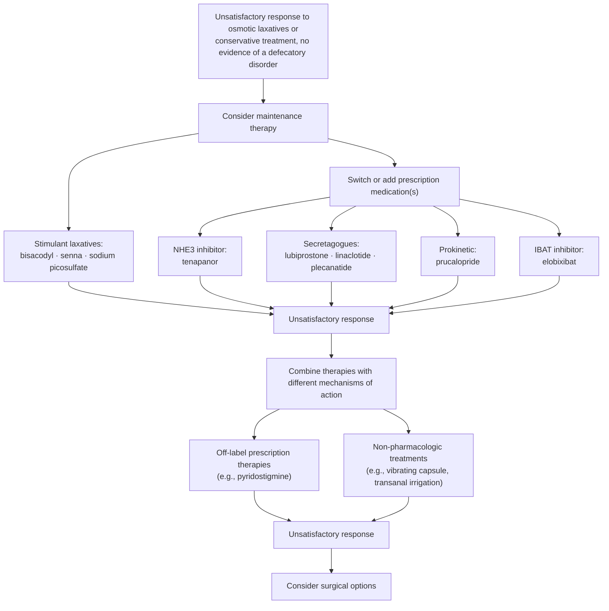
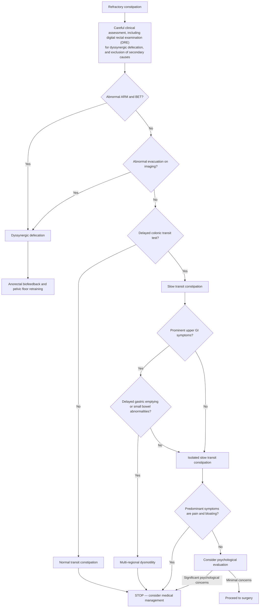
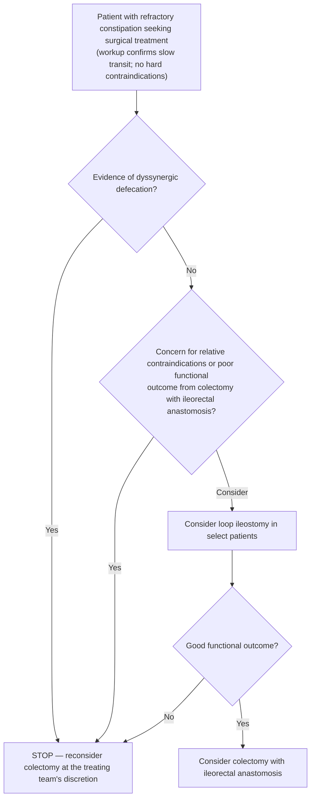

## Bibliographic Info
- **Article:** [Staller K, Neshatian L, Lembo A, Bharucha AE. AGA Clinical Practice Update on Evaluation and Management of Refractory Constipation: Expert Review. Clin Gastroenterol Hepatol 2026;24:296–305.](https://doi.org/10.1016/j.cgh.2025.09.031)
- **Authors:** Kyle Staller, Leila Neshatian, Anthony Lembo, Adil E. Bharucha
- **Year:** 2026
- **Journal/Publisher:** Clinical Gastroenterology and Hepatology (AGA Institute)
- **DOI:** [10.1016/j.cgh.2025.09.031](https://doi.org/10.1016/j.cgh.2025.09.031)
- **Type:** guideline (AGA Clinical Practice Update — Expert Review)

## Summary

American Gastroenterological Association (AGA) Expert Review on refractory constipation (RC) — the minority of [[chronic-idiopathic-constipation|chronic constipation (CC)]] patients who fail an adequate trial of lifestyle, dietary, medical, and (when indicated) pelvic floor [[biofeedback-therapy|biofeedback]] therapy. CC affects 8%–12% of the US population, with 3 million patients/year seeking clinical evaluation; RC is a far smaller subset but consumes disproportionate healthcare resources and concentrates in tertiary centers. The review uses *chronic constipation*, *chronic idiopathic constipation*, and *functional constipation* interchangeably.

Because RC is relatively rare, the recommended approach is systematic and pathophysiology-driven: (1) exclude correctable secondary causes (medications, disordered eating, neurologic disease) and [[defecation-disorders|defecatory disorders (DDs)]]; (2) confirm slow colonic transit; and (3) document adequate trials of over-the-counter (OTC) and Food and Drug Administration (FDA)–approved medications, alone and in combination, plus non-pharmacologic therapies, before considering surgery. [[anorectal-manometry|Anorectal manometry (ARM)]] with balloon expulsion testing (BET) and a completed biofeedback course should generally precede the RC label.

When medical therapy is exhausted, off-label prescription agents (e.g., pyridostigmine) and adjuncts (transanal irrigation, vibrating capsule, electroacupuncture) are reasonable. Colectomy with ileorectal anastomosis is the most evidence-based surgical option but is reserved for confirmed slow-transit constipation **without** an ongoing DD, preceded by regional gut transit testing and psychological evaluation. A diverting loop [[ostomy-management|ileostomy]] offers a reversible diagnostic trial. Relative contraindications: clinically significant upper-gut dysmotility; severe, untreated psychiatric disease; and predominant bloating and/or abdominal pain.

## Methods and Grading

- Expert review commissioned and approved by the AGA Institute Clinical Practice Updates Committee (CPUC) and the AGA Governing Board; internal CPUC peer review + external peer review through standard journal procedures.
- Best Practice Advice (BPA) statements drawn from a review of the published literature and from expert opinion.
- **No systematic reviews were performed, so the BPA statements carry no formal rating of the quality of evidence or of the strength of the considerations presented — every statement below is ungraded.**
- The document numbers its own statements **BPA 1–14**; the numbering below is the document's, not the wiki's.
- The authors state explicitly that the decision to pursue surgery for RC should be made by an experienced clinician weighing the preponderance of evidence for the individual patient, **without adhering to a strict algorithm** — the figures are labelled "suggested."
- Three suggested algorithms are provided (Figures 1–3); the document contains no tables.

## Key Findings / Claims — Best Practice Advice (verbatim)
1. **Best Practice Advice (BPA) 1:** RC is defined by infrequent and/or unsatisfactory bowel habits, with or without abdominal pain, despite an adequate trial of lifestyle, dietary, medical, and/or pelvic floor biofeedback therapy when indicated in adults who satisfy criteria for CC or constipation-predominant irritable bowel disease.
2. **BPA 2:** Most patients with CC should be evaluated with anorectal manometry (ARM) with balloon expulsion testing (BET) and complete a course of pelvic floor biofeedback therapy, when indicated, before being labeled as having RC.
3. **BPA 3:** Patients with RC should be thoroughly evaluated for secondary causes of constipation such as medications, disordered eating, or comorbid neurological diseases.
4. **BPA 4:** Clinicians caring for RC patients should describe its typical course and set realistic expectations.
5. **BPA 5:** Patients with RC should undergo colonic transit testing off of treatments to document slow-transit constipation and ideally also on a maximal laxative regimen to document the refractory nature of symptoms.
6. **BPA 6:** Among patients with RC, defecography should be considered.
7. **BPA 7:** Patients with RC should trial all standard over-the-counter and Food and Drug Administration–approved therapies for constipation as standalone therapy or in combination when accessible.
8. **BPA 8:** We suggest trials of off-label prescription agents (eg, pyridostigmine) for patients with RC who have failed available over-the-counter and Food and Drug Administration–approved agents.
9. **BPA 9:** Trials of adjunct, nonpharmacologic approaches including transanal irrigation for RC with neurogenic bowel dysfunction, a vibrating capsule, or electroacupuncture are reasonable in patients with RC.
10. **BPA 10:** Surgical therapy for RC should only be considered after confirming slow-transit constipation and excluding pelvic floor dysfunction. Only patients with RC and no evidence of an ongoing DD should be offered a colectomy with ileorectal anastomosis.
11. **BPA 11:** Preoperative evaluation should include regional gut transit testing.
12. **BPA 12:** Patients should undergo a psychological evaluation before surgical therapy for RC.
13. **BPA 13:** Relative contraindications to surgical treatment of RC include severe, untreated psychiatric disease including active eating disorders and unresolved issues related to sexual trauma; primary complaints of bloating and/or abdominal pain; and reversible, secondary causes of constipation.
14. **BPA 14:** A diverting loop ileostomy offers a diagnostic trial of surgical treatment of RC, especially where there are concerns about efficacy or relative contraindications.

## Supporting Detail (condensed)

### Defining RC — the international consensus criteria behind BPA 1

- International consensus definition the review adopts: **"infrequent or unsatisfactory bowel habits"** *plus* **any one** of the following 5 items:
  1. Inadequate number of bowel movements most of the time, with complete bowel movements on **fewer than 3 days/week**.
  2. Straining on most occasions, or worsening straining.
  3. No improvement in stool consistency on current therapy **and Bristol stool scale score <3**.
  4. Insufficient improvement of another sign or symptom of CC on current treatment.
  5. Poor tolerability of the current treatment makes the relief provided unacceptable.
- Why a practical definition matters: it drives a tailored, pathophysiology-driven plan and avoids surgery where surgery is not indicated and is potentially harmful.
- Defining RC is difficult — colonic and anorectal function interact with partly reversible factors (diet, physical activity, medications, psychological and comorbid conditions), "adequate treatment" varies, and patients describe constipation differently.

### Diagnosing a defecatory disorder before labelling RC (BPA 2)

- **~37%** of CC patients undergoing pelvic floor testing have **dyssynergic defecation** — constipation plus impaired rectal evacuation from inadequate rectal propulsive forces and/or inadequate anal relaxation during defecation. The review uses DD for this entity throughout.
- A **careful rectal examination in every patient** precedes physiologic testing, to gauge DD likelihood and other anorectal pathology.
- **ARM with BET is generally sufficient** to diagnose DD and also predicts who will benefit from biofeedback.
- Diagnostic findings:

| Test | Abnormality defining DD |
|---|---|
| [[anorectal-manometry\|ARM]] | **Reduced rectoanal gradient**; supportive features — elevated anal resting pressure, reduced anal relaxation |
| BET | **Prolonged — ≥1 minute** |
| Defecography | **Inadequate rectal evacuation** |

- **Two of these 3 abnormal tests are typically required to diagnose DD.**
- DD **should be diagnosed and treated before diagnosing RC**; biofeedback is the cornerstone of DD management.
- **Biofeedback duration: often up to 3–6 months of consistent practice** before benefit manifests. **Normalisation of BET after biofeedback suggests the DD has resolved.**

### Secondary causes to exclude (BPA 3)

- **Medications** are the most common iatrogenic cause: opioid-induced or opioid-exacerbated constipation ([[opioid-induced-constipation]]); anticholinergic agents such as antipsychotics; iron supplements. In many patients these **exacerbate a pre-existing constipation rather than being the primary cause**.
- **Inadequate caloric intake** may predispose to RC, particularly in eating disorders such as anorexia nervosa, which are over-represented in gastrointestinal (GI) clinics; some RC patients have an **undiagnosed or unrecognised eating disorder** driving symptoms.
- **Coexisting conditions:** endometriosis; rarely undiagnosed or early-stage neurologic disease (Parkinson's disease, multiple sclerosis) without the typical neurologic manifestations.
- **Autonomic function testing** should be considered in CC patients presenting with **orthostatic symptoms** — alternative therapy is available for RC with autonomic dysfunction (see BPA 8).

### Setting expectations — the normative bowel data behind BPA 4

- In the US, **~95% of individuals have between 3 bowel movements/day and 3 bowel movements/week**.
- **90% have an average Bristol stool scale consistency between 3 and 5 for men, and between 2 and 6 for women.**
- CC is a **chronic disease requiring ongoing — likely lifelong — treatment**; counsel accordingly and set goals against these normative data to support adherence.

### Colonic transit testing (BPA 5)

- Modalities: **scintigraphy** or **radiopaque markers** (multiple protocols varying in simplicity, radiation exposure and ability to quantify colonic transit time — extensively validated, minimal radiation, quantify overall *and regional* transit). **Two wireless motility capsules** are also available for regional gut transit (see BPA 11).
- **Stop laxatives for at least 7 days and medications that delay colon transit for at least 2 weeks** before testing.
- **Poor intraindividual day-to-day reproducibility** in DD and colonic inertia → repeat testing may be necessary, and in some patients testing **while taking laxatives**.
- **Overlap between slow-transit constipation and DD is as high as 40%** — mechanistically, stool in the rectosigmoid colon can activate rectocolonic inhibitory reflexes that delay colon transit.
- Interpretation of testing **on laxatives**: **normal** colon transit → symptoms are driven by other factors (DD, visceral hypersensitivity, laxative side effects); **slow** transit → colonic dysmotility is contributing, and colectomy may be considered in select cases once a defecatory disorder has been excluded.

### Defecography (BPA 6)

- Barium or magnetic resonance (MR) defecography should be considered when **clinical features suggest a structural abnormality**, or when **ARM and BET are inconclusive**.
- Identifiable abnormalities: inadequate or excessive widening of the **anorectal angle** and/or **perineal descent** during defecation; internal intussusception; [[rectal-prolapse|solitary rectal ulcers and rectal prolapse]]; rectoceles; enteroceles; bladder and uterovaginal prolapse.
- Each abnormal anorectal test finding — lower rectoanal gradient on manometry, prolonged BET, reduced evacuation on defecography — is **highly specific** for DD. In selected patients defecography helps confirm the diagnosis, **particularly when the ARM gradient is abnormal but the BET is normal**.
- **Choosing barium vs MR:**

| | Barium defecography | MR defecography |
|---|---|---|
| Position | **Seated** — preferable when the primary question is rectal evacuation | **Supine** |
| Radiation | Yes | **None** |
| Strengths | Real-time evacuation assessment | More precise pelvic organ prolapse and pelvic floor motion; **especially useful for pelvic floor dysfunction in patients with clinical DD features and a normal BET** — a group that includes **>90% of patients with a large rectocele, enterocele and/or peritoneocele** |
| Availability / cost | Wider | **Less widely available, more expensive** |

- Anatomic findings are **more likely to be clinically relevant in selected patients** — e.g., normal ARM with impaired contrast evacuation on defecography, or a **rectocele >4 cm in size**.

### Exhausting OTC and FDA-approved therapy (BPA 7)

- **[[prucalopride]] and [[linaclotide]]** are effective in CC patients unresponsive to OTC laxatives; **[[plecanatide]]** has shown efficacy in "severe" constipation. Caveat: these trials **did not rigorously evaluate prior OTC therapy or colonic transit**.
- **Empiric combination therapy with different mechanisms of action is common when monotherapy fails**, though data are anecdotal — e.g., an **osmotic laxative (polyethylene glycol) with a stimulant (bisacodyl) or a prokinetic (prucalopride)**.
- **Bisacodyl** stimulates high-amplitude propagating contractions and appears particularly effective at increasing spontaneous bowel movements; selected patients benefit from **regular** stimulant laxative use.
- **Concerns about chronic stimulant laxative use in refractory adult constipation are unfounded.** Senna dosing: **FDA guidelines recommend a maximum of 35 mg twice daily**, and **up to 1.0 g/day for up to 8 weeks has been safe**; widely available products such as senna teas often exceed this dose without reported adverse events.
- **Suppositories and enemas** can be beneficial, particularly in pelvic floor dysfunction, though data guiding their use are limited.
- **Bowel cleanouts** help clarify constipation's contribution to symptoms, or precede starting maintenance treatment — particularly with a large stool burden. **Use sparingly**, to avoid setting unrealistic expectations of repeat treatment.

### Off-label prescription agents (BPA 8)

- **Pyridostigmine** (cholinesterase inhibitor): improves symptoms and accelerates colonic transit in autonomic neuropathy, diabetes mellitus–related constipation, and [[postural-orthostatic-tachycardia-syndrome|postural orthostatic tachycardia syndrome]]. Preliminary evidence suggests **combining pyridostigmine with bisacodyl** may improve outcomes in RC. *The review gives no pyridostigmine dose.*
- **[[tenapanor]]** (sodium/hydrogen exchanger 3 inhibitor, approved for [[irritable-bowel-syndrome|irritable bowel syndrome]] with constipation) may be considered when on-label agents fail.
- **Elobixibat** (ileal bile acid transporter inhibitor, approved in several Asian countries) may be considered where available.
- **Colchicine and misoprostol** may improve constipation symptoms, **but given limited efficacy and an unfavourable side-effect profile the authors do not advise their routine use.**

**Figure 1 — suggested algorithm for the medical treatment of RC ([[aga-2026-refractory-constipation]], p299).**

### Non-pharmacologic adjuncts (BPA 9)

- **Transanal irrigation** — effective **particularly in neurogenic bowel dysfunction**: reduces stool burden, improves bowel emptying, enhances quality of life.
- **Vibrating capsule** — improved symptoms vs placebo in CC, **including patients with "severe" symptoms defined as no complete spontaneous bowel movements over a 2-week baseline period**.
- **Electroacupuncture** (traditional acupuncture plus electrical stimulation) — more effective than **sham acupuncture** and than **prucalopride**.
- **[[sacral-nerve-stimulation|Sacral nerve stimulation (SNS)]]** improves symptoms in some patients with [[fecal-incontinence|fecal incontinence]] but **did not improve symptoms in CC**.
- These adjuncts can give meaningful relief and may reduce the need for invasive procedures such as colectomy; combined pharmacologic–non-pharmacologic strategies need further study.

### Surgical selection (BPA 10, 12, 13)

- Outcomes of **colectomy with ileorectal anastomosis are better in patients with slow colonic transit *without* DD**; slow-transit/DD overlap reaches 40%.
- Studies of DD's impact on colectomy outcomes are inconsistent (varying DD diagnostic methods, differing DD interventions, small retrospective reviews) — but there is **ample evidence, and strong consensus, for addressing DD before colectomy with ileorectal anastomosis**.
- **Trial biofeedback before colectomy** — it may normalise colonic transit in many patients with DD. Failure to address DD first leads to poor functional outcomes (persistent abdominal pain and constipation) and low satisfaction.
- **Psychological evaluation (BPA 12):** anxiety and depression are common in CC and particularly common in DD; they exacerbate symptom severity and burden, reduce quality of life, increase demand for surgery, and adversely affect surgical outcomes. **Depression and other psychological complications have been reported postoperatively.** Evaluation should be by a professional knowledgeable about the demands of surgery.
- **Relative contraindications (BPA 13) and the numbers behind them:**

| Contraindication | Supporting detail |
|---|---|
| Active eating disorder | Eating disorders affect **up to 19% of patients with CC**; **increasing calorie intake can normalise colonic transit** |
| Unresolved issues related to sexual trauma | **Up to 40% of CC patients and 20% of those with DD report a history of sexual abuse**; associated with more severe symptoms, heightened GI-specific anxiety, depression and rectal sensitivity. A history of abuse **strongly predicts adverse outcomes and increased abdominal complaints after colectomy** |
| Predominant bloating and/or abdominal pain | Chronic abdominal pain, bloating and fecal incontinence **persist in up to 50% of CC patients after colectomy**, with increased healthcare utilisation and poor quality of life — screen these patients carefully before colectomy |
| Reversible, secondary causes of constipation | See BPA 3 |
| Multiregional GI dysmotility | Concurrent multiregional dysmotility in slow-transit constipation correlates with **increased surgical complications and poor outcomes** — a relative contraindication |

### Preoperative regional gut transit testing (BPA 11)

- A subset of RC patients also have upper GI symptoms and/or gastroduodenal dysmotility. **A meta-analysis found recurrent constipation and poor quality of life after colectomy were more common in patients with upper GI dysmotility before surgery.**
- **Obtain gastric emptying** to identify **moderate-to-severe delayed gastric emptying** ([[gastroparesis]]) or more diffuse upper GI dysmotility **in constipated patients with clinically significant upper GI symptoms**. Note: constipation itself can contribute to upper GI symptoms, which may improve after colectomy.
- **Do not use barium x-ray or lactulose breath tests to assess small intestinal transit** — inadequately validated and limited.
- **Small bowel imaging** (small bowel follow-through, computed tomography (CT) or MR enterography) helps **exclude small intestinal dilatation** when suspicion for small intestinal dysmotility or [[acute-colonic-pseudo-obstruction|chronic intestinal pseudo-obstruction]] is high.
- **Whole-gut scintigraphy** (well validated, available in only a few centres) or **newly approved wireless motility capsules** give regional gut transit times in this population.
- **Before colectomy, consider intraluminal colonic motility assessment with manometry and/or a barostat where available — especially when colonic transit is equivocal.** Fasting and/or postprandial colonic tone and/or compliance were reduced in **40% of patients with normal transit and 47% with slow-transit constipation**, so some patients with slow transit have normal motility and vice versa.

**Figure 2 — suggested algorithm for selecting patients for surgical treatment of RC ([[aga-2026-refractory-constipation]], p301).**

### Choosing the operation — diverting loop ileostomy as a diagnostic trial (BPA 14)

- **Colectomy with ileorectal anastomosis is the most evidence-based surgical intervention for slow-transit constipation**, but carries significant risk of complications.
- **A 2-stage approach starting with a reversible diverting loop ileostomy may be preferred** in some patients: it allows an informed decision about symptom improvement, with **completion colectomy and ileorectal anastomosis potentially offered 6–12 months later** for those with significant symptom improvement.
- Loop ileostomy may also **mitigate the high complication rates of colectomy** at the time of stoma creation.
- Particularly valuable for patients with **less definitive indications for colectomy**, **relative contraindications (including symptomatic regional gut dysmotility)**, or **risk of poor functional outcomes**.
- Despite high rates of reoperation and complications after stoma surgery, **many patients opt to retain a temporary stoma because it improved their quality of life**. In selected RC patients an ostomy is a justified last-resort option.

**Figure 3 — suggested algorithm for selecting the type of surgical procedure for RC ([[aga-2026-refractory-constipation]], p302).** Entry requires a **complete workup confirming slow-transit constipation and no hard contraindications**. The figure's **relative contraindications** are pan-gut dysmotility; significant comorbid psychiatric disease; significant bloating or abdominal pain.

## Relevance to Wiki

- **[[chronic-idiopathic-constipation]]** — owns the RC pathway: definition and the 5 consensus criteria, ARM+BET and a biofeedback course as a gate on the RC label, secondary-cause exclusion, transit testing off treatment (and on maximal laxatives), defecography, exhaustive OTC/FDA-approved and off-label trials, non-pharmacologic adjuncts, and the pre-surgical algorithm with diverting loop ileostomy as a diagnostic trial. Also owns the senna ceiling (35 mg twice daily; up to 1.0 g/day for ≤8 weeks shown safe) and the stimulant-laxative safety statement.
- **[[defecation-disorders]]** — the 2-of-3 abnormal-test rule, BET ≥1 minute, rectoanal gradient, DD prevalence ~37% of tested CC patients, slow-transit/DD overlap up to 40%, defecography findings, and the "treat DD before labelling RC / before colectomy" rule.
- **[[anorectal-manometry]]** — ARM+BET as sufficient to diagnose DD and as a gate on the RC diagnosis; the BET ≥1 minute cut-point; barium vs MR defecography comparison.
- **[[biofeedback-therapy]]** — up to 3–6 months of consistent practice before benefit; normalised BET after biofeedback suggests DD resolution; biofeedback trial required before colectomy.
- **[[ostomy-management]]** — diverting loop ileostomy as a reversible diagnostic trial, completion colectomy at 6–12 months.
- **[[sacral-nerve-stimulation]]** — corroborates that SNS does not improve CC.
- **[[gastroparesis]]** — gastric emptying testing as part of the preoperative regional gut transit workup in RC.
- Corroborates and extends [[aga-acg-2023-constipation|AGA–American College of Gastroenterology (ACG) 2023]] pharmacologic guidance into the refractory subset and the surgical decision.

## Contradictions / Open Questions

- **How many abnormal tests diagnose a defecatory disorder — a live, unresolved disagreement within 2026.** This update states **2 of 3** abnormal tests (ARM, BET, defecography) are typically required. **[[rome-v-2026-dgbi|Rome V]] requires only 1 of 3** (plus difficult-evacuation symptoms) and **[[acg-2021-anorectal-disorders|ACG 2021]] requires ARM *and* BET**. Rome V (*Gastroenterology*, June 2026) is the more recent publication, so [[defecation-disorders]] and [[anorectal-manometry]] follow its 1-of-3 bar; this review's 2-of-3 and ACG's both-tests rule remain the stricter operating standard — and note this review applies its 2-of-3 bar specifically to the decision to label a patient refractory and to proceed toward surgery.
- **Senna ceiling.** [[aga-acg-2023-constipation|AGA–ACG 2023]] gives senna 8.6–17.2 mg daily with **"no clear maximum."** This update supplies one: **FDA maximum 35 mg twice daily**, with **up to 1.0 g/day for up to 8 weeks reported safe**. Newer source, so the explicit ceiling is what the wiki should carry.
- **Chronic stimulant laxative use.** This update states plainly that concerns about chronic stimulant use in refractory adult constipation are **unfounded** and that selected patients benefit from regular use — a firmer stance than the conditional/low-certainty senna recommendation in AGA–ACG 2023.
- **Rectocele size thresholds answer different questions.** This review flags a **rectocele >4 cm** as more likely clinically relevant on defecography; [[acg-2021-anorectal-disorders|ACG 2021]] uses **>5 cm** (with trapping/non-emptying) as a *surgical* selection feature after biofeedback failure. Not a direct conflict — one is relevance of an imaging finding, the other an operative indication — but the two numbers sit side by side on [[defecation-disorders]] and should be labelled by their question.
- **No dose is given for the off-label agents.** Pyridostigmine, colchicine, misoprostol, tenapanor and elobixibat are named without doses, durations or monitoring in this review.
- **BPA 1 as printed reads "constipation-predominant irritable bowel disease."** The intended population is constipation-predominant [[irritable-bowel-syndrome|irritable bowel syndrome]].
- Open question the authors raise: the effectiveness of **combined pharmacologic and non-pharmacologic therapy** in RC has not been studied.

---

## See Also

[[chronic-idiopathic-constipation]], [[chronic-constipation]], [[defecation-disorders]], [[anorectal-manometry]], [[biofeedback-therapy]], [[ostomy-management]], [[sacral-nerve-stimulation]], [[opioid-induced-constipation]], [[irritable-bowel-syndrome]], [[gastroparesis]], [[prucalopride]], [[linaclotide]], [[plecanatide]], [[lubiprostone]], [[tenapanor]], [[fecal-incontinence]], [[rectal-prolapse]], [[postural-orthostatic-tachycardia-syndrome]]

---

## Sources

1. [[aga-2026-refractory-constipation|AGA Clinical Practice Update on Evaluation and Management of Refractory Constipation: Expert Review]]
