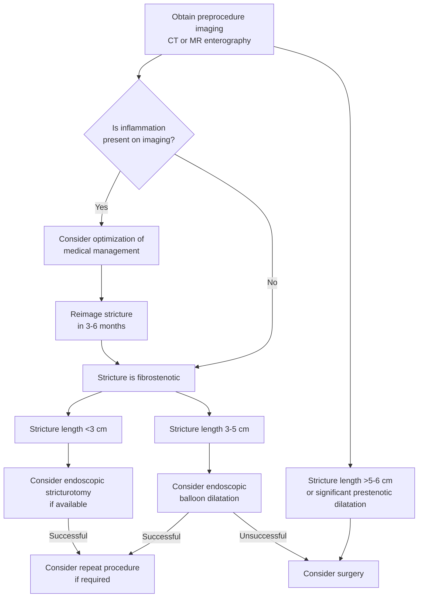

## Bibliographic Info
- **Article:** [Kochhar GS, Coelho-Prabhu N, Hashash JG, Shen B. AGA Clinical Practice Update on the Role of Therapeutic Endoscopy in Inflammatory Bowel Disease: Commentary. Clin Gastroenterol Hepatol 2026;24(3):595–601.](https://doi.org/10.1016/j.cgh.2025.11.007)
- **Authors:** Gursimran S. Kochhar, Nayantara Coelho-Prabhu (shared co-first authorship), Jana G. Hashash, Bo Shen
- **Year:** 2026 (March issue)
- **Journal/Publisher:** Clinical Gastroenterology and Hepatology, vol 24 iss 3 — American Gastroenterological Association (AGA) Institute
- **DOI:** [10.1016/j.cgh.2025.11.007](https://doi.org/10.1016/j.cgh.2025.11.007)
- **Type:** guideline tier — AGA Institute Clinical Practice Update (CPU), **Commentary** format

## Contents
- [[#Summary]]
- [[#Methods and Grading]]
- [[#Table 1 — Do's and Don'ts in IBD Therapeutic Endoscopy]]
- [[#Figure 1 — Approach to the Intestinal Stricture]]
- [[#Key Guidance]]
  - [[#Preprocedure Preparation]]
  - [[#Stricture Characterization and Patient Selection]]
  - [[#Endoscopic Balloon Dilation]]
  - [[#Endoscopic Stricturotomy]]
  - [[#Enteral Stenting]]
  - [[#Fistula and Abscess]]
  - [[#Colitis-Associated Neoplasia]]
  - [[#IBD Surgery-Associated Anastomotic Complications]]
  - [[#Future Perspectives]]
- [[#Table 2 — Notable Studies in Interventional IBD]]
- [[#Relevance to Wiki]]
- [[#Contradictions / Open Questions]]
- [[#See Also]]
- [[#Sources]]

## Summary

Scope: when advanced therapeutic endoscopy can — and should not — be used in [[inflammatory-bowel-disease|inflammatory bowel disease (IBD)]], as a way to delay or prevent surgery. Three problem domains: **strictures**, **fistulas/abscesses**, and **colitis-associated neoplasia (CAN)**, plus a fourth on **surgery-associated anastomotic complications** (bleeding, leaks, sinuses).

Strictures. 5%–28% of patients with [[crohns-disease|Crohn's disease (CD)]] have stricturing disease at presentation and **>50% develop a stricturing complication within the first 10 years** after diagnosis. Medical therapy has limited efficacy once disease is fibrostenotic, so the selection question is endoscopy vs surgery: **short strictures (<4–5 cm) with fewer than 3 risk factors are suitable for endotherapy**, while long (>4–5 cm) or multiple (>4) strictures, or ≥3 risk factors, point to surgery. **Endoscopic balloon dilation (EBD)** is first-line (technical and clinical success 74%–100%); **endoscopic stricturotomy (EST)** is favored for short fibrotic strictures and the anal canal; **enteral stenting** is a last-resort, highly selective option.

Neoplasia. Resect endoscopically whenever complete resection is feasible — [[endoscopic-mucosal-resection|endoscopic mucosal resection (EMR)]] and [[endoscopic-submucosal-dissection|endoscopic submucosal dissection (ESD)]] achieved complete resection in 97.9% of >600 lesions (mean 23 mm). Surgery is reserved for high-risk lesion features and for multifocal unresectable or invisible dysplasia. On detection technique the update is more permissive than earlier documents: **high-definition dye-based chromoendoscopy (DCE) ideally, high-definition virtual chromoendoscopy if trained in it**, with the HELIOS randomized trial showing high-definition white light endoscopy plus segmental re-inspection noninferior to DCE.

Surgical aftermath. At least half of patients with CD and 10%–15% of patients with [[ulcerative-colitis|ulcerative colitis (UC)]] eventually need surgery; the update maps which postsurgical bleeds, leaks, abscesses and sinuses are endoscopically treatable and which are not.

## Methods and Grading

- Commissioned and approved by the AGA Institute CPU Committee and the AGA Governing Board; internal peer review by the CPU Committee plus external peer review per standard *Clinical Gastroenterology and Hepatology* procedures.
- Stated to incorporate recently published studies in the field **and the experiences of the authors**.
- **This is a Commentary, not a Best Practice Advice document.** It contains **no numbered statements and no grades** — no GRADE, no strength-of-recommendation label, no evidence-quality label anywhere in the text or tables.
- It also makes **no statement that a systematic review was or was not performed** — unlike Best Practice Advice–style updates, the Methods paragraph simply does not address it.
- Its structured, actionable guidance is delivered as **Table 1, an unnumbered "Do's and Don'ts" table**, and as the stricture algorithm in Figure 1. Both are reproduced below; any ordering below is the wiki's, not the document's.

## Table 1 — Do's and Don'ts in IBD Therapeutic Endoscopy

**Colitis-associated neoplasia**

| Do's | Don'ts |
|---|---|
| Surveillance yearly for [[primary-sclerosing-cholangitis\|primary sclerosing cholangitis (PSC)]] | Survey at standard intervals in inadequate prep or active inflammation |
| Surveillance with ideal [[bowel-preparation\|bowel prep]] | Partially resect lesions |
| Minimal to no inflammation; if inflammation is present, repeat [[colonoscopy]] within 1 y after optimization of therapy | Refer to colectomy if lesions are resectable |
| Enhanced imaging — high-definition DCE ideally, but high-definition virtual chromoendoscopy if trained in it | Perform yearly surveillance on all patients |
| Describe lesions using the **5 Ss**: size, shape, site (location in colon), surface, surrounding mucosa (active inflammation or not) | |
| Endoscopic resection when feasible | |
| Random biopsies for high-risk patients | |
| Follow tailored surveillance guidelines | |

**Anastomotic bleeding**

| Do's | Don'ts |
|---|---|
| [[endoscopic-hemostasis\|Endoscopic clipping]] and a spray of hemostatic gel can be used to treat anastomotic bleeding | Topical injection of epinephrine, or angioembolization, should be avoided in the treatment of anastomotic bleeding |
| Endoscopic clipping can be attempted in acute anastomotic leaks, or at the internal opening of the fistula from chronic anastomotic leaks | Endoscopic clipping should be avoided in disease-associated fistula, or in chronic anastomotic leak-associated sinus |
| Endoscopic stent drainage can be used for acute anastomotic leaks | |
| Endoscopic sinusotomy can be used for chronic anastomotic leak-associated sinus | |

**Endoscopic stricture management**

| Do's | Don'ts |
|---|---|
| Obtain a preprocedure computed tomography (CT) enterography / magnetic resonance (MR) enterography | Stop biological or advanced medical therapies during endotherapy for strictures |
| Discontinue antithrombotic and antiplatelet agents | Inject corticosteroid into the strictures after endotherapy |
| Perform graded dilatation | Perform EBD if the stricture is associated with a fistula or abscess |
| Use wire-guided controlled radial expansion (CRE) balloons | Prophylactic antibiotics are not required prior to endotherapy |
| Biopsy the stricture postdilatation to rule out malignancy | Perform EBD if deep ulcerations are present secondary to inflammation — optimize inflammation management first |
| Follow-up endoscopy to assess the long-term response to endotherapy | |

**Endoscopic fistula management**

| Do's | Don'ts |
|---|---|
| Obtain preprocedure imaging | Drain complex fistulas endoscopically |
| Optimize medical management for fistulas | Close the exit site of the fistula |
| Choose short and simple fistulas for endotherapy | |
| Prioritize drainage over closure of fistula | |

*Table 1 — reproduced from the source. CRE, controlled radial expansion; DCE, dye-based chromoendoscopy.*

## Figure 1 — Approach to the Intestinal Stricture

*Figure 1 — approach to and management of the patient with an intestinal stricture. After a successful EBD or EST either can be repeated; if unsuccessful, proceed to surgery.*

## Key Guidance

### Preprocedure Preparation

- Almost all interventional IBD procedures can be performed **electively**; rarely urgent.
- **Adequate bowel preparation is critical.**
- Hold before elective procedures, per current society guidances:
  - Anticoagulants.
  - Antiplatelet agents — **except low-dose aspirin**.
  - Systemic corticosteroids.
  - [[glp-1-receptor-agonists|Glucagon-like peptide-1 (GLP-1) receptor agonists]].

### Stricture Characterization and Patient Selection

- Mechanism: chronic inflammation, fibrosis, and smooth muscle hyperplasia.
- Epidemiology in CD: stricturing disease in **5%–28% at presentation**; **>50% develop stricturing complications within the first 10 years** after diagnosis.
- Descriptive axes used by the document:

| Axis | Categories |
|---|---|
| Origin | Primary vs secondary/anastomotic |
| Nature | Benign vs malignant |
| Activity | Inflammatory vs fibrostenotic |
| Severity | Mild vs severe |
| Length | Short vs long — **cutoff 4–5 cm** |
| Complexity | Simple vs complex — **complex = with fistula or abscesses** |
| Number | Single vs multiple |

- Most typical site of a **primary** stricture: **terminal ileum and the ileocecal valve**.
- Medical therapy has limited efficacy for fibrostenotic strictures; surgery remains the mainstay. Endoscopy is a valid and valuable approach **when surgery is not feasible** — short gut, multiple prior surgeries, rigid/fixed abdomen, overall poor medical condition.
- Preprocedure cross-sectional imaging is critical, to establish: stricture **length**, significant **prestenotic dilation**, associated **fistulas**, and presence of significant **inflammation**.
- **Who is suitable for endoscopic therapy — both conditions:**
  - Short stricture, length **<4–5 cm**, **and**
  - **Fewer than 3** of these risk factors: fistulizing disease · prestenotic dilation **>5 cm** · high C-reactive protein (CRP) · prior [[anti-tnf-agents|anti-tumor necrosis factor (anti-TNF)]] exposure.
- **Who may require surgery:** stricture length **>4–5 cm**, **multiple strictures (>4)**, or **≥3** of the above risk factors.
- **Any number of strictures may be treated endoscopically if technically possible** — number alone is not a bar.

### Endoscopic Balloon Dilation

- **First-line option** for strictures: ease of use, availability, and high technical and clinical success rates of **74%–100%**.
- **Less likely to succeed with:**
  - Longer stricture length (**>4–5 cm**).
  - High body mass index.
  - Proximal small bowel strictures.
  - Significant prestenotic dilation (**>5 cm in the small bowel**).
  - **Primary** strictures (vs anastomotic).
- **Stricture length ≤5 cm strongly predicts surgery-free survival** — risk of surgery rises **8% for every 1 cm increase** in stricture length.
- Symptomatic recurrence in **~50%**, with **two-thirds eventually requiring additional dilation or surgical intervention** over follow-up ranging 20–144 months.
- **Technique:**
  - **Retrograde dilation** — pass the scope through the stricture to the proximal end, then dilate as the scope is pulled back to the distal end — **preferred whenever feasible**.
  - **Guidewire** encouraged, particularly for impassable or angulated strictures. Fluoroscopy use depends on stricture location and endoscopist experience.
  - **Graded dilation**: controlled radial expansion during inflation, with partial or complete deflation between expansions.
  - **Target size 18–20 mm**, which may require more than 1 session.
- **Balloon size and perforation: no convincing evidence links the two.** Therefore caution and **reassessment of the stricture after each dilation** — perforation may occur even with smaller balloon sizes.
- **No benefit from intralesional steroids**, based on a recent consensus statement.
- Can be performed **anywhere in the gastrointestinal (GI) tract, including anastomotic locations**.
- **Ostomy-site strictures** — arise from tissue ingrowth, stoma site retraction, or in a continent ileostomy (Kock or "K" pouch); **EBD can be performed safely** for ostomy-associated strictures.
- **Avoid EBD** where there are associated **deep ulcers** or a **fistula** — it may worsen the fistula.
- On the horizon: drug-coated balloons; the endoluminal functional lumen imaging probe (EndoFLIP; Medtronic) to assess stricture distensibility post-dilation.

### Endoscopic Stricturotomy

- Technique: an [[electrosurgery|electro-incision knife]] dissects and removes strictured tissue using electrocautery — **radial, horizontal, or circumferential** fashion.
- Performed in few centers. In the authors' experience, **most effective for short fibrotic strictures, 1–3 cm**.
- **Incision depth is regulated by the length of the knife; incisions are confined to the submucosa.**
- Can be stand-alone, or part of a **hybrid technique combined with EBD**.
- **Greater efficacy and lower perforation risk than EBD — but higher risk of delayed bleeding (5%–6%).**
- Systematic review/meta-analysis — **640 EST procedures in 287 patients with IBD** (169 CD, 118 UC):
  - Technical success **96.4%**, clinical success **62%**.
  - Mean stricture length **1.68 ± 0.84 cm**.
  - Over mean follow-up **1.0 ± 1.1 y**: **16.4% required surgery**, **44.2% required additional endoscopic treatment** (repeat EST or EBD).
- May be considered, based on endoscopist experience, **for all areas of the GI tract including the anal canal**.
- **Anal canal strictures** are not ideally suited for surgical management; EBD is a viable option, but in the authors' experience **EST remains more effective** there. Another option: **self-dilatation using graded metallic dilators**.

### Enteral Stenting

- Stent options: fully covered self-expanding metal stents (FCSEMS), uncovered SEMS, partially covered SEMS, biodegradable stents, and lumen-apposing metal stents (LAMS).
- **Uncovered stents should almost never be used for benign disease.** **LAMS are not currently Food and Drug Administration (FDA)-approved for luminal use.**
- **ProtDilat randomized controlled trial (RCT)** — enteral stenting vs EBD: **EBD was more effective than FCSEMS; the need for repeat procedures was lower in the EBD group.** Caveat the authors raise: the FCSEMS used were not designed for small bowel or ileocolonic anastomoses — originally intended for the esophagus and repurposed. This must be weighed when evaluating trials comparing FCSEMS with EBD.
- Meta-analysis, 9 studies / 163 patients stented:
  - Pooled **clinical success 60.9%** (95% confidence interval [CI] 51.6%–69.5%; I² = 13%).
  - Pooled **technical success 93%** (95% CI 87.3%–96.3%; I² = 0%).
  - Pooled **overall adverse events 15.7%**, **proximal stent migration 6.4%**, **perforation 2.7%**.
  - Pooled **spontaneous stent migration 43.9%** (95% CI 11.4%–82.7%; I² = 88%).
- **Stent migration is the single most significant challenge.**
- **Enteral stenting is highly selective, not routinely performed, and the American Society for Gastrointestinal Endoscopy (ASGE) advises against it.** Reserved for **refractory cases, strictures that do not respond to EBD or EST, in patients who are not surgical candidates**.

### Fistula and Abscess

- Historically, structural phenotypes of IBD including fistulizing CD are treated surgically; certain phenotypes may now be treated endoscopically.
- **Endoscopic fistulotomy** — may be performed for a **short (<3 cm) ileocecal fistula arising from long-standing ileocecal valve stenosis**.
- **[[perianal-fistulizing-crohns-disease|Perianal abscesses]]**, with or without associated fistula → **incision and drainage**, or **endoscopic wire-guided placement of setons** in the endoscopy suite.
- **Endoscopic closure of disease-associated fistulas in CD is usually ineffective** — but the endoscopic approach **can be attempted in anastomotic leak-associated fistulas**.
- **[[endoscopic-ultrasound|Endoscopic ultrasound (EUS)]]-guided drainage of abscess using LAMS** has been shown feasible in patients with IBD.

### Colitis-Associated Neoplasia

- **Risk of CAN after disease onset: 1% at 10 y, 2% at 20 y, 5% at >20 y.**
- CAN is **often flat and hard to detect**.
- **Detection:**
  - Options to enhance detection: **DCE** and **virtual chromoendoscopy**. Multiple international guidelines recommend chromoendoscopy as the optimal choice for surveillance.
  - Network meta-analysis: **DCE detects 1.42× (95% CI 1.02–1.98) more dysplastic lesions** than high-definition white light endoscopy.
  - Previous meta-analyses: **no difference between high-definition DCE and virtual chromoendoscopy**, including narrow-band imaging.
  - **HELIOS RCT (563 patients): high-definition white light endoscopy with segmental re-inspection was noninferior to high-definition DCE for detecting CAN, with a significantly shorter withdrawal time.**
  - **Limits of DCE:** ineffective with inadequate bowel preparation or active inflammation; requires training; prolongs withdrawal time — all limiting widespread uptake.
  - **Random biopsies are still advised for high-risk patients** — PSC, prior dysplasia, active inflammation.
- **Reporting:** use standardized descriptive terminology via the **modified Paris classification**; report **size, shape, site, surface pattern, and surrounding mucosal disease activity**. Dysplasia identified on nontargeted/random biopsies is labeled **"invisible" dysplasia**. Describing the surrounding mucosa guides resection planning — **poorly defined lesion borders, active inflammation, and ulceration within the lesion are all hindrances to effective removal**.
- **Resection:**
  - Per guidances, **CAN should be resected endoscopically when complete resection is feasible**.
  - **Refer for surgical resection — high-risk lesions:** mucosal ulceration, radiating folds, inability to lift, ill-defined margins, invasive cancer on histology.
  - **Multifocal unresectable or invisible dysplasia → surgical resection.**
  - **Active background inflammation** → optimize medical therapy and bring the patient back in **3–6 months** for repeat colonoscopy with curative intent.
  - **Standard [[polypectomy]] techniques, including cold snare polypectomy, are adequate for small (<10 mm) well-defined lesions.** EMR and ESD are effective for larger lesions.
  - Meta-analysis of **>600 lesions, mean size 23 mm**, removed by EMR or ESD: **complete resection 97.9%**, **local recurrence 4.9%**, **metachronous lesions 7.4%** — hence the need for continued high-quality surveillance.
  - **ESD is technically challenging in IBD** — submucosal fibrosis and fat expansion make dissection and plane recognition much harder.
  - **[[endoscopic-full-thickness-resection|Endoscopic full-thickness resection]]** is now indicated in non-IBD cases for scarred, residual, recurrent, or nonlifting lesions; case reports in CAN show good efficacy, but **long-term outcome data are lacking**.
- **Biopsies of mucosa surrounding a dysplastic lesion:** detection rate of dysplasia there is low → **routine biopsies are not required unless there are specific questions about resection completeness**.
- **After resection of IBD CAN lesions, follow-up surveillance intervals must be tailored to the findings** per multiple national and international guidances.
- As therapeutic options expand, more patients avoid colectomy — expect **increasing CAN over time**.

### IBD Surgery-Associated Anastomotic Complications

- **At least half of patients with CD, and ~10%–15% of patients with UC**, eventually require surgery for medically refractory disease, structural complications, or neoplastic complications.
- Postsurgical complications are common — mainly **bleeding and leaks**, at the **ileocolonic anastomosis (ICA)**, ileorectal anastomosis, colorectal anastomoses, and pouch-anal anastomoses.
- **Anastomotic leaks (ALs) are classified acute (within 30 days) and chronic.**
- **Usual locations of ALs:** the ICA itself and the **transverse staple line of the side-to-side ICA**; and **the tip of the J pouch**.
- **Small ALs** can be self-limited — manage with conservative therapy, or with a diverting ileostomy.
- **Large (>3 cm) acute AL-associated abscesses** → drain **subcutaneously/percutaneously (external drainage)** via interventional radiology, **or endoscopically** with a drainage endo-sponge or drainage stents (**internal drainage**).
- **After abscess drainage**, endoscopic closure with **through-the-scope or over-the-scope clips may be attempted**.
- **Chronic AL-associated sinuses or fistulas** → treat with **endoscopic sinusotomy or fistulotomy**.
- **Endoscopic closure of chronic ALs with over-the-scope clips** — from the transverse staple line at the ICA in CD, or at the tip of the J in [[pouchitis|ileal pouch-anal anastomosis]] — **may be attempted**.

### Future Perspectives

- Expect more gastroenterologists, advanced endoscopists, and IBD specialists performing endoscopic therapy for IBD and for IBD surgery-associated complications.
- Foreseen growth areas: endoscopic technology (EUS, intraoperative enteroscopy, image-enhanced endoscopy, [[artificial-intelligence-endoscopy|artificial intelligence]]) and endoscopic techniques (new modalities for strictures, prevention and damage control of endoscopic complications).

## Table 2 — Notable Studies in Interventional IBD

| Author, year | Intervention | Study type | Patients | Outcomes | Adverse events |
|---|---|---|---|---|---|
| Andujar X, 2020 | EBD | Retrospective cohort | 187 | 79.2% technical success | 1.3% |
| Hirai F, 2018 | EBD | Prospective | 95 | 93.7% technical success | 5% |
| Lan N, 2018 | EST | Retrospective cohort | 185 | 100% | 3.7% |
| Loras C, 2022 | Enteral stenting | Prospective randomized trial | 80 | 100% technical success | 3% |
| Kochhar G, 2018 | Endoscopic fistulotomy | Retrospective case series | 29 | 100% | 3.4% |
| TeGroen M, 2025 | Dysplasia detection | Randomized clinical trial | 563 | High-definition white light endoscopy with segmental re-inspection noninferior to high-definition chromoendoscopy for colorectal neoplasia detection in patients with IBD | None |
| Maselli R, 2025 | ESD | Retrospective multicenter cohort | 91 | With ESD or hybrid ESD: en bloc 95.8%, R0 85.4%, curative 83.3% | 12.5% |

*Table 2 — reproduced from the source.*

## Relevance to Wiki

- **[[crohns-disease]]** — stricture decision set: endotherapy vs surgery (<4–5 cm **and** <3 risk factors), the 4 risk factors, the <3 cm / 3–5 cm / >5–6 cm algorithm, EBD target 18–20 mm, 8%-per-cm surgery risk, don't-dilate rules (deep ulcers, fistula/abscess), endoscopic fistulotomy for short (<3 cm) ileocecal fistula.
- **[[inflammatory-bowel-disease]]** — the therapeutic-endoscopy menu (EBD, EST, stenting, fistulotomy, sinusotomy, clip closure) and when each is and is not appropriate.
- **[[ulcerative-colitis]]** — CAN risk 1%/2%/5% at 10/20/>20 y; 10%–15% lifetime colectomy; resect-vs-refer criteria.
- **[[colonoscopy]]** — IBD surveillance technique: high-definition DCE ideally / virtual chromoendoscopy if trained; HELIOS noninferiority; random biopsies retained for PSC, prior dysplasia, active inflammation; the 5 Ss; modified Paris reporting.
- **[[polypectomy]], [[endoscopic-mucosal-resection]], [[colorectal-esd]], [[endoscopic-submucosal-dissection]]** — cold snare adequate for <10 mm well-defined CAN lesions; EMR/ESD for larger; 97.9% complete resection, 4.9% local recurrence, 7.4% metachronous; ESD harder in IBD (submucosal fibrosis, fat expansion).
- **[[endoscopic-full-thickness-resection]]** — case-report-level use in CAN; long-term data lacking.
- **[[colonic-stenting]]** — ProtDilat (EBD beat FCSEMS), 43.9% spontaneous migration, ASGE advises against, uncovered stents almost never in benign disease, LAMS not FDA-approved for luminal use.
- **[[esophageal-dilation]]** — graded dilation, retrograde dilation, wire-guided CRE balloons, no balloon-size/perforation link.
- **[[antibiotic-prophylaxis-endoscopy]]** — prophylactic antibiotics not required prior to endotherapy for IBD strictures.
- **[[glp-1-receptor-agonists]], [[anticoagulation-gi-bleeding]], [[preprocedure-testing]]** — periprocedural hold list with the low-dose aspirin exception.
- **[[perianal-fistulizing-crohns-disease]]** — endoscopic wire-guided seton placement; EUS-guided LAMS abscess drainage; endoscopic closure of disease-associated fistulas usually ineffective.
- **[[pouchitis]]**, **[[ostomy-management]]** — J-pouch tip leaks, over-the-scope clip closure; safe EBD of ostomy-site and continent-ileostomy strictures.
- **[[endoscopic-hemostasis]]** — anastomotic bleeding: clips + hemostatic gel spray; avoid epinephrine injection and angioembolization.

## Contradictions / Open Questions

- **Balloon size and perforation — direct conflict with [[asge-2015-ibd]].** ASGE 2015: balloons **>20 mm are associated with more adverse events**. This update: **no convincing evidence links balloon size to perforation risk**, target **18–20 mm**. Same tier, newer year → the AGA 2026 position is what the wiki asserts, with its own corollary that perforation can occur even with smaller balloons, so reassess the stricture after each dilation.
- **Intralesional corticosteroid after dilation — this update closes a question [[asge-2015-ibd]] left open.** ASGE 2015 reported conflicting randomized data (13-patient adult trial trending worse; 29-patient pediatric CD trial reducing redilation and surgery). This update: **no benefit from intralesional steroids**, and lists injecting corticosteroid after endotherapy as a **Don't**. Newer same-tier source wins.
- **Stricture-length threshold.** [[asge-2015-ibd]] recommends EBD for benign IBD strictures **<4 cm** (its recommendation 21, low quality) and notes lower success for small-bowel strictures >3 cm. This update uses **<4–5 cm** for suitability plus the finer split (**<3 cm → EST if available; 3–5 cm → EBD; >5–6 cm or significant prestenotic dilation → surgery**). Not a reversal — more granular and slightly more permissive. [[aga-2026-inpatient-ibd]] gives **<5 cm noninflammatory** post-obstruction, consistent with this range.
- **Enteral stenting — resolves what [[asge-2015-ibd]] called undefined.** ASGE 2015: role of FCSEMS for refractory IBD strictures "not defined." ProtDilat now shows **EBD more effective than FCSEMS with fewer repeat procedures**, and this update reports that **ASGE now advises against routine enteral stenting**, reserving it for refractory strictures in non-surgical candidates.
- **Chromoendoscopy ranking vs [[aga-2021-ibd-colorectal-dysplasia]].** The 2021 CPU put **virtual chromoendoscopy on equal footing with DCE** on high-definition scopes. This update ranks them — **high-definition DCE ideally, virtual chromoendoscopy if trained in it** — while reporting HELIOS, in which high-definition white light endoscopy with segmental re-inspection was **noninferior** to high-definition DCE. It keeps DCE nominally first while publishing the trial that undercuts the ranking; pages should carry both.
- **Random/nontargeted biopsies.** [[aga-2021-ibd-colorectal-dysplasia]] made them conditional (not routinely required if DCE or virtual chromoendoscopy on a high-definition scope; consider with prior dysplasia or PSC). This update keeps them for high-risk patients and **adds active inflammation**. Neither [[asge-2015-scenic-ibd-dysplasia]] nor [[asge-2015-ibd]] resolved the targeted-only question, and nothing here resolves it.
- **Internal inconsistency on antiplatelet holds.** Body text: hold antiplatelet agents **except low-dose aspirin**. Table 1: "discontinue antithrombotic and antiplatelet agents", **no aspirin exception**. The text carve-out is the more specific statement and is what entity pages should carry.
- **Clipping in chronic anastomotic leaks — read Table 1 precisely.** Clipping **can** be attempted at the **internal opening of a fistula from a chronic anastomotic leak**, but **should be avoided in a chronic anastomotic leak-associated sinus** (sinusotomy instead) and in **disease-associated fistula**. The distinction is fistula opening vs sinus, not acute vs chronic.
- **Compared and found concordant or non-overlapping:** [[acg-2025-crohns]] (recommendations 52–53 endorse dilation or surgery for fibrostenotic-predominant symptomatic strictures but give no length cut-points — this update supplies the criteria rather than contradicting them); [[acg-2025-uc]]; [[aga-2026-inpatient-ibd]]; [[asge-2015-scenic-ibd-dysplasia]] (resect-and-survey principle retained).
- **Open questions:** optimal stent type and dwell time for benign IBD strictures, and whether purpose-built small-bowel/ileocolonic stents would change the ProtDilat result; long-term outcomes of endoscopic full-thickness resection in CAN; whether EST's efficacy advantage over EBD holds outside expert centers; durability of endoscopic closure of chronic anastomotic leaks.
- **Absences worth knowing:** no dilation interval or maximum number of sessions; no surveillance interval numbers of its own (defers to "tailored" national and international guidances); no electrosurgical settings for EST; no antibiotic or anticoagulant hold durations (defers to current society guidances).

## See Also

[[inflammatory-bowel-disease]], [[crohns-disease]], [[ulcerative-colitis]], [[perianal-fistulizing-crohns-disease]], [[pouchitis]], [[colonoscopy]], [[polypectomy]], [[endoscopic-mucosal-resection]], [[endoscopic-submucosal-dissection]], [[colorectal-esd]], [[endoscopic-full-thickness-resection]], [[colonic-stenting]], [[esophageal-dilation]], [[endoscopic-hemostasis]], [[endoscopic-management-of-perforation]], [[endoscopic-ultrasound]], [[electrosurgery]], [[antibiotic-prophylaxis-endoscopy]], [[glp-1-receptor-agonists]], [[anticoagulation-gi-bleeding]], [[preprocedure-testing]], [[anti-tnf-agents]], [[primary-sclerosing-cholangitis]], [[colorectal-cancer]], [[ostomy-management]], [[bowel-preparation]], [[artificial-intelligence-endoscopy]], [[ibd-endoscopic-scoring]]

---

## Sources

1. [[aga-2026-therapeutic-endoscopy-ibd|AGA Clinical Practice Update on the Role of Therapeutic Endoscopy in Inflammatory Bowel Disease: Commentary]]
