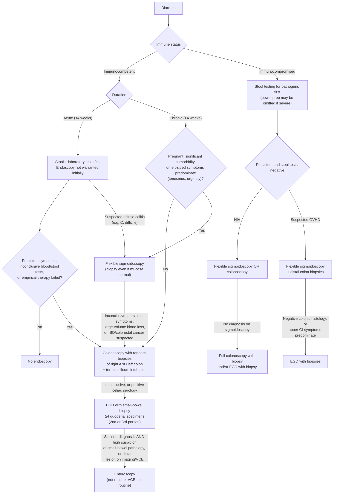

## Bibliographic Info

- **Article:** [Shen B, Khan K, Ikenberry SO, et al. The role of endoscopy in the management of patients with diarrhea. *Gastrointest Endosc* 2010;71(6):887-92.](https://doi.org/10.1016/j.gie.2009.11.025)
- **Authors:** ASGE Standards of Practice Committee (Bo Shen, lead author; Jason A. Dominitz, Chair)
- **Year:** 2010
- **Journal/Publisher:** Gastrointestinal Endoscopy
- **DOI:** [10.1016/j.gie.2009.11.025](https://doi.org/10.1016/j.gie.2009.11.025)
- **Type:** guideline (ASGE Standards of Practice; Grading of Recommendations Assessment, Development and Evaluation [GRADE] quality-of-evidence ratings only)

## Summary

American Society for Gastrointestinal Endoscopy (ASGE) Standards of Practice statement on **when and how to use endoscopy in the workup of diarrhea**, updating the society's 2001 document. Diarrhea is defined in adults by abnormal stool weight, consistency, and/or frequency; a 4-week duration separates acute from chronic. The document addresses **immunocompetent** and **immunocompromised** hosts separately and focuses chiefly on chronic diarrhea — there are few indications for endoscopy in acute diarrhea.

For the immunocompetent host, stool and laboratory tests come first; endoscopy is for persistent symptoms, an inconclusive workup, or failure of empirical therapy. When the colon is examined for chronic diarrhea, **biopsies are taken even when the mucosa looks normal**, and because microscopic colitis is patchy, **random samples from both the right and the left colon** are taken rather than left-sided samples alone. The terminal ileum is intubated; routine biopsy of a *normal-appearing* terminal ileum is explicitly left undecided. For malabsorptive or small-bowel presentations, [[upper-endoscopy|esophagogastroduodenoscopy (EGD)]] with **a minimum of 4 duodenal biopsy specimens** evaluates [[celiac-disease|celiac disease]] and its mimics. [[capsule-endoscopy|Video capsule endoscopy (VCE)]] and [[device-assisted-enteroscopy|enteroscopy]] are not for routine use.

In the immunocompromised host, stool testing is again first-line and the infectious differential is wider — notably cytomegalovirus (CMV), where a positive blood test does not establish tissue-invasive disease and biopsy may be required. In [[hiv-aids-related-diarrhea|human immunodeficiency virus (HIV) infection]], either flexible sigmoidoscopy or [[colonoscopy|colonoscopy]] is acceptable first, with colonoscopy carrying the higher yield; diagnostic yield rises as the CD4 count falls. For suspected graft-versus-host disease (GVHD) after hematopoietic stem cell transplantation (HSCT), flexible sigmoidoscopy with distal colon biopsy is the preferred initial endoscopic evaluation, with EGD reserved for negative colonic histology or predominant upper gastrointestinal (GI) symptoms.

## Key Findings / Claims

### Definitions and timing

- **Diarrhea (adults):** abnormal stool weight **>200 g/day**, consistency (loose or liquid), and/or frequency **>3 times/day**.
- **Acute ≤4 weeks · chronic >4 weeks.** Causes differ, so the need, threshold, and timing of endoscopy differ.
- **Acute diarrhea:** infectious illness in otherwise healthy people is common and short-lived and rarely needs specific therapy — **endoscopy is not warranted for the initial evaluation**.
- **Consider endoscopy in acute diarrhea only for:** persistent symptoms · inconclusive diagnosis after routine blood and stool tests · failure to respond to empirical therapy.

### Flexible sigmoidoscopy — when it is the right first test

Suitable as the **initial** investigation for:

- **Acute** diarrhea with suspected **diffuse colitis** (e.g., suspected [[clostridioides-difficile|*Clostridium difficile*]] colitis).
- **Chronic** diarrhea in patients who are **pregnant**, have **significant comorbidities**, or when **left-sided colonic symptoms predominate** (e.g., tenesmus, urgency).
- In many situations it may be sufficient as the initial endoscopic test in chronic diarrhea.
- **Biopsy regardless of appearance** — take histology specimens even when the mucosa looks normal, to exclude [[microscopic-colitis|microscopic colitis]] and other causes.

**Escalate to colonoscopy if:** sigmoidoscopic findings are inconclusive · symptoms persist · there is large-volume blood loss · [[inflammatory-bowel-disease|inflammatory bowel disease (IBD)]] or [[colorectal-cancer|colorectal cancer]] is suspected.

### Colonoscopy in chronic diarrhea

- Colonoscopy with biopsy diagnoses IBD, microscopic inflammatory disorders, and colorectal neoplasia. IBD endoscopy itself is covered by a separate ASGE guideline.
- Patients already due for colorectal cancer screening or surveillance can have **one diagnostic colonoscopy serve both purposes**.
- **Diagnostic yield 7%–32%**; IBD and microscopic colitis are the most common findings.
- **Histology is essential** — many causes are not macroscopically evident (quiescent IBD, microscopic colitis, eosinophilic colitis, amyloidosis).
- **Microscopic colitis:** 2 forms — lymphocytic and collagenous. Watery diarrhea with **no obvious endoscopic abnormality**. In referral centers it accounts for **~10%** of patients seen for chronic diarrhea.
- **Why both sides are sampled:** one retrospective series of 809 patients found >99% of 122 abnormal pathologic findings (80 of them microscopic colitis) on distal colonic samples and calculated sigmoidoscopy to be more cost-effective — but multiple other studies show microscopic colitis is **patchy**, and left-sided-only sampling can miss the diagnosis. In chronic diarrhea with a **normal-appearing colon**, take multiple biopsy samples from **both the right and the left side**.
- **Bowel preparation is chosen individually.** Sodium phosphate–based preparations can cause mucosal changes that mimic the macroscopic appearance of IBD, most commonly in the **distal colon**; endoscopically hard to tell apart, but usually distinguishable **on histology**.
- **Nonsteroidal anti-inflammatory drugs (NSAIDs)** can cause terminal ileal mucosal changes that mimic IBD.

### Terminal ileum

- **Intubate the terminal ileum** during colonoscopy done for chronic diarrhea.
- Differential for abnormal terminal ileal findings in acute or chronic diarrhea: [[crohns-disease|Crohn's disease]] · [[nsaid-enteropathy|NSAID-induced enteropathy]] · carcinoid · tuberculosis · lymphoma · adenocarcinoma.
- **Yield of ileoscopy:** conclusive incidental diagnosis in 2.7% of asymptomatic patients scoped for polyp surveillance, rising to **18%** in patients with diarrhea (non-HIV).
- **Where ileal biopsy earns its place:** inflammatory diarrhea; known or strongly suspected Crohn's disease; abnormal terminal ileum on imaging; endoscopically abnormal terminal ileal mucosa. In one report, microscopic ileal lesions were found in 125 (49%) of 257 patients with diarrhea and suspected IBD — biopsies were **essential** to the diagnosis in 15 (6%) and contributory in 53 (21%).
- **Normal-appearing terminal ileum:** significant findings in only **0%–4.2%**; routine biopsy of normal-looking mucosa is controversial and probably low yield. The document does not settle the question.

### EGD and small-bowel biopsy

- Acute diarrhea is generally a lower-GI infectious process — **routine EGD is not indicated**.
- Consider an upper GI evaluation for small-bowel disease in **chronic** diarrhea when laboratory studies and lower endoscopy are unrevealing. Differential: celiac disease · *[[giardiasis|Giardia]]* infection · Crohn's disease · eosinophilic gastroenteropathy · Whipple's disease · intestinal amyloid · pancreatic insufficiency.
- **Biopsy the small intestine even when the endoscopic appearance is normal.** State the clinical suspicion on the pathology request so special histochemical and immunohistochemical stains can be run; **specimen orientation** affects histologic accuracy.
- **Celiac serology is the first-line diagnostic modality** when celiac disease is suspected; the **tissue transglutaminase (tTG)** assay has the highest performance characteristics **in the absence of immunoglobulin A (IgA) deficiency**. Most experts confirm a positive serology with tissue biopsy.
- **Celiac disease cannot be diagnosed on endoscopic appearance alone** (e.g., scalloped folds); magnification endoscopy may raise yield and highlight areas for targeted biopsy.
- **How many and from where:** specimens from the **second or third portion of the duodenum with standard forceps** are usually sufficient. In 102 patients, celiac disease was confirmed in **90% with 2 specimens, 95% with 3, and 100% with 4** — hence the minimum of 4.
- **Patchy and distal disease:** celiac involvement may be patchy (particularly in pediatric patients) and isolated jejunal involvement can occur. Evaluate the more distal small bowel in selected patients — persistent symptoms with suspected celiac disease, or suspected small-bowel lymphoma.
- **Microscopic colitis not responding to treatment:** celiac serology and/or upper endoscopy with proximal small-bowel biopsy to exclude celiac disease, because the two are commonly concurrent.
- **Other targeted upper-endoscopic tests:** duodenal biopsies for touch preparation and/or duodenal aspirates for trophozoites in patients at high risk of *Giardia* infection with negative stool studies · quantitative culture of small-bowel biopsy or aspirate for [[small-intestinal-bacterial-overgrowth|small-bowel bacterial overgrowth]] · endoscopy-assisted pancreatic function testing for [[exocrine-pancreatic-insufficiency|pancreatic insufficiency]] in [[chronic-pancreatitis|chronic pancreatitis]].

### Video capsule endoscopy and enteroscopy

- **VCE** in chronic diarrhea with concurrent abdominal pain/symptoms: **yield 13%–24%** — Crohn's disease, NSAID-induced enteropathy, celiac disease, submucosal masses.
- VCE may be **more sensitive than EGD for the mucosal changes of celiac disease** — sensitivity **70%–85%**, specificity **100%** in untreated celiac disease.
- **Still not for routine use** in chronic diarrhea: modest diagnostic yield, no tissue, and risk of capsule retention.
- **Enteroscopy:** limited data for diarrhea alone. Push enteroscopy yield as high as **22%** in chronic diarrhea and/or malabsorption; antegrade and retrograde balloon-assisted enteroscopy increasingly used.
- **When enteroscopy is reasonable:** high suspicion of small-bowel pathology **and** EGD plus colonoscopy with biopsies non-conclusive, **or** distal small-bowel lesions detected by radiographic imaging or VCE.

### Immunocompromised host

- Causes differ from the immunocompetent host. **Stool testing for pathogens is the first-line evaluation**; endoscopy is generally indicated only when the illness is **persistent and stool tests fail to reveal a cause**.
- In **severe** diarrhea it may be possible to **omit the bowel preparation**.
- **CMV colitis** is among the commoner infectious causes after organ or stem cell transplantation, in HIV, and on immunosuppressive medication. A positive **quantitative CMV polymerase chain reaction (PCR)**, viral culture, or serology **does not necessarily indicate tissue-invasive disease** — endoscopic biopsy may be necessary. If suspicion stays high despite non-diagnostic histology, **in situ hybridization, immunohistochemistry, and tissue culture for CMV** may be required.

### HIV

- 2.8% of >15,000 hospitalized patients with HIV in one 1998 series were admitted for a diarrheal diagnosis. Most endoscopic data predate highly active antiretroviral therapy.
- CMV is the most common pathogen detected; histopathology may also identify adenovirus and enteropathogenic bacteria. **A pathogen may be found endoscopically despite negative stool studies.**
- **Yield of colonoscopy is significantly higher when the CD4 count is <100 cells/mm³** — opportunistic infections are more common at low CD4.
- **Colonoscopy vs sigmoidoscopy:** in 307 patients with unexplained chronic diarrhea, colonoscopy out-yielded sigmoidoscopy (**39% vs 22%**, *P* = .009) and was more cost-effective. In another 317 patients, **30% of pathogens and 75% of lymphomas were identified only on proximal colonic samples**, beyond the reach of the sigmoidoscope. Against this, 2 studies (79 and 48 patients) identified **82%–93%** of infectious causes from left-sided colonic specimens.
- **Upper endoscopy** is also considered if diarrhea persists despite appropriate therapy or there are upper GI symptoms (nausea, vomiting, odynophagia). In 442 patients with HIV-related chronic diarrhea having upper endoscopy with small-bowel biopsy and aspirate, a pathogen was found in **28%**; **jejunal specimens may out-yield duodenal** ones.

### Graft-versus-host disease

- A complication of HSCT, commonly presenting with **secretory diarrhea in the first 3 months after transplantation**; acute and chronic forms; any part of the GI tract.
- In **acute GVHD** diarrhea is often severe, watery or bloody. Differential: side effects of chemotherapeutic or other medications · lymphoma · viral, bacterial, fungal, or parasitic infection.
- Endoscopic findings track disease stage — normal mucosa, erythema, edema, erosions, ulcerations, mucosal sloughing.
- **Appearance does not predict histology** — there is no correlation between abnormal mucosal appearance and histologic findings. In symptomatic patients scoped after HSCT, **biopsy both normal- and abnormal-appearing mucosa**. EGD and/or colonoscopy with biopsies of stomach, small bowel, colon, and rectum are all suitable.
- **Highest-yield biopsy site in patients at risk of acute GVHD is the distal colon — sensitivity 82%–95%.**
- **Duodenal biopsy carries a significant risk of duodenal hematoma**; reported risk factors are a **diagnosis of acute GVHD** and **thrombocytopenia**. Hence flexible sigmoidoscopy with distal colon biopsy first, and EGD if those samples are negative or upper GI symptoms predominate.
- Some centers advocate combined upper endoscopy and colonoscopy as the initial evaluation of post-HSCT diarrhea to expedite diagnosis.

### Endoscopic evaluation of diarrhea — the document's approach

*Flowchart — endoscopic evaluation of diarrhea, assembled from this guideline's text and Recommendations 1-10. The document itself prints no algorithm figure.*

## How This Document Grades

The document's **only** table is its GRADE legend, reproduced below. Two points govern how its statements should be read:

- **The 10 recommendations are numbered 1–10 by the document itself** — the numbers below are the document's, not the wiki's.
- **The only grade attached is a GRADE quality-of-evidence band.** There is **no separate strength-of-recommendation label**. Strength is carried by the verb, as the document's introduction states: weaker recommendations are indicated by phrases such as *"we suggest,"* stronger ones are typically stated as *"we recommend."* Recommendation 1 uses neither verb ("should be the initial step").
- Recommendation 3's second sentence (routine biopsy of a normal-appearing terminal ileum) carries **no grade** — it is a statement of insufficient data, not a recommendation. Recommendation 10 carries **two** grades, one per clause.

| Quality of evidence | Definition | Symbol |
|---|---|---|
| High quality | Further research is very unlikely to change our confidence in the estimate of effect | ⊕⊕⊕⊕ |
| Moderate quality | Further research is likely to have an important impact on our confidence in the estimate of effect and may change the estimate | ⊕⊕⊕○ |
| Low quality | Further research is very likely to have an important impact on our confidence in the estimate of effect and is likely to change the estimate | ⊕⊕○○ |
| Very low quality | Any estimate of effect is very uncertain | ⊕○○○ |

*Table 1 — GRADE system for rating the quality of evidence for guidelines, recreated from the document (which adapted it from Guyatt et al.). No recommendation in this guideline is rated High or Very low.*

## Recommendations (verbatim, numbered as in the document)

1. Stool and laboratory tests should be the initial step for the evaluation of clinical scenarios suggestive of infectious diarrhea. *(⊕⊕⊕○ Moderate quality)*
2. In patients with chronic unexplained diarrhea, we suggest colonoscopy with random biopsies of the right and left side of the colon. Sigmoidoscopy is an alternative option, although this may miss right-sided organic disease. *(⊕⊕○○ Low quality)*
3. We recommend intubation of the terminal ileum during colonoscopy for patients undergoing evaluation of chronic diarrhea. *(⊕⊕⊕○ Moderate quality)* There are insufficient data to determine whether biopsy of an endoscopically normal-appearing terminal ileum should be routinely performed, but the yield of this is likely low. *(ungraded — not a recommendation)*
4. We recommend EGD with small-bowel biopsy in patients with chronic diarrhea or suspected malabsorption and inconclusive evaluation after colonoscopy with biopsy and in patients with positive celiac serology. *(⊕⊕⊕○ Moderate quality)*
5. We recommend obtaining a minimum of 4 duodenal biopsy specimens for evaluation of suspected celiac disease. *(⊕⊕⊕○ Moderate quality)*
6. Enteroscopy is not recommended for the routine evaluation of chronic diarrhea but may be useful for evaluation of small-bowel disease when other investigations are nondiagnostic. *(⊕⊕○○ Low quality)*
7. VCE is not recommended for the routine evaluation of chronic diarrhea. *(⊕⊕○○ Low quality)*
8. In patients with HIV and diarrhea, we suggest either flexible sigmoidoscopy or colonoscopy if laboratory evaluation is nondiagnostic. *(⊕⊕○○ Low quality)*
9. In the absence of a diagnosis on flexible sigmoidoscopy, we recommend a full colonoscopy with biopsy and/or EGD with biopsy for HIV patients with persistent diarrhea. *(⊕⊕⊕○ Moderate quality)*
10. In patients with suspected GVHD and diarrhea, we suggest flexible sigmoidoscopy with distal colon biopsies as the initial endoscopic evaluation. *(⊕⊕○○ Low quality)* In the event of negative colonic histology findings or when upper GI symptoms predominate, we recommend an EGD with biopsies. *(⊕⊕⊕○ Moderate quality)*

## Relevance to Wiki

- [[chronic-diarrhea]] — the endoscopic arm of the workup: when to scope, flexible sigmoidoscopy vs colonoscopy selection criteria, random right + left colonic biopsies, terminal ileum intubation, EGD with ≥4 duodenal specimens, and the limited roles of VCE and enteroscopy.
- [[acute-diarrhea]] — endoscopy is not warranted for initial evaluation; the three triggers that change that.
- [[microscopic-colitis]] — normal-appearing mucosa, patchy distribution, right + left sampling, and the concurrent-celiac rule for treatment non-responders.
- [[celiac-disease]] — serology-first strategy, tTG performance caveat in IgA deficiency, duodenal biopsy site and number, patchy/jejunal disease.
- [[hiv-aids-related-diarrhea]] — sigmoidoscopy vs colonoscopy data, the CD4 <100 cells/mm³ yield threshold, proximal-colon and jejunal sampling.
- [[colonoscopy]], [[upper-endoscopy]], [[capsule-endoscopy]], [[device-assisted-enteroscopy]] — indications and explicit limits in the diarrhea workup.
- [[giardiasis]], [[small-intestinal-bacterial-overgrowth]], [[exocrine-pancreatic-insufficiency]] — the targeted upper-endoscopic sampling techniques for each.
- Supplies the duodenal-hematoma caution and distal-colon biopsy preference for diarrhea after hematopoietic stem cell transplantation.

## Contradictions / Open Questions

- **Duodenal biopsy protocol is superseded.** This guideline asks for **a minimum of 4 specimens from the second or third portion of the duodenum**. The newer [[acg-2022-celiac|ACG 2022 celiac guideline]] requires **1–2 specimens from the duodenal bulb plus ≥4 from the distal duodenum** (strong recommendation, moderate evidence) and allows a non-biopsy diagnostic route in selected patients. **Follow ACG 2022 on how to biopsy for celiac disease**; this document's "minimum of 4" is the floor, not the current protocol.
- **Microscopic colitis biopsy protocol has since been quantified.** This guideline says "multiple biopsy samples from both the right and left sides" without a count, and allows sigmoidoscopy as an alternative. [[peery-2025-microscopic-colitis|Peery 2025]] specifies **≥2 biopsies from the right colon and ≥2 from the left, rectum excluded**, with colonoscopy to the terminal ileum; [[aga-2016-microscopic-colitis|AGA 2016]] says that if flexible sigmoidoscopy is used, the **descending colon must be sampled in addition to the rectosigmoid**.
- **Prevalence of microscopic colitis in chronic diarrhea differs between sources** — this document gives **~10%** of patients seen for chronic diarrhea in referral centers; AGA 2016 gives **7.5%** of patients undergoing evaluation for chronic diarrhea.
- **The document contradicts itself on how far to scope, and does not resolve it.** Its own cited 809-patient series found >99% of abnormal pathology on distal colonic samples and judged sigmoidoscopy more cost-effective; other cited studies show patchy microscopic colitis missed by left-sided sampling. Recommendation 2 lands on right + left sampling while still permitting sigmoidoscopy "although this may miss right-sided organic disease."
- **The same tension is unresolved in HIV.** Colonoscopy out-yielded sigmoidoscopy 39% vs 22%, and 30% of pathogens / 75% of lymphomas were proximal-only — yet 82%–93% of infectious causes were found on left-sided specimens in two other series. Recommendation 8 therefore *suggests* **either** test, and gives no criterion for choosing between them.
- **Routine biopsy of a normal-appearing terminal ileum is an explicit non-recommendation.** The document states there are insufficient data to decide, with yield likely low (0%–4.2%). It should not be read as either endorsing or prohibiting the practice.
- **The persistent-diarrhea window has moved.** This document's endoscopy triggers for acute diarrhea are qualitative ("persistent symptoms"). The newer [[acg-2016-acute-diarrhea|ACG 2016 acute diarrhea guideline]] puts a number on it: endoscopic evaluation is **not** recommended for symptoms persisting **14–30 days** with a negative stool workup (strong recommendation, very low evidence).
- **Acute GVHD severity is not staged here.** Endoscopic findings are said to track "the stage of disease," but no staging system, grading scale, or threshold is given — the biopsy strategy is the same at every stage.
- **The HIV endoscopic evidence predates modern therapy.** The document states its data come mostly from studies preceding highly active antiretroviral therapy, so the quoted yields may not hold in a virally suppressed population.
- **IBD endoscopy is deferred, and that cross-reference is itself outdated.** The document hands IBD diagnosis, surveillance, and endoscopic therapy to the then-current ASGE IBD guideline (2006); the wiki's current ASGE position is [[asge-2015-ibd]].

## See Also

[[chronic-diarrhea]], [[acute-diarrhea]], [[hiv-aids-related-diarrhea]], [[microscopic-colitis]], [[celiac-disease]], [[seronegative-villous-atrophy]], [[crohns-disease]], [[inflammatory-bowel-disease]], [[clostridioides-difficile]], [[giardiasis]], [[small-intestinal-bacterial-overgrowth]], [[exocrine-pancreatic-insufficiency]], [[chronic-pancreatitis]], [[colorectal-cancer]], [[colonoscopy]], [[upper-endoscopy]], [[capsule-endoscopy]], [[device-assisted-enteroscopy]]
