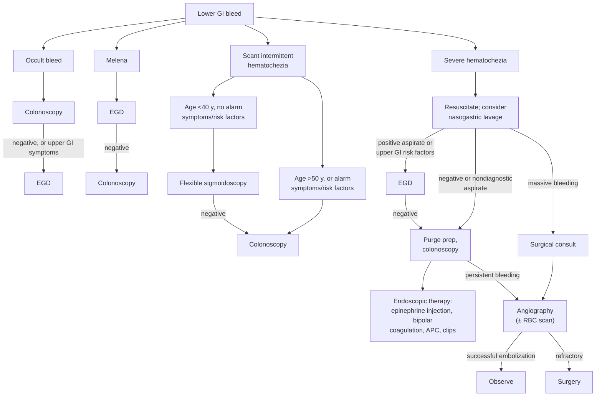

## Bibliographic Info

- **Article:** [ASGE Standards of Practice Committee. The role of endoscopy in the patient with lower GI bleeding. *Gastrointest Endosc* 2014;79:875-85.](https://doi.org/10.1016/j.gie.2013.10.039)
- **Authors:** ASGE Standards of Practice Committee
- **Year:** 2014
- **Journal/Publisher:** Gastrointestinal Endoscopy (ASGE)
- **DOI:** [10.1016/j.gie.2013.10.039](https://doi.org/10.1016/j.gie.2013.10.039)
- **Type:** guideline (ASGE Standards of Practice; GRADE quality-of-evidence ratings only)

## Summary

American Society for Gastrointestinal Endoscopy (ASGE) Standards of Practice guideline on endoscopy in lower gastrointestinal (GI) bleeding (LGIB), spanning occult bleeding, chronic scant hematochezia, melena, and severe acute hematochezia. **[[colonoscopy|Colonoscopy]]** is the test of choice for occult bleeding and for chronic intermittent scant hematochezia in patients aged >50 y or with [[iron-deficiency-anemia|iron deficiency anemia]] (IDA), colorectal neoplasia risk factors, or alarm symptoms (weight loss, bowel habit change); [[upper-endoscopy|esophagogastroduodenoscopy (EGD)]] is added when no colonic source is found or upper GI symptoms/IDA/nonsteroidal anti-inflammatory drug (NSAID) use are present. For melena or severe hematochezia with hemodynamic instability, an **initial EGD** excludes a high-risk upper source before colonoscopy. In severe hematochezia, **colonoscopy within 24 hours of admission after a rapid bowel preparation** is suggested. [[endoscopic-hemostasis|Endoscopic hemostasis]] is detailed for diverticular bleeding (epinephrine injection + thermal coagulation or clips; clip/tattoo for relocalization) and [[angioectasia|angioectasias]] ([[argon-plasma-coagulation|argon plasma coagulation (APC)]] preferred), with device settings. Severe hematochezia that cannot be stabilized or where endoscopy fails warrants surgical/radiologic (angiographic embolization) consultation.

It corroborates the newer [[acg-2023-lgib|American College of Gastroenterology (ACG) 2023]] LGIB guideline on diagnostic sequence and on endoscopic hemostasis technique, and adds device-level detail (injection volumes, probe energies, argon flow, purge-prep rate) that ACG 2023 does not supply. ACG 2023 supersedes it on **colonoscopy timing** and on risk stratification/resuscitation thresholds.

## Key Findings / Claims

### Definitions and burden

- **LGIB — historical definition:** bleeding from a source **distal to the ligament of Treitz**. After deep enteroscopy, small-bowel sources were reclassified as midgut bleeding and a newer definition was proposed: bleeding **distal to the ileocecal valve**. Both definitions are stated; the document does not pick one.
- **Acute LGIB:** bleeding of recent duration (**<3 days**) that may cause hemodynamic instability, anemia, and/or need for transfusion.
- **Chronic LGIB:** blood per rectum over several days or longer — occult fecal blood, intermittent melena or maroon stools, or scant bright red blood per rectum.
- LGIB = 20%–30% of all major GI bleeding; annual incidence 0.03%, rising **200-fold** from the second to the eighth decade; ~35.7/100,000 adults hospitalized/year in the United States; mean age at presentation 63–77 y. Mortality 2%–4%, usually from comorbidities and nosocomial infection.
- Compared with [[upper-gi-bleeding|upper GI bleeding (UGIB)]], LGIB presents with **higher hemoglobin** and is **less likely** to cause hypotensive shock or require transfusion.
- An upper GI source is present in **11%–15%** of suspected LGIB; [[small-bowel-bleeding|small-bowel]] sources account for **2%–15%**.

### Etiologies (document's Table 2, with frequencies from the text)

| Etiology | Share of LGIB / key figures |
|---|---|
| Diverticular bleeding | 20%–65% of acute LGIB; diverticula in up to 30% aged ≥50 y, ~60% aged >80 y; clinically significant bleeding in 3%–15% of those with diverticula |
| Ischemic colitis ([[colon-ischemia]]) | 1%–19%; mainly elderly; watershed splenic flexure/rectosigmoid; rectum usually spared |
| Angioectasia | 3%–15%; prevalence 1%–2% at screening colonoscopy, 40%–50% of those with hematochezia; >2/3 in patients aged >70 y |
| [[hemorrhoids\|Hemorrhoids]] | 2%–10% of acute LGIB; present in up to 75% of LGIB patients but usually incidental |
| Colorectal neoplasia ([[colorectal-cancer]]) | up to 17%; right-sided tumors → occult blood loss and IDA, left-sided → hematochezia; bleeding is usually slow, so endoscopic hemostasis is rarely required |
| Postpolypectomy bleeding ([[polypectomy]]) | 2%–8%; 8.7 bleeds/1000 procedures in a 50,000-colonoscopy Medicare analysis |
| [[inflammatory-bowel-disease\|Inflammatory bowel disease]] | LGIB requiring hospitalization is uncommon — 1.2%–6% of all admissions in Crohn's disease, 0.1%–4.2% in ulcerative colitis; more frequent with colonic Crohn's than isolated small-bowel disease; resolves spontaneously in up to 50%, recurs in up to 35%; biologics can be effective |
| Infectious colitis | listed etiology |
| NSAID colopathy | ulcerations + diaphragm-like strictures, terminal ileum and right colon; may be misdiagnosed as inflammatory bowel disease |
| [[radiation-proctopathy\|Radiation proctopathy]] | 4%–13% |
| Stercoral ulcer | rectal ulcers in 8% of severe hematochezia; 32% of LGIB arising after intensive care unit admission |
| Rectal varices | listed etiology |
| Dieulafoy lesion | listed etiology |

- **Diverticular bleeding detail:** painless hematochezia; trauma to the vasa recta at the neck or dome; NSAIDs increase risk, hypertension and anticoagulation may contribute to severity. Resolves spontaneously in **75%–80%**, recurs in **25%–40% within 4 years**. Definitive diagnosis (active bleeding or high-risk stigma) in only ~**22%**.
- **Angioectasia detail:** red flat lesions 2 mm to several centimeters with radiating ectatic vessels from a central feeding vessel; predominantly cecum and ascending colon. Colonoscopy sensitivity **80%**; narcotic sedation may reduce mucosal blood flow and hide them. Bleeding angioectasias with aortic stenosis = [[heydes-syndrome|Heyde syndrome]] — high rebleeding rate despite endoscopic treatment; definitive management may require aortic valve replacement.
- **HIV-associated LGIB:** 2.6%, usually AIDS-related thrombocytopenia; inpatient mortality 28%; opportunistic causes include cytomegalovirus, herpes simplex virus, Kaposi sarcoma, idiopathic proctocolitis.

### Risk stratification (named prediction rules and their criteria)

- **Strate rule — 7 clinical predictors**, developed and validated to sort acute LGIB into 3 strata: heart rate ≥100/min · systolic blood pressure ≤115 mm Hg · syncope · nontender abdominal examination · rectal bleeding during the first 4 hours of evaluation · aspirin use · multiple comorbid illnesses.

| Risk factors present | Stratum | Risk of severe bleeding |
|---|---|---|
| ≥3 | High | 80% |
| 1–3 | Moderate | 45% |
| 0 | Low | <10% |

- **Velayos predictors** of severe LGIB (independent): initial hematocrit **<35%** · abnormal vital signs **1 hour after** initial medical evaluation (systolic blood pressure <100 mm Hg or heart rate >100/min) · gross blood on initial rectal examination.
- **BLEED model** (for UGIB and LGIB) — ongoing **b**leeding, **l**ow systolic blood pressure, **e**levated prothrombin time, **e**rratic mental status, unstable comorbid **d**isease — predicts resource use and inpatient adverse events including mortality.
- All three models **have not been adopted into clinical practice**; the document gives no score thresholds for triage beyond the strata above.
- **Disposition/resuscitation:** most chronic LGIB (occult blood or scant hematochezia) can be worked up electively as an outpatient. Acute LGIB with melena or hematochezia usually needs admission (elderly, comorbid). Stabilize with crystalloids or blood products; coagulation factors and platelets may be needed for patients on [[anticoagulation-gi-bleeding|antithrombotic agents]] or with bleeding disorders. Intensive care monitoring for ongoing/severe bleeding, transfusion requirement **>2 units** of packed red blood cells, or significant comorbidities.
- **Nasogastric tube/gastric lavage:** never studied prospectively in suspected acute LGIB, but consider it with hematochezia + hemodynamic instability to rule out brisk UGIB. **Bile in the aspirate makes an actively bleeding upper source unlikely; a clear aspirate does not exclude one.**
- Targeted history that guides the workup: NSAID use, prior bleeding episodes, recent polypectomy, radiation therapy for prostate or pelvic malignancy, inflammatory bowel disease, colorectal cancer risk factors.

### Endoscopic evaluation — yields and the document's algorithm

- Colonoscopy is first-line for occult GI bleeding and chronic scant hematochezia in higher-risk patients.
- EGD complements colonoscopy when the colon is non-diagnostic, especially with upper GI symptoms, IDA, or NSAID use. Overall EGD yield in this setting **13%–41%** (mostly peptic ulcer and esophagitis).
- **Occult bleeding:** colonoscopy to look for colorectal neoplasia. Computed tomography (CT) colonography is an alternative when colonoscopy carries high adverse-event risk, or for proximal lesions after an incomplete colonoscopy. Persistent anemia after negative EGD + colonoscopy → small-bowel evaluation ([[capsule-endoscopy]], [[device-assisted-enteroscopy|deep enteroscopy]] are covered in a separate ASGE document).
- **Melena:** EGD first (most are UGIB); colonoscopy if EGD negative. Melena carries an increased likelihood of colorectal cancer vs average-risk screening (odds ratio 2.87). Melena persisting after negative bidirectional endoscopy → small-bowel endoscopy.
- **Chronic intermittent scant hematochezia:** usually an anorectal or distal colon source. Digital rectal examination (DRE) + flexible sigmoidoscopy ± anoscopy may be sufficient **in healthy patients aged <40 y**; flexible sigmoidoscopy yield is **9%–58%**. Pursue colonoscopy if no definitive source on flexible sigmoidoscopy, age >50 y, IDA, colorectal neoplasia risk factors, or alarm symptoms of weight loss or bowel habit change.
- **Severe hematochezia + hemodynamic instability:** emergent EGD first to find/treat a high-risk upper lesion; colonoscopy after the upper source is excluded. In the **hemodynamically stable** patient with severe hematochezia, colonoscopy comes first and EGD follows if colonoscopy is negative.
- **Colonoscopy diagnostic yield in LGIB 45%–100%** — significantly higher than nuclear red blood cell (RBC) scan or angiography; endoscopic therapy is applied in **10%–40%** of colonoscopies, achieving immediate hemostasis in **50%–100%**.

*Figures 1 and 2 — management of LGIB and of severe hematochezia, combined and recreated from the document's algorithms.*

### Timing and bowel preparation

- Urgent colonoscopy in severe hematochezia: different studies support **8 to 24 hours** of admission; Recommendation 8 suggests **within 24 hours**.
- Earlier colonoscopy raises diagnostic yield and the chance of a therapeutic intervention. Endoscopic therapy was delivered in **29%** of colonoscopies done within 12 h, **13%** at 12–24 h, **4%** at 24–48 h, and **0%** after 48 h. Early colonoscopy also shortened hospital stay and reduced cost.
- **Preparation:** polyethylene glycol (PEG)-based solution orally, or by nasogastric tube in patients at aspiration risk or unable to drink, at ~**1 L every 30–45 minutes until the effluent is free of fecal material**; colonoscopy **within 1–2 hours** of finishing the prep. Re-accumulated blood after preparation can help localize the source.

### Endoscopic treatment — technique and device settings

**Bleeding diverticula**
- **Epinephrine** 1:10,000 or 1:20,000, injected in **1-mL aliquots up to 2 mL** at the site of active bleeding or around a nonbleeding visible vessel — alone or combined with thermal contact therapy.
- **Adherent clot:** guillotine with a polypectomy snare to expose the underlying vessel.
- **Thermal contact:** heater probe **10–15 J**, or bipolar coagulation **10–16 W** with **2–3-second** pulses and mild contact pressure. Perforation has been reported in the thin-walled right colon in up to **2.5%** — avoid higher settings and repeated applications.
- **Clips:** deploy over the vessel at the neck of the diverticulum, or appose the walls to close the orifice and tamponade a vessel within the dome; a cap can evert the diverticulum. **No reports of early rebleeding after clip treatment.**
- **Band ligation:** described in small series only — limited by inadequate suction of diverticula with small orifices and wide domes, and by high early rebleeding; not yet routine.
- **Tattoo adjacent to the bleeding diverticulum** (and a clip) for repeat endoscopic, surgical, or angiographic localization.

**Bleeding angioectasias**
- Contact and noncontact thermal methods both work; **APC is preferred** — easy to apply, treats large surface areas, predictable depth of penetration.
- **APC settings: 30–45 W with 1 L/min argon flow**, probe held **1–3 mm** from the mucosa, fired in **1–2-second pulses** — lower power to reduce perforation risk in the thin-walled right colon.
- Follow-up of 100 patients with angioectasias (31% colonic) for a median of 16 months after APC: significant hemoglobin improvement, reduced transfusion need, no adverse events. Clips plus APC also reported.

### Nonendoscopic management

- **Mesenteric angiography ± preceding nuclear RBC scan:** reserved for severe bleeding that cannot be stabilized or prepped for colonoscopy, and for endoscopic failures.
- **Multidetector row CT** may be superior to the nuclear RBC scan — shorter scan time, accurate arterial images, shows contrast extravasation anywhere in the GI tract; it **has replaced the nuclear RBC scan at several centers** (not universally).
- Angiography detects bleeding at a rate of **0.5 mL/min**.
- **Superselective embolization** (microcoils, polyvinyl alcohol particles, water-insoluble gelatin) improved success and reduced bowel infarction. Meta-analysis as first-line therapy: hemostasis in **85%** of diverticular bleeding vs **50%** of other sources at 30-day follow-up. **Early rebleeding after embolization 22%.** Major adverse events — bowel infarction, nephrotoxicity, hematomas — in up to **17%**. Angioectasias are harder to embolize, with rebleeding up to **40%**.
- **Surgery is rarely required** and is reserved for persistent or refractory diverticular bleeding. Criteria that may indicate the need for surgery: **hypotension and shock despite resuscitation** · **persistent bleeding requiring transfusion of ≥6 units of packed red blood cells** · **no diagnosis despite pan-intestinal evaluation** in a surgical candidate with persistent bleeding.
- **Localize before operating:** segmental colectomy is preferred; subtotal colectomy carries significantly higher mortality. Operate electively when possible — emergent surgery carries high mortality.

## Recommendations (verbatim)

**How this document grades.** The 12 statements are numbered 1–12 by the document itself. The only grade attached is a **GRADE quality-of-evidence** rating in one of four bands — High (⊕⊕⊕⊕), Moderate (⊕⊕⊕○), Low (⊕⊕○○), Very low (⊕○○○). There is **no separate strength-of-recommendation label**: strength is carried by the verb — "We recommend" is the stronger form, "We suggest" the weaker. Every statement, including the surgical/radiologic consultation one, carries a quality rating.

1. We recommend colonoscopy in patients with occult GI bleeding. *(⊕⊕⊕⊕ High quality)*
2. We recommend EGD in patients with occult GI bleeding if a bleeding source is not identified in the colon, especially in those patients with upper GI symptoms, iron deficiency anemia, or nonsteroidal anti-inflammatory drug use. *(⊕⊕⊕○ Moderate quality)*
3. We suggest small-bowel evaluation after negative EGD and colonoscopy results in patients with occult GI bleeding who have persistent anemia. *(⊕⊕○○ Low quality)*
4. We recommend colonoscopy for the evaluation of chronic intermittent scant hematochezia in patients aged >50 years and for patients who have iron deficiency anemia, risk factors for colorectal neoplasia, or the alarm symptoms of weight loss or bowel habit changes. *(⊕⊕⊕○ Moderate quality)*
5. We suggest that in younger patients presenting with chronic intermittent scant hematochezia without alarm symptoms, a digital rectal examination and flexible sigmoidoscopy may be sufficient evaluation. *(⊕⊕○○ Low quality)*
6. We recommend EGD in the initial evaluation of patients with melena followed by colonoscopy if the EGD result is negative. *(⊕⊕⊕⊕ High quality)*
7. We recommend an initial EGD in patients with severe hematochezia and hemodynamic instability to evaluate for a high-risk upper GI lesion, followed by colonoscopy if the EGD result is negative. *(⊕⊕⊕⊕ High quality)*
8. We suggest colonoscopy within 24 hours of admission after a rapid bowel preparation in the evaluation of patients with severe hematochezia. *(⊕⊕⊕○ Moderate quality)*
9. We recommend endoscopic treatment with epinephrine solution injection combined with thermal coagulation or endoscopic clip placement as the preferred management in patients presenting with diverticular bleeding. *(⊕⊕⊕⊕ High quality)*
10. We recommend endoscopic clip or tattoo placement adjacent to a bleeding diverticulum if identified at colonoscopy for future localization in the event of recurrent bleeding. *(⊕⊕⊕○ Moderate quality)*
11. We recommend endoscopic treatment with argon plasma coagulation as the preferred management in patients with bleeding angioectasias. *(⊕⊕⊕⊕ High quality)*
12. We recommend surgical and radiologic consultation in patients presenting with severe hematochezia who cannot be stabilized for endoscopy or in whom endoscopic evaluation has failed to reveal a bleeding source. *(⊕⊕⊕○ Moderate quality)*

## Relevance to Wiki

- Complementary endoscopic-technique source for [[acute-lower-gi-bleeding]] — device settings (epinephrine dilution and volume, heater probe joules, bipolar watts, APC watts and flow), purge-prep rate, and the surgical-referral criteria.
- Supports endoscopic hemostasis, argon plasma coagulation, angioectasia (including Heyde syndrome), colon ischemia, radiation proctopathy, and the postpolypectomy bleeding content on the polypectomy page.
- Supplies definitions of acute vs chronic LGIB and the historical vs ileocecal-valve boundary used throughout the LGIB pages.

## Contradictions / Open Questions

- **Timing of colonoscopy — superseded.** This document *suggests* colonoscopy within 24 hours of admission for severe hematochezia, and its own data show endoscopic therapy applied in 29% of colonoscopies done within 12 h vs 0% after 48 h. The newer ACG 2023 guideline recommends **against** urgent colonoscopy within 24 hours for most hospitalized patients, citing randomized trials showing no benefit and one showing harm versus elective (24–96 h) colonoscopy. **Follow ACG 2023 on timing.** This document itself notes 2 studies that found no improvement in rebleeding or surgery after urgent colonoscopy.
- **The Strate strata overlap.** Exactly three risk factors falls into both the high-risk (≥3 factors, 80%) and moderate-risk (1–3 factors, 45%) band as the document states them; it does not say which applies.
- **Age cut-point for scant hematochezia is given twice, differently.** The text and algorithm allow digital rectal examination + flexible sigmoidoscopy for healthy patients aged **<40 y**, while colonoscopy is recommended from **>50 y**. Patients aged 40–50 y without alarm features are not addressed.
- **LGIB has two active definitions** — distal to the ligament of Treitz (historical) vs distal to the ileocecal valve (proposed after deep enteroscopy). The document presents both and does not choose, which changes whether small-bowel sources count as LGIB.
- **Hemorrhoids: incidental or causal?** Hemorrhoids are found in up to 75% of patients with LGIB and are called mostly incidental, accounting for only 2%–10% of acute LGIB — yet two studies found them to be the underlying etiology in 24%–64.4% of patients presenting with hematochezia.
- **Diverticular bleeding localizes differently by modality** — left colon in 50%–60% of colonoscopic detections, right colon in 50%–90% of angiographic detections. A definitive diagnosis is made in only ~22%, so most "diverticular bleeds" are presumptive.
- **Rebleeding after endoscopic therapy is inconsistent across eras:** older thermal/epinephrine series report early (<30-day) rebleeding of 0%–38%, while two recent clip series reported no early rebleeding and late rebleeding in 18%–22%. Late rebleeding may arise from a different diverticulum than the index bleed.
- **Risk scores are not usable yet.** The Strate, Velayos, and BLEED tools are described as potentially useful for triage and level of care but **not adopted into clinical practice**; no validated threshold for admission or intensive care is given beyond "ongoing/severe bleeding, >2 units transfused, or significant comorbidities."
- **Nasogastric lavage** in suspected acute LGIB has never been studied prospectively, yet is advised for hematochezia with hemodynamic instability; a clear aspirate cannot exclude an upper source.
- Band ligation for diverticular bleeding is described but explicitly **not yet ready for routine practice**.

## See Also

[[acute-lower-gi-bleeding]], [[upper-gi-bleeding]], [[small-bowel-bleeding]], [[colonoscopy]], [[upper-endoscopy]], [[endoscopic-hemostasis]], [[argon-plasma-coagulation]], [[angioectasia]], [[heydes-syndrome]], [[colon-ischemia]], [[hemorrhoids]], [[radiation-proctopathy]], [[polypectomy]], [[inflammatory-bowel-disease]], [[iron-deficiency-anemia]], [[anticoagulation-gi-bleeding]], [[capsule-endoscopy]], [[device-assisted-enteroscopy]]
