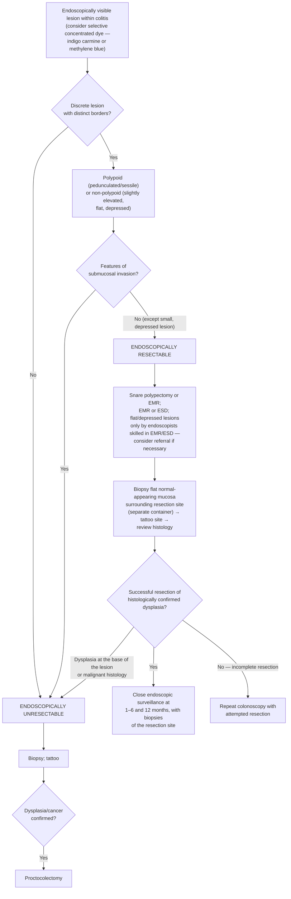

## Bibliographic Info
- **Article:** [Shergill AK, Lightdale JR, Bruining DH, et al. The role of endoscopy in inflammatory bowel disease. Gastrointest Endosc 2015;81(5):1101–1121.e13.](https://doi.org/10.1016/j.gie.2014.10.030)
- **Authors:** ASGE Standards of Practice Committee (Amandeep K. Shergill, Jenifer R. Lightdale, David H. Bruining, et al.)
- **Year:** 2015
- **Journal/Publisher:** Gastrointestinal Endoscopy
- **DOI:** [10.1016/j.gie.2014.10.030](https://doi.org/10.1016/j.gie.2014.10.030)
- **Type:** guideline (American Society for Gastrointestinal Endoscopy [ASGE] Standards of Practice; GRADE-rated)

## Summary

ASGE Standards of Practice statement on the role of endoscopy across the full arc of inflammatory bowel disease (IBD) care: **diagnosis and subtyping, small-bowel evaluation, disease-activity/mucosal-healing assessment, postoperative recurrence, dysplasia surveillance, and endoscopic therapy of strictures.** Literature search January 1980 – March 2014; it updates a prior ASGE guideline. For diagnosis, colonoscopy **with ileoscopy** plus multi-site mucosal biopsies is the cornerstone and distinguishes Crohn's disease (CD) from ulcerative colitis (UC) in ~90% of cases; ileoscopy is key to separating true CD ileitis from UC backwash ileitis, and a cecal/periappendiceal patch in UC should not be misread as CD. Small-bowel CD is evaluated with capsule endoscopy (CE; after a patency capsule or cross-sectional enterography when obstruction is possible) and device-assisted enteroscopy for reachable lesions; endoscopic ultrasound (EUS) aids characterization of perianal fistulizing CD.

For surveillance, the guideline endorses screening colonoscopy 8 years after disease onset, then surveillance every 1–3 years, with **chromoendoscopy and targeted biopsies as the preferred dysplasia-detection technique** (random biopsies remain a reasonable alternative where chromoendoscopy yield is limited or it is unavailable) — concordant with the [[asge-2015-scenic-ibd-dysplasia|SCENIC international consensus]] published the same year. It recommends the revised Montreal Classification for standardized phenotyping, pouch surveillance for the highest-risk patients (prior dysplasia/cancer), neoterminal-ileum evaluation 6–12 months after resection to risk-stratify recurrence, and **endoscopic balloon dilation for symptomatic benign IBD strictures <4 cm**. A UC colon stricture is malignant until proven otherwise.

All 21 statements sit in a single numbered **SUMMARY** list at the end of the document; the numbering below is the guideline's own. Each carries a GRADE quality-of-evidence symbol only — the document assigns **no separate strength-of-recommendation rating**, and has no ungraded key-concept or best-practice tier.

## Key Findings / Claims

### GRADE legend (Table 1)

| Quality of evidence | Definition | Symbol |
|---|---|---|
| High | Further research is very unlikely to change our confidence in the estimate of effect. | ⊕⊕⊕⊕ |
| Moderate | Further research is likely to have an important impact on our confidence in the estimate of effect and may change the estimate. | ⊕⊕⊕◯ |
| Low | Further research is very likely to have an important impact on our confidence in the estimate of effect and is likely to change the estimate. | ⊕⊕◯◯ |
| Very low | Any estimate of effect is very uncertain. | ⊕◯◯◯ |

No statement in this document is graded very low.

### Diagnosis and subtyping
- Colonoscopy + ileoscopy + multi-site biopsy is the diagnostic cornerstone; differentiates CD vs UC in ~90% of patients.
- Biopsy technique: ideally **≥2 biopsy specimens from each of 5 sites** throughout the examined bowel, including ileum and rectum, at the initial evaluation; sample both diseased and normal-appearing mucosa, label separately.
- Relative contraindications to endoscopy in IBD: severe colitis, [[toxic-megacolon|toxic megacolon]].
- Hold sodium phosphate–based preps and nonsteroidal anti-inflammatory drugs (NSAIDs) before the examination — both cause mucosal changes mimicking IBD.
- Obtain the index colonoscopy **before starting therapy**: therapy obscures discriminating features (segmental colitis, patchy inflammation, rectal sparing).
- Features favoring CD: skip lesions, rectal sparing, terminal-ileal involvement, internal fistula opening, anal/perianal disease, aphthous/deep/serpiginous ulcers, cobblestoning. Features favoring UC: diffuse continuous inflammation proximal to the anal canal, granularity, loss of vascular pattern, friability, superficial ulceration, an abrupt line of demarcation. **None is specific.**
- Ileoscopy — CD ileitis vs UC backwash ileitis:

  | | Backwash ileitis (UC) | CD ileitis |
  |---|---|---|
  | Segment | Short, contiguous with cecal colitis | Extensive, may be patchy |
  | Severity vs cecum | Milder than or continuous with the colitis | Greater than the cecal inflammation |
  | Pancolitis | Present | Inflammation may occur without pancolitis |
  | Ulcers/stricture | No stricture, stenosis or significant ulceration | Discrete ulcers, stricture of ileum or ileocecal valve |

  Backwash ileitis occurs in up to 25% of patients with UC with pancolitis.
- Cecal/periappendiceal patch with an otherwise normal right colon in UC should **not** be misdiagnosed as CD; patients with a cecal patch have similar rates of remission, relapse and proximal extension to those without.
- Stricturing disease is rare in UC and raises the possibility of CD or malignancy.
- Histology: no single criterion is definitive. Chronicity markers — architectural distortion, basal plasmacytosis, increased lamina propria cellularity, pyloric gland metaplasia, Paneth cell metaplasia in the left colon. Granulomas suggest CD but are not pathognomonic (also tuberculosis, fungal/bacterial infection, sarcoidosis, foreign-body reaction, diversion colitis, and crypt-injury-associated granulomas in UC); **only lamina propria granulomas not associated with crypt injury support CD.** Granuloma detection 13.6%–55.6%, higher when biopsies are taken from the edge of ulcers and aphthous erosions.
- IBD type unclassified (IBD-U) = colon disease not classifiable as UC or CD. *Indeterminate colitis* is reserved for post-colectomy cases unclassified on the resection specimen. Diagnosis was revised in 4% and remained IBD-U in 7% over >22 months of follow-up; ~9% of 843 cases changed diagnosis in a population-based cohort. IBD-U prevalence in pediatric series 5%–30%.

### Revised Montreal Classification (Table 2)

*Recommendation 10 asks for Montreal reporting; these are its categories.*

**Ulcerative colitis**

| Classification | Definition | Maximal endoscopic involvement |
|---|---|---|
| E1 | Proctitis | Limited to rectum |
| E2 | Left-sided | Limited to colonic mucosa distal to splenic flexure |
| E3 | Extensive | Extends proximal to splenic flexure |

**Crohn's disease**

| A: Age at onset | L: Location | B: Behavior |
|---|---|---|
| A1 = ≤16 y | L1 = ileal | B1 = non-stricturing, non-penetrating |
| A2 = 17–40 y | L2 = colonic | B2 = stricturing |
| A3 = >40 y | L3 = ileocolonic | B3 = penetrating |
| | L4 = isolated upper gastrointestinal (GI) | + p = perianal disease is present |

L4 is added to L1–L3 as a modifier when upper GI Crohn's disease is also present.

- Macroscopic proximal extension of proctitis or left-sided colitis occurs in ~20%–50% of adults with UC; >80% of children have extensive inflammation at the initial colonoscopy.
- Endoscopy can underestimate extent compared with histology — biopsy to define the inflamed extent, which drives prognosis, therapy and dysplasia risk stratification.

### Disease activity, scoring and mucosal healing
- **No consensus endoscopic severity score exists**; the guideline reviews the available indices in its online supplements rather than endorsing one, and preference among them remains at the practitioner's discretion. See [[ibd-endoscopic-scoring]] for the score tables themselves.
  - Supplemental Table A — capsule scoring indices for small-bowel CD (Lewis score; CE Crohn's Disease Activity Index).
  - Supplemental Tables B–E — adult endoscopic scoring systems for UC and CD.
  - Supplemental Table F — summary of other societies' surveillance recommendations.
  - Supplemental Table G — surveillance intervals after index resection of dysplasia.
- Descriptors the guideline says should appear in **every** IBD endoscopy report, whatever score is used: extent of disease; continuous involvement vs skip areas; and the presence of erythema, friability, erosions, ulcerations and loss of vascular pattern (in CD, by colonic segment).
- Symptom scores correlate poorly with endoscopic inflammation and with mucosal healing in adults.
- The Pediatric Ulcerative Colitis Activity Index correlates well with colonoscopic appearance, but objective endoscopic assessment may still be required in children on immunomodulator/biologic therapy.
- Mucosal healing has become a critical outcome measure and may reduce hospitalization and lifetime surgical risk, but **a validated definition is lacking** and treating to mucosal healing in otherwise asymptomatic mild disease remains controversial.

### Modality roles
- **Flexible sigmoidoscopy** — inadequate for isolated proximal colitides; preferred when full colonoscopy is high risk (e.g. fulminant colitis). Also useful to define activity in established UC, to evaluate superimposed colitides ([[clostridioides-difficile|Clostridioides difficile]], cytomegalovirus, ischemic colitis) in recurrent or persistent symptoms, and before immunomodulator rescue therapy in steroid-refractory disease to exclude opportunistic infection.
- **[[upper-endoscopy|Esophagogastroduodenoscopy (EGD)]]** — upper GI involvement proximal to the ligament of Treitz in up to 16% of patients with CD. **Not** recommended routinely in adults suspected of CD; indicated in adults with upper GI symptoms, and in IBD-U where upper tract involvement can establish CD. Take **≥2 biopsies each from esophagus, stomach and duodenum** when sampling for suspected IBD. In pediatric IBD, isolated upper GI granulomas occur in up to 28% of newly diagnosed CD with a normal ileocolonoscopy — hence EGD for all pediatric patients regardless of upper GI symptoms.
- **[[capsule-endoscopy|Capsule endoscopy (CE)]]** — diagnostic yield 26%–71%. In a 4-way comparison for active small-bowel CD, CE sensitivity 83% (comparable to computed tomography [CT] enterography 83%) but the **lowest specificity of all modalities, 53%**. Absence of CD findings on CE carries a negative predictive value of 96%–100%. Mucosal breaks are **not** diagnostic of CD on their own — infection, ischemia, radiation and NSAID injury mimic them, NSAID injury appears within 1–2 weeks of ingestion, and up to 14% of healthy individuals have mucosal breaks. European Society of Gastrointestinal Endoscopy (ESGE) and European Crohn's and Colitis Organisation (ECCO) advise stopping NSAIDs for 1–2 months before CE.
  - **Retention** occurs in up to 13% of patients with suspected or known CD. Precede CE with a radiologic study (CT enterography, magnetic resonance enterography, or small-bowel follow-through) or a patency capsule in established CD. Patients with obstructive symptoms, endoscopic/radiographic narrowing — especially with failure to pass a patency capsule — **should not undergo CE**. A retained capsule above a stricture may respond to anti-inflammatory therapy or balloon-assisted retrieval; otherwise surgery.
- **[[device-assisted-enteroscopy|Enteroscopy]]** — limited initial role (CE and radiology have higher yield and less invasiveness); reserved for abnormalities within reach, for histology, stricture dilation, hemostasis or foreign-body retrieval. Overall yield of balloon-assisted enteroscopy in suspected CD 30%–59%; adverse events ~1% for diagnostic enteroscopy (double-balloon systematic review: minor 9.1%, major 0.72%). Balloon-assisted dilation of symptomatic CD strictures succeeds in ~70% with adverse events 8%–11%; **dilation may be less successful for small-bowel strictures >3 cm in length.**
- **[[endoscopic-ultrasound|EUS]]** — accuracy for classifying perianal fistula anatomy 91% (vs magnetic resonance imaging [MRI] 87%, examination under anesthesia 91%, any 2 methods combined 100%). A meta-analysis found MRI may be superior for fistula detection (sensitivity/specificity 87%/69% vs 87%/43% for EUS, with high heterogeneity). ECCO recommends pelvic MRI as the initial evaluation of choice; EUS can monitor medical and surgical therapy.

### Pouch and postoperative endoscopy
- Normal J-pouch appearance: "owl's eyes" — one eye to the afferent limb, one to the tip of the J-pouch, with a long sharp "beak" of mucosa between.
- Pouch failure 3.5%–15%; pouchitis is the most common long-term adverse event, up to 50% at 10 years.
- At pouchoscopy evaluate **both the pouch and the afferent limb**; a gastroscope is easier to use than a flexible sigmoidoscope. Pouchitis findings: erythema, edema, granularity, friability, spontaneous or contact bleeding, erosions, ulcerations — these also occur in CD of the pouch, and abnormalities **isolated to the anastomosis are not necessarily pouchitis**.
- Afferent-limb ulcers suggest CD when NSAIDs and infection are excluded; inflammation of a **long segment (≥10 cm) of afferent limb**, especially with concomitant discrete ulcers, suggests CD. Differential: pre-pouch ileitis, NSAID enteritis, infection, ischemia.
- **Avoid biopsying the staple line** — foreign-body granulomas/pseudogranulomas cause misdiagnosis.
- Pouch stricture dilation is safe and effective and allows most patients to retain the pouch.
- Postoperative CD: endoscopic recurrence precedes symptom relapse and occurs in 70%–90% within 1 year of surgery. Neoterminal ileal changes are the most important prognostic factor for clinical recurrence; the Rutgeerts Anastomotic Score classifies that risk (score criteria and recurrence rates: [[ibd-endoscopic-scoring]]).

### Pouch surveillance
- Pouch carcinoma incidence is low and the benefit of surveillance uncertain — **no consensus on optimal patient selection, interval or technique**, and no data on image-enhanced endoscopy in the pouch.
- Risk factors for dysplasia after restorative proctocolectomy: history of dysplasia or colorectal cancer (CRC), [[primary-sclerosing-cholangitis|primary sclerosing cholangitis (PSC)]], refractory [[pouchitis|pouchitis]], atrophic mucosa with severe inflammation (type C pouch mucosa).
- In a case-control population-based study of 1200 patients, prior dysplasia or carcinoma was the **only** risk factor for pouch neoplasia — hazard ratio 3.8 (95% confidence interval [CI] 1.4–10.2) for prior dysplasia; 24.7 (95% CI 9.6–63.4) for prior carcinoma. 63% of pouch carcinomas arose at the anal transition zone. Without a history of colorectal neoplasia, pouch neoplasia incidence was 2.2% at 15 years.
- Highest-risk patients (history of dysplasia or cancer) → consider **annual pouchoscopy**, sampling **proximally within the pouch and distally within the anal transition zone**. PSC, refractory pouchitis and type C pouch mucosa may also be considered for annual surveillance.

### Colorectal cancer screening and surveillance (Table 4)

| | |
|---|---|
| **Eligible patients** | UC: left-sided or extensive colitis. CD: involving at least 1/3 of colon. Ideally, surveillance colonoscopy should be performed when colonic disease is in remission. |
| **Screening** | All patients at 8 y, with restaging biopsies. |
| **Surveillance** | Every 1–3 y. Optimal surveillance interval not defined. Annual surveillance merited by any of: active inflammation; anatomic abnormality (stricture, multiple pseudopolyps); history of dysplasia; family history of CRC in a first-degree relative; PSC. Endoscopically and histologically normal mucosa on ≥2 surveillance colonoscopies → the interval can be lengthened. |
| **Recommended technique** | Chromoendoscopy with pancolonic dye spraying and targeted biopsies is sufficient for surveillance in IBD; consider 2 biopsies from each colon segment for histologic staging. **or** random biopsies with targeted biopsies of any suspicious lesions — a reasonable alternative if chromoendoscopy is not available, or if its yield is reduced by significant underlying inflammation, pseudopolyposis or poor preparation. Pancolitis: 4-quadrant biopsies every 10 cm from cecum to rectum, **minimum 33 biopsies**. No pancolitis: 4-quadrant biopsies every 10 cm limited to the greatest extent of endoscopic or histologic involvement documented by any colonoscopy. |
| **Nomenclature for detected dysplasia** | Location: within or outside an area of known colitis. Borders: distinct or indistinct. Morphology: polypoid or non-polypoid. Ulceration. Features of submucosal invasion. |
| **Comments** | Extent of colonic involvement defined by the greatest extent of endoscopic **or** histologic involvement documented by any colonoscopy. Isolated proctitis does not confer increased risk of IBD-related CRC. Patients with PSC begin surveillance colonoscopy at the time of PSC diagnosis, then yearly. |

- CRC risk rises with longer duration and greater extent of severe colitis, family history of CRC, young age at disease onset, PSC, prior dysplasia, and stricturing disease.
- Random biopsies sample <1% of total colon mucosa; one review estimated detection of only one additional neoplasia episode per 1266 random biopsies. 4-quadrant biopsies **every 5 cm in the left colon** may be considered given the higher frequency of left-sided CRC in UC.
- Chromoendoscopy contrast agents: **0.1% methylene blue or 0.03%–0.5% indigo carmine**, sprayed segmentally on withdrawal after insertion to the cecum with white-light endoscopy; excellent preparation required. Meta-analysis: 7% incremental yield over white-light with random biopsies (95% CI 3.3%–10.3%), number needed to treat **14.3** (95% CI 9.7–30.3) to detect one additional patient with dysplasia or cancer. Chromoendoscopy vs high-definition white-light in a tandem study: 21.3% vs 9.3% detection (*P* = .004).
- **Narrow-band imaging has not increased dysplasia yield** vs standard- or high-definition white-light, nor vs chromoendoscopy; other advanced imaging requires substantial training and current data do not support routine use.
- Lesions in colonic segments uninvolved by colitis are treated as sporadic adenomas with standard post-polypectomy surveillance.

### Management of endoscopically visible dysplasia (Figure 2)

*Lesion morphology is described with the Paris classification — see [[polypectomy]] for the classification table. Features of submucosal invasion = depressions, failure to lift with attempted submucosal injection, or overlying ulceration.*

- Endoscopic features of **un**resectability: ill-defined margins, features of submucosal invasion, asymmetrical lift not attributable to fibrosis from colitis, ulceration or large depressions, flat neoplastic change adjacent to the lesion.
- **En bloc resection is preferred** — it permits histologic evaluation of completeness, and may require referral to a centre with advanced polypectomy expertise. The guiding principle is to maximize complete eradication on the **first** resection attempt.
- Endoscopically invisible dysplasia found on random biopsy under white-light endoscopy should be **confirmed by a second GI pathologist** and prompt repeat evaluation with surface chromoendoscopy by an experienced endoscopist.
- Endoscopically invisible high-grade dysplasia (HGD) or multifocal low-grade dysplasia (LGD) is an indication for colectomy (high risk of synchronous and metachronous CRC). Management of **unifocal, flat, endoscopically invisible LGD is controversial and should be individualized** — whether colectomy or enhanced surveillance is better is unsettled; older pre-chromoendoscopy meta-analysis gave a positive predictive value of 22% for concurrent CRC and 36% for concurrent HGD ± CRC, while more recent studies show most patients with LGD do not progress over ~3–4 years.
- An "indefinite for dysplasia" pathology result should prompt aggressive treatment of underlying active inflammation and repeat endoscopic evaluation, preferably with chromoendoscopy.
- HGD in a completely resected dysplastic lesion requires a case-by-case discussion of close surveillance vs colectomy; colectomy remains an option for definitive treatment of colitis-associated dysplasia in all cases.
- Risk after endoscopic resection of polypoid dysplasia: pooled CRC incidence 5.3 cases/1000 patient-years (95% CI 2.7–10.1); any dysplasia 65 cases/1000 patient-years (95% CI 54–78), a 10-fold higher rate.
- **Optimal surveillance intervals after endoscopic resection of polypoid and non-polypoid dysplasia in colitis have not been defined**; studies have used 1-month to 6-month intervals.

### Stricture evaluation and dilation
- CD strictures are typically in the terminal ileum and colon, or at the ileocolonic surgical anastomosis.
- **In UC, a colon stricture should be considered malignant until proven otherwise**, and surgery should be considered — especially if the stricture cannot be thoroughly examined and biopsied.
- Endoscopic balloon dilation: in a systematic review of 13 studies (347 patients), **58%** had a durable clinical response and avoided surgery over a mean 33-month follow-up; 66% of strictures were at the ileocolonic anastomosis. On multivariate analysis the **only predictor of surgery-free follow-up was stricture length <4 cm** (odds ratio 4.01, CI 1.16–13.8). Major adverse events 2% (perforation, bleeding); two further series reported technical success 89%–97% with serious adverse events 5%. Up to 50% require repeat dilation and 25% require surgery within 5–6 years. **Balloons >20 mm are associated with more adverse events.**
- **Corticosteroid injection at the time of dilation — the data conflict.** One small randomized controlled trial of 13 patients with anastomotic strictures found steroid injection trended toward a *worse* outcome with more patients requiring repeat dilation; a randomized double-blind trial of 29 pediatric patients with CD found intralesional steroid injection after balloon dilation significantly *reduced* the need for redilation and surgery.
- **The role of fully covered self-expandable metal stents (SEMSs) for refractory IBD strictures is not defined.** One series of 25 SEMSs in 17 patients (59% anastomotic, stricture length 2–6 cm): technical success 92%, stents left a mean 4 weeks, treatment success (no major adverse event plus ≥1 year symptom-free follow-up) 65%. A separate pilot of 11 patients with strictures <5 cm found a high rate of stent migration and other adverse events.

### Recommendations (SUMMARY, numbered as in the document)

Each statement carries a GRADE quality-of-evidence symbol only; the guideline assigns no separate strength rating.

1. We recommend colonoscopy with ileoscopy for the initial evaluation of IBD and for differentiating IBD subtypes. *(high quality)*
2. We recommend mucosal biopsy specimens from multiple sites during the initial endoscopic evaluation of IBD. *(high quality)*
3. We recommend flexible sigmoidoscopy in patients with IBD when colonoscopy is contraindicated and to evaluate for other inflammatory etiologies before escalating therapies in patients with refractory disease. *(The printed symbol for this statement is ⊕⊕⊕⊕◯ — five circles, where the guideline's own legend defines only four-circle bands. Its quality rating therefore cannot be read from the document; it lies between high and moderate.)*
4. We recommend that EGD be performed in pediatric patients with suspected IBD at the time of ileocolonoscopy. *(moderate quality)*
5. We recommend CE to evaluate the small intestine in patients with suspected CD who have no obstructive symptoms and negative ileocolonoscopy results. *(moderate quality)*
6. We recommend that a patency capsule, small-bowel follow-through, CT enterography, or magnetic resonance enterography be performed before CE in patients with known small-bowel CD involvement. *(moderate quality)*
7. We recommend CE in patients with known CD and unexplained symptoms only when abnormalities detected with CE will alter management. *(moderate quality)*
8. We suggest enteroscopy in patients with IBD who have abnormalities within reach of the enteroscope seen on other imaging studies to facilitate endoscopic and histologic evaluation and the potential for therapeutic interventions. *(moderate quality)*
9. We suggest EUS for characterizing and managing fistulous perianal CD in conjunction with other imaging modalities. *(low quality)*
10. We recommend the Montreal Classification System be used to standardize reporting of disease extent and IBD phenotypes for both UC and CD. *(moderate quality)*
11. We recommend endoscopic and histologic assessment of the pouch and afferent limb in symptomatic patients. *(high quality)*
12. We suggest endoscopic evaluation of the neoterminal ileum 6 to 12 months after surgery in order to risk-stratify patients whose medical management may be affected by endoscopic recurrence. *(moderate quality)*
13. We recommend that all patients with UC or CD colitis undergo a screening colonoscopy 8 years after disease onset to (1) re-evaluate extent of disease and (2) initiate surveillance for colorectal neoplasia. *(moderate quality)*
14. We recommend surveillance colonoscopy be performed every 1 to 3 years beginning after 8 years of disease in patients with UC with macroscopic or histologic evidence of inflammation proximal to and including the sigmoid colon and for patients with Crohn's colitis with greater than one-third of colon involvement. *(moderate quality)*
15. We recommend chromoendoscopy with targeted biopsies as the preferred surveillance technique to maximize dysplasia detection. *(moderate quality)*
16. We suggest that chromoendoscopy-targeted biopsies are sufficient for dysplasia surveillance in patients with IBD and that consideration should be given to taking two biopsies from each colon segment for histologic staging to assess extent and severity of inflammation. *(low quality)*
17. We suggest that random biopsies with targeted biopsies of any suspicious appearing lesions remain a reasonable alternative for dysplasia surveillance if the yield of chromoendoscopy is reduced by significant underlying inflammation, significant pseudopolyposis, or poor preparation or if chromoendoscopy is not available. *(low quality)*
18. We recommend that patients with IBD whose polypoid dysplastic lesions have been removed completely receive endoscopic surveillance at 1 to 6 months and at 12 months, with yearly surveillance thereafter. *(moderate quality)*
19. We suggest that patients with IBD whose non-polypoid dysplastic lesions have been removed completely receive endoscopic surveillance at 1 to 6 months and at 12 months, with yearly surveillance thereafter. *(low quality)*
20. We recommend proctocolectomy in patients with IBD if a detected lesion is not endoscopically resectable, if there is evidence of dysplasia at the base of the lesion, or if endoscopically invisible HGD or multifocal LGD is found in the colon during a high-quality chromoendoscopy examination. *(moderate quality)*
21. We recommend IBD-associated benign strictures **<4 cm** in length manifesting obstructive symptoms be managed with endoscopic balloon dilation when feasible. *(low quality)*

## Relevance to Wiki
- [[crohns-disease]] — diagnostic ileoscopy criteria, Montreal A/L/B phenotyping, CE pathway and retention rules for small-bowel CD, EGD in pediatric CD, neoterminal-ileum evaluation at 6–12 months, endoscopic balloon dilation of benign strictures <4 cm.
- [[ulcerative-colitis]] — colonoscopy + ileoscopy diagnosis, backwash ileitis vs CD ileitis table, cecal patch, Montreal E1–E3 extent, UC colon stricture malignant until proven otherwise.
- [[inflammatory-bowel-disease]] — biopsy protocol (≥2 specimens from 5 sites), IBD-U vs indeterminate colitis, report descriptors.
- [[pouchitis]] — pouch and afferent-limb endoscopy in symptomatic patients, staple-line biopsy caveat, pouch-surveillance risk stratification.
- [[perianal-fistulizing-crohns-disease]] — EUS vs MRI accuracy for fistula classification.
- [[ibd-endoscopic-scoring]] — the guideline's position that no endoscopic severity score is standard, plus the report descriptors required regardless of score; Rutgeerts score lives there.
- [[colorectal-cancer]] — IBD-related CRC risk factors and the surveillance schedule.
- [[colonoscopy]], [[capsule-endoscopy]], [[device-assisted-enteroscopy]], [[endoscopic-ultrasound]], [[endoscopic-mucosal-resection]], [[endoscopic-submucosal-dissection]] — modality roles, yields and adverse-event rates in IBD.
- [[treat-to-target-ibd]] — mucosal healing as an outcome measure and the absence of a validated definition.
- [[asge-2015-scenic-ibd-dysplasia|SCENIC]] — the dysplasia-detection and resect-vs-colectomy consensus; SCENIC remains the home for dysplasia terminology and the chromoendoscopy recommendations, this document for surveillance **intervals** and technique, which SCENIC did not address.

## Contradictions / Open Questions
- **Random biopsies.** This guideline keeps a 33-biopsy random protocol as an explicit fallback (recommendation 17) and notes that the British Society of Gastroenterology and ECCO no longer recommend random biopsies of normal-appearing mucosa when chromoendoscopy is performed. [[asge-2015-scenic-ibd-dysplasia|SCENIC]], published the same year, likewise did not resolve the role of random biopsies. The two documents are concordant in preferring chromoendoscopy but neither settles the targeted-only question.
- **Surveillance intervals are explicitly unsettled within the document itself**: Table 4 gives "every 1–3 y" while simultaneously stating the optimal interval is not defined, and the text notes that two U.S. guidelines say 1–2 years and 1–3 years and that risk-stratified recommendations differ across the British Society of Gastroenterology, National Institute for Health and Care Excellence, ECCO, the Cancer Council of Australia and ESGE. The one point common to all risk-stratified guidelines is annual surveillance for the highest-risk group.
- **Recommendation 3 carries an uninterpretable evidence grade** — five circles are printed where the legend defines four-circle bands only. Treat its quality rating as unstated rather than high or moderate.
- **Unifocal, flat, endoscopically invisible LGD** — colectomy vs enhanced surveillance is unresolved; the guideline says the decision should be individualized.
- **Corticosteroid injection with stricture dilation** — adult and pediatric randomized trials point in opposite directions (see Stricture evaluation and dilation).
- **Pouch surveillance** has no consensus on patient selection, interval or technique, and no data exist on image-enhanced endoscopy in the pouch.
- **Age of the document.** This is a 2015 endoscopic-practice guideline informing the **endoscopic** role in IBD only. Where newer same-tier guidelines in the wiki address IBD dysplasia surveillance or IBD pharmacologic management — [[aga-2021-ibd-colorectal-dysplasia]], [[aga-2024-ibd-malignancy]], [[aga-2024-pouchitis]], [[acg-2025-uc]], [[acg-2025-crohns]], [[aga-2024-uc-pharm]], [[aga-2025-crohns-pharm]], [[aga-2026-therapeutic-endoscopy-ibd]] — the newer document governs the wiki's entity pages on any point of conflict.

## See Also

[[inflammatory-bowel-disease]], [[ulcerative-colitis]], [[crohns-disease]], [[pouchitis]], [[perianal-fistulizing-crohns-disease]], [[colorectal-cancer]], [[primary-sclerosing-cholangitis]], [[toxic-megacolon]], [[colonoscopy]], [[upper-endoscopy]], [[capsule-endoscopy]], [[device-assisted-enteroscopy]], [[endoscopic-ultrasound]], [[endoscopic-mucosal-resection]], [[endoscopic-submucosal-dissection]], [[polypectomy]], [[ibd-endoscopic-scoring]], [[treat-to-target-ibd]], [[uc-vs-crohns-comparison]]
