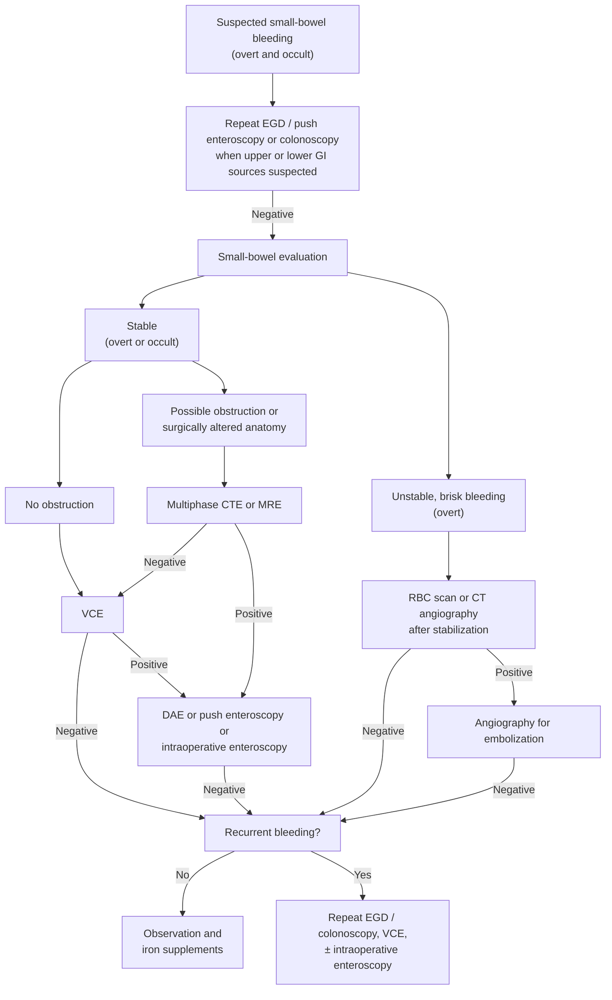

## Bibliographic Info

- **Article:** [ASGE Standards of Practice Committee. The role of endoscopy in the management of suspected small-bowel bleeding. *Gastrointest Endosc* 2017;85:22-31.](https://doi.org/10.1016/j.gie.2016.06.013)
- **Authors:** Gurudu SR, Bruining DH, Acosta RD, et al.; ASGE Standards of Practice Committee (DeWitt JM, Chair)
- **Year:** 2017
- **Journal/Publisher:** Gastrointestinal Endoscopy (ASGE)
- **DOI:** [10.1016/j.gie.2016.06.013](https://doi.org/10.1016/j.gie.2016.06.013)
- **Type:** guideline (ASGE Standards of Practice; GRADE quality-of-evidence ratings only — the document assigns no separate strength label)

## Summary

American Society for Gastrointestinal Endoscopy (ASGE) Standards of Practice guideline on the endoscopic evaluation of **suspected small-bowel bleeding**. Endorses the shift from "obscure gastrointestinal (GI) bleeding (OGIB)" to anatomic terminology, and a stepwise algorithm: exclude upper/lower sources (repeat [[upper-endoscopy|esophagogastroduodenoscopy (EGD)]]/[[colonoscopy]] when an upper or lower source is suspected) → **[[capsule-endoscopy|video capsule endoscopy (VCE)]] as the initial small-bowel test** → [[device-assisted-enteroscopy|device-assisted enteroscopy (DAE)]] or push enteroscopy to treat positive findings, or when VCE is unavailable/nondiagnostic.

Cross-sectional imaging (multiphase computed tomography enterography [CTE] or magnetic resonance enterography [MRE]) comes **first** when a small-bowel neoplasm is suspected or when there is any potential reason for capsule retention (stricture, bowel obstruction, suspected [[inflammatory-bowel-disease|inflammatory bowel disease (IBD)]]). For hemodynamically significant bleeding, urgent angiography with selective embolization follows resuscitation; in stable patients with active bleeding a CT angiogram (CTA) or red blood cell (RBC) scan localizes the source and times the angiogram. In surgically altered anatomy with a bypassed segment (e.g., Roux-en-Y gastrojejunostomy), DAE is the preferred modality.

It is the **newest** tier-1 source on this topic in the wiki — it postdates and broadly corroborates [[acg-2015-small-bowel-bleeding|American College of Gastroenterology (ACG) 2015]], while adding the 2-week VCE timing window, the DAE-first exception (high suspicion of [[angioectasia|angiectasias]] or surgically altered anatomy), and the yield figures below. For non-localizable chronic angiectasia bleeding, hormonal therapy is abandoned (no efficacy in randomized controlled trials [RCTs]); [[somatostatin-analogs|octreotide]] and low-dose thalidomide may remove the need for transfusion and iron.

## Key Findings / Claims

### Definitions and causes

- **OGIB** = overt or occult bleeding of unknown origin that persists or recurs after an initial **negative bidirectional** endoscopic evaluation (ileocolonoscopy + EGD). **Overt** = visible bleeding (melena, hematochezia); **occult** = fecal occult blood positivity and/or unexplained [[iron-deficiency-anemia|iron deficiency anemia]].
- Term now reserved: after comprehensive evaluation of the **entire** GI tract including the small bowel fails to find a source, it is OGIB; otherwise call it small-bowel bleeding.
- Small-bowel sources = only **5%** of all GI bleeding.
- **Angiectasias: 20%–30%** of small-bowel bleeding; more common in older patients.
- Small-bowel tumours ([[gastrointestinal-stromal-tumor|GI stromal tumours]], [[gastroenteropancreatic-neuroendocrine-tumors|carcinoid]], lymphoma, adenocarcinoma) — younger and older patients alike.
- Other benign: nonsteroidal anti-inflammatory drug (NSAID) erosions/ulcers, [[crohns-disease|Crohn's disease]].
- Rare: [[meckels-diverticulum|Meckel's diverticulum]]-associated ulceration (especially younger patients), radiation enteropathy, Dieulafoy's lesions, small-bowel varices, aortoenteric fistulas.

### Timing and triage

- **Overt bleeding with an upper presentation (e.g., hematemesis): early EGD within 24 hours** before small-bowel evaluation.
- Recent, adequate-quality EGD already done → repeat the upper exam **with push enteroscopy** to look for proximal small-bowel lesions; if negative, consider repeat colonoscopy **with terminal ileum evaluation**.
- **Occult bleeding** — repeat EGD when an upper lesion is suspected (NSAID risk factors, or prior EGD details uncertain); repeat colonoscopy when the prior bowel preparation was suboptimal, other quality questions exist, or there is clinical suspicion of a missed colon lesion.
- Hemodynamic resuscitation is key in all GI bleeding; manage antithrombotics per the dedicated guidelines ([[anticoagulation-gi-bleeding]]).
- Negative tests with recurrent bleeding → technetium-99m pertechnetate scintigraphy (Meckel scan) can be considered **in younger patients**.
- **Provocative testing with anticoagulants is rarely considered** — safety concerns, limited benefit.

### Second-look endoscopy — yields

| Setting | Source found within reach of a standard EGD |
|---|---|
| During VCE studies | **2.8%** (4/140) and **4.7%** (6/128) |
| Studies using push enteroscopy | **26%** (25/95) |
| Patients undergoing DAE | **13.1%** (14/107) |

- Factors raising repeat-EGD yield: **large [[hiatal-hernia\|hiatal hernias]], hematemesis, history of NSAID use**.
- Repeat colonoscopy yield varies widely: **0/50** when done before VCE, vs **10/35 (29%)** at retrograde balloon-assisted enteroscopy (BAE) 1 week after a negative colonoscopy.
- Colon cancer miss rates attributed to incomplete procedures, poor bowel preparation, and female sex.
- **Small-bowel biopsy to evaluate for [[celiac-disease|celiac disease]] should be considered in patients with iron-deficiency anemia** — upper GI mucosal lesions may coexist with malabsorption as a second cause of anemia.

### VCE

- **Timing window: yield is higher if VCE is performed within 2 weeks of an overt bleeding episode, greatest at 48 to 72 hours.** Timing influences both diagnosis and outcome by identifying patients for early intervention.
- Meta-analysis (14 prospective studies, 396 patients): yield for clinically significant lesions **VCE 56%** vs **push enteroscopy 26%** vs **small-bowel follow-through 6%**.
- Prospective multicentre study of overt small-bowel bleeding: **overall VCE yield 67%**; angiectasias the most common source (**33%**).
- Predictors of a positive VCE: **hemoglobin <10 g/dL, bleeding duration >6 months, overt presentation, male sex, age >60 y, inpatient status**.
- VCE findings led to endoscopic/surgical intervention or a change in medical management in **37%–87%**.
- Rebleeding after a negative VCE is low: **6%–11%**.
- **Repeat VCE** — consider at the time of repeat bleeding; particularly informative when the presentation changes from occult to overt or hemoglobin falls by **4 g/dL**. Second-look VCE after a nondiagnostic first study was positive in **49%** (76 patients); in iron-deficiency anemia, **35%** of second studies were positive/suspicious and **10%** changed management.
- **Capsule retention: 1.4%** of VCE examinations (series of 1000 procedures) — the primary risk of VCE.
- Other limitations: no therapeutic capability, cannot precisely locate a lesion, false positives, missed lesions.
- **Perform multiphase CTE or MRE first if there is any potential reason for capsule retention** — stricture, bowel obstruction, or suspected IBD.

### Push enteroscopy

- Diagnostic yield for a bleeding source: **24%–56%**.
- After excluding all lesions proximal to the ligament of Treitz (63 patients): **41%** recurrent overt, **33%** persistent overt, **26%** occult small-bowel bleeding.
- Allows diagnosis, biopsy and therapy; reduces transfusion requirements and improves functional status at 1 year.
- Use instead of repeat EGD when suspicion for an upper source is high, or to treat VCE-found lesions judged within its reach.

### DAE

- DAE = BAE (single-balloon and double-balloon systems) **plus** spiral enteroscopy. **Total enteroscopy may be achieved by combining antegrade and retrograde approaches** (the document gives no insertion depths or total-enteroscopy rates — see [[asge-2015-deep-enteroscopy]]).
- BAE in small-bowel bleeding: **diagnostic yield 43%–81%**, **treatment success 43%–84%**.
- Meta-analysis (11 studies, 375 patients): VCE and double-balloon enteroscopy (DBE) yields comparable — **60% vs 57%, P = .42**.
- **DBE yield is far higher after a positive VCE than a negative one: 75% vs 27.5%, P = .02** — the main argument for VCE-directed DAE.
- **Early DBE within 24 hours:** 90% diagnostic and therapeutic yield (10 patients, overt bleeding). **Urgent DBE within 72 hours of the last visible bleeding vs non-urgent: 70% vs 30%, P < .05** (120 patients).
- Single-balloon enteroscopy yield **58%–74%**; systematic review/meta-analysis found it similar to DBE for diagnostic and therapeutic yield.
- Spiral enteroscopy: **33%** in initial series, **57%–62%** in a later prospective study, with improved transfusion, iron and repeat-procedure outcomes.
- **Route selection:** multiphase CTE may indicate whether an antegrade or retrograde approach is more appropriate.
- Cost models: BAE is the most cost-effective initial test after standard endoscopy **if the goal is treatment or definitive diagnosis** (rather than visualization alone), and in patients likely to have angiectasias reachable by a single antegrade approach.

### Imaging and nuclear studies

| Modality | Key figures from this document |
|---|---|
| Small-bowel follow-through | Yield **3%–6%** — no longer part of routine evaluation |
| Enteroclysis | Source in only **8%** after negative push enteroscopy; not useful for angiectasia; no longer routine |
| Multiphase CTE | Phases after intravenous bolus: **arterial ~30 s, enteric 50 s, delayed 90 s**, with large-volume neutral oral contrast. Detects inflammatory lesions, neoplasms, angiectasias, varices, Dieulafoy's lesions, aortoenteric fistulas, pseudoaneurysms |
| CTE vs VCE — small-bowel tumours | CTE **16/17 (94.1%)** vs VCE **6/17 (35.3%)** |
| CTE vs VCE — pooled yield | CTE **40%** vs VCE **53%** (meta-analysis, 18 studies) — complementary: CTE after nondiagnostic VCE **50%** positive; VCE after negative CTE **57%** positive |
| MRE | Alternative to CTE when small-bowel obstruction is suspected; data in suspected small-bowel bleeding are limited |
| CTA | Like CTE but **without oral contrast**. Pooled sensitivity **89%**, specificity **85%** (9 studies, 198 patients); widely available and rapid |
| RBC scan | Needs a bleeding rate of **at least 0.1 to 0.4 mL/min**. Identifies only a general area and is very limited in directing treatment — a positive scan should go **immediately** to angiography. Failed to localize in **85%** of 103 patients |
| Meckel scan | Sensitivity **62%–87.5%** for ectopic gastric mucosa; useful in pediatric patients and young adults with overt bleeding |
| Angiography | Needs a bleeding rate **>0.5 mL/min**. Less sensitive than nuclear scans but better at localizing, and allows immediate therapy. Reported yields **20%–77%** in GI bleeding. Use **selective mesenteric embolization** to reduce the risk of intestinal ischemia |

### Intraoperative enteroscopy

- Diagnostic yield **58%–88%**; can be performed orally, rectally and/or through enterotomies.
- Directed by VCE: of 15 patients with VCE lesions, intraoperative enteroscopy yielded treatment in **13 (87%)**; all 3 with negative VCE were normal.
- Adverse events: **serosal tears, avulsion of mesenteric vessels, prolonged ileus**.
- **Last resort only** — high morbidity. Reserved for recurrent bleeding requiring multiple transfusions and/or repeated hospitalizations after unrevealing VCE and DAE, or when DAE cannot be done without lysis of adhesions.

### Therapy

- Lesions within reach of a standard endoscope: **electrocautery, [[argon-plasma-coagulation|argon plasma coagulation (APC)]], injection therapy, mechanical hemostasis (hemoclips or bands)**, or a combination ([[endoscopic-hemostasis]]).
- More distal vascular lesions such as angiectasias: push enteroscopy or DAE **depending on location**. Treatment decreases blood loss and transfusion need.
- Masses/tumours likely require surgery; massive bleeding is coordinated with surgery and interventional radiology.
- After appropriate endoscopic and imaging studies, **clinically stable patients with iron deficiency may be managed with iron therapy alone and followed clinically**. Iron supplementation or transfusion may still be needed in patients with comorbidities and poor candidates for repeat endoscopy.
- **Hormonal therapy for angiectasias is largely abandoned** — lack of efficacy in RCTs.
- **Octreotide and low-dose thalidomide** have shown benefit in eliminating the need for transfusion and iron supplementation in chronic blood loss from angiectasias; consider them for patients who are not candidates for endoscopic therapy or who keep bleeding after it. This document gives no dose or duration for either agent.

## Management Algorithm (Figure 1)

Suggested approach to overt and occult small-bowel bleeding. Positive results direct specific therapy; because the tests are complementary more than one may be needed, and the first-line test may be set by institutional expertise and availability.

*Figure 1 — Suggested management approach to overt and occult small-bowel bleeding. ([[asge-2017-small-bowel-bleeding]])*

## Recommendations

The document **numbers its own recommendations 1–8** and rates each with a GRADE (Grading of Recommendations Assessment, Development and Evaluation) **quality-of-evidence symbol only** — it attaches no separate strength label. Strength is carried by the verb: the document states that weaker recommendations use "we suggest" and stronger ones "we recommend". **Recommendation 7 is the only "we recommend" of the eight.**

**Evidence-quality symbols used (document Table 1):**

| Symbol | Band | Definition |
|---|---|---|
| ⊕⊕⊕⊕ | High quality | Further research is very unlikely to change our confidence in the estimate of effect |
| ⊕⊕⊕○ | Moderate quality | Further research is likely to have an important impact on our confidence in the estimate of effect and may change the estimate |
| ⊕⊕○○ | Low quality | Further research is very likely to have an important impact on our confidence in the estimate of effect and is likely to change the estimate |
| ⊕○○○ | Very low quality | Any estimate of effect is very uncertain |

*No recommendation in this document is rated High quality.*

1. For patients with signs or symptoms consistent with recurrent upper or lower GI sources of bleeding, we suggest repeating EGD and colonoscopy, respectively, before small-bowel evaluation. *(⊕⊕○○ Low quality)*
2. We suggest VCE as the initial test for patients with overt or occult small-bowel bleeding. Positive VCE results should be followed with push enteroscopy if within reach or DAE. *(⊕⊕○○ Low quality)*
3. We suggest DAE or push enteroscopy if VCE is unavailable or nondiagnostic in patients with overt small-bowel bleeding. *(⊕⊕○○ Low quality)*
4. We suggest that in select circumstances (eg, high level of suspicion of small-bowel angiectasias or in patients with surgically altered anatomy) DAE may be considered as the initial small-bowel diagnostic procedure in patients with small-bowel bleeding. *(⊕⊕○○ Low quality)*
5. We suggest that after an appropriate negative evaluation, clinically stable patients without recurrent bleeding may be treated with iron therapy and clinically followed if iron deficiency is present. *(⊕⊕○○ Low quality)*
6. We suggest multiphase CTE or MRE in patients with obscure bleeding and suspected small-bowel neoplasms. *(⊕⊕⊕○ Moderate quality)*
7. Following appropriate hemodynamic resuscitation, we **recommend** angiography for selective embolization in patients who present with hemodynamically unstable suspected small-bowel bleeding. *(⊕⊕⊕○ Moderate quality)*
8. We suggest a CTA or RBC scan for localization of the bleeding site and to guide timing of angiography in hemodynamically stable patients with suspected active small-bowel bleeding. *(⊕⊕○○ Low quality)*

## Relevance to Wiki

- Corroborates and is added as a source to [[small-bowel-bleeding]], [[capsule-endoscopy]], and [[device-assisted-enteroscopy]].
- Reinforces VCE-first algorithm and the role of DAE as initial procedure in select anatomy.

## Contradictions / Open Questions

- Aligns with [[acg-2015-small-bowel-bleeding|ACG 2015]]; no substantive conflict. The newer ACG content is retained where more detailed.
