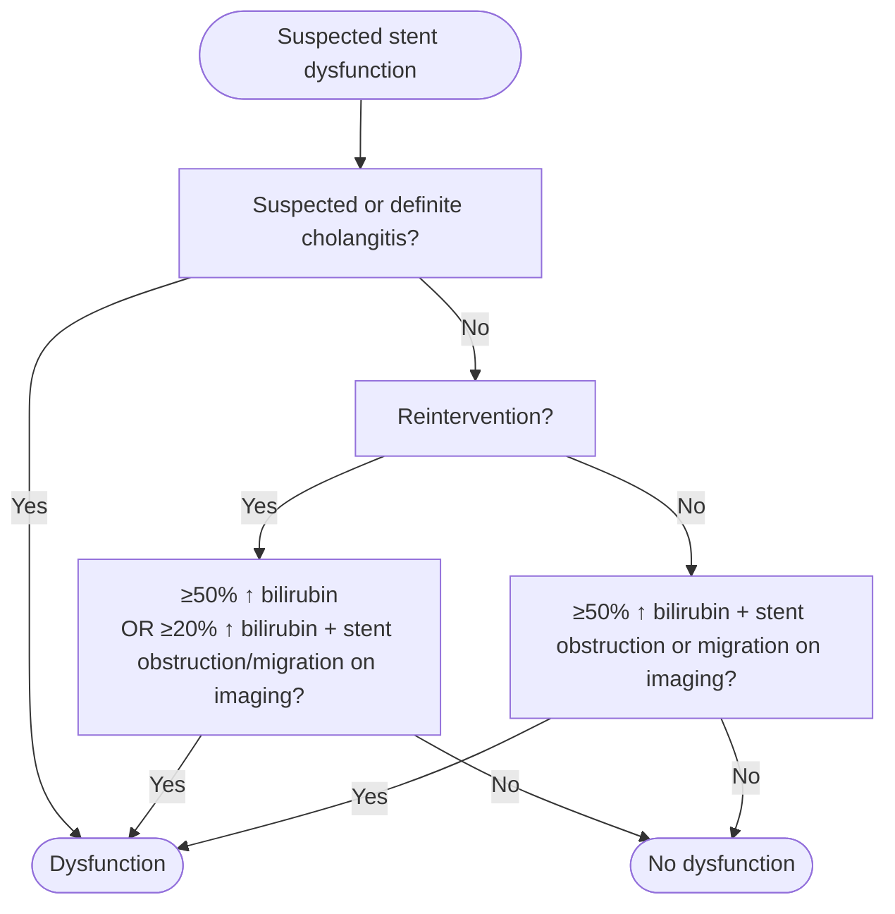

## Bibliographic Info
- **Article:** [Chen YI, Forbes N, Jacques J, Martel M, Barkun A, Elmunzer BJ; STANDARD-BD Consensus Working Group. Methodological Standards for Biliary Drainage Trials in Malignant Distal Biliary Obstruction: An International Consensus. *Gastroenterology* 2026 (article in press)](https://doi.org/10.1053/j.gastro.2026.09.009)
- **Authors:** Yen-I Chen (McGill), Nauzer Forbes (Calgary), Jérémie Jacques (Limoges), Myriam Martel (McGill), Alan Barkun (McGill), B. Joseph Elmunzer (Atrium Health–Wake Forest), and the STANDARD-BD Consensus Working Group (22 panelists from North and South America, Europe, Asia and Australia).
- **Year:** 2026 (received 31 August 2026; accepted 8 September 2026)
- **Journal/Publisher:** *Gastroenterology* 2026;■:1–7 — **Commentary**; Elsevier for the American Gastroenterological Association (AGA) Institute. This version is the uncorrected proof ("Article in press"; author queries still open; volume/pages not yet assigned).
- **DOI:** [10.1053/j.gastro.2026.09.009](https://doi.org/10.1053/j.gastro.2026.09.009)
- **Type:** consensus statement — international methodological consensus for **trial design** (investigator-led, not a society clinical guideline; published as a Commentary)
- **Method (as printed, p. 1):**
  - Systematic review per Preferred Reporting Items for Systematic Reviews and Meta-Analyses (PRISMA) 2020: MEDLINE, Embase, CENTRAL and Web of Science, inception to January 2025 (PROSPERO 1364791). 4663 citations → **71 malignant distal biliary drainage trials** included.
  - **Steering committee of 6 investigators + 22 international expert panelists**, chosen for leading high-impact interventional randomized controlled trials (RCTs), consensus recommendations and cost-effectiveness studies.
  - **RAND/University of California, Los Angeles (UCLA) Appropriateness Method** — modified Delphi: 2 rounds of independent voting with iterative group discussion (≥90% of panelists present at each of 2 discussion rounds); recordings and summaries circulated before each vote; appropriateness determined by previously described statistical methods.
  - Steering committee drafted each statement from the systematic review findings.
  - **Outcome:** all 14 statements deemed **"appropriate"** after 2 rounds. **No agreement percentages, medians or evidence grades are printed** for any statement.
- **Licence:** not open access — "© 2026 American Gastroenterological Association Institute. Published by Elsevier Inc. All rights are reserved, including those for text and data mining, AI training, and similar technologies." (p. 7). Figures 1–2 are not reusable; redraw only.
- **Funding / conflicts:** no funding statement; several authors report consulting with device makers (Boston Scientific, Cook Medical, Olympus and others). Authors declare that Claude AI (Anthropic) helped with preliminary literature searches outside the formal systematic review and helped generate Figure 1.

## Summary
- Endoscopic retrograde cholangiopancreatography (ERCP) has been standard care for malignant distal biliary obstruction (MDBO) for >5 decades; post-ERCP pancreatitis and stent dysfunction prompted RCTs of endoscopic ultrasound (EUS)–guided biliary drainage (EUS-BD) vs ERCP. Those trials used **non-standard patient selection, baseline items and end point definitions**, which blocks evidence synthesis.
- The systematic review found the gaps: MDBO defined in only 68% of trials (>10 definitions); clinical success defined in 53.5% (>20 definitions); technical success defined in 40.8% (>10 definitions); stent dysfunction reported in 80% with >20 definitions; standardized adverse event (AE) lexicon in 36.6%, blinded adjudication in 1 study.
- The **STANDARD-BD framework** (Figure 1) gives 14 statements: who to include (1–3), whether drainage worked (technical and clinical success, 4 and 6), whether it stayed effective (stent dysfunction, 5) and what matters to patients and health systems (AEs, quality of life, cost, hospitalization, procedure time, mortality, oncologic therapy, pancreaticoduodenectomy; 7–14).
- **Authors' caveat (p. 5):** the outcome definitions come from consensus deliberation **without trial validation**; they adapt earlier literature definitions using readily available objective criteria.

## Key Findings / Claims

**How items are labelled here.** Statements are numbered **1–14** as printed (section headings "Statement N"). Every statement was rated "appropriate" (RAND/UCLA); the paper prints **no agreement %, no strength and no evidence grade**. "SR" = the systematic-review finding printed under each statement (% of the 71 trials).

### Who should be included (Statements 1–3)

**Statement 1 — Patient population (p. 1).** Define the trial population with these eligibility criteria — a starting point, not exhaustive:
- Definition of MDBO for inclusion (Statement 2)
- Comorbidity index cutoff: American Society of Anesthesiologists (ASA) score and/or Charlson Comorbidity Index (CCI)
- Performance status threshold: Eastern Cooperative Oncology Group (ECOG) and/or Karnofsky scale
- Tumor type and staging
- **Bile duct diameter threshold** in EUS-BD trials — specify the measuring modality; if measured by EUS, specify **anatomic vs operative diameter** for stent insertion
- Inclusion/exclusion of patients with **gastric outlet obstruction (GOO)**
- **Ascites** presence and grade for inclusion/exclusion
- Inclusion/exclusion of **altered upper gastrointestinal anatomy**
- Rationale: bile duct diameter, ascites and altered anatomy can substantially affect technical success and AE rates, particularly for EUS-BD.
- SR: performance status reported in 29.6%, GOO in 12.7%, comorbidity indices in 11.3%.

**Statement 2 — Defining MDBO (p. 1).** All of:

| Element | Criterion |
|---|---|
| Biochemical | Total bilirubin **>3 × upper limit of normal (ULN)** |
| Stricture | **Malignant etiology, suspected or definite** |
| Location | Stricture **≥2 cm from the hilum** |
| Imaging | **Upstream biliary dilation** on computed tomography (CT) and/or magnetic resonance imaging (MRI) |

- Rationale: drainage may be indicated with minimally elevated bilirubin, but **>3 × ULN** was chosen to ensure a clear indication for drainage and allow objective assessment of response. Distance from the hilum favored over variable landmarks such as **cystic duct insertion**.
- SR: MDBO defined in only 68% of trials, >10 definitions.

**Statement 3 — Baseline items (p. 2).** *Recommended*, not mandatory ("ideal" list; may not suit every RCT; adapted from consensus on mandatory measurements in pancreatic cancer trials):

| Domain | Items |
|---|---|
| Demographics | Age · sex · body mass index |
| Laboratory | Pre–biliary drainage bilirubin and albumin · CA 19-9 |
| Tumor | Type, staging, histology, differentiation · liver and/or lung metastasis and peritoneal carcinomatosis |
| Ascites | Presence and grade |
| Prior treatment | Chemotherapy, immunotherapy and/or radiation · prior upper gastrointestinal surgery |
| Function / comorbidity | ECOG · ASA, CCI |
| Quality of life (QoL) | Global and physical, validated instrument |
| Anatomy | Gallbladder status · symptomatic GOO · duodenal invasion or compression without symptomatic GOO |
| EUS-BD only | Diameter of the punctured duct + method of measurement |

*Items as printed in Statement 3; the domain grouping is the wiki's (the paper gives a flat list).*

- Not mandatory because of concerns about feasibility in all practice settings.
- SR: performance status 29.6%, comorbidity indices 11.3%, liver metastases 12.7%, GOO 12.7%, albumin 14.1%.

### Did the drainage work? (Statements 4 and 6)

| Outcome | Definition (as printed) |
|---|---|
| **Clinical success** (Statement 4, p. 2) | Bilirubin reduction **≥50% within 2 weeks** **or** reduction to **<25% of the pre–biliary drainage procedure level within 6 weeks** |
| **Technical success** (Statement 6, p. 3) | Successful placement of the stent with evidence of **immediate drainage of bile**, using the **assigned or randomized approach**, during the **index procedure** |

- Statement 4 rationale: normalization of bilirubin matters for starting systemic chemotherapy, but a **relative reduction** applies consistently across widely varying baseline bilirubin; the 2-time-point definition captures early or delayed biochemical response. SR: defined in 53.5%, >20 definitions.
- Statement 6 rationale: definition must stay objective and reproducible; document procedural details that may influence technical outcomes — **sedation, stent type, bile duct diameter**. SR: defined in 40.8%, >10 definitions.

### Did the drainage remain effective? (Statement 5 — stent dysfunction, p. 3)

Stent dysfunction = **either**:
- **Suspected or definite cholangitis** (Tokyo criteria) **with or without** endoscopic or radiologic reintervention, **or**
- **Endoscopic or radiologic biliary reintervention** with ≥1 of: a **≥50% increase in bilirubin from the lowest level** after the index procedure, **or** a **≥20% increase in bilirubin from the lowest level with imaging evidence of biliary obstruction**, **or**
- A **≥50% increase in bilirubin from the lowest level** after the index procedure **and imaging evidence of biliary obstruction, without** endoscopic or radiologic reintervention.

*Classifying suspected stent dysfunction in a malignant distal biliary obstruction trial*
*Source: redrawn from Figure 2 of Chen 2026; bilirubin rises are measured from the lowest post-procedure level*
*[[chen-2026-biliary-drainage-trial-methodology|Chen 2026 Biliary Drainage Trial Standards]]*

- **Never-responders are not dysfunction:** bilirubin that never falls to clinical success after index stenting = **not achieving clinical success**, not stent dysfunction.
- **Adjudication:** the panel *suggests* an **independent, blinded committee** adjudicate all suspected stent dysfunction events.
- **Analysis:** **competing risk methodology** — **death or curative surgical resection** precludes the event and may otherwise bias conventional time-to-event analyses.
- Rationale: reintervention-only definitions miss obstruction when reintervention is deferred for frailty; clinical judgment alone may introduce bias → objective biochemical + imaging criteria. SR: stent dysfunction reported in 80%, >20 definitions.

**Tokyo Guidelines 2018 (TG18) cholangitis criteria as reproduced in Figure 2:**

| Domain | Items (as printed in the figure) |
|---|---|
| A | Fever (≥38°C) and/or chills · inflammatory response: leukocytosis (<4,000 or >10,000/µL) or elevated C-reactive protein (CRP) |
| B | Jaundice (total bilirubin ≥2 mg/dL) · abnormal liver function tests — alkaline phosphatase (ALP), gamma-glutamyl transferase (GGT), aspartate aminotransferase (AST), alanine aminotransferase (ALT) >1.5× ULN |
| C | Biliary dilatation · evidence of etiology (e.g., stricture, stone, stent dysfunction, tumor) |
| **Suspected** | ≥1 item from A + ≥1 item from B or C |
| **Definite** | ≥1 item from A + ≥1 item from B + ≥1 item from C |

### What matters to the patient and health care system (Statements 7–14, pp. 4–5)

| # | Statement (condensed) | Key detail | SR finding |
|---|---|---|---|
| 7 | **AEs:** report, define and grade for severity **all procedure-related AEs** using a standardized consensus or lexicon | Accepted adjudication criteria for general endoscopic AEs (American Society for Gastrointestinal Endoscopy [ASGE] lexicon; Adverse Events in Gastrointestinal Endoscopy [AGREE] classification) or, where available, procedure-specific criteria. All AEs, related or not, **captured** (good clinical practice) but not necessarily reported. Panel **recommended a blinded adjudication committee** (unblinded trials risk bias) | Standardized lexicon 36.6%; blinded panel in 1 study |
| 8 | **QoL:** record with a **validated instrument at prespecified time intervals** | Cancer-specific instruments favored — European Organisation for Research and Treatment of Cancer Quality of Life Questionnaire–Core 30 (EORTC QLQ-C30); generic measures (e.g., SF-36) less suitable; other validated instruments acceptable by context | 11.3% |
| 9 | **Cost-effectiveness:** analysis **not mandated**; collect the health resource utilization data needed for later cost per quality-adjusted life year (QALY) analysis | QALYs derived with **EQ-5D-5L**; meticulous collection of patient interventions and outcomes | 21.1% |
| 10 | **Hospitalization:** capture **total hospitalization, including any intensive care unit (ICU) length of stay** | Total duration rather than a binary variable (inpatient vs outpatient pathways vary) | 26.8% reported length of stay |
| 11 | **Procedural time:** record with a **clear and objective definition** | Some panelists did not see it as a key end point; most wanted efficiency reported (affects timely access) | 19.7%; 28.6% of these defined it |
| 12 | **Mortality:** report survival rates and curves **to the end of prespecified follow-up** using established methods (e.g., Kaplan-Meier) | — | 95.7% reported; 74.6% used Kaplan-Meier |
| 13 | **Oncologic therapy:** capture (1) proportion receiving **systemic cancer therapy after randomization**, (2) **time to systemic therapy** after randomization, (3) **interruption** of systemic therapy from stent- or procedure-related AEs | Most essential and feasible: rate of systemic therapy initiation + time to treatment after drainage; interruptions when feasible. Delayed chemotherapy from persistent obstruction or AEs may affect oncologic outcomes | 25.4%; of these 50% gave proportion treated, 38.9% time to treatment |
| 14 | **Pancreaticoduodenectomy** (trials including potentially resectable patients): report **rate of pancreaticoduodenectomy**, **R0 and R1 resection rates**, **severe 30- and 90-day AEs (Clavien-Dindo classification)** | Drainage strategy may influence operative difficulty and postoperative outcomes | Resection reported in 19.7%; R0/R1 in none; postoperative AEs in 22.2% |

### Figure 1 — STANDARD-BD framework (p. 2)
- Summary diagram in four tiers — who to include · did drainage work (technical, clinical success) · did it remain effective (stent dysfunction; death and curative resection as competing events) · patient/health-system outcomes (safety, QoL, cancer treatment, surgery, resource use) — plus **implementation principles**: blinded adjudication of AEs and major end points, **intention-to-treat analysis**, competing-risk analysis for stent dysfunction.
- Figure is copyrighted (all rights reserved); no image reproduced here.

## Relevance to Wiki
- **Audience is trial investigators**, not bedside decisions: no statement tells a clinician whom to drain, how or when. Clinically usable content is limited to **standard outcome definitions** a reader can apply when appraising drainage trials or auditing results.
- **[[eus-guided-biliary-drainage]]** and **[[ercp]]** — one-line pointer to the standardized definitions of technical success, clinical success (≥50% bilirubin fall within 2 weeks or to <25% of baseline within 6 weeks) and stent dysfunction (cholangitis by Tokyo criteria, or reintervention/imaging with bilirubin rise from nadir) when quoting trial success rates; MDBO trial definition (bilirubin >3 × ULN, stricture ≥2 cm from the hilum, upstream dilation on CT/MRI).
- **[[pancreatic-cancer]]** — trials should record time to systemic therapy after drainage and its interruption by stent AEs; trials including resectable patients should report pancreaticoduodenectomy, R0/R1 and 30/90-day Clavien-Dindo AEs.
- **[[biliary-stricture]]**, **[[acute-cholangitis]]** — no new clinical recommendation; the TG18 criteria reproduced in Figure 2 are already owned by [[tg18-2018-cholangitis-criteria]] (primary source; use that, not this reproduction).

## Contradictions / Open Questions
- **Not a clinical guideline:** investigator-led methodological consensus (Commentary), RAND/UCLA "appropriate" ratings only, no agreement %, no grades; definitions **not validated** in trials (authors' own caveat).
- **Text vs Figure 2 — imaging criterion for stent dysfunction:** Statement 5 text requires "imaging evidence of **biliary obstruction**"; Figure 2 branches require "**stent obstruction or migration** on imaging". Stent migration is not named in the text.
- **Text vs Figure 1 — stent dysfunction:** Figure 1 summarizes the reintervention arm as "biliary reintervention with biochemical **and/or imaging** evidence of obstruction", which reads as imaging alone being enough; the text requires a ≥50% bilirubin rise, or a ≥20% rise **plus** imaging. Figure 1's bilirubin arm also omits "without reintervention".
- **Text vs Figure 1 — other wording drift:** technical success "assigned or randomized approach" (text) vs "using the randomly assigned approach" (figure); malignant stricture "suspected or definite" (text) vs "suspected or confirmed" (figure); Figure 1 adds **readmission** under hospitalization and **intention-to-treat analysis** as an implementation principle, neither stated in any of the 14 statements; Figure 1 lists AE severity grading as "mild / moderate / severe", the text only says "graded for severity using a standardized consensus or lexicon".
- **TG18 criteria as reproduced (Figure 2) vs the TG18 source:** fever **≥38°C** in Figure 2 vs body temperature **>38 °C** in TG18 Table 2 thresholds (the TG18 text itself defines fever as 38 °C or above) — [[tg18-2018-cholangitis-criteria]]; Figure 2 labels white blood cell count <4,000/µL as "leukocytosis" and gives no C-reactive protein cutoff (TG18 Table 2: ≥1 mg/dL; TG18 calls A-2 "evidence of inflammatory response") — [[tg18-2018-cholangitis-criteria]]. Use the primary TG18 page for diagnosis.
- **Distance from the hilum:** this trial definition puts distal MDBO at a stricture **≥2 cm** from the hilum; [[esge-2026-biliary-strictures]] uses **>2 cm** from the hilum as its fully covered self-expandable metal stent (FCSEMS) cutoff (different purpose — stent choice, not a disease definition); [[acg-2023-biliary-strictures]] keeps multiple plastic stents preferred when the stricture is <1–1.5 cm from the hilum.
- **Bilirubin threshold for inclusion (>3 × ULN)** is a trial-entry rule chosen for objective response assessment; the panel itself notes drainage may be indicated with only minimally elevated bilirubin — not a clinical drainage threshold.
- **Proof status:** this version is the uncorrected proof (open author queries Q1–Q14; Statement 4 lead-in ends "defined as."); wording may change in the final version.
