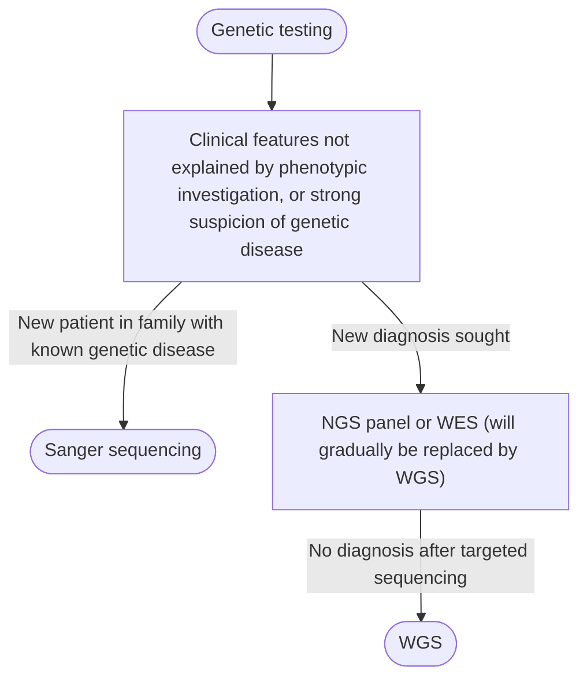

## Bibliographic Info
- **Article:** [European Association for the Study of the Liver. EASL Clinical Practice Guidelines on genetic cholestatic liver diseases. *Journal of Hepatology* 2024;81:303–325](https://doi.org/10.1016/j.jhep.2024.04.006)
- **Authors:** European Association for the Study of the Liver (EASL) Clinical Practice Guideline Panel — Chair Henkjan J. Verkade; assistant to chair Antonia Felzen; panel members Pavel Strnad, Binita Kamath, Richard Thompson, Verena Keitel, Emmanuel Gonzales; EASL Governing Board representative Saskia van Mil.
- **Year:** 2024 (received and accepted 5 April 2024; available online 8 June 2024)
- **Journal/Publisher:** *Journal of Hepatology* vol. 81, August 2024, pp. 303–325; © 2024 EASL, published by Elsevier B.V., all rights reserved
- **DOI:** [10.1016/j.jhep.2024.04.006](https://doi.org/10.1016/j.jhep.2024.04.006)
- **Type:** guideline — clinical practice guideline (CPG) of a non-US society (EASL); expert panel + Delphi. Under the wiki's source-priority rules it fills gaps only where no US guideline covers the decision.
- **Method (as printed, pp. 303–304):**
  - Initiated by the EASL Governing Board July 2021; EASL standard operating procedure; Guidelines International Network standards.
  - Questions in PICO format (patient/problem/population, intervention, comparison, outcome), vetted by a simplified Delphi of **32** physicians, scientists, patient representatives and other stakeholders; systematic literature review (PubMed, expanded to Embase, Google Scholar, Scopus) plus citation snowballing. Panel met virtually **12** times.
  - **Level of evidence (LoE)** — Oxford Centre for Evidence-Based Medicine, **Table 1**: **1** systematic reviews (with homogeneity) of randomised controlled trials (RCTs) · **2** RCT or observational studies with dramatic effects; systematic review of lower-quality studies · **3** non-randomised controlled cohort/follow-up study/control arm of a randomised trial · **4** case series, case-control or historically controlled studies · **5** expert opinion (mechanism-based reasoning). Simple model: LoE 1–2 "further research is unlikely to change our confidence in the estimate of benefit and risk"; 3–4 "further research (if performed) is likely to have an impact…"; 5 "any estimate of effect is uncertain".
  - **Grades of recommendation — Table 2:** **Strong** = "shall, should, is recommended / shall not, should not, is not recommended"; **Weak or open** = "can, may, is suggested / may not, is not suggested". Criteria: evidence, consistency of studies, risk–benefit ratio, patient preferences, ethical obligations, feasibility. No clear evidence → expert opinion of the panel.
  - All recommendations approved through a **second Delphi round**; final approval by the EASL Governing Board. Each recommendation carries a consensus label in the text ("consensus" or "strong consensus") and an agreement percentage in the **Appendix** (pp. 320–321). The document does not print the percentage cut-points behind "consensus" vs "strong consensus".
- **Licence / figures:** no Creative Commons licence ("All rights reserved"). Figures are described or transcribed below, not reproduced.
- **Conflicts:** International Committee of Medical Journal Editors (ICMJE) disclosure forms accompany the article (not printed).

## Summary
- **Scope (p. 305):** six monogenic cholestatic disorders — **alpha-1 antitrypsin deficiency (AATD)**, **Alagille syndrome (ALGS)**, **familial intrahepatic cholestasis type 1 (FIC1) deficiency** (progressive familial intrahepatic cholestasis [PFIC] 1), **bile salt export pump (BSEP) deficiency** (PFIC2), **multidrug resistance protein 3 (MDR3) deficiency** (PFIC3 and other *ABCB4* phenotypes) and **bile acid synthesis defects (BASD)** — plus general approaches to genetic testing and cholestatic pruritus. Care generally belongs in a tertiary referral centre. Rarer PFIC types (Table 5) are outside scope.
- **38 boxed recommendations**; none numbered by the document (the R-numbers below are the wiki's, in document order). **28 strong / 10 weak.** Levels of evidence: LoE 2 ×5, LoE 3 ×24, LoE 4 ×4, LoE 5 ×5.
- **Core positions:**
  - AATD: serum AAT level as triage (measured without inflammation); **50 mg/dL (9.2 µmol/L)** raises suspicion of severe AATD; genotyping for definitive diagnosis; Pi\*ZZ livers not used as grafts.
  - ALGS: **ileal bile acid transporter (IBAT) inhibitor** for cholestatic pruritus when available; no routine biopsy; no statins.
  - FIC1: no routine surgical biliary diversion to prolong native liver survival; enterohepatic circulation (EHC) interruption may treat post-transplant diarrhoea/steatohepatitis.
  - BSEP: management by genotype; surgical EHC interruption for responsive genotypes; IBAT inhibitor for pruritus with missense mutations; **hepatocellular carcinoma (HCC) screening every 3–6 months** (missense) or **every 3 months** (biallelic predicted protein-truncating mutations [PPTMs]); post-transplant BSEP alloimmunisation.
  - MDR3/*ABCB4*: genotype predicts response to **ursodeoxycholic acid (UDCA)**; UDCA for ≥1 missense variant + clinical phenotype; follow-up for liver complications incl. malignancy; testing of first-degree relatives; long-term UDCA after an MDR3 monoallelic-deficient graft.
  - BASD (*HSD3B7*, *AKR1D1*): oral primary bile acid (cholic acid).
- Two flowcharts: genetic testing (Figure 1) and pruritus management, paediatric vs adult (Figure 2).

## Key Findings / Claims

**How items are labelled here.** The document numbers no recommendations: **R1–R38 are the wiki's numbers**, in printed order. Each row gives LoE, strength and consensus label exactly as printed in the box, the agreement % from the Appendix (pp. 320–321), and the journal page of the box.

### General recommendations (unboxed text, pp. 304–305)

- **Genetic testing** for cholestatic liver disease without a clear cause is recommended **early in the work-up in infants and children**, and **after exclusion of more frequent causes in adults** — in adults particularly with unusual features or no response to initial treatment (p. 304).
- **Next-generation sequencing (NGS)** — panel or **whole-exome sequencing (WES)** — recommended; **Sanger sequencing of single genes discouraged**, perhaps except **_ABCB4_ testing in (young) patients with small duct primary sclerosing cholangitis (PSC)**. WES non-diagnostic → consider **whole-genome sequencing (WGS)** (p. 304).
- **Re-analyse WES/WGS data at least every 3 years** in patients without a diagnosis after the first round (p. 304).
- **Genetic counselling must precede genetic testing**; handling of incidental findings discussed in advance (p. 304).
- Variant classes (American College of Medical Genetics and Genomics): classes 1–2 likely benign · class 3 = **variant of uncertain significance (VUS)** · class 4 likely pathogenic · class 5 pathogenic. Many variants in cholestasis fall in class 3; in silico tools, family segregation, in vitro analysis and data from other families may upgrade them (p. 304).
- Relapsing disease described in FIC1, BSEP, MDR3, tight junction protein 2 (TJP2) and ubiquitin specific peptidase 53 (USP53) deficiencies; late-onset phenotypes arise from variants interacting with drugs, pregnancy, infections or other liver disease (p. 304).
- Heterozygous carriers: predisposition to elevated liver tests, gallstones, episodic/chronic cholestasis, intrahepatic cholestasis of pregnancy (ICP), drug-induced liver injury (DILI), hepatobiliary malignancy (Introduction, p. 303).

**Figure 1 — Genetic testing for cholestatic liver disease (p. 304), transcribed:**

*Genetic testing for cholestatic liver disease*
*Source: redrawn from Figure 1 of EASL 2024 genetic cholestatic liver diseases*
*[[easl-2024-genetic-cholestatic-liver-diseases|EASL 2024 Genetic Cholestatic Liver Diseases CPG]]*
*NGS = next-generation sequencing · WES = whole-exome sequencing · WGS = whole-genome sequencing*

### Cholestatic pruritus (pp. 305–307; no boxed recommendations)

- Approach applies across all cholestatic liver diseases, separately for children and adults; many steps are expert opinion and CPG-committee consensus (p. 305).

**Figure 2 — Pruritus management flowchart (p. 305), transcribed:**

| Step | Paediatric | Adult |
|---|---|---|
| **Conservative treatment** (both) | Skin emollients · short nails · good hygiene · avoid hot baths and high temperatures · avoid wool and other fabrics that amplify pruritus | Same |
| **Conventional medications** (numbered as printed) | 1. UDCA\* · 2. **Rifampicin (first-line treatment)** · 3. IBAT inhibitors (ALGS and PFIC) | 1. **Fibrates (first-line treatment: bezafibrate, fenofibrate)** · 2. UDCA\* · 3. Rifampicin · 4. IBAT inhibitors (ALGS and PFIC) |
| **Less commonly used medications** | 1. Cholestyramine · 2. Antihistamines · 3. Selective serotonin reuptake inhibitor (SSRI) (sertraline) · 4. Opioid antagonist (naltrexone) · 5. Chaperones (4-phenylbutyric acid [4-PB]) | 1. Cholestyramine · 2. SSRI (sertraline) · 3. Opioid antagonist (naltrexone) · 4. Chaperones (4-PB) |
| **Episodic cholestatic pruritus** (both) | Possible: molecular adsorbent recirculating system (MARS) or plasmapheresis | Same |
| **Chronic cholestatic pruritus** (both) | 1. Mechanical/surgical interruption of the EHC · 2. Liver transplantation | Same |

*\*UDCA is not generally considered a first-line treatment due to lack of evidence; because of its low risk profile it is often tried as one of the first options (Figure 2 legend).*

**Table 3 — Drugs and their targets in genetic cholestatic liver diseases (pp. 306–307), condensed:**

| Drug class | Drug | Effect | Efficacy (as printed) | Approved use | Experimental / off-label use |
|---|---|---|---|---|---|
| Antibiotics | Rifampicin | ↓ cholestatic pruritus (possibly via pregnane X receptor activation) | Moderate | — | ALGS, FIC1, BSEP, MDR3 deficiency (PFIC in general) |
| Antihistamines | Chlorpheniramine; alimemazine | ↓ cholestatic pruritus | Marginal (sedative) | — | Same |
| Bile acid sequestrants | Cholestyramine | ↓ cholestatic pruritus (binds bile acids, interrupts EHC) | Marginal | — | Same |
| Bile acids (primary) | Cholic acid | Restores normal liver function (replacement therapy) | High | BASD | — |
| Bile acids (secondary) | UDCA | ↓ pruritus; ↓ cholestasis and bile acid toxicity; ↓/prevents cholelithiasis | Low in FIC1 and BSEP deficiency; variable (none to high) in MDR3 deficiency, related to genotype | — | AATD, ALGS, FIC1, BSEP, MDR3 deficiency |
| Chaperones / potentiators / correctors | 4-phenylbutyrate; glycerol phenylbutyrate; ivacaftor | ↓ pruritus; ↓ cholestasis | Limited case reports and fundamental studies; low efficacy in specific missense mutations | — | FIC1, BSEP deficiency |
| Fibrates | Bezafibrate | ↓ cholestatic pruritus (mechanism not fully understood) | Unknown in paediatrics; intermediate in adults | — | ALGS, FIC1, BSEP, MDR3 deficiency |
| IBAT inhibitors | Maralixibat; odevixibat | ↓ cholestatic pruritus and/or circulating bile acids (block ileal bile acid reabsorption) | Variable, none to high; in PFIC depends on PFIC type and partially on genotype | ALGS, FIC1, BSEP, MDR3 deficiency (PFIC in general) | — |
| Opioid antagonists | Naltrexone | ↓ pruritus (blocks central opioid receptors) | Marginal | — | ALGS, FIC1, BSEP, MDR3 deficiency |
| SSRIs | Sertraline | ↓ pruritus (modulates central pruritoception) | Marginal | — | ALGS, FIC1, BSEP, MDR3 deficiency |

### Alpha-1 antitrypsin deficiency (pp. 307–310)

| # | Recommendation (condensed where long) | LoE · strength · consensus | Agreement | Page |
|---|---|---|---|---|
| **R1** | Measuring serum AAT levels as a **triage tool** for AATD testing is recommended | LoE 3 · strong · consensus | 78% | 307 |
| **R2** | Serum AAT levels should be measured **in situations without inflammation** | LoE 3 · strong · consensus | 86% | 307 |
| **R3** | A cut-off of **50 mg/dL (9.2 µmol/L)** can be used as a triage tool that raises suspicion of **severe** AATD | LoE 3 · weak · consensus | 80% | 307 |
| **R4** | **Phenotyping** can be used when a quick decision is needed; **genotyping** should be used for definitive diagnosis when available | LoE 3 · weak · consensus | 73% | 307 |
| **R5** | Children with AATD-associated liver disease: **insufficient data to advise for/against UDCA** | LoE 3 · strong · consensus | 82% | 309 |
| **R6** | **Impaired liver synthetic function or decompensation of cirrhosis** should be used to identify severe disease associated with poor outcomes | LoE 3 · strong · strong consensus | 100% | 309 |
| **R7** | **Liver stiffness measurements** can be used in **adults with Pi\*ZZ** to estimate the level of histological fibrosis | LoE 3 · weak · strong consensus | 95% | 309 |
| **R8** | **Lifestyle counselling is recommended** — smoking, obesity and alcohol consumption harm patients with AATD | LoE 3 · strong · strong consensus | 100% | 310 |
| **R9** | Despite lack of evidence that counselling changes lifestyle, the authors **suggest** lifestyle counselling given lifestyle's influence on outcome (Appendix wording: "recommend") | LoE 5 · weak · strong consensus | 96% | 310 |
| **R10** | Adults with AATD and otherwise unexplained, recurrently elevated liver enzymes: **liver biopsy should be considered when careful non-invasive evaluation remains inconclusive** | LoE 3 · strong · strong consensus | 100% | 310 |
| **R11** | **Living donor** transplantation: **Pi\*MZ** organs only when other suitable organs are lacking **and** no signs of liver injury are present | LoE 5 · weak · strong consensus | 96% | 310 |
| **R12** | Livers from **Pi\*ZZ** individuals should **not** be used as donor organs | LoE 3 · strong · strong consensus | 96% | 310 |

**Rationale and data (AATD):**
- *SERPINA1* gene; >100 variants; **95%** of severe AATD = homozygous **Pi\*ZZ**; Pi\*ZZ in **>90%** of children with severe AATD liver disease; Pi\*ZZ → **85%** decrease in plasma AAT (p. 307).
- Normal AAT **90–175 mg/dL (16.6–32.2 µmol/L)** (p. 307). Pi\*ZZ typically **<50 mg/dL (9.2 µmol/L)**; plasma levels cannot reliably separate no AATD from mild AATD. Cut-off **110 mg/dL (20.2 µmol/L)** often used: sensitivity **73.4%**, specificity **88.5%** → test further when suspicion is high (e.g. family testing) even if level exceeds 110 mg/dL (p. 308).
- AAT is an acute-phase protein → re-test inconclusive cases with parallel C-reactive protein. Second step: genotyping (specific mutations) or phenotyping (isoelectric focusing; faster, more available, detects variants outside the local panel). Inconclusive → sequence the whole *SERPINA1* gene (p. 308).
- **Figure 4 (p. 309) — genotypes, transcribed:**

| Genotype | MM | MZ | SZ | ZZ |
|---|---|---|---|---|
| Frequency | 9:10 | 1:30 | 1:500 | 1:2,000 |
| Cirrhosis risk (relative) | 1 | 1.7 | 3 | 20 |
| HCC risk (relative) | 1 | n.s. | 7 | 23–45 |

- **Figure 5 (p. 309) — liver phenotype timeline in AATD:** childhood peak — **2–10%** neonatal cholestasis, **2–3%** portal decompensated cirrhosis, **0–2%** liver transplantation (ages ~1–10) · **mostly asymptomatic** (ages ~20–40) · second rise after ~40 — **20–35%** significant liver fibrosis (schematic curve; approximate ages from the axis).
- UDCA: improved clinical status and liver tests in some Pi\*ZZ children, no benefit in the most severe; monitor liver tests if used. Fazirsiran (small-interfering RNA) lowered serum and hepatic AAT in adults with Pi\*ZZ (small open-label phase II) → discuss trial inclusion (p. 309).
- Markers of severe disease: prolonged international normalised ratio (INR), recurrence of jaundice, decreased albumin; portal hypertension or decompensation (ascites, varices, gastrointestinal bleeding, hepatic encephalopathy) should trigger consideration of liver transplantation, timed by established cholestatic end-stage parameters (p. 309).
- Non-invasive monitoring: neonatal cholestasis, aspartate aminotransferase (AST) and gamma-glutamyltransferase (GGT) conflicting as predictors; alanine aminotransferase (ALT) questioned for poor sensitivity; liver stiffness measurement (LSM) by vibration-controlled transient elastography (VCTE) good for advanced fibrosis, less for significant fibrosis (comparable to AST-to-platelet ratio index [APRI] and Fibrosis-4 index [FIB-4]) (pp. 309–310).
- Elevated transaminases in only **10–15%** of adults with Pi\*ZZ (p. 310).
- Pi\*MZ: **2–4%** of Caucasians; ca. **1.7-fold** liver-related mortality at population level; recipients of Pi\*MZ grafts show mildly low AAT and an MZ phenotype; outcome data mixed — a retrospective study and a small case series found no adverse consequences, while several case reports described post-transplant complications or rapid AAT-globule accumulation. Restrictive use advised in **obese** recipients and **paediatric** recipients; acceptable especially in older recipients (p. 310).

### Alagille syndrome (pp. 310–312)

| # | Recommendation | LoE · strength · consensus | Agreement | Page |
|---|---|---|---|---|
| **R13** | **Routine liver biopsy** for prognosis or management of liver disease in ALGS is **not recommended** | LoE 3 · strong · strong consensus | 100% | 311 |
| **R14** | When available, **IBAT inhibitor** treatment should be offered to patients with ALGS **and cholestatic pruritus** | LoE 2 · strong · strong consensus | 100% | 311 |
| **R15** | **Statins are not recommended** for hyperlipidaemia or xanthomas in ALGS | LoE 4 · strong · strong consensus | 100% | 312 |

**Rationale and data (ALGS):**
- Autosomal dominant; *JAG1* mutations in most, *NOTCH2* in a small minority; bile duct paucity (pp. 310–311).
- Biopsy: bile duct paucity insensitive in young infants; biopsy still valuable diagnostically in limited situations, e.g. a genetic VUS. Fibrosis on biopsy before age 5 → >3-fold risk of severe hepatic outcome (retrospective, 144 children); fibrosis + xanthoma + serum bilirubin **65 µmol/L** threshold predicted severe outcome. APRI higher in F3–F4 vs F0–F2 (3 vs 1.7); a 50% rise in APRI → almost 2-fold odds of transplantation (40 children) → non-invasive tools such as APRI may support prognosis (p. 311).
- IBAT inhibitors: maralixibat — ITCH (phase IIb) missed its primary endpoint (possibly low dose); ICONIC (phase IIb, randomised withdrawal) met its primary efficacy endpoint (at least 50% serum bile acid [sBA] reduction from baseline to week 12 or 18; withdrawal phase in those with ≥50% reduction) at **380 µg/kg once daily**, with reduced pruritus (ItchRO) and clinical scale score; benefits durable to week 72 in a 57-child pooled analysis. Odevixibat phase III ASSERT met its primary pruritus endpoint (p. 311).
- **Liver transplantation remains standard of care** for progressive cholestasis and decompensated portal hypertension in ALGS; **referral to a transplant centre strongly encouraged** with substantial liver involvement; sBA reductions linked to transplant-free survival (pp. 311–312).
- Hyperlipidaemia largely lipoprotein-X, not thought atherogenic; one case report of statins (p. 312).

### FIC1 deficiency — PFIC1 (p. 312)

| # | Recommendation | LoE · strength · consensus | Agreement | Page |
|---|---|---|---|---|
| **R16** | **Surgical interruption of the EHC is not recommended** as a routine treatment to prolong native liver survival in FIC1 deficiency | LoE 3 · strong · consensus | 90% | 312 |
| **R17** | **Medical or surgical interruption of the EHC at or after transplantation** could be used to treat **diarrhoea and steatohepatitis** in FIC1 deficiency | LoE 5 · weak · strong consensus | 95% | 312 |

**Rationale and data (FIC1):**
- *ATP8B1* gene; expressed in hepatocytes and intestinal epithelium → extrahepatic features (diarrhoea, pancreatitis, hearing loss; Figure 3). Heterozygous variants → **benign recurrent intrahepatic cholestasis (BRIC)** and chronic liver disease in adults; a few ICP cases; no link with hepatobiliary cancer reported (p. 312).
- No randomised studies of surgical EHC interruption; retrospective data show no clear native-liver-survival benefit (non-significant trend); responders (sBA reduction to **<65 µmol/L**) had a delay in transplantation (p. 312).
- Odevixibat RCT in PFIC (pruritus and sBA endpoints; 6-month placebo phase); preliminary PEDFIC vs NAtural course and Prognosis of PFIC and Effect of biliary Diversion (NAPPED) comparison suggests native-liver-survival benefit (p. 312).
- Post-transplant diarrhoea and fatty liver improved after surgical EHC interruption (case reports) and after IBAT inhibitor in a few patients (p. 312).
- **Figure 6 (p. 313):** schematic of medical (IBAT inhibitor) vs surgical (e.g. partial external biliary diversion [PEBD]) interruption of the EHC.

### BSEP deficiency — PFIC2 (pp. 312–315)

| # | Recommendation (condensed where long) | LoE · strength · consensus | Agreement | Page |
|---|---|---|---|---|
| **R18** | Management incl. follow-up/screening and treatment, **including EHC interruption**, should be based on the existing evidence **for specific genotypes** | LoE 3 · strong · strong consensus | 96% | 313 |
| **R19** | **HCC screening intervals** should be based on **genotype** (see R24–R25) | LoE 3 · strong · consensus | 91% | 313 |
| **R20** | To prolong native liver survival, **surgical interruption of the EHC should be considered** in patients with a **responsive genotype** | LoE 3 · strong · consensus | 91% | 314 |
| **R21** | Current lack of data → **not yet possible to recommend medical rather than surgical** EHC interruption to prolong native liver survival | LoE 5 · weak · strong consensus | 100% | 314 |
| **R22** | **Surgical** EHC interruption **can** be used to reduce **pruritus** in a **responsive genotype** before considering liver transplantation | LoE 3 · weak · consensus | 82% | 314 |
| **R23** | **Medical EHC interruption by IBAT inhibition should be considered** to reduce **pruritus** before considering liver transplantation in patients with **missense mutations** | LoE 2 · strong · strong consensus | 100% | 314 |
| **R24** | **Missense mutations:** HCC screening interval **3 to 6 months** (based on expert opinion) | LoE 3 · strong · strong consensus | 100% | 314 |
| **R25** | **Biallelic PPTMs:** HCC screening interval **3 months** | LoE 3 · strong · strong consensus | 100% | 314 |
| **R26** | Post-transplant **BSEP alloimmunisation**: diagnose by **anti-BSEP antibodies in plasma** or **anti-canalicular antibodies on immunofluorescence staining of liver tissue** | LoE 3 · strong · strong consensus | 96% | 315 |
| **R27** | Treatment: **adapt the immunosuppressive regimen**; when necessary consider **rituximab + plasmapheresis** | LoE 3 · strong · strong consensus | 100% | 315 |
| **R28** | **Re-transplantation(s)** may become necessary if treatment fails | LoE 3 · weak · strong consensus | 96% | 315 |

**Genotype groups (pp. 313–314):**

| Genotype | Course | Management implication (text) |
|---|---|---|
| Homozygous **p.D482G** and/or **p.E297G** (milder missense) | Residual transport; median native liver survival **>18 years**; sustained response to surgical EHC interruption | Interrupt EHC **before** considering transplantation, provided no other HCC risk factors |
| **Two PPTMs** | Poor native liver survival; poor response to surgical EHC interruption; **high HCC incidence at a young age** | Closer HCC monitoring, **no surgical EHC interruption**, consider **early** transplantation; excluded from IBAT trials |
| **p.E297G or p.D482G + one PPTM** (compound heterozygous) | Poor response to surgical EHC interruption; short native liver survival | May need the same approach as two PPTMs |

**Rationale and data (BSEP):**
- *ABCB11* gene; heterozygous variants → adult BRIC, chronic cholestasis, ICP or DILI, often triggered by environmental factors (p. 312).
- Postoperative sBA **below 102 µmol/L** after surgical EHC interruption associated with long-term native liver survival (p. 314).
- Odevixibat approved by the European Medicines Agency (EMA) and the US Food and Drug Administration (FDA) in **2021**; first PFIC RCT showed reduced pruritus and sBA over **24 weeks** as **add-on** (UDCA, rifampicin, antihistamines allowed); no published long-term transplant-delay data (p. 314).
- Surgical EHC interruption: sustained partial/complete pruritus relief **54% (22/41)**; **66%** with ≥1 p.E297G or p.D482G, **36%** with ≥1 other missense; no long-term relief in 3 patients with two PPTMs (p. 314).
- HCC: incidence in children **<16 years** **4–34%** by genotype; biallelic PPTMs ~**15% before age 5**; 7/10 HCCs diagnosed before age 2 → monitor **from diagnosis onwards**; **alpha-fetoprotein and ultrasound** are the standard paediatric modalities; screen **even after a good response** to surgical EHC interruption (p. 315).
- Alloimmunisation: occurs when mutations abolish canalicular BSEP expression; mimics the original disease (cholestasis, pruritus, **low GGT**) without rejection or biliary complication; biopsy may show giant-cell transformation ± fibrosis; refractory → re-transplantation, not always with long-term success (p. 315).
- The text names the milder variant as both p.D482G and p.D487G (p. 313).

### MDR3 deficiency — *ABCB4* (pp. 315–319)

| # | Recommendation (condensed where long) | LoE · strength · consensus | Agreement | Page |
|---|---|---|---|---|
| **R29** | **Biallelic *ABCB4* variants:** genetics should be used to predict **phenotype and response to UDCA** | LoE 2 · strong · consensus | 92% | 315 |
| **R30** | Known **pathogenic *ABCB4* variants** → offer **follow-up for liver-related complications, including malignancy** | LoE 2 · strong · strong consensus | 100% | 315 |
| **R31** | **Genetic testing should be offered to first-degree relatives** of patients with MDR3 deficiency | LoE 2 · strong · strong consensus | 100% | 317 |
| **R32** | Follow-up adjusted to **clinical presentation and detected variant** (expert opinion) | LoE 5 · strong · strong consensus | 96% | 317 |
| **R33** | Medical history, laboratory analysis and **non-invasive screening for higher-degree fibrosis** at follow-up visits **(at least) every 6 months** | LoE 3 · strong · strong consensus | 96% | 317 |
| **R34** | **Liver ultrasound and/or magnetic resonance imaging (MRI) with magnetic resonance cholangiopancreatography (MRCP)** at least **yearly** | LoE 4 · strong · strong consensus | 100% | 317 |
| **R35** | **UDCA recommended** for those with **at least one *ABCB4* missense variant and a clinical phenotype** | LoE 3 · strong · strong consensus | 100% | 318 |
| **R36** | Partial UDCA response reported with **biallelic protein-truncating** variants → UDCA **may** be offered | LoE 4 · weak · strong consensus | 100% | 318 |
| **R37** | **Long-term UDCA** recommended for recipients of an **MDR3 monoallelic-deficient graft** | LoE 4 · strong · strong consensus | 96% | 319 |

**Table 4 — Follow-up and treatment of *ABCB4*-associated diseases (p. 316), recreated:**

| Manifestation | Follow-up | Follow-up interval | HCC/cholangiocarcinoma (CCA) screening (ultrasound) | UDCA therapy |
|---|---|---|---|---|
| **Monoallelic — asymptomatic heterozygous carriers** (family screening) | Individualised | Normal labs, no signs of advanced fibrosis: **3-year** intervals; abnormal liver tests: **yearly** | Abnormal liver biochemistry: yearly | Recommended with signs of cholestatic liver disease (ICP, gallstone disease, LPAC); consider with abnormal liver tests |
| **Monoallelic — ICP** | At least twice after delivery | **6–8 weeks post-partum**; 2nd follow-up by labs/presentation: in **2–3 years** or yearly | Yearly if liver tests abnormal after pregnancy | From **2nd trimester to delivery**; lifelong depending on labs and variant |
| **Monoallelic — gallstone disease** | With known pathogenic *ABCB4* variant; depending on labs | Once per year or every **3–5 years**, depending on values | Ultrasound every **3–5 years** | Recommended |
| **Monoallelic — low phospholipid-associated cholelithiasis (LPAC)** | Yes | **Yearly** | Once per year | **Lifelong** |
| **Monoallelic — biliary fibrosis** | Yes | Every **6–12 months**, depending on signs of portal hypertension | At least yearly; **every 6 months** in advanced fibrosis | Lifelong, may not benefit those with 1 PPTM |
| **Biallelic — MDR3 deficiency** | Yes | Every **3–6 to 6–12 months** by UDCA response and portal hypertension | At least yearly; **every 6 months** with portal hypertension | Lifelong until liver transplantation when required; may not benefit those with two PPTMs |

**Rationale and data (MDR3):**
- *ABCB4* encodes the canalicular phosphatidylcholine floppase; MDR3 deficiency has **high GGT**, unlike FIC1 and BSEP deficiency (**low GGT**) (p. 315).
- Heterozygous *ABCB4* variants → chronic cholestasis, ICP, DILI, LPAC syndrome, HCC (p. 315). Icelandic population data: p.G622E → fibrosis/cirrhosis odds ratio (OR) **5.52**; p.N510S (OR **4.74**) and p.L445GfsX22 (OR printed **3,07**) → HCC/CCA (pp. 315, 317).
- Biallelic: missense variants more likely to respond to UDCA; two PPTMs usually do not, or only partially; two severe variants usually need transplantation **before age 10** (p. 315). No UDCA response in 8 patients with a premature stop codon vs normalised liver tests in **21/23** with ≥1 missense variant (p. 318).
- **LPAC syndrome criteria (p. 317):** onset of biliary symptoms **under 40 years** · **recurrence of biliary symptoms after cholecystectomy** · **hyperechoic intrahepatic foci or comet-tail images** within intrahepatic bile ducts on ultrasound. The document does not state how many criteria are required.
- LPAC with vs without an *ABCB4* variant: hepatobiliary malignancy **10.1% vs 2.2%** (multivariate OR 5.0); complications on MRI **35% vs 15%** (cholangitis-like stenoses, abscess, portal hypertension, CCA) (p. 317).
- Follow-up content: history; labs (AST, ALT, alkaline phosphatase, GGT, bilirubin, albumin, prothrombin time, INR, platelets); non-invasive fibrosis test (e.g. FIB-4 or elastography); ultrasound and/or MRI/MRCP at **3-month to <2-year** intervals by manifestation and UDCA response (p. 317).
- **ICP (p. 318):** genetic risk ~**20%** of ICP risk; offer genetic testing in **severe ICP (sBA >100 µmol/L)**, **recurrent** and/or **early-onset** ICP; UDCA recommended; visit with labs ~**6–8 weeks after delivery**; if liver tests normalise, second visit after **2–3 years**; not normalised + **class 4/5 *ABCB4* variant** → lifelong UDCA can be considered (retrospective data).
- **LPAC (pp. 318–319):** heterozygous missense variant in **40–50%**; transplant-free survival **>90%** on UDCA (retrospective) → **lifelong UDCA**, widely used dose **8–10 mg/kg up to 13–15 mg/kg body weight**; yearly liver tests + imaging (expert opinion).
- Heterozygous relatives of severe MDR3 deficiency: asymptomatic, normal labs, no advanced fibrosis or gallstones → individualised, **every 3 years** seems adequate; with ICP, gallstones, LPAC, cholestasis or DILI → consider UDCA, yearly follow-up (p. 318).
- Children with severe MDR3 deficiency: clinical and biological review **at least every 6 months**, ultrasound **yearly**; decompensated/end-stage → close monitoring, nutritional support, prepare for transplantation; **UDCA adherence critical** — treatment holidays worsen liver tests (p. 318).
- 67 adult heterozygous carriers (93% given UDCA): transplant-free survival **91%** at median 14 years; liver stiffness normal (**<6.3 kPa**) in 75% (p. 318).

### Other PFIC types (p. 319)

**Table 5 — Types of PFIC (p. 320):** FIC1 deficiency (PFIC1) *ATP8B1* · BSEP deficiency (PFIC2) *ABCB11* · MDR3 deficiency (PFIC3) *ABCB4* · TJP2 deficiency *TJP2* · farnesoid X receptor (FXR) deficiency *NR1H4* · SLC51A deficiency *SLC51A* · USP53 deficiency *USP53* · KIF12 deficiency *KIF12* · ZFYVE19 deficiency *ZFYVE19* · MYO5B deficiency *MYO5B* (myosin 5B) · SEMA7A deficiency *SEMA7A* · VPS33B deficiency *VPS33B*.
- Outside the CPG's scope; such patients should be cared for by tertiary care physicians. UK transplant list: **5–30%** of patients with cirrhosis lack a diagnosis; NGS cholestasis panel found a variant in **6/10** (five *ABCB4*); WES diagnosed **5/19 (26%)** adults with idiopathic liver disease (p. 319).

### Bile acid synthesis defects (pp. 319–320)

| # | Recommendation | LoE · strength · consensus | Agreement | Page |
|---|---|---|---|---|
| **R38** | Patients with a **primary bile acid synthesis defect** (namely ***HSD3B7*** and ***AKR1D1*** deficiencies) should be treated with an **oral primary bile acid** | LoE 3 · strong · strong consensus | 100% | 319 |

- 3β-hydroxysteroid dehydrogenase (*HSD3B7*) and Δ4-3-oxosteroid-5β-reductase (*AKR1D1*) deficiencies; autosomal recessive; European prevalence ~**1.13 per 10 million** (p. 319).
- **Diagnostic features:** neonatal/infant cholestasis, **absence of pruritus**, **normal serum GGT**, normal or low total serum primary bile acids; diagnosis by **mass spectrometry of urinary bile acids** + mutation in *HSD3B7* or *AKR1D1* (p. 319).
- **Cholic acid** is the bile acid of choice (neither hepatotoxic nor embryotoxic/teratogenic); the only primary bile acid with marketing authorisation in both the USA and Europe for these two indications; effects maintained and safe in adulthood, including pregnancy (pp. 319–320).

### Figure 3 — disease manifestations (p. 308), transcribed
- **AATD:** liver (hepatitis, cirrhosis), lung (emphysema, anti-neutrophil cytoplasmic antibody [ANCA] vasculitis), kidney and face (ANCA vasculitis), subcutaneous fat (panniculitis, rare).
- **ALGS:** liver (cholestasis, cirrhosis), eye (posterior embryotoxon), heart (congenital heart defects), vasculature (pulmonary, renal, central nervous system arteries), kidney (renal dysplasia), face (dysmorphism), vertebrae.
- **FIC1 deficiency:** liver (cholestasis, cirrhosis), ear (hearing loss), pancreas (pancreatitis), intestine (diarrhoea, steatorrhoea).
- **BSEP deficiency:** liver (cholestasis, cirrhosis, HCC).
- **MDR3 deficiency:** liver (cholestasis, cirrhosis, cholelithiasis, CCA, HCC).
- **BASD:** liver (cholestasis, cirrhosis), intestine (diarrhoea, steatorrhoea), kidney (renal cysts).

## Relevance to Wiki
- Non-US guideline → fills gaps only; where a US guideline covers the same decision, the US guideline governs.
- [[alpha-1-antitrypsin-deficiency-liver-disease]] — AAT triage (R1–R4), paediatric UDCA (R5), severity markers (R6), LSM (R7), lifestyle (R8–R9), biopsy (R10), Pi\*MZ / Pi\*ZZ donor livers (R11–R12), Figures 4–5. The newer multi-society [[aga-aasld-easl-2026-aatd-liver-disease]] governs adult assessment where they overlap.
- [[intrahepatic-cholestasis-of-pregnancy]] — *ABCB4* carriers: genetic testing criteria, 6–8-week and 2–3-year post-partum follow-up, lifelong UDCA with persistent abnormal tests and a class 4/5 variant (p. 318; Table 4).
- [[ursodeoxycholic-acid]] — MDR3 deficiency by genotype (R29, R35–R37), LPAC dose 8–10 up to 13–15 mg/kg, Table 3 efficacy by disease.
- [[liver-transplantation]] — Pi\*MZ / Pi\*ZZ grafts (R11–R12), BSEP alloimmunisation (R26–R28), MDR3 monoallelic graft → long-term UDCA (R37), post-transplant FIC1 diarrhoea (R17), ALGS referral.
- [[hepatocellular-carcinoma]] — BSEP-deficiency surveillance every 3–6 months (missense) or 3 months (biallelic PPTMs) with alpha-fetoprotein + ultrasound from diagnosis (R24–R25); *ABCB4* HCC/CCA screening (Table 4).
- [[cholangiocarcinoma]] — *ABCB4* variant carriers: malignancy follow-up (R30, Table 4).
- [[primary-sclerosing-cholangitis]] — *ABCB4* testing in (young) small-duct PSC (p. 304).
- [[liver-stiffness-measurement]] — use in adults with Pi\*ZZ (R7); non-invasive fibrosis tests in *ABCB4* follow-up (R33).
- [[abnormal-liver-chemistries]], [[drug-induced-liver-injury]], [[liver-disease-in-pregnancy]], [[mri-mrcp]], [[liver-biopsy]] — genetic testing in unexplained cholestasis (Figure 1), heterozygous transporter variants as DILI/ICP susceptibility, MRI/MRCP in *ABCB4* follow-up (R34).
- No wiki page yet for PFIC (FIC1, BSEP, MDR3 deficiency), BRIC, LPAC syndrome, Alagille syndrome, bile acid synthesis defects, IBAT inhibitors (odevixibat, maralixibat) or cholestatic pruritus — this guideline is the main ingested source for all of them.

## Contradictions / Open Questions
- **AATD — newer multi-society guidance:** [[aga-aasld-easl-2026-aatd-liver-disease]] (2026, US societies co-author) prefers VCTE for staging with LSM-based monitoring intervals and states biopsy is **not required** for diagnosis (consider at 8–15 kPa). EASL 2024 only says LSM "can be used" (weak, R7) and that biopsy "should be considered" when non-invasive evaluation is inconclusive (R10). Compatible in direction; the 2026 document is more specific and governs for adults.
- **AATD serum threshold:** EASL 2024 uses **50 mg/dL (9.2 µmol/L)** as the triage cut-off for severe AATD (R3) and cites 110 mg/dL as a sensitivity-oriented cut-off; the 2026 AGA/AASLD/EASL document triages serum AAT itself (Figure 2, Step 2): **>90 mg/dL** minimal risk, **57–90 mg/dL** mild/intermediate, **<57 mg/dL (<11 µM)** at risk for severe AATD, likely ZZ, then genotype. The severe-AATD cut-off differs (50 vs 57 mg/dL); the 2026 document is newer and US-endorsed and governs.
- **Cholestatic pruritus sequence:** Figure 2 puts **cholestyramine** among "less commonly used medications" and names **rifampicin** (children) or **fibrates** (adults) first-line. The wiki's PBC pruritus ladder (US guidance, [[primary-biliary-cholangitis]]) uses cholestyramine as initial therapy, then rifampicin, naltrexone or sertraline. Different populations (genetic cholestasis vs PBC); for PBC the US sequence governs. Figure 2 also lists UDCA as often tried for itch, while the PBC page states UDCA does not relieve itch.
- **Internal inconsistencies in the EASL document:**
  - R9: box says the authors "**suggest**" lifestyle counselling; the Appendix says "**recommend**" (both weak).
  - R5 ("insufficient data to advise for/against UDCA") is labelled a **strong** recommendation.
  - *ABCB4* follow-up: R33 says visits **at least every 6 months**; the text on the same page suggests a first visit at 6 months then **yearly**; Table 4 allows **3-year** intervals for asymptomatic carriers with normal tests.
  - Fibrates: Figure 2 names **bezafibrate and fenofibrate** first-line in adults; Table 3 lists **bezafibrate** only, with efficacy "unknown in paediatrics; intermediate in adults".
  - BSEP milder variant printed as **p.D482G** and **p.D487G** on the same page (p. 313).
  - The thresholds behind "consensus" vs "strong consensus" are not printed (in the Appendix, "consensus" items carry 73–92% agreement and "strong consensus" items 95–100%).
- **Open questions named by the panel (Future perspectives, p. 320; also pp. 313, 317):** long-term effect of IBAT inhibitors on native liver survival, progression and HCC risk; why some FIC1/BSEP patients do not respond; IBAT efficacy across BSEP genotypes; prevalence of HCC/CCA and progressive disease in *ABCB4* heterozygotes (prospective registries needed).

## See Also
[[alpha-1-antitrypsin-deficiency-liver-disease]], [[intrahepatic-cholestasis-of-pregnancy]], [[ursodeoxycholic-acid]], [[liver-transplantation]], [[hepatocellular-carcinoma]], [[cholangiocarcinoma]], [[primary-sclerosing-cholangitis]], [[primary-biliary-cholangitis]], [[liver-stiffness-measurement]], [[abnormal-liver-chemistries]], [[drug-induced-liver-injury]], [[liver-disease-in-pregnancy]], [[mri-mrcp]], [[liver-biopsy]]

---

## Sources

1. [[easl-2024-genetic-cholestatic-liver-diseases|EASL Clinical Practice Guidelines on Genetic Cholestatic Liver Diseases (2024)]]
