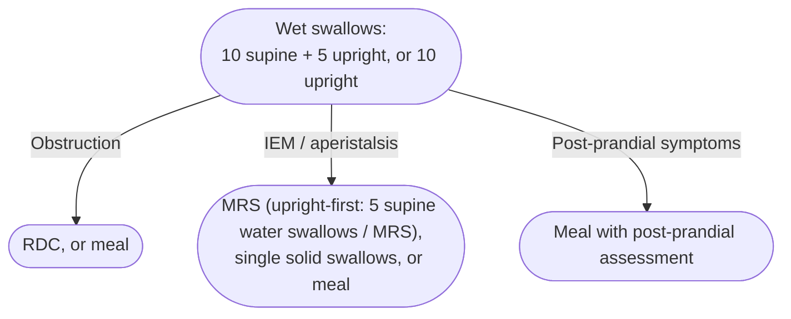

## Bibliographic Info
- **Article:** [Fox MR, Sweis R, Yadlapati R, et al. Chicago classification version 4.0© technical review: Update on standard high-resolution manometry protocol for the assessment of esophageal motility. Neurogastroenterology & Motility. 2021;33:e14120.](https://doi.org/10.1111/nmo.14120)
- **Authors:** Mark R. Fox, Rami Sweis (co-first authors), Rena Yadlapati, John Pandolfino, Albis Hani, Claudia Defilippi, Tack Jan, Nathalie Rommel
- **Year:** 2021 (received 3 February 2021; revised 16 February 2021; accepted 19 February 2021)
- **Journal/Publisher:** Neurogastroenterology & Motility, 33(4):e14120 — John Wiley & Sons
- **DOI:** [10.1111/nmo.14120](https://doi.org/10.1111/nmo.14120)
- **Type:** consensus — labelled "Technical Note"; technical review from the Chicago Classification version 4.0 (CCv4.0) working group on the standard high-resolution manometry (HRM) protocol
- **Licence:** "© 2021 John Wiley & Sons Ltd" — no Creative Commons licence stated for this article; figures are not reproduced here (Figure 9 is redrawn below).

## Summary
- **Scope:** the CCv4.0 standard HRM protocol — patient preparation, positions (supine and upright), single wet swallows, and provocative tests: multiple rapid swallows (MRS), rapid drink challenge (RDC), single solid swallows, solid test meal (STM), post-prandial observation, pharmacologic provocation (Abstract, p. 1).
- **Method (§2, p. 2):** one eight-member working group (two chairs). Each proposed statement ranked in two rounds by the whole CCv4.0 group using RAND/UCLA Appropriateness Methodology (Table S1, supplement). **Median score ≥7 and/or ≥80% agreement → adopted** as a CCv4.0 recommendation.
- **Key advance (§3, p. 13):** positional change and provocative testing added to HRM; wet swallows still the basis of diagnosis.
- **Why (§2.2, p. 4):** supine single water swallows lack sensitivity and specificity for some motility disorders → many inconclusive diagnoses. Full protocol can be completed within **15 minutes**.
- **Normative values:** must match the technology and methodology used, and the position and bolus consistency (Key points, p. 2; §2.1, p. 2).
- **No final consensus** on which provocative test to apply in a given scenario; two alternate algorithms given for guidance (Table 1, Figure 9); decisions on when to provoke remain with the operator (§3, p. 14).
- **If still inconclusive after the full CCv4.0 HRM:** barium esophagogram or endoluminal functional lumen imaging probe (Endo-FLIP) (Key points, p. 2).

## Key Statements
This article prints **no agreement percentages, strength ratings or levels of evidence** — the ranked statements are in supplementary Table S1, which is not in the article PDF. The adopted recommendations appear as Box 1 (standard protocol, p. 3), Table 1 (p. 6) and five subsections headed "CC4 recommendation". Labels below are those section numbers; the article itself numbers only the two starting options in §2.3.1.

| Label (locator) | Recommendation (condensed) |
|---|---|
| §2.3.1 (p. 5) | Protocol **can commence in either position** (Table 1) |
| §2.3.1 option 1 (p. 5) | Start with **10 small-volume wet swallows supine**. No conclusive diagnosis (eg, type I or II achalasia) → **≥5 upright swallows**, to exclude anomalies seen more often supine (eg, false-positive esophagogastric junction (EGJ) outflow obstruction [EGJOO]) |
| §2.3.1 option 2 (pp. 5–6) | Start with **10 small-volume wet swallows upright**. No conclusive diagnosis → **can** follow with **≥5 supine swallows**, to exclude anomalies seen more often upright (eg, false-positive ineffective esophageal motility [IEM]); may not be required if normal, effective motility is seen upright and during provocative tests (not yet confirmed in clinical studies) |
| §2.5.1 (p. 7) | **MRS standardized:** operator offers **2 ml aliquots** by syringe, each a few seconds apart → **5 swallows, up to 10 ml** total. Included **supine** in the protocol; can also be done upright. Intact response, augmentation and repeat rule → table below |
| §2.6.1 (p. 9) | **RDC upright** (minimize aspiration, reproduce normal drinking, induce symptoms): **minimum 100 ml (ideally 200 ml)** water by rapid swallows **without stopping**, often through a straw. Measure distal contractile integral (DCI) and integrated relaxation pressure (IRP) during the swallows. Especially recommended in **suspected EGJ outflow obstruction and achalasia when IRP does not reach diagnostic thresholds with single water swallows**. Criteria → table below |
| §2.7.1 (p. 10) | **Single solid swallows** acquired like wet swallows: **1–2 cm cube** of buttered bread, soft biscuit, dumpling or cake, chewed and swallowed when ready; **≥30 s between swallows** (two pharyngeal swallows per bolus allowed); if included, **≥5 solid swallows (10 preferred)**; standard metrics, appropriate normative values. Criteria → table below |
| §2.8.1 (p. 12) | **Test meal not required routinely**; consider when wet swallows and other provocative tests have not found a cause for symptoms, or findings are inconclusive and/or do not guide management. May also show peristaltic reserve in IEM on water swallows and whether it is clinically relevant. Standardized meal or patient's own "culprit meal". Procedure and criteria → table below |

**Box 1 — standard protocol (p. 3).** Fast **≥4 h** (sips of clear fluid allowed, §2.2); informed consent.

| Step | Supine first (use supine normative values) | Then upright (use upright normative values) |
|---|---|---|
| Adaptation | ≥60 s | ≥60 s |
| Document position | ≥3 deep inspirations | ≥3 deep inspirations |
| Baseline | ≥30 s | >30 s (as printed) |
| Wet swallows | **10 × 5 ml** | **≥5 × 5 ml** |
| Provocation | **1 MRS sequence** (repeat up to 3 sequences if failed attempt or abnormal response) | **1 RDC** |

- **Catheter:** solid-state HRM, **<2 cm sensor spacing**, with combined impedance sensors; water-perfused acceptable with appropriate normative values (Box 1). Impedance recommended, not required (§2.1, p. 2). Water-perfused upright → **correct for hydrostatic effects** (§2.1).
- **No clinically relevant motility disorder found → consider:**
  - High probability of a missed diagnosis, especially EGJ outflow obstruction → **solid test swallows, solid test meal and/or pharmacologic provocation** (amyl nitrite, cholecystokinin), **upright**.
  - Suspected rumination/belching disorder → **post-prandial high-resolution impedance observation**.
- **Equivocal, and/or suspected EGJ outflow obstruction not meeting achalasia criteria → supportive tests:** timed barium esophagram (preferably with tablet); endoluminal functional lumen imaging planimetry (FLIP).
- Clinicians may modify the protocol for resources and time, as long as normative values are applied and other positions and provocative tests are used appropriately. **Starting upright → 10 upright swallows.**
- **Reporting:** Chicago Classification (CC) v3.0 metrics **plus baseline EGJ measures** and **symptoms during the study and within 15 s of a motility dysfunction**.

**Table 1 — required vs optional tests (p. 6)**

| CCv4 HRM protocol | Supine-first study | Upright-first study |
|---|---|---|
| Primary position 5–10 ml water ×10ᵃ | Required | Required |
| Alternate position 5–10 ml water ×5–10 | Required | Optional |
| Multiple repeated swallow ×1–3ᵇ | Required | Optional |
| Rapid drink challenge ×1 | Required | Required |
| Single solid swallow ×5–10ᶜ | Optional | Required |
| Solid test meal ± post-prandial observation | Optional | Optional |

*ᵃ Conclusive achalasia type 1 or 2 from 10 wet swallows in the primary position → no further maneuvers required. ᵇ MRS is mainly to document peristaltic reserve; three MRS required only if no augmented post-MRS contraction after 1 or 2 attempts. ᶜ To document peristaltic reserve (eg, reflux patients): an effective contraction in >2/10 swallows may be adequate; to test whether abnormal motility causes symptoms: minimum 10 swallows.*

## Key Findings / Claims

### Provocative tests — procedure and criteria
| Test | How | Normal / intact | Abnormal |
|---|---|---|---|
| **MRS** (supine; §2.5–2.5.1, p. 7) | 5 × 2 ml aliquots by syringe, a few seconds apart (up to 10 ml) | **Absent body contractility (DCI <100 mmHg·s·cm)** with **complete deglutitive lower esophageal sphincter (LES) inhibition** during the swallows, **plus augmented post-MRS contraction** | **No augmentation** = lack of peristaltic (contractile) reserve; associated with more post-operative dysphagia in patients referred for antireflux surgery. Impaired deglutitive inhibition helps identify achalasia (EGJ) and spasm/hypercontractile disorders (body) |
| **MRS augmentation** (p. 7) | Compare post-MRS contraction with mean DCI of **non-failed** single water swallows **in the same position** | Augmented if post-MRS DCI in normal range (**DCI >450 mmHg·cm·s**) **and** any of 3 post-contractions more vigorous than that mean (**ratio >1**); must be true peristalsis, not artifact or pressurization | Failed or ineffective post-MRS contraction → **repeat up to 3 times** |
| **RDC** (upright; §2.6–2.6.1, p. 9) | **≥100 ml (ideally 200 ml)** water, rapid swallows without stopping, often via straw | **Absent body contractility (DCI <100 mmHg·s·cm)** with complete deglutitive LES inhibition during RDC | **Outflow obstruction: IRP >12 mmHg, especially with panesophageal pressurization >20–30 mmHg** (both Medtronic software). DCI >100 mmHg·s·cm during RDC (lack of inhibition) typical of spasm and hypercontractile motility |
| **Single solid swallows** (§2.7.1, p. 10) | ≥5 (10 preferred) 1–2 cm cubes, ≥30 s apart | **Effective contraction = distal latency (DL) >4.5 s, break <3 cm, DCI >1000 mmHg·cm·s**; **≥20%** of solid swallows effective | **IRP >25 mmHg** (Medtronic) = pathological EGJ function. **<20% effective = IEM for solids**, high likelihood of dysphagia during the test |
| **Solid test meal** (§2.8.1, p. 12) | 200 g meal, ideally needing **20–30 pharyngeal swallows**; **maximum 8 min** (median 6 min); symptoms recorded concurrently in the electronic record; count pharyngeal swallows and effective contractions (defined as for solid swallows) | Healthy: **≥20%** of pharyngeal contractions followed by an effective contraction | Not finished within 8 min = abnormal and "symptomatic". **Abnormal EGJ function: ≥2 swallows with IRP >25 mmHg** (Medtronic). **Spasm: ≥2 swallows with DL <4.5 s.** **Hypercontractile esophagus: ≥2 contractions with DCI >8000 mmHg·s·cm.** **IEM: >80% ineffective swallows.** Close temporal link of abnormal motility with typical symptoms supports clinical relevance |
| **Post-prandial observation** (p. 12; Figure 8, p. 13) | Extend recording after the meal; combined HRM-impedance optimal | — | **Rapid gastric pressure rises >25–30 mmHg ("R waves")** with typical symptoms → rumination / supragastric belching. High frequency of transient LES relaxations (TLESRs) after meals consistent with gastroesophageal reflux disease (GERD) |

*Medtronic thresholds as printed; the article gives no equivalents for other systems.*

### Choosing provocative tests — Figure 9 (p. 13)

*Provocative tests after the initial wet swallows, by finding*
*Source: redrawn from Fox 2021 Figure 9 (two alternate algorithms: supine-first and upright-first, merged; branches identical except where noted)*
*[[fox-2021-ccv4-standard-hrm-protocol|Fox 2021 CCv4.0 Standard HRM Protocol]]*
*RDC = rapid drink challenge · IEM = ineffective esophageal motility · MRS = multiple rapid swallows*

### Position (§2.3, p. 5; Figure 1–2)
- Upright vs supine: faster, less vigorous contractions (lower DCI) — gravity reduces work; ineffective hypotensive contractions more frequent upright.
- Large prospective study (healthy + swallowing disorders, both positions): diagnostic agreement **67%**, mainly from more IEM upright; **90%** when IEM excluded or position-specific normal values used.
- Residual disagreement mostly **EGJOO, reported more often supine**; most supine EGJOO cases false positive, not persisting upright (Figure 2: EGJOO with **IRP >15 mmHg** more frequent supine, often artefactual, no raised intrabolus pressure).
- Abnormal motility in either position, especially unexpected → **re-evaluate in the alternative position**.
- Single position only → apply **position-appropriate normative values** (p. 6).

### Rapid drink challenge — evidence (§2.6, p. 9)
- Adds sensitivity for **functional EGJOO** (eg, subtype achalasia) and **structural EGJOO** (stricture, tight fundoplication) missed on water swallows; easy, highly reproducible.
- **RDC-IRP >12 mmHg** (Medtronic) accurately identifies achalasia, even with normal IRP on single water swallows.
- **RDC-IRP >8 mmHg** (Medtronic) increases sensitivity, good specificity for all causes of EGJOO.
- Patterns:
  - Normal "hypopressive" (healthy and IEM) — discriminates non-obstructive hypercontractile motility or achalasia: sensitivity **80%**, specificity **93%**.
  - "Brief hyperpressive" — impaired deglutitive inhibition, non-obstructive hypercontractile disorders (distal spasm, hypercontractile esophagus).
  - "Prolonged hyperpressive" — impaired EGJ function, raised RDC-IRP; discriminates achalasia and EGJOO: sensitivity **70%**, specificity **85%**.
- Normal post-RDC contraction sequence = specific marker of normal contractility, but absent in some healthy controls.
- Typical symptoms during RDC confirm clinical relevance; up to **17%** of symptomatic patients with normal wet swallows have abnormal RDC findings needing further testing.

### Solid swallows and test meal — evidence (§2.7–2.8, pp. 9–12)
- Solids vs wet swallows: higher IRP (viscous resistance), better coordinated, slower (longer DL), more vigorous (higher DCI) → solid-specific normative values (Figure 5).
- Two pharyngeal swallows taken within 4 seconds for one solid bolus do not affect the esophageal contraction; some healthy subjects show an effective contraction after only 1 in 4–5 pharyngeal swallows.
- Preserved peristaltic reserve on solids more common in non-erosive reflux disease than reflux esophagitis or Barrett's esophagus; <20% effective solid contractions → high likelihood of dysphagia.
- Test meal (minimum 20 pharyngeal swallows) significantly increases diagnostic yield for major motility disorders.
- Dysphagia after antireflux surgery: abnormal motility **70%** with test meal vs **30%** with single water swallows; about half had EGJOO only during the meal, many with good outcome after pneumatic dilatation.
- Symptomatic EGJOO case series: sensitivity **85%** with test meal vs **54%** single water swallows and **54%** barium esophagram. Of **97** primary EGJOO: **29** achalasia-like therapy (**26** good outcome), **8** opioid-induced dysmotility (opioid reduction or peripheral opioid antagonists), **48** no therapy.

### Other
- **Pharmacologic provocation** (amyl nitrite, cholecystokinin) can support a primary EGJ disorder; technique in the main CCv4.0 supplement (§2.4, p. 6).
- **Viscous swallows** (yogurt, apple sauce) not covered further — limited evidence that they improve sensitivity, especially if solid swallows are included (§2.4, p. 6).
- Survey of 91 centers: RDC **77%**, solids **63%**, test meal **18%** — inconsistent methods, no agreed interpretation (§2.4, p. 6).
- Future outcome studies may show redundancy (eg, wet swallows in one position, MRS) (§3, p. 14).

## Relevance to Wiki
- [[chicago-classification-v4]] — *Required HRM Protocol* and *Provocative Maneuvers* sections: Table 1 (required vs optional tests, supine-first vs upright-first), MRS augmentation definition (DCI >450 mmHg·cm·s, ratio >1), RDC volume (≥100 ml, ideally 200 ml) and pressurization range, solid-swallow and test-meal criteria, reporting of symptoms within 15 s.
- [[high-resolution-manometry]] — protocol steps, catheter requirements, hydrostatic correction for water-perfused upright studies, position-specific normative values, Figure 9 test-selection algorithm.
- [[esophagogastric-junction-outflow-obstruction]] — supine false-positive EGJOO; RDC-IRP >12 / >8 mmHg; solid swallow and test-meal IRP >25 mmHg; test-meal sensitivity and outcomes in primary EGJOO.
- [[achalasia]] — RDC unmasks achalasia with normal wet-swallow IRP; conclusive type 1 or 2 on 10 wet swallows → no further maneuvers.
- [[ineffective-esophageal-motility]] — peristaltic reserve by MRS augmentation and solid swallows; IEM for solids (<20% effective); test-meal IEM (>80% ineffective); more IEM upright.
- [[distal-esophageal-spasm]], [[hypercontractile-esophagus]] — test-meal thresholds (≥2 swallows DL <4.5 s; ≥2 contractions DCI >8000 mmHg·s·cm); RDC "brief hyperpressive" pattern.
- [[rumination-syndrome]] — post-prandial HRM-impedance: R waves >25–30 mmHg with symptoms.
- [[hrm-antireflux-surgery]] — absent MRS augmentation and post-operative dysphagia; test meal in dysphagia after antireflux surgery.
- [[flip-panometry]] — supportive test when HRM is equivocal or EGJ obstruction does not meet achalasia criteria.
- Related source: [[chicago-v4-2021-esophageal-dysmotility]] (main CCv4.0 document; this review is its protocol companion).

## Contradictions / Open Questions
- **Solid swallows — break size.** This review: effective = DL >4.5 s, break **<3 cm**, DCI >1000 mmHg·cm·s, **≥20%** of swallows (§2.7.1, p. 10). Main CCv4.0 document (provocation table) and [[chicago-classification-v4]]: **>20%** of pharyngeal swallows effective, DCI >1000, **without a large break (>5 cm)**. A 3–5 cm break is effective under the main document but not under this review. The main document has no DL criterion here.
- **Solid bolus size and number.** This review: **1–2 cm cube**, ≥5 swallows (10 preferred), ≥30 s apart. Main document and [[chicago-classification-v4]]: ten swallows of **~1 cm³** soft solid.
- **RDC volume and window.** This review: **minimum 100 ml (ideally 200 ml)**; criteria IRP >12 mmHg, especially with panesophageal pressurization **>20–30 mmHg**. Main document and [[chicago-classification-v4]]: **200 ml**; IRP >12 mmHg **over the first 30 s** of the RDC **and** panesophageal pressurization **>20 mmHg** (Low GRADE, Conditional). This review makes pressurization supportive ("especially") rather than a joint criterion, and states no 30-s window.
- **MRS augmentation.** [[chicago-classification-v4]] (from the main document): post-MRS DCI > mean single-swallow DCI. This review adds that the post-MRS DCI must be in the **normal range (>450 mmHg·cm·s)**, that **non-failed** swallows in the **same position** form the comparator, and that any of three post-contractions counts. MRS aliquots "a few seconds" apart here vs **2–3 s** (10 ml syringe) in the main document.
- **Solid test meal criteria.** [[chicago-classification-v4]] has no test-meal criteria. This review: ≥2 swallows IRP >25 mmHg (EGJ), ≥2 DL <4.5 s (spasm), ≥2 DCI >8000 (hypercontractile), >80% ineffective (IEM); 200 g in ≤8 min. Main document: >20% effective contractions (as for solid swallows), no symptoms, <200 g in 8 min abnormal.
- **Upright-first protocol.** [[chicago-classification-v4]] does not give Table 1: starting upright, the alternate-position swallows and MRS are **optional** and single solid swallows are **required**; starting supine, solids are optional.
- **Internal inconsistencies in this review:**
  - Wet-swallow volume: **5 ml** in Box 1; **5–10 ml** in §2.2 and Table 1.
  - Baseline: **≥30 s** supine but **>30 s** upright in Box 1.
  - Alternate-position swallows: "at least 5" (§2.3.1, Box 1) vs "×5–10" (Table 1).
  - Effective solid contractions: "at least 20%" (§2.7.1) vs footnote c ">2/10 swallows may be adequate" for documenting reserve.
- **Open (§3, p. 14):** no consensus on which provocative test suits which clinical scenario; MRS normative values not established in a large healthy population and upright MRS studies lacking (§2.5, p. 6); outcome studies needed.
