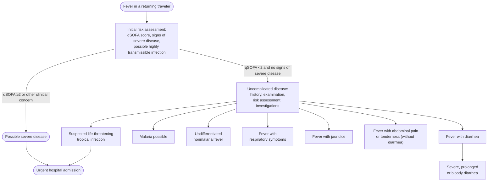
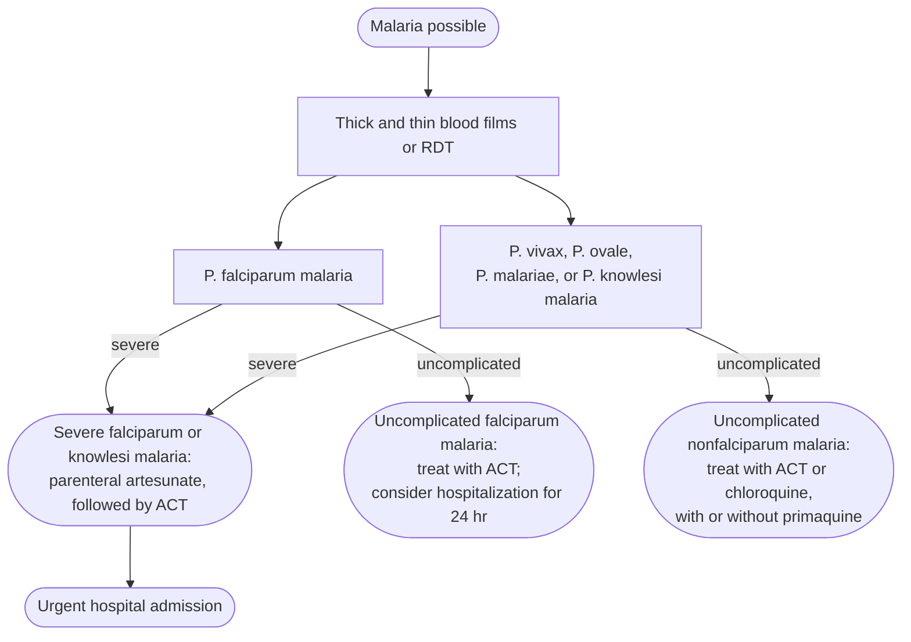

## Bibliographic Info

- **Article:** [Thwaites GE, Day NPJ. Approach to Fever in the Returning Traveler. N Engl J Med 2017;376:548-60.](https://doi.org/10.1056/NEJMra1508435)
- **Authors:** Guy E. Thwaites, F.R.C.P., and Nicholas P.J. Day, F.Med.Sci., F.R.C.P. — Centre for Tropical Medicine and Global Health, Nuffield Department of Medicine, University of Oxford, United Kingdom (both); Oxford University Clinical Research Unit, Ho Chi Minh City, Vietnam (Thwaites); Mahidol–Oxford Tropical Medicine Research Unit, Faculty of Tropical Medicine, Mahidol University, Bangkok, Thailand (Day)
- **Year:** 2017 (issue of February 9, 2017)
- **Journal/Publisher:** The New England Journal of Medicine, vol 376, no 6, pp 548–560 — Review Article (Dan L. Longo, M.D., Editor); Massachusetts Medical Society
- **DOI:** [10.1056/NEJMra1508435](https://doi.org/10.1056/NEJMra1508435)
- **Type:** narrative review
- **Copyright:** "Copyright © 2017 Massachusetts Medical Society."
- **Evidence:** a narrative review — it numbers and grades no recommendations. The management statements below are the authors' advice and carry no strength or evidence grade. No drug doses are given anywhere in the article.
- **Provenance of exhibits:** Figure 1 is "Adapted from Gherardin and Sisson"; Table 1 data are "from Jensenius et al." (a GeoSentinel study). Tables S1 and S2 are in the article's online Supplementary Appendix.
- **Disclosures:** "No potential conflict of interest relevant to this article was reported."
- **Locators:** page numbers below are the journal pages printed on the article (548–560).

## Summary

Fever in a returning traveler is common, often leads to hospitalization, and may be the only symptom of a serious or life-threatening illness. Even at referral centers about 25% of patients never receive a diagnosis, so the authors advise a **risk-based approach**: first identify and treat life-threatening causes of fever and those posing a high risk of transmission to health care workers, laboratory staff and the wider population (Figure 1). Falciparum malaria is the most common serious infection and the main cause of death; in GeoSentinel data, enteric fever accounted for 18% of acute, potentially life-threatening tropical diseases in travelers.

The initial assessment is that of any ill patient with suspected infection: a full history (exposures, places visited, likely incubation periods — Table 2), a thorough examination (signs of severity, rash, an infectious focus such as a chest infection or jaundice indicating hepatitis, an eschar), and the Quick Sepsis-related Organ Failure Assessment (qSOFA) score to pick out patients who need high levels of care and urgent empirical antibiotics. Malaria is actively ruled out in every traveler from an endemic region; severe malaria is treated with parenteral artesunate followed by oral artemisinin-based combination therapy (ACT). Empirical sepsis treatment follows local guidelines, adjusted for resistance patterns where the patient traveled (carbapenem for high extended-spectrum beta-lactamase (ESBL) areas; doxycycline added if severe scrub typhus or another rickettsial infection is suspected).

Highly transmissible infections — viral hemorrhagic fevers, severe respiratory infections, measles, chickenpox, tuberculosis and antibiotic-resistant organisms — are assessed early so that isolation and protective measures can be applied (Table 3). Once life-threatening and transmissible causes are excluded, the differential is narrowed by exposure history (Table 2), the traveler's characteristics and incubation periods, then by syndrome. Figure 1's syndrome branches cover fever with diarrhea, jaundice, abdominal pain, respiratory symptoms, rash, eschar and prolonged fever.

## Key Findings / Claims

### Epidemiology and Outcomes

- **Frequency (p 548):** 3% of 784 Americans who traveled abroad for short periods reported a febrile illness; fever was the chief symptom in 28% of 24,920 ill travelers presenting to travel clinics on return
- **Changing challenge (p 548):** more travelers are older than 60 years or are "medical tourists" — more likely to have clinically significant coexisting conditions and increased morbidity from infections; likelihood of multidrug resistance in infecting organisms is increasing
- **Undiagnosed (p 549):** approximately 25% of patients never receive a diagnosis even at referral centers (though they generally do well clinically)
- **GeoSentinel 1996–2011 (p 549):** of 82,825 cases of illness in travelers, 3655 (4%) were acute, potentially life-threatening tropical diseases; fever was a symptom in 91% of these
  - Falciparum malaria 77% of the 3655 cases; enteric fever 18%
  - 13 deaths (0.4%): 10 falciparum malaria, 2 melioidosis, 1 severe dengue
  - Falciparum malaria acquired mainly in West Africa; enteric fever contracted largely on the Indian subcontinent
  - Travelers had predominantly visited developing countries and were seen at travel clinics — characteristics that skewed the results
- **Cosmopolitan causes (p 549):** widely distributed infections causing severe febrile illness should not be overlooked — respiratory and urinary tract infections, meningococcal disease, tuberculosis. "Nontropical" causes of fever were 34% in one European case series of travelers returning from the tropics
- **Mortality (pp 549, 551):** morbidity (including hospitalization with febrile illness) and mortality are greater in elderly travelers; overall mortality in most case series 0.2 to 0.5%
- **Causes of death (p 551):** falciparum malaria is the most common serious infection and remains the main cause of death; delayed diagnosis is common where it is not endemic and may be fatal. Other reported causes of death: melioidosis, severe dengue, scrub typhus, enteric fever, encephalitis, and nontropical infections (influenza, bacterial pneumonia, septicemia)
- During the recent Ebola epidemic in West Africa, falciparum malaria was the most common diagnosis in patients returning from the affected area (p 551)

### Information Sources and Decision Tools

- A detailed travel history is central; its value depends on accurate, up-to-date geographic risk information (p 548). The Centers for Disease Control and Prevention (CDC) website summarizes global epidemiology of key travel-related infections and malaria geographic risk
- **GeoSentinel** (pp 548–549): established in 1995 by the International Society of Travel Medicine and the CDC; 63 travel clinics on six continents; tracks 60 key diagnoses month to month. Linked networks: CanTravNet (Canada), EuroTravNet (Europe). Limitation: sampling and selection bias; incidence and absolute risks cannot be calculated
- **Decision-support tools (p 549):**
  - Swiss web-based algorithm (www.fevertravel.ch) — evaluation of 539 physician–patient pairs: approximately 40% adherence to the guidance per case and good clinical outcomes
  - KABISA (Institute of Tropical Medicine, Antwerp; free) — in 205 patients, performed as well as expert travel physicians, often providing unconsidered diagnoses
  - Global Infectious Diseases and Epidemiology Network (GIDEON) — commercial; Bayesian matrix from travel history, clinical and laboratory findings, and incubation periods
- Automated news-scanning (e.g., HealthMap, which tracked the 2009 H1N1 influenza outbreak) enables early outbreak detection (p 549)

### Risk-Based Approach (Figure 1)

*Risk-based approach to fever in the returning traveler — entry and branches*
*Source: redrawn from Figure 1 of Thwaites and Day 2017 (adapted there from Gherardin and Sisson); arrow labels are the figure's box titles*
*[[nejm-2017-fever-returning-traveler|Approach to Fever in the Returning Traveler (NEJM 2017)]]*
*qSOFA = Quick Sepsis-related Organ Failure Assessment*

*Malaria branch of the risk-based approach*
*Source: redrawn from Figure 1 of Thwaites and Day 2017; arrow labels are the figure's box titles*
*[[nejm-2017-fever-returning-traveler|Approach to Fever in the Returning Traveler (NEJM 2017)]]*
*RDT = rapid diagnostic test · ACT = artemisinin-based combination therapy*

- **Figure 1 legend:** a positive malaria RDT should always be confirmed by thick and thin blood films; after glucose-6-phosphate dehydrogenase (G6PD) testing to rule out G6PD deficiency, give primaquine for a radical cure if *P. vivax* or *P. ovale* infection is confirmed
- **qSOFA (Figure 1 legend; p 551):** score 0 to 3, 1 point each for
  - low blood pressure — systolic pressure ≤100 mm Hg
  - high respiratory rate — ≥22 breaths per minute
  - altered mentation — a score of <15 on the Glasgow Coma Scale (range 3 to 15; lower = reduced consciousness)

**Figure 1 boxes — contents as printed** (the gastrointestinal and hepatobiliary boxes are under [[#GI and Hepatobiliary Presentations]])

| Box | Contents |
|---|---|
| Initial risk assessment | Assess qSOFA score (altered mentation, tachypnea, hypotension) · assess for signs of severe disease (cyanosis, meningism, peritonism, digital gangrene) · possible highly transmissible infection? If yes, isolate patient as appropriate |
| Possible severe disease (qSOFA score ≥2 or other clinical concern) | Resuscitate if patient in shock · perform blood cultures · obtain malaria films or RDT, if appropriate; treat severe malaria with parenteral artesunate, followed by ACT · consider empirical antibiotic treatment, taking into account possible pathogens and likely antimicrobial drug resistance (AMR) patterns · history, examination, and investigations (as for qSOFA score <2) · consider causes of life-threatening tropical infections, as well as cosmopolitan causes of sepsis · assess risk of highly transmissible infection |
| Uncomplicated disease (qSOFA score <2 and no signs of severe disease) | **History:** travel, fever onset, symptoms, possible exposures · **Examination:** rash, jaundice, altered mentation, neck stiffness, cellulitis, abdominal tenderness, pulmonary consolidation, eschar, lymphadenopathy, genital sores, eye signs · **Risk assessment:** suspected life-threatening tropical infection? suspected highly transmissible infection? isolate patient as appropriate · **Investigations:** complete blood count (CBC), biochemical studies (e.g., liver-function tests (LFTs) and creatinine), C-reactive protein, blood cultures, chest film, urine microscopy and culture, baseline serologic tests, whole-blood EDTA sample for polymerase chain reaction (PCR), saving of serum for later testing, and specific investigations for focal disease; RDTs for diseases endemic in the visited areas (e.g., dengue, leptospirosis, and rickettsioses for Southeast Asia) |
| Urgent hospital admission | If qSOFA score ≥2, consider intensive care unit (ICU) care · if highly transmissible disease suspected, isolate patient as appropriate |
| Undifferentiated nonmalarial fever | Consider cosmopolitan causes (e.g., urinary tract infection, Epstein–Barr virus (EBV), viral upper respiratory tract infection (URTI), cellulitis, abscesses) · common tropical or subtropical causes (e.g., dengue, rickettsial infections, leptospirosis, chikungunya, Zika virus [all diagnosed on serologic tests, antigen (Ag) detection, or PCR] and enteric fever [blood cultures]) · consider empirical antibiotics (doxycycline or azithromycin) to cover rickettsia and leptospirosis |
| Eschar present (from undifferentiated fever) | Consider scrub typhus or spotted fever group rickettsial infection · diagnosis: serologic tests or PCR · empirical treatment: doxycycline |
| Rash present (from undifferentiated fever) | Consider dengue, chikungunya, Zika virus and rickettsial infections, acute human immunodeficiency virus (HIV) infection, measles, Katayama fever · consider empirical doxycycline for rickettsia, once dengue ruled out |
| Prolonged fever (>7 days) (from undifferentiated fever) | Consider enteric fever (empirical treatment with intravenous (IV) ceftriaxone), endocarditis (echocardiogram), tuberculosis, brucellosis, visceral leishmaniasis, Q fever, abscess, noninfective causes |
| Fever with respiratory symptoms → consolidation (clinically or on chest film) | If bacterial pneumonia suspected, treat as community-acquired pneumonia · consider highly transmissible infections (influenza, tuberculosis, Middle East respiratory syndrome coronavirus (MERS-CoV), measles) · consider unusual infections with pulmonary involvement (Q fever, psittacosis, leptospirosis, Katayama fever, scrub typhus, melioidosis) · if eosinophilia consider filariasis, strongyloidiasis, fungal infections |
| Fever with respiratory symptoms → within 4 days after return from a country where an outbreak of influenza or a pandemic was occurring | Test for influenza with rapid test or PCR · treat with neuraminidase inhibitor · isolate at home (or in hospital, if avian influenza suspected) |

### Initial Assessment (p 551)

- Same as for any ill patient suspected of having an infection
- **Full history** — exposure risks, risks of particular geographic areas, likely incubation periods (Table 2)
- **Thorough examination** — particular attention to signs of severity, a rash, and an infectious focus such as a chest infection or jaundice indicating hepatitis
- **qSOFA** (recommended on the basis of the Third International Consensus Definitions for Sepsis and Septic Shock (Sepsis 3)) — part of a rapid clinical assessment to identify patients at risk for severe sepsis and in need of high levels of care and urgent empirical treatment with antibiotics, i.e., patients meeting **two or more** of the three qSOFA criteria (Figure 1 legend above)
- **Eschar** — should be specifically sought
  - Returning from southern Africa: one or more eschars may point to the relatively benign African tick typhus (*Rickettsia africae*)
  - Returning from South or Southeast Asia: an eschar suggests scrub typhus (*Orientia tsutsugamushi* infection), a potentially fatal disease
  - The scrub typhus eschar is often missed — the mite vector frequently bites moist, usually covered areas (genitalia, perineum, area beneath the breasts)

### Malaria (p 551)

- **Actively rule out, as a priority, in all travelers returning from regions where it is endemic** — regardless of whether they have been receiving chemoprophylaxis
- **Smears:** test thick and thin blood smears; repeat testing twice if the results are negative
- **Rapid diagnostic tests:** diagnose malaria within minutes at the bedside or in the laboratory; particularly useful where local microscopy expertise is in short supply; confirm the result with a blood smear
- **Treat as severe malaria** — patients with malaria who:
  - are prostrate or comatose
  - have shock, acidosis, severe anemia, hypoglycemia, evidence of vital organ dysfunction, or a high parasitemia level (>10%)
  - are unable to take oral medications reliably
- **Severe malaria treatment:** in adults, children, and pregnant women, treat promptly with **parenteral artesunate** — shown to reduce mortality substantially compared with quinine (and by extension quinidine) — followed by a course of oral ACT when oral medication can be taken reliably
- The Food and Drug Administration has not approved artesunate in the United States; it is available through the CDC Malaria Hotline
- Branch-by-branch treatment (uncomplicated falciparum, nonfalciparum, primaquine): malaria flowchart above

### Empirical Treatment of Suspected Life-Threatening Infection (pp 551, 555)

- Driven by the clinical picture and likely exposure
- Severe sepsis suspected → follow local and national guidelines, modified for differences in antimicrobial resistance prevalence in the geographic location visited
- **Carbapenem:** if local community-acquired sepsis guidelines do not include one, give a carbapenem when the patient has traveled to an area where ESBL is highly prevalent, such as South or Southeast Asia
- **Melioidosis** (*Burkholderia pseudomallei*; a common cause of sepsis in parts of Southeast Asia) → treat suspected infection with a carbapenem or ceftazidime — the bacteria are intrinsically resistant to most beta-lactam antibiotics and to aminoglycosides
- **Severe scrub typhus (or another rickettsial infection) suspected** → add doxycycline to the empirical regimen — *O. tsutsugamushi* and rickettsia species are intrinsically resistant to beta-lactams

### GI and Hepatobiliary Presentations

#### Fever with Diarrhea (Figure 1; pp 557–558)

- **Common causes (Figure 1):** travelers' diarrhea ([[enterotoxigenic-e-coli|enterotoxigenic *Escherichia coli* (ETEC)]], [[norovirus]]), [[giardiasis]], [[cryptosporidiosis]], [[campylobacter-infection|Campylobacter infection]], [[shigellosis]], [[salmonella-infection|nontyphoidal salmonellosis]], [[entamoeba-histolytica-infection|intestinal amebiasis]]
- Diarrhea is usually self-limiting, though empirical antibiotics may reduce symptom duration (Figure 1)
- **Severe, prolonged or bloody diarrhea (Figure 1):**
  - Investigate with stool microscopy and culture, blood cultures, stool PCR or Ag detection
  - Sigmoidoscopy with biopsy to rule out [[inflammatory-bowel-disease|inflammatory bowel disease]]
  - Rehydration and empirical treatment with macrolides or fluoroquinolones (tinidazole or metronidazole, if amebiasis or giardiasis suspected)
- Acute diarrhea is common among travelers returning from South Asia and Central Asia (p 557); diarrhea in children and women: [[#Lower-Risk Travelers with Fever]]
- Food and water exposures and their associated infections: Table 2

#### Enteric Fever

- Pathogens, incubation period, regions, transmission, test and treatment: enteric fever row of Table 1 below
- **In Figure 1:** diagnosed by blood culture (abdominal-pain and undifferentiated-fever branches); consider it, with empirical IV ceftriaxone, when fever is prolonged (>7 days)
- Frequency, geography and deaths: [[#Epidemiology and Outcomes]]; higher risk in travelers visiting friends or relatives and vaccine prevention: [[#Lower-Risk Travelers with Fever]]

#### Fever with Jaundice (Figure 1; pp 551, 558)

- **Rule out possible life-threatening infections:** leptospirosis, severe malaria, viral hemorrhagic fevers, yellow fever, severe dengue, Carrión's disease
- **Consider acute viral hepatitis** (hepatitis A, B, C, E), cytomegalovirus (CMV), EBV — serologic tests
- **Consider acute cholangitis** — stones, liver flukes (ultrasound, blood cultures, stool examination)
- **Imaging:** abdominal or renal tract ultrasonography or computed tomography in cases of [[jaundice]] or acute kidney injury (p 558)
- Exposure history for hepatitis A, B, C and E: Table 2

#### Fever with Abdominal Pain or Tenderness, without Diarrhea (Figure 1)

- **Consider:**
  - Cosmopolitan causes (e.g., appendicitis, urinary tract infection, [[acute-cholecystitis|cholecystitis]], [[acute-pancreatitis|pancreatitis]])
  - Enteric fever (blood culture)
  - Giardiasis (stool microscopy, Ag detection, PCR); treat with tinidazole or metronidazole
  - [[acute-cholangitis|Acute cholangitis]] — stones, liver flukes (ultrasound, blood cultures, stool examination)
  - **Liver abscess — pyogenic or amebic** (blood cultures, ultrasound, serologic tests)

#### Antibiotic-Resistant Gut Colonization (pp 555, 557)

- Enterobacteriaceae that produce ESBL are highly prevalent in many developing countries; travelers are at risk for colonization, particularly if they were hospitalized or **received antibiotic treatment for traveler's diarrhea**
- Travel to tropical regions is associated with transient acquisition of antibiotic-resistant commensal bacteria in the gastrointestinal tract, lasting around 3 months
- Patients transferred from a health care facility in another country may also need to be isolated before it has been established whether they are colonized or infected with drug-resistant bacteria

### Life-Threatening Tropical Infections (Table 1, pp 552–553)

Diseases with an incubation period of less than 4 weeks and at least a 5% risk of death within 4 weeks after symptom onset without treatment; only diseases largely confined to tropical or subtropical regions are included.

| Disease (pathogen) | Incubation period | Geographic regions affected | Vector or exposure | Diagnostic test | Treatment |
|---|---|---|---|---|---|
| **Viral infections** | | | | | |
| Avian influenza (H5N1 influenza A virus) | 2–8 days | East and Southeast Asia | Poultry | Real-time PCR (RT-PCR) | Oseltamivir, peramivir, or zanamivir |
| MERS-CoV | 2–14 days | Arabian peninsula | Contact with infected humans or camels | RT-PCR | Supportive |
| Ebola virus disease, Lassa fever, and Marburg hemorrhagic fever | <22 days | Africa | Contact with infected humans or animals | RT-PCR | Supportive; also consider ribavirin for Lassa fever |
| Crimean–Congo hemorrhagic fever | 1–9 days for tick bite, 3–13 days for infective contact | Southern Europe, Middle East, Africa, northwestern China | Ixodid (hard) ticks; contact with infected humans or animals | RT-PCR | Supportive |
| Yellow fever | 3–8 days | South America, Africa | Aedes mosquitoes; haemagogus and sabethes mosquitoes in the jungle cycle | RT-PCR, IgM enzyme-linked immunosorbent assay (ELISA) | Supportive |
| Severe dengue | 4–7 days | Widespread, particularly South and Southeast Asia, South and Central America, Caribbean, Africa | Aedes mosquitoes | NS1 or IgM rapid diagnostic test, NS1 and IgM ELISAs, RT-PCR | Supportive |
| Japanese encephalitis | 5–15 days | Asia, western Pacific | Culex mosquitoes | IgM ELISA | Supportive |
| Rift Valley fever | 2–6 days | Africa, Arabian peninsula | Mosquitoes (species vary by region); exposure to blood from infected animals | RT-PCR, IgM ELISA | Supportive |
| Rabies (rabies virus and other lyssaviruses) | 20–60 days (usually longer than 4 weeks but can be shorter; occasionally months or years) | Widespread | Animal bite | Saliva: virus isolation and RT-PCR; serum and spinal fluid: rapid fluorescent focus inhibition test (RFFIT) for antibody detection; skin biopsy: RT-PCR and immunofluorescence assay | Wound cleaning, human rabies immune globulin, and vaccination if high-risk bite; supportive care if disease develops |
| **Bacterial infections** | | | | | |
| Anthrax (*Bacillus anthracis*) | 1 day for cutaneous anthrax, 1–7 days for pulmonary anthrax | Enzootic in Africa and Asia | Contact with infected animals or animal products | Bacterial culture, RT-PCR | Prolonged combination antimicrobial therapy, antitoxin |
| Enteric fever (*Salmonella enterica* serovar Typhi and *S. enterica* serovar Paratyphi A and C) | 6–30 days | South and Southeast Asia | Fecal–oral transmission | Bacterial culture | Antimicrobial therapy (multidrug resistance is common) |
| Epidemic typhus (*Rickettsia prowazekii*) | 7–14 days | Central Africa; Asia; Central, North, and South America; usually outbreak-associated | Human body lice (*Pediculus humanus*), flying squirrel ectoparasites, possibly some ticks | IgM and IgG ELISAs, PCR | Doxycycline |
| Leptospirosis | 2–29 days | Widespread, particularly South and Southeast Asia and South America | Contact with urine from infected animals (many domestic and wild animals, including rodents) | IgM and IgG ELISAs, PCR | Doxycycline or azithromycin (for mild infection); parenteral penicillin, doxycycline, or third-generation cephalosporin (for severe infection) |
| Louseborne relapsing fever (*Borrelia recurrentis*) | 4–14 days | Ethiopia, Eritrea, and Sudan | Human body lice (*P. humanus*) | Microscopic examination of blood smear, IgM and IgG ELISAs, PCR | Doxycycline (Jarisch–Herxheimer reactions are common and may require ICU admission) |
| Melioidosis (*Burkholderia pseudomallei*) | 1–21 days (but can be months or years) | South and Southeast Asia, northern Australia; isolated reports from Africa and South America | Contact with contaminated soil or surface water | Bacterial culture | Ceftazidime or a carbapenem, followed by prolonged oral therapy with cotrimoxazole |
| Murine or endemic typhus (*R. typhi*) | 7–14 days | Widespread, particularly Southeast Asia | Rodent fleas | IgM and IgG ELISAs, PCR | Doxycycline or chloramphenicol |
| Oroya fever, or Carrión's disease (*Bartonella bacilliformis*, *B. rochalimae*, and *B. ancashensis*) | 10–210 days | South America, particularly Peru | Phlebotomine sandflies | Bacterial culture | Ciprofloxacin plus ceftriaxone, chloramphenicol |
| Scrub typhus (*Orientia tsutsugamushi*) | 6–20 days | Asia and northern Australia | Larval mites (chiggers) | IgM and IgG ELISAs, PCR | Doxycycline, azithromycin |
| Spotted fever group rickettsioses | 2–14 days | Widespread | Mostly ticks | IgM and IgG ELISAs, PCR | Doxycycline |
| Plague (*Yersinia pestis*) | 2–6 days for bubonic plague, 1–3 days for pneumonic plague | Remote areas of Africa, Asia, and South America | Rodent fleas | Bacterial culture | Aminoglycosides (streptomycin or gentamicin), tetracyclines, or fluoroquinolones |
| **Protozoal infections** | | | | | |
| East African sleeping sickness (*Trypanosoma brucei rhodesiense*) | 7–21 days | Eastern and southern Africa | Tsetse flies | Microscopic examination of blood, lymph node fluid, or chancre-tissue biopsy specimen | Suramin (for early stage), eflornithine plus nifurtimox (for late stage), melarsoprol (for late stage) |
| Falciparum malaria (*Plasmodium falciparum*) | 7–30 days (can be longer) | Africa, Asia, South America; highest risk of infection in sub-Saharan Africa | Anopheles mosquitoes | Microscopic examination of thick and thin blood smears; rapid diagnostic tests (antigen detection) | Parenteral artesunate (for severe malaria), ACT (for uncomplicated malaria) |
| Knowlesi malaria (*P. knowlesi*) | 10–14 days | Southeast Asia, particularly Borneo | Anopheles mosquitoes | Microscopic examination of thick and thin blood smears | Same as treatment for falciparum malaria |

### Highly Transmissible Infections (pp 555, 557; Table 3)

- A risk assessment for highly transmissible pathogens is a critical first step (Table 3, Figure 1) — it allows precautions protecting health care and laboratory workers, other patients, visitors and the community
- Consider: viral hemorrhagic fevers (Ebola, Crimean–Congo, Marburg, Lassa — high mortality, human-to-human transmission with nosocomial outbreaks); droplet or aerosol infections (influenza, MERS-CoV, measles, tuberculosis); colonization or infection with antibiotic-resistant organisms (methicillin-resistant *Staphylococcus aureus*, carbapenem-resistant Enterobacteriaceae)
- **Suspect viral hemorrhagic fever** (Public Health England and CDC risk-assessment algorithms) in patients who have fever (temperature, ≥37.5°C) or a history of fever in the previous 24 hours **and** who have traveled within 21 days to an area where viral hemorrhagic fever is endemic or epidemic
  - Direct contact with body fluids from people or animals known or suspected to have a viral hemorrhagic fever = high risk; sexual contact with an infected person and funeral attendance may also increase exposure to Ebola, Lassa, and Marburg viruses
  - **Malaria remains the most likely diagnosis** in suspected viral hemorrhagic fever — blood films and other essential tests (blood cultures, CBC, kidney and liver function tests) should not be delayed pending viral hemorrhagic fever results (usually done by specialist reference laboratories)
  - Inform any laboratory of specimens from patients with possible viral hemorrhagic fever; Public Health England recommends biosafety level 2 laboratory procedures and autoanalyzers, with standard precautions
- Severe respiratory viral outbreaks (influenza H5N1, H7N9, H1N1; MERS-CoV; severe acute respiratory syndrome) — knowledge of current outbreaks is essential. Measles, chicken pox and tuberculosis also need prompt consideration, especially in hospitals

| Infection | Geographic regions affected | Mode of transmission | Incubation period | Immediate precautions for suspected infection |
|---|---|---|---|---|
| **Viral hemorrhagic fevers** | | | | |
| Ebola virus disease | Guinea, Sierra Leone, Liberia, Ivory Coast, Sudan, Uganda, Kenya, Democratic Republic of Congo, Republic of the Congo, Gabon, Angola, Zimbabwe | Direct contact with blood, secretions, organs, or other body fluids of infected persons; contact with objects (e.g., needles or clothing) contaminated with infected secretions | 2–21 days | Isolate patient and use strict barrier nursing techniques; hospital workers have frequently been infected in Ebola outbreaks |
| Marburg hemorrhagic fever | Ivory Coast, Sudan, Uganda, Kenya, Democratic Republic of Congo, Republic of the Congo, Gabon, Angola, Zimbabwe | Initial infection through exposure in mines or caves inhabited by rousettus bats; person-to-person transmission requires direct contact with blood or other body fluids from an infected person (feces, vomit, urine, saliva, or respiratory secretions) | 3–10 days | Isolate patient and use strict barrier nursing techniques |
| Lassa fever | Guinea, Sierra Leone, Liberia, Nigeria | Initial infection through direct or indirect contact with infected rodent excreta on surfaces or in food or water; person-to-person transmission occurs through contact with infected body fluids (e.g., blood, saliva, urine, or semen) | 5–21 days | Isolate patient and use strict barrier nursing techniques |
| Crimean–Congo hemorrhagic fever | Broad area of endemicity: Africa, Middle East, Asia, Eastern Europe; outbreaks in Russia, Turkey, Iran, Kazakhstan, Mauritania, Kosovo, Albania, Pakistan | Tickborne transmission, but possible transmission to humans through direct contact with body fluids of infected humans or animals | 1–9 days for tick bite, 5–13 days for direct contact | Isolate patient and use strict barrier nursing techniques |
| **Severe acute respiratory infections** | | | | |
| Influenza A | Global distribution; outbreaks of avian influenza in Southeast Asia and China | Direct or airborne transmission | 1–4 days | Isolate patient and use strict barrier nursing techniques; staff should wear FFP3 (filtering facepiece, class 3) or N95 masks |
| MERS-CoV | Arabian Peninsula, particularly Saudi Arabia | Direct contact with respiratory secretions or airborne transmission of large droplets | 2–14 days | Isolate patient and use strict barrier nursing techniques; staff should wear FFP3 or N95 masks |
| Pneumonic plague | Remote areas of Africa, Asia, and South America | Inhalation of infective droplets or hematogenous spread to lungs in septicemic or bubonic plague | 1–3 days, if acquired through inhalation | Isolate patient and use strict barrier nursing techniques; staff should wear FFP3 or N95 masks; prophylactic oral ciprofloxacin or doxycycline should be administered if a health care worker is exposed |
| **Other serious infections** | | | | |
| Measles | Global distribution with regional outbreaks | Direct or airborne transmission | 7–21 days | Isolate patient; check status of vaccinations and previous infections in contacts in hospital (staff and other patients) |
| Chickenpox | Global distribution | Direct or airborne transmission | 10–21 days | Isolate patient; check status of vaccinations and previous infections in contacts in hospital (staff and other patients) |
| Pulmonary tuberculosis | Global distribution; common in Africa and Asia | Airborne transmission | Months to years | Isolate patient; for suspected case of multidrug-resistant tuberculosis, isolate patient in negative-pressure room, if available |

*Table 3 footnote: strict barrier nursing techniques include the use of masks, gloves, and gowns.*

### Isolation and Protection (p 557)

- Isolate patients in a single room immediately if they might have a life-threatening and potentially transmissible infection
- Health care workers in direct contact with patients at high risk for a viral hemorrhagic fever or severe airborne infection reduce exposure with increased personal protection: meticulous hand hygiene, double gloves, fluid-repellent disposable gowns and footwear, a full face shield or goggles, and a fluid-repellent respirator (FFP3 or N95) for splash and respiratory protection
- Negative-pressure isolation reduces airborne transmission risk to other patients and staff
- Inform hospital infection control and public health about all patients with a suspected or confirmed life-threatening infection with person-to-person transmission potential

### Lower-Risk Travelers with Fever (pp 557–558)

Once life-threatening and transmissible causes are ruled out, the many remaining causes (not all tropical or infectious) are narrowed by identifying possible exposures and applying incubation periods; a detailed travel and activity history is essential.

**History and associated diseases (Table 2, p 554)**

| History | Implications or associated diseases |
|---|---|
| Day-by-day itinerary | Provides geographic disease associations |
| Vaccinations and malaria prophylaxis | Narrow the differential diagnosis but do not rule out vaccine-preventable diseases or malaria |
| Other drugs taken while or since traveling | Partial treatment of infection may delay or alter disease presentation (e.g., malaria) |
| Immune status (diabetes, glucocorticoid treatment, renal failure, splenectomy, diseases associated with immune deficit) | Melioidosis, listeriosis, tuberculosis, fungal infections, CMV infection |
| Consumption of unclean water, unpasteurized milk, or improperly cooked or raw food | Travelers' diarrhea, giardiasis, nontyphoidal salmonellosis, enteric fever, shigellosis, campylobacter infection, hepatitis A and E, amebic dysentery, brucellosis, listeriosis |
| Exposure to fresh water (rafting, kayaking, swimming in rivers or lakes, floods) | Leptospirosis, acute schistosomiasis |
| Skin contact with soil (e.g., walking barefoot) | Strongyloidiasis, melioidosis |
| Tattoos, piercings, intravenous drug use, or medical procedures (e.g., injections and blood-product transfusions) | Hepatitis B or C virus infection, acute HIV infection, CMV infection, malaria, babesiosis |
| Sexual contact, specifically unprotected sex with a new partner, commercial sex workers, or multiple partners | Primary herpesvirus infection; acute HIV infection; hepatitis A, B, or C virus infection; syphilis; gonorrhea; Zika virus infection; viral hemorrhagic fevers |
| Visits with relatives or friends while abroad (Was anyone ill?) | Tuberculosis, other infections transmitted by exposure to ill persons |
| Insect bites — mosquitoes | Malaria, dengue fever, chikungunya, Zika virus infection, Japanese encephalitis, yellow fever, Rift Valley fever, West Nile virus infection, filarial fever |
| Insect bites — ticks | Rickettsioses, Q fever, tickborne relapsing fever, Lyme disease, tickborne encephalitis, babesiosis, Crimean–Congo hemorrhagic fever, tularemia |
| Insect bites — mites | Scrub typhus, rickettsialpox (*R. akari*) |
| Insect bites — fleas | Murine typhus, plague |
| Insect bites — lice | Louseborne relapsing fever (*B. recurrentis*), epidemic typhus (*R. prowazekii*), trench fever (*Bartonella quintana*) |
| Insect bites — flies | Leishmaniasis, African sleeping sickness, bartonellosis, phlebotomus (sandfly) fever |
| Insect bites — triatomine bugs | Chagas' disease |
| Animal bites | Rabies, cat-scratch fever (*B. henselae*), rat-bite fever (*Spirillum minus* or *Streptobacillus moniliformis* infection), simian herpesvirus B infection |
| Close contact with animals | Toxoplasmosis, anthrax, Q fever, hantavirus infection, Nipah virus, Hendra virus, plague, psittacosis, diseases from animal ectoparasites |
| Close contact with wild or pet birds | Psittacosis, avian influenza |

**Region and activity (p 557)**
- Systemic febrile illness without localizing findings — common in travelers returning from sub-Saharan Africa or Southeast Asia; dermatologic problems — the Caribbean, Central America, or South America (acute diarrhea: [[#GI and Hepatobiliary Presentations]])
- Temperate travel: tickborne infections (Lyme disease, tularemia, babesiosis, spotted fevers in parts of the United States; other diseases in eastern Europe and Russia)
- Determine each country visited, with dates, and activity-based risks: accommodation, food eaten, exposure to animals, fresh water, bloodborne diseases (e.g., tattoos or dental work), insect bites, sexual activity; contact with ill persons (including those visited in a hospital)

**Traveler characteristics (p 558)**
- Visiting friends or relatives: greater risk for malaria, enteric fever, nondiarrheal intestinal parasitic infections, respiratory syndromes, tuberculosis, sexually transmitted diseases
- Expatriates: disproportionately greater risk for chronic infections — malaria, filariasis, schistosomiasis, strongyloidiasis, giardiasis, brucellosis, tuberculosis — than short-term travelers
- Older than 60 years: proportionally more life-threatening illnesses, especially severe malaria and lower respiratory tract infections, than children — in whom diarrheal, skin, and upper respiratory tract infections account for the majority of reported diagnoses
- Women appear to be proportionally more likely than men to report acute or chronic diarrhea and upper respiratory tract infection, and less likely to report vectorborne diseases (malaria, rickettsioses); how sex influences susceptibility and reporting is uncertain
- Immunosuppressive drugs, glucocorticoids, or poorly controlled HIV infection: increased risk for infections (e.g., talaromycosis in Southeast Asia; leishmaniasis in southern Europe, South Asia, and South America)

**Timing and prevention (p 558)**
- The majority of travel-related febrile illnesses develop within a month
- **Fever beginning more than 21 days after return → dengue, rickettsial infections, Zika virus infection, and viral hemorrhagic fevers are unlikely**, regardless of exposure history
- Pretravel vaccinations and chemoprophylaxis narrow the causes, but neither is 100% effective
- Most common vaccine-preventable causes of fever in travelers: influenza, enteric fever, and viral hepatitis
- Vaccine-preventable diseases in GeoSentinel: approximately 3% of cases, but high hospitalization rates (60%)

**Dengue, chikungunya, Zika and look-alikes (p 558)**
- Zika: increasingly strong associations with Guillain–Barré syndrome and birth defects such as microcephaly
- Symptomatic acute Zika presents like dengue, chikungunya, rickettsial infections and leptospirosis — fever, headache, arthralgia, maculopapular rash (rash rarely with leptospirosis)
- Conjunctivitis: Zika and chikungunya; conjunctival suffusion and subconjunctival hemorrhage are common in leptospirosis

**Initial investigations (p 558)**
- CBC; biochemical studies including liver and renal function tests; blood culture; rapid diagnostic tests for malaria and dengue; PCR of a plasma sample (e.g., for rickettsia); serologic tests; chest film; blood-smear examination; urine tests — dipstick, microscopy, culture, and possibly PCR (e.g., for Zika virus or leptospira)
- As clinical suspicion calls for: stool-sample examination for ova and parasites; intracranial imaging and lumbar puncture with reduced consciousness (including confirmed cerebral malaria); imaging in jaundice or acute kidney injury ([[#GI and Hepatobiliary Presentations]])
- Point-of-care rapid diagnostic tests for several tropical infections are increasingly available and well validated — particularly widely used for malaria and dengue

## Relevance to Wiki

- [[fever-returning-traveler]] — adds the risk-based triage (qSOFA, severe-disease signs, transmissibility), malaria rule-out and severe-malaria criteria, the syndrome branches of Figure 1, incubation periods (Tables 1 and 3) and exposure history (Table 2)
- [[acute-diarrhea]] — fever with diarrhea in travelers: common causes and the workup of severe, prolonged or bloody diarrhea, including sigmoidoscopy with biopsy to rule out inflammatory bowel disease
- [[jaundice]] — febrile jaundice after travel: life-threatening infections to exclude, acute viral hepatitis, acute cholangitis (stones, liver flukes)
- [[acute-cholangitis]], [[entamoeba-histolytica-infection]] — liver flukes and amebic liver abscess as travel-related causes of fever with abdominal pain
- [[salmonella-infection]] — enteric fever incubation (6–30 days), geography, multidrug resistance, empirical IV ceftriaxone for prolonged fever

## Contradictions / Open Questions

- Within the review, the Crimean–Congo hemorrhagic fever incubation after contact differs between exhibits: Table 1 gives 3–13 days "for infective contact", Table 3 gives 5–13 days "for direct contact" (tick bite 1–9 days in both)

## See Also

[[fever-returning-traveler]], [[acute-diarrhea]], [[jaundice]], [[salmonella-infection]], [[giardiasis]], [[entamoeba-histolytica-infection]], [[acute-cholangitis]]
