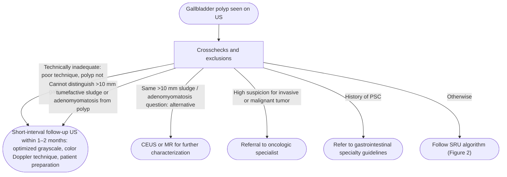

## Bibliographic Info
- **Article:** [Kamaya A, Fung C, Szpakowski JL, Fetzer DT, Walsh AJ, Alimi Y, Bingham DB, Corwin MT, Dahiya N, Gabriel H, Park WG, Porembka MR, Rodgers SK, Tublin ME, Yuan X, Zhang Y, Middleton WD. Management of Incidentally Detected Gallbladder Polyps: Society of Radiologists in Ultrasound Consensus Conference Recommendations. Radiology. 2022;305(2):277–289.](https://doi.org/10.1148/radiol.213079)
- **Authors:** Aya Kamaya (chair; Stanford), Christopher Fung, Jean-Luc Szpakowski, David T. Fetzer, Andrew J. Walsh, Yewande Alimi, David B. Bingham, Michael T. Corwin, Nirvikar Dahiya, Helena Gabriel, Walter G. Park, Matthew R. Porembka, Shuchi K. Rodgers, Mitchell E. Tublin, Xin Yuan, Yang Zhang, William D. Middleton — radiology, surgery, gastroenterology, pathology and sonography
- **Year:** 2022 (November 2022 issue, vol 305, no 2; accepted March 14, 2022)
- **Journal/Publisher:** Radiology — Radiological Society of North America (RSNA); "Reviews and Commentary · Statements and Guidelines"
- **DOI:** [10.1148/radiol.213079](https://doi.org/10.1148/radiol.213079)
- **Type:** guideline (society consensus conference recommendations — Society of Radiologists in Ultrasound [SRU])

**Method and grading (as stated).** Panel members each reviewed the literature on an assigned topic; risk categories and recommendations were created and refined over conference calls, July–September 2021. Recommendations were "derived based on the existing literature, expert opinion, and panel consensus." **No evidence grading and no strength labels**; the document **numbers no recommendations** — each is phrased "the SRU consensus conference committee agreed that…" under a section heading. The S1–S20 numbering below is the wiki's; the locator is the section heading and journal page as printed (PDF page = journal page − 276).

**Licence.** "© RSNA, 2022"; "This copy is for personal use only." No Creative Commons licence → no figure screenshots; Figures 1 and 2 are redrawn below.

## Summary

Gallbladder polyps are common on ultrasound (US) and almost all those <10 mm are benign cholesterol (pseudo)polyps or inflammatory polyps. Recent cohort data show the risk of gallbladder cancer (GBC) is not increased in patients with small polyps, so the SRU panel set out to cut frequent, prolonged follow-up and unnecessary cholecystectomy for incidental polyps.

Applicability is checked first (Figure 1): technically inadequate studies get a short-interval repeat US; possible tumefactive sludge or adenomyomatosis >10 mm gets repeat US or contrast-enhanced US (CEUS)/magnetic resonance (MR); high suspicion of invasive cancer → oncologic referral; **primary sclerosing cholangitis (PSC) is excluded** and goes to gastroenterology specialty guidelines.

Eligible polyps are then sorted by **morphology alone** into three risk categories — **extremely low** (pedunculated "ball-on-the-wall" or thin stalk), **low** (thick/wide stalk or sessile) and **indeterminate** (focal wall thickening ≥4 mm adjacent to the polyp) — and managed by **size** (Figure 2). Surgical consultation is the endpoint at **≥15 mm** for extremely low and low risk and at **≥7 mm** for indeterminate risk; small extremely low and low risk polyps need no follow-up; surveillance, when done, stops by **3 years** at most. Rapid growth (**≥4 mm within 12 months**) or reaching the category's threshold size triggers surgical consultation; growth ≤3 mm is natural history.

Age, coexisting gallstones, vascularity, echogenicity, number of polyps and other patient factors (smoking, diabetes, obesity, sex) do **not** change the category. Known high-incidence ethnicity/geography may raise a polyp at most to low risk. Endoscopic US (EUS) is not part of the typical evaluation.

## Contents
- [[#Definitions (Table)]]
- [[#Applicability — Figure 1]]
- [[#Risk Categories and Management — Figure 2]]
- [[#Consensus Statements]]
- [[#Key Findings / Claims]]
- [[#Relevance to Wiki]]
- [[#Contradictions / Open Questions]]

## Definitions (Table)

The document's only table ("Definitions", p. 279), condensed:

| Term | Definition |
|---|---|
| **Gallbladder polyp** | Solid, **nonmobile, nonshadowing** protrusion from the gallbladder mucosa, not attributable to gallstones, inspissated bile (sludge), a mucosal fold, or diffuse or focal wall thickening; pedunculated or sessile |
| Pedunculated | Attached to the wall via a stalk or pedicle |
| Sessile | Flat or dome-shaped mass extending from the mucosal layer with no stalk; broad-based attachment |
| **Focal wall thickening adjacent to polyp** | Localized wall thickening **≥4 mm** thick adjacent to the polyp, not attributable to edema, adenomyomatosis, mucosal fold, or gallbladder underdistention |
| "Ball-on-the-wall" appearance | Pedunculated polyp, typically round or ovoid, barely attached to the wall — like a ball resting on a flat surface |
| Sludge | Inspissated bile precipitated out of solution; often echogenic, nonshadowing, **mobile**, layering dependently |
| Tumefactive sludge | Biliary precipitate coalesced into a more solid appearance ("sludge ball"); can mimic a mass or polyp |
| Adenomyomatosis | Diffuse, focal or segmental mural hyperplasia with comet-tail artifact (gray-scale) or twinkling artifact (color Doppler) from intramural cholesterol crystals; Rokitansky-Aschoff sinuses may appear as intramural cysts |
| Gallstone | Solid, **shadowing**, hyperechoic, nonvascular structure in the lumen; generally mobile |

## Applicability — Figure 1

Before using the risk categories, apply the crosschecks and exclusions of Figure 1 (p. 278).

*Who the SRU gallbladder polyp algorithm applies to*
*Source: redrawn from Figure 1 of the SRU 2022 gallbladder polyp consensus*
*[[sru-2022-gallbladder-polyps|SRU 2022 Gallbladder Polyp Consensus]]*
*US = ultrasound · CEUS = contrast-enhanced ultrasound · MR = magnetic resonance · PSC = primary sclerosing cholangitis · SRU = Society of Radiologists in Ultrasound*

Figure 1 footnotes:
- **Findings that may indicate invasive tumor:** wall invasion, concurrent liver masses, malignant biliary obstruction, or pathologic lymph node enlargement at the porta hepatis or para-aortic chain.
- Higher-sensitivity Doppler (power Doppler, B-Flow, microvascular Doppler) may help separate a polyp from tumefactive sludge.
- The specialty guideline named for PSC is the American Gastroenterological Association (AGA) clinical practice update on hepatobiliary cancer surveillance in PSC — [[aga-2019-psc-cancer-surveillance]] (reference 28); the text also names the American College of Gastroenterology (ACG) PSC guideline ([[acg-2015-psc]], reference 29).

## Risk Categories and Management — Figure 2

Figure 2 (p. 279), "SRU Gallbladder Polyp Consensus Conference Guidelines", redrawn as a table. Size rounded to the nearest millimeter.

| Risk category | Morphology | ≤6 mm | 7–9 mm | 10–14 mm | ≥15 mm |
|---|---|---|---|---|---|
| **Extremely low risk** | Pedunculated **ball-on-the-wall**; pedunculated with **thin stalk** | No follow-up | No follow-up | Follow-up US at **6, 12, 24 months** (surgical consult an acceptable alternative) | Surgical consult |
| **Low risk** | Pedunculated with **thick or wide stalk**; **sessile** | No follow-up | Follow-up US at **12 months** | Follow-up US at **6, 12, 24, 36 months** vs surgical consult | Surgical consult |
| **Indeterminate risk** | **Focal wall thickening ≥4 mm** adjacent to polyp | Follow-up US at **6, 12, 24, 36 months** vs surgical consult | Surgical consult | Surgical consult | Surgical consult |

*SRU risk category × polyp size → management*
*Source: redrawn from Figure 2 of the SRU 2022 gallbladder polyp consensus (as printed: extremely low ≤9 mm / 10–14 mm / ≥15 mm; low ≤6 / 7–9 / 10–14 / ≥15 mm; indeterminate ≤6 / ≥7 mm)*
*[[sru-2022-gallbladder-polyps|SRU 2022 Gallbladder Polyp Consensus]]*
*US = ultrasound*

Figure 2 footnotes (all apply to the table):
- **a** — Round polyp size to the nearest millimeter.
- **b** — Applies to every follow-up cell. **On follow-up:**
  - **Increase ≥4 mm in ≤12 months, OR polyp reaches the threshold size within its category** → recommend surgical consult. (Figure captions 3–7 spell this out: reaches **15 mm** for extremely low/low risk; reaches **7 mm** for indeterminate risk.)
  - **Decrease of ≥4 mm** → stop following.
- **c** — Surgical consult may be an acceptable alternative for **10–14 mm extremely low risk** polyps.
- **d** (on the low risk label) — Optional: classify a polyp as **low risk instead of extremely low risk** if certain ethnicities are known (North Indian, North/South American Indigenous, local incidence).
- **e** (on all three category labels) — **If unsure between categories, choose the low risk category.**

## Consensus Statements

Every "the SRU consensus conference committee agreed / recommends" statement in the text, in document order. **Ungraded; S-numbers are the wiki's.** Locator = section heading as printed, journal page.

| # | Locator | Statement (condensed; meaning, direction and qualifiers kept) |
|---|---|---|
| S1 | SRU Consensus Conference Algorithm, p. 278; Figure 1 | Applicability of the SRU algorithm is decided after the crosschecks and exclusions listed in Figure 1 (see [[#Applicability — Figure 1]]) |
| S2 | SRU Consensus Conference Algorithm, p. 278; Figure 2; Essentials | Polyps are divided by morphology into **extremely low risk** (pedunculated, "ball-on-the-wall" or thin stalk), **low risk** (pedunculated with thick or wide stalk, or sessile) and **indeterminate risk** (focal wall thickening adjacent to the polyp); management by size threshold, growth and category per Figure 2 |
| S3 | Patient Factors → Genetic and Geographic Risk, p. 280 | If known, geographic and genetic patient factors **may increase** polyp risk stratification **up to the low risk category** (Figure 2 footnote d) |
| S4 | Patient Factors → Primary Sclerosing Cholangitis, p. 280 | SRU guidelines **should not be applied to patients with PSC**. Radiologists should be aware of the increased malignancy risk in PSC and **refer to specialty guidelines** (AGA and ACG) for management and thresholds for surgical consideration |
| S5 | Patient Factors → Age, p. 280 | Due to lack of evidence, **patient age should not influence risk stratification** |
| S6 | Patient Factors → Coexisting Gallstones, p. 280 | **Coexisting gallstones should not influence** risk stratification |
| S7 | Patient Factors → Other Patient Risk Factors, p. 281 | Other patient factors (smoking, diabetes mellitus, obesity, female sex) **do not increase absolute malignancy risk enough to influence** risk stratification |
| S8 | Risk of … Malignant Neoplasm → Size, p. 281 | Polyp size may be associated with risk of neoplasia; **surgical consultation recommended for polyps ≥15 mm**. For **10–14 mm**, the decision for surgical consultation may be made depending on **patient factors or evidence of growth** at follow-up imaging |
| S9 | Growth, p. 282 | Growth of **up to 3 mm** may be part of the natural history of nonmalignant polyps. Growth of **≥4 mm within 1 year = rapid growth** (Figure 2 footnote b → surgical consult) |
| S10 | Length of Follow-up, p. 282 | **Extended follow-up is not productive.** If a polyp is followed, **a maximum of 3 years** is sufficient to identify the vast majority of polyp-associated malignancies |
| S11 | Morphologic Features → Sessile versus Pedunculated, pp. 282, 284 | Ball-on-the-wall or pedunculated thin-stalk polyps → **extremely low risk**, **no follow-up if ≤9 mm**. Sessile or pedunculated thick/wide-stalk polyps → **low risk**, **no follow-up if ≤6 mm**. **If shape is uncertain, the low risk category may be used** |
| S12 | Polyp Vascularity, p. 284 | Detection of polyp vascularity **should not influence** risk stratification |
| S13 | Polyp Echogenicity, p. 284 | Polyp echogenicity **should not influence** risk stratification |
| S14 | Focal Wall Thickening Adjacent to the Polyp, p. 284; Figure 7 | **Focal wall thickening ≥4 mm adjacent to a polyp**, not attributable to wall edema, mucosal fold(s), adenomyomatosis or gallbladder underdistention, is a concerning finding → **indeterminate risk** category |
| S15 | Single versus Multiple, p. 284 | The **number of polyps should not influence** risk stratification |
| S16 | Alternative Imaging Evaluation → CT and MRI, p. 285; Figure 9 | **Short-interval follow-up US within 1–2 months**, with optimized technique and patient preparation, may help evaluate gallbladder lesions **>10 mm** when tumefactive sludge vs mass, polyp or adenomyomatosis is hard to distinguish. **Alternatively, CEUS** for further characterization; **if CEUS is not readily available, magnetic resonance imaging (MRI) may be considered** |
| S17 | CT and MRI, p. 285 | Computed tomography (CT) may help distinguish these entities, but its **diagnostic accuracy is inferior to CEUS or MRI** for this purpose |
| S18 | Endoscopic US, p. 286 | Because it is invasive, **EUS should not be considered part of the typical evaluation** of gallbladder polyps |
| S19 | Surgical Considerations, p. 286 | Patient selection for surgery is **multifactorial**, requires **shared decision-making**, and must account for patient health status as well as the risk profile of imaging findings |
| S20 | Cost-effectiveness, p. 287 | There is a **paucity of high-quality evidence** on the cost-effectiveness of specific thresholds for polyp resection vs surveillance; future cost-effectiveness studies are encouraged (no recommendation) |

Figure captions 3–7 (pp. 282–284) restate the Figure 2 actions for each morphology with the follow-up rule "**increase of 4 mm or more within a 12-month period, or reaches 15 mm** [7 mm for indeterminate risk] → surgical consultation". Figure 8 caption (p. 285): with frank liver invasion and suspected malignant invasion, **the SRU algorithm should not be used**; oncologic referral.

## Key Findings / Claims

Evidence the panel cites (condensed; journal page in parentheses).

**Burden and pathology**
- Polyps on US in about **3%–6%** of the general population; most are cholesterol (pseudo)polyps or inflammatory polyps (p. 277).
- Only **6% of GBCs** arise from a polypoid precursor; most arise from flat dysplastic epithelium. Even in polyps >10 mm some studies suggest only **0.4%** are malignant; most malignant polyps measure >20 mm (p. 277).
- Large population study: GBC rate **0.053% (19/35,856)** with polyps vs **0.054% (316/586,357)** without; relative risk of GBC with asymptomatic polyps does not appear increased (p. 277).
- **Intracholecystic papillary neoplasm (ICPN)** (World Health Organization [WHO] 2019): mass-forming noninvasive epithelial neoplasm **≥10 mm** in the mucosa projecting into the lumen; biliary, gastric, intestinal or oncocytic patterns; low- or high-grade dysplasia. ICPN-associated GBC 3-year survival **60%–90%** vs **27%** without a polypoid precursor (pp. 278–279).
- ~**0.4%** of cholecystectomies show neoplastic polyps; pyloric gland adenomas in **0.2%–0.5%** of specimens, associated with familial adenomatous polyposis or Peutz-Jeghers syndrome (pp. 278–279).
- Mean size: neoplastic **18–21 mm** vs nonneoplastic **4–7.5 mm** (p. 279).

**Patient factors (p. 280–281)**
- Highest GBC incidence (up to **7.5/100,000 men, 23/100,000 women**) in North and South American Indigenous and North Indian populations.
- PSC: gallbladder lesions at cholecystectomy associated with GBC in **18%–50%** and premalignant lesions in **25%–35%** (possible surgical referral bias); size threshold for surgery in PSC controversial.
- Age: one study found age >65 y not a risk factor for growth; another found age >60 y associated with GBC; no evidence that age should change management.
- Smoking relative risk 1.25, diabetes 1.97, obesity 1.31; GBC 2–6× more common in women; absolute risk change small.

**Size (p. 281)**
- No GBC in polyps **≤5 mm** (2014 meta-analysis of 10 studies); 0% malignancy <5 mm and in 4-mm polyps (two systematic reviews).
- **154** patients with polyps <6 mm followed 12 years by US: none developed GBC.
- **61%–69%** of US polyps are not found at cholecystectomy; for apparent polyps ≤5 mm, no polyp in up to **83%**.
- 20-year cohort: GBC in **0.4%** of 2055 patients with polyps >10 mm; cancer rate **1.3, 8.7 and 128 per 100,000** for polyps <6 mm, 6 to <10 mm, and ≥10 mm.
- Neoplastic vs nonneoplastic: **18.1 vs 7.5 mm** (2085 lesions); neoplasia and cancer presented more often as focal wall thickening than as lumen-protruding polyps (P < .001). **>15 mm** an independent risk factor for neoplasia (2021 study); **≥15 mm** predicted neoplasia on univariable analysis (two studies).
- Survey of SRU fellows (~3 million gallbladder sonograms): no documented malignant polyp <10 mm.

**Growth and follow-up (pp. 281–282)**
- Growth in studies usually defined as change of **≥2 mm** over unspecified time; at 10 years, two-thirds of polyps <6 mm and over half of 6–10 mm polyps grew ≥2 mm. Decrease or resolution in up to **34%**.
- Serial US: polyps fluctuate **2–3 mm** (mean +2.6 ± 1.2 mm or −3 ± 1.5 mm). A 434-patient serial US study concluded that the 2-mm increase suggested by the European multisociety guidelines may be too low a threshold to warrant cholecystectomy (p. 277).
- 507 polyps (8% of 6359) grew from <10 mm to ≥10 mm: none malignant in 1549 person-years.
- Rapid growth anecdotes: 7 → 16 mm over 6 months; in PSC, 2 → 18 mm over 2 years.
- Timing: **53% (10/19)** of GBCs diagnosed within 6 months and **68% (13/19)** within 1 year of polyp detection; 9 of the 13 were ≥15 mm or "large". After 1 year, GBC rate per 100,000 person-years **0** (<6 mm), **4.5** (6 to <10 mm), **33.4** (≥10 mm). After 4 years, one cancer in 137,633 person-years (polyp 6–10 mm); none in polyps ≥10 mm.

**Morphology (p. 282–284)**
- Thin stalk rarely seen; implied by a single small vessel at the base on color/power Doppler or CEUS, or by the polyp wiggling in place (Figure 4).
- Almost all studies show more malignant/neoplastic polyps among sessile than pedunculated polyps; shape independent on multivariable analysis in only one study.
- Vascularity more often seen in neoplastic polyps but never an independent risk factor; larger cholesterol polyps may show internal flow; microvascular Doppler techniques detect slow flow.
- Iso-/hypoechoic polyps more often neoplastic than hyperechoic, but echogenicity not independent on multivariable analysis.
- Single polyp independent risk factor in only two studies.

**Imaging beyond US (pp. 284–286)**
- **CEUS:** distinguishes vascular lesion from sludge; neoplastic lesions show marked early enhancement, nonneoplastic late hypoenhancement relative to liver; washout often in malignant polyps; stalk-like central enhancement suggests cholesterol polyp; branching intralesional vessels correlate with malignancy.
- **CT:** findings suggesting malignancy at multivariable analysis — size **>15 mm**, sessile shape, visible on unenhanced CT. 1998 study of polyps >5 mm on US: 45% seen on unenhanced CT, 100% on enhanced CT; a polyp undetectable on unenhanced CT, pedunculated and seen on enhanced CT → benign cholesterol polyp with 90% accuracy.
- **MRI:** high T1 signal suggests cholesterol polyp or pigment stone; restricted diffusion suggests malignancy; can show Rokitansky-Aschoff sinuses (adenomyomatosis) and nonenhancing sludge (Figure 9).
- **EUS:** better polyp typing than transabdominal US in one study (**97% vs 71%**); predictors of neoplasia — maximum diameter **≥11 mm**, heterogeneous internal echoes, absence of hyperechoic foci; other studies show no difference from transabdominal US.

**Surgery and cost (pp. 286–287)**
- Cholecystectomy morbidity **2%–8%**; bile duct injury **3–6 per 1000**; mortality **2–7 per 1000**; acute illness (e.g., cholecystitis) the strongest predictor of morbidity. Weigh surgical risk carefully in cirrhosis.
- Cost-effectiveness data sparse; one model assumed all neoplastic polyps become malignant (not supported by the literature); a 558-patient study using the same assumptions concluded the 2017 European guidelines were cost-effective despite a low malignancy rate (3 dysplastic adenomatous polyps, all >10 mm, and one adenocarcinoma focus in a 16-mm polyp among 89 cholecystectomies).

## Relevance to Wiki

- **New pancreaticobiliary disease script needed: gallbladder polyps** — no page exists. It should own the Definitions table, the Figure 1 applicability flowchart and the Figure 2 risk-category × size table, the follow-up rules (≥4 mm/12 months or threshold size → surgical consult; ≥4 mm decrease → stop; ≤3 years total), and S3–S19.
- **[[gallbladder-cancer]]** — its *Gallbladder Polyps (precursor risk stratification)* section rests only on [[asge-2013-biliary-neoplasia]] (cholecystectomy >10 mm; US every 12 months for 6–10 mm without other risk factors; age ≥60 y, gallstones and sessile shape as "other risk factors"). For incidental polyps outside PSC, the SRU 2022 thresholds are newer and should lead, with ASGE 2013 kept and the contradiction surfaced (below); condense to a line + link to the new polyp page. Differential diagnosis "benign gallbladder polyps" → link. GBC epidemiology (6% from polypoid precursors; ICPN definition and survival; high-incidence populations) fits Assessment.
- **[[primary-sclerosing-cholangitis]]** — *Gallbladder cancer surveillance* (AASLD 2022 ≤8 mm may be monitored with US every 6 months; >8 mm cholecystectomy should be considered) from the American Association for the Study of Liver Diseases (AASLD) is unchanged; add that the SRU algorithm **explicitly excludes PSC** and defers to AGA/ACG, and the SRU-cited PSC figures (GBC 18%–50%, premalignant 25%–35% of gallbladder lesions at cholecystectomy).
- **[[endoscopic-ultrasound]]** — SRU: EUS not part of the typical evaluation of gallbladder polyps (invasive); EUS predictors of neoplasia already on the gallbladder-cancer page via ASGE.
- **[[mri-mrcp]]** — role in separating tumefactive sludge/adenomyomatosis from a >10-mm polyp when CEUS is unavailable.
- Possibly [[hcc-surveillance]] / [[cirrhosis]] — polyps found on hepatocellular carcinoma (HCC)-screening US: weigh the increased surgical risk in cirrhosis (p. 286).

## Contradictions / Open Questions

- **ASGE 2013 vs SRU 2022 — thresholds for incidental polyps (non-PSC).** Both are tier-1 society documents; SRU 2022 is newer and governs incidental polyps by the wiki's priority rule. Points of disagreement:
  - Surgery threshold: [[asge-2013-biliary-neoplasia]] — asymptomatic polyp **>10 mm → cholecystectomy**. SRU — **surgical consult at ≥15 mm** (extremely low/low risk); **10–14 mm → US surveillance** (or consult, by patient factors/growth); **≥7 mm** only for indeterminate risk (focal wall thickening ≥4 mm).
  - 6–10-mm polyps: ASGE — US **every 12 months** in asymptomatic patients **without other GBC risk factors**. SRU — **no follow-up** up to 9 mm if extremely low risk; US **once at 12 months** for 7–9 mm low risk; surveillance **stops by 3 years**.
  - Risk modifiers: ASGE treats **age ≥60 y and coexisting gallstones** (with sessile shape) as risk factors with which polyps ≥6 mm may benefit from cholecystectomy (ASGE calls the evidence insufficient to advocate it). SRU — **age and gallstones should not influence** risk stratification; sessile shape → low risk only.
  - Scope: ASGE's symptomatic-polyp recommendation (cholecystectomy) is outside SRU's scope (incidental polyps) — no conflict.
- **Role of EUS.** The [[gallbladder-cancer]] page presents EUS typing (97% vs 71%) as what separates surgical from nonsurgical polyps ([[asge-2013-biliary-neoplasia]]); SRU cites the same study but concludes **EUS should not be part of the typical evaluation**. SRU newer → leads for incidental polyps.
- **Prevalence.** ASGE 2013: ~4%–7% of healthy subjects; SRU: ~3%–6% of the general population. Minor.
- **PSC — no conflict, but a scope trap.** SRU **excludes PSC**; PSC thresholds stay with [[aasld-2022-psc]] (≤8 mm may be monitored with US every 6 months; >8 mm cholecystectomy should be considered, preferably at an experienced center in advanced disease), [[acg-2015-psc]] (>8 mm) and [[aga-2019-psc-cancer-surveillance]] (size, growth and clinical status; risk rises >8 mm). The SRU growth definition (≥4 mm in 12 months) is not stated for PSC and should not be imported. The PSC page's "18–56% adenocarcinoma" figure (AASLD) differs from SRU's cited "18%–50%" GBC in PSC gallbladder lesions — different cited studies.
- **European multisociety 2017 guideline** (European Society of Gastrointestinal and Abdominal Radiology, European Association for Endoscopic Surgery and other Interventional Techniques, International Society of Digestive Surgery–European Federation, and European Society of Gastrointestinal Endoscopy; SRU reference 8) suggests a 2-mm growth trigger, which a 434-patient serial-US study cited by SRU concluded may be too low a threshold for cholecystectomy; it is not on file, so its rules cannot be stated beyond what SRU reports.
- **Open questions in the source:** shape data are limited (one multivariable study) and future studies may change the categories; the "patient factors" that should steer a 10–14-mm decision are not specified; no cost-effectiveness evidence for any threshold; recommendations expected to evolve.
